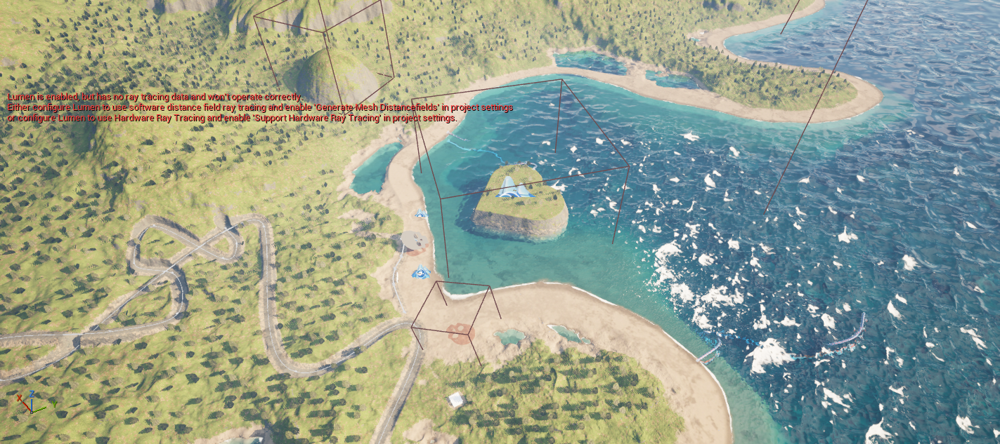

# ShaderWorld Wissen für einen City Builder

Praktische deutsche Anleitungen für **Unreal Engine 5.8.4 und ShaderWorld 4.1**. Die Wissensbasis erklärt Einrichtung, Bauplätze, Straßen, Spielstände, Terrainlöcher und Ozeanwellen anhand eines untersuchten Testprojekts. Sie verwendet **Open Knowledge Format 0.2** und bleibt als normales Markdown lesbar.

**[Hier mit dem Lernpfad beginnen](knowledge/index.md)** · [Prüfstand und offene Tests](knowledge/verification.md) · [Doku ergänzen](knowledge/maintenance.md)



Die rote Lumen-Meldung und die Drahtkästen gehören zur untersuchten Editoransicht. Die Meldung ist ein offener Renderer-Konfigurationspunkt; das Bild ist keine vollständig abgestimmte Beleuchtungsreferenz.

## Was du hier bekommst

- Genaue Editor-Schritte, Einstellungen, erwartete Bilder und Hilfe bei typischen Fehlern.
- Quellen und einen fachlichen Prüfstatus je Thema: Herstellerangabe, Codebefund, Editor/PIE oder Neustarttest.
- Ausgewählte, von lokalen Dateipfaden bereinigte Prüfberichte und unveränderte eigene Viewport-Aufnahmen.
- Einen lokalen Prüfer für Metadaten, Links und Bilddateien.

Dieses Repository ist eine **inoffizielle, projektbezogene Ergänzung** zur [ShaderWorld-Dokumentation](https://universgen.gitbook.io/shader-world). Es enthält weder das kostenpflichtige Plugin noch dessen Quellcode, Assets oder ein ausführbares Unreal-Projekt. Für die allgemeinen Beispielanleitungen ist eine eigene ShaderWorld-Installation nötig. Die CityLab-Anleitungen setzen zusätzlich das im ursprünglichen Lernprojekt implementierte Labor voraus; dessen besondere Tastenbelegung gehört zu unserem Projekt.

## Schnell einsteigen

1. [Terrain und Kollision einrichten](knowledge/guides/setup-terrain.md).
2. [Die drei Beispielwelten kennenlernen](knowledge/reference/example-maps.md).
3. [Wind und Schaum ausprobieren](knowledge/guides/ocean-waves-and-foam.md).
4. [Bauplätze und Straßen verstehen](knowledge/guides/building-pads-and-roads.md) und [Speichern/Laden prüfen](knowledge/guides/save-and-load.md).
5. [Löcher und Bergtunnel richtig einordnen](knowledge/guides/holes-and-mountain-tunnels.md).
6. [Foundations: Gelände planen und einzeln roden](knowledge/guides/foundations-lab.md) – fünf Biomprofile und die erweiterte Speicherung kennenlernen.

## Aktueller Prüfstand am 28. Oktober 2026

Das neue [Foundations-Labor](knowledge/guides/foundations-lab.md) bestand mit dem korrigierten nativen Paintbackend und schwarzer Datamap **zwei getrennte gerenderte uncooked Spielprozesse mit 29/29 und 12/12 Checks**: Planung ohne Weltänderung, tatsächliches Anheben/Absenken/Ebnen, dauerhafte Einzelrodung und Wiederherstellung mit Speicherformat 4. Dieselbe korrigierte Fassung bestand auch als **Development-Paket** in zwei frischen Spielprozessen mit tatsächlich gekochten Daten; beide Phasen bestanden **29/29 beziehungsweise 12/12 Checks**. Der [bereinigte Bericht](knowledge/evidence/foundations-report.json) trennt diesen Neustartnachweis von fünf zurückgelesenen Biomprofilen, 19 eigenen Assets und acht erfolgreichen nativen Automationtests. Das [geschlossene Testhausdach](knowledge/assets/images/foundations-roof.png) ist zusätzlich in einem tatsächlichen PIE-Frame sichtbar.

Eine echte Slate-Bedienprobe bestätigte Planerstellung aus rund **5 km Kamerahöhe**, Plan-Undo, Tab-Auswahl, Speichern und normales PIE-Autoload mit erhaltener absoluter Ebnen-Höhe. Bei der anschließenden Sichtprüfung brachte die bisherige freie Materialbemalung jedoch Bewuchs auf einen geräumten Bauplatz zurück. Der neue native Layer-Brush-Pfad mit Flow-Anteil 0 bestand die Core-/Side-Regression mit echtem Bewuchs, Regeneration und wiederholten Loads. Die korrigierte Fassung bestand auch die verpackte Daten-/Physikabnahme. In normalem PIE zeigte die abschließende **T/F6/K/L-Sichtprobe** sichtbares Snow nach Ausführung und nach Speichern/Laden; ein übermalter Bauplatz behielt seinen Sandboden und blieb im geprüften Bild frei von Bewuchs. [Vorher](knowledge/assets/images/foundations-paint-before.png), [nach Laden](knowledge/assets/images/foundations-paint-reloaded.png) und [geschützter Bauplatz](knowledge/assets/images/foundations-protected-pad.png) sind belegt. Eigene Materialpixel-Abnahme im Paket, Shipping und größere Welten stehen weiterhin aus. Die begrenzten Bürgerumwege sind kontrolliert getestet, allgemeine Navigation, Maschinenarbeit und Materialbilanz bleiben offen. [Prüfstand und Grenzen](knowledge/verification.md) ordnet auch die älteren RoadLab-, Tunnel- und CityLoop-Nachweise ein.

## Lokal lesen und prüfen

Öffne `knowledge/index.md` in einem Markdown-Editor oder direkt auf GitHub. Ein Google-Konto, Cloud-Katalog oder zusätzlicher Server ist zum Lesen nicht nötig.

Für die technische Dokuprüfung mit Python 3.11 oder neuer:

```powershell
python -m pip install -r requirements.txt
python tools/validate_knowledge.py
```

GitHub Actions führt dieselbe Prüfung bei Pushes nach main und bei Pull Requests aus. Der Prüfer prüft die Wissensbasis, führt keine Unreal-Simulation aus und bestätigt keine Spielszenarien. Mehr zum Format, Quellenmodell und Aktualisieren steht unter [Wartung](knowledge/maintenance.md).

Stand: **28. Oktober 2026**. Neue Pluginversionen benötigen eine bewusste Nachprüfung der betroffenen Rezepte.
