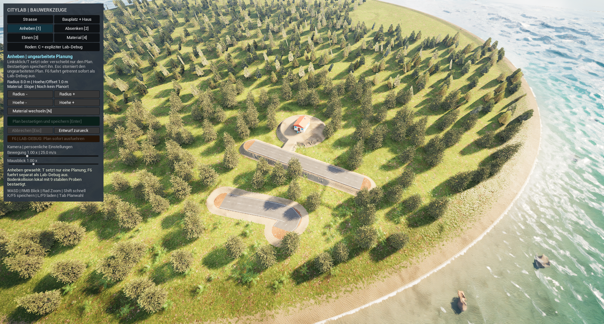

# Baukamera und Werkzeugleiste bedienen

**Die neue Bedienfassung ist im beschriebenen Umfang geprüft.** Persönliche Regler, UI-Fokusschutz, inerte Planbestätigung, Entwurfsabbruch, Bauplatzvorschau und PIE-Wiederherstellung bestanden die normalen Slate-Prüfungen. Elf native Tests und die verpackte Foundations-Regression nach dem finalen Layoutbuild sind erfolgreich. Die finale Leiste ist vollständig lesbar im normalen PIE-Bild geprüft. Längeres reales Rechtsmausdrehen, WASD/Shift und Alt-Tab bleiben offen. Verwende **`/Game/Maps/ShaderWorldFoundations`** mit **CityLabFoundationsGameMode**.[^controls-acceptance][^packaged-acceptance][^panel-image]

Die unveränderte Aufnahme zeigt die kompilierte Leiste im normalen PIE. **Anheben** ist ausgewählt, aber noch kein Planort gesetzt; deshalb sind Planbestätigung und F6-Ausführung im Bild deaktiviert. Straßen, Testhaus und Küste gehören zur vorhandenen Laborkarte.[^panel-image][^image-manifest]

## Kamera: bewegen, schauen und zoomen

1. Bewege den Mauszeiger in die Spielwelt außerhalb der Werkzeugleiste.
2. **WASD** verschiebt die Kamera parallel zum Boden. Nahe am Boden ist sie langsamer, weit oben schneller. **Shift** hält einen zusätzlichen Geschwindigkeitsfaktor von **3×** aktiv.
3. Halte die **rechte Maustaste** gedrückt und bewege die Maus zum Drehen. Der Zeiger soll währenddessen verschwinden und nach Loslassen an seine frühere Stelle zurückkehren. Fokusverlust soll den Kamerablick beenden.
4. Mit dem **Mausrad** zoomst du zum verfügbaren Bodenpunkt unter der Maus. Fehlt dieser Punkt, verwendet der Code die Blickrichtung. Zoomschritt und Bewegung hängen von der Kamerahöhe und der persönlichen Geschwindigkeit ab; der frühere feste 6-m-Scrollschritt gilt für diese Fassung nicht mehr.[^camera][^road-camera]

Bodenschutz und eine Prüfung des Bewegungswegs sind vorgesehen. Fehlt eine brauchbare lokale Bodenkollision, kann eine Bewegung zum Boden warten beziehungsweise ausbleiben. Das ist keine Zusage, dass sämtliche asynchronen ShaderWorld-Arbeiten beendet sind; Terrain, Straßen, Bäume und Gebäude brauchen weiterhin ihre eigenen Kollisionsnachweise.[^road-camera]

## Empfindlichkeit selbst einstellen

Suche im Panel **Kamera | persoenliche Einstellungen**. Die Regler haben getrennte Aufgaben:[^panel]

| Anzeige | Bereich | Bedeutung |
| --- | --- | --- |
| **Bewegung** | 0,25× bis 4×; Ausgangswert 1× | Persönlicher Faktor auf höhenabhängiges Verschieben und Zoomen; Shift kommt beim Verschieben zusätzlich hinzu |
| **Mausblick** | 0,25× bis 3×; Ausgangswert 1× | Persönlicher Faktor nur für das Drehen mit rechter Maustaste |

**1× beim Mausblick bezieht sich bereits auf die Engine-Mauseinstellung 0,14.** Diese Basis entspricht dem Zweifachen des früheren Werts 0,07. Der Nutzer fand den vorherigen projektweiten Wert 0,21 etwas zu schnell; die neue persönliche Einstellung soll weitere Änderungen der Projektkonfiguration vermeiden. Ein Reglerwert von 2× ist daher nicht gleichbedeutend mit dem ursprünglichen Wunsch „zweimal so schnell wie 0,07“.[^engine-input][^camera]

Die Anzeige **Bewegung** nennt zusätzlich die aktuelle Geschwindigkeit in **m/s**. Die persönlichen Werte werden in **GameUserSettings.ini** gespeichert und beim nächsten Spielstart geladen. Ein normales Stop/Start von PIE stellte im Test beide geänderten Werte wieder her; anschließend wurden die ursprünglichen persönlichen Werte **1×/1×** wiederhergestellt. Sie gehören **nicht** zum Stadtspielstand **CityLabFoundations**: K/L speichert oder lädt die Stadt, nicht die Kameraempfindlichkeit. Zum Ausgangswert stellst du den jeweiligen Regler auf **1×**; ein eigener Resetknopf ist nicht vorhanden. Eine gesonderte Wiederherstellung persönlicher Werte in einem neuen verpackten Betriebssystemprozess wurde dabei nicht geprüft.[^camera][^road-camera][^controls-acceptance][^saves]

## Werkzeug auswählen und sein Ziel setzen

Die Werkzeugleiste heißt **CITYLAB | BAUWERKZEUGE**. Ihre Schaltflächen wählen den jeweiligen Modus. **Bauplatz + Haus**, die getrennten **Radius −/+**- und **Hoehe −/+**-Zeilen sowie die persönlichen Regler sind in der finalen Aufnahme vollständig lesbar. Persönliche Slider, Planbestätigung, Entwurfsschutz, Esc-Abbruch und Bauplatzvorschau sind mit nativen Slate-Eingaben geprüft.[^panel][^foundations-input][^controls-acceptance][^panel-image]

| Werkzeug | Linksklick in der Spielwelt | Bestätigen |
| --- | --- | --- |
| **Strasse** | Fügt einen Entwurfspunkt hinzu; mindestens zwei Punkte nötig | **Strasse bauen [Enter]** baut sofort als Laborfunktion |
| **Bauplatz + Haus** | Fixiert zunächst nur eine gelbe Standortvorschau | **LAB-DEBUG: Testhaus sofort bauen** ebnet/rodet das Grundstück und baut das Testhaus |
| **Anheben / Absenken / Ebnen / Material** | Erstellt oder verschiebt einen ungearbeiteten Plan | **Plan bestaetigen und speichern [Enter]** speichert nur die Planung; Boden und Bewuchs bleiben unverändert |
| **Roden** | Keine Klickrodung | **C** rodet ausdrücklich einen getaggten Baum am aktuellen Weltzeiger als Lab-Debug; kein Holzertrag |

**Bestätigen eines Geländeplans führt keine Erdarbeit aus.** Nur **F6 | LAB-DEBUG: Plan sofort ausfuehren** verändert Gelände beziehungsweise Material sofort. Bestätigen einer Straße oder eines Testhauses bleibt dagegen ausdrücklich beschrifteter Sofortbau des Labors. Arbeitskräfte, Maschinen, Materialkonten und Bauzeit sind noch nicht implementiert.[^foundations-input][^panel]

Eine Schaltfläche übernimmt einen zuvor in der Welt gesetzten Standort oder die ausgewählte Plan-ID. Sie soll keinen neuen Zielpunkt unter der Werkzeugleiste abfragen. Für Rodung gibt es keinen versteckten Ersatz durch einen alten Zielpunkt. Bewege den Zeiger dafür ausdrücklich auf den gewünschten Weltbereich und drücke **C**. Gras und Felsen sind keine getaggten Baumressourcen.[^foundations-input]

## Parameter, Abbrechen und Tastenkürzel

- **Radius −/+**, **Hoehe −/+** und **Material wechseln [N]** ändern passende Planparameter. Der Größenwert ist bei Höhen- und Materialbrushes die halbe Kantenlänge eines Quadrats, obwohl manche Anzeigen weiterhin Radius sagen.
- **Abbrechen [Esc]** verwirft einen Straßenentwurf beziehungsweise eine Grundstücksvorschau oder storniert einen ungearbeiteten Geländeplan. Es entfernt keine bereits gebaute Welt. Ohne aktiven Entwurf ist Esc keine allgemeine Rücksetzfunktion.
- **Entwurf zurueck** entfernt beim Straßenwerkzeug den letzten Entwurfspunkt; beim Geländeplan führt es das vorhandene Plan-Undo aus.
- **1–4** wählt die vier Geländewerkzeuge, **T** setzt/verschiebt den Plan, **Tab** wählt offene Pläne, **Bild auf/ab** ändert Höhe/Offset, **Komma/Punkt** die Größe, **U/Strg+Z** nimmt eine ungearbeitete Planänderung zurück und **Entf** storniert sie.
- **R** bleibt Straßenpunkt-Kürzel, **P** direkter Testhaus-Debug, **K/F5** speichert und **L/F9** lädt den eigenen Stadtspielstand.[^foundations-input][^panel]

Während der Zeiger über der Leiste steht, ein Regler gezogen wird oder die Leiste Tastaturfokus hält, sollen Kamera- und Weltkürzel nicht durchschlagen. Im tatsächlichen Sliderfokustest ließen **R/P/T/F6/C/U/Strg+Z** Straßen, Grundstück, Rodungszustand, Planrecords und Kamerapose unverändert. Ein Ziehen mit gedrückter Maus wird zusätzlich im nativen **WorldClickIsolation**-Test vom Weltklick getrennt. Die längere reale Kamera-Capture-/Bewegungsbedienung bleibt eine eigene offene Probe.[^controls-acceptance][^panel][^foundations-input][^road-camera]

## Bestandene Prüfungen und offene Grenzen

| Prüfung | Tatsächlich belegter Stand | Grenze |
| --- | --- | --- |
| Build und Verpackung | Finale Editor-/Gamebuilds erfolgreich; vollständiger Cook/Stage/Archive rund 58 s, abschließendes Layout-Staging/Archive rund 15 s erfolgreich | Beim letzten Staging wurden gekochte Assets wiederverwendet; Paket-Bedienung und Pixelwirkung sind getrennte Prüfungen[^packaged-acceptance] |
| Native Tests | 11 erfolgreich, davon 9 ohne und 2 mit den bekannten Warnungen; neue Camera-Mathe-/Preference- und WorldClickIsolation-Tests enthalten | Kontrollierte Code-/API-Tests, kein längeres reales Mausziehen |
| Slider und UI-Fokus | Normale Slate-Klicks sowie Enter-/Rechts-/Links-Tasten geprüft; R/P/T/F6/C/U/Strg+Z bei Sliderfokus ohne Welt-/Kameradelta | Ausgewählte Eingaben, keine vollständige Langbedienung |
| Geländeplan bestätigen | Zweimal bestätigt: gleiche Plan-ID, Revision 1, Position und Recordzahl; Plan blieb ungearbeitet, kein weiterer ausgeführter Eingriff | Logischer Readback, kein zusätzlicher Physik-/Pixelvergleich dieses Knopfs |
| Straßenentwurf und Escape | Enter-/Pfeiltasten bei Sliderfokus ließen zwei Entwurfspunkte und zwei Straßen unverändert; Esc nach Welt-Refokus leerte nur den Entwurf, PIE lief weiter | Ein Punkt per echter Weltaktion, zweiter Punkt kontrolliert als Fixture ergänzt; keine neue Straße gebaut |
| Persönliche Werte und PIE-Restore | Move rund 2,225 und Look rund 1,575 nach Stop/Start identisch geladen; dieselbe Plan-ID; anschließend persönliche Werte 1/1 wiederhergestellt | Gleicher Editorprozess; persönliche Paket-Persistenz nicht gesondert geprüft |
| Finale verpackte Regression | Zwei frische Spielprozesse mit tatsächlichem CookedData: 29/29 Checks in 115,8 s, danach 12/12 in 69,0 s; 306 beziehungsweise 297 Physikproben und je drei Loads | Nach finalem Layoutbuild; keine neue physische Maus- oder verpackte Pixelabnahme[^packaged-acceptance] |
| Bauplatzvorschau und Abbrechen | Echter Welt-Linksklick aktivierte die Bestätigung; Abbrechen ließ vorhandene Straßen, Grundstück, Einzelrodung, vier Records und Kamerapose unverändert | Keine neue Hauserrichtung in dieser Vorschauprobe |
| Finale Leistenaufnahme | Alle Labels nach Layoutfix lesbar, persönliche Werte wieder 1/1 | Einzelner normaler PIE-Frame, keine verpackte Bildabnahme |
| Reales langes RMB/WASD und Fokus-Capture | Offen | Kein Erfolg für physisch längeres Halten/Bewegen behauptet |

Die UI-Fokusprobe verwendete einen konkreten vorhandenen Stand mit **zwei Straßen, einem Grundstück, einer gespeicherten Einzelrodung und fünf Änderungsrecords**, davon ein ungearbeiteter Plan. Diese Zahlen blieben bei den geprüften Fokusbefehlen unverändert. Sie sind nicht die acht gespeicherten Records des getrennten Foundations-Regressionslaufs.[^controls-acceptance]

Der Straßenkontexttest hat ausdrücklich keinen Straßenneubau geprüft: Ein Punkt entstand durch echte Weltaktion, der zweite wurde kontrolliert als Fixture ergänzt. Enter bei Sliderfokus ließ beide Punkte und zwei bestehende Straßen unverändert; nach nativer rechter Maustaste zum Refokussieren entfernte Esc nur den Entwurf, während die zwei Straßen und PIE erhalten blieben. Eine weitere echte Weltklickprobe setzte lediglich eine Bauplatzvorschau; Abbrechen ließ den ursprünglichen Bestand erhalten. Ein kontrollierter CameraLook-API-Versuch blieb am Fokusguard inaktiv und ist kein erfolgreicher Capture-Test. Der ursprüngliche Nutzerspielstand wurde byteidentisch wiederhergestellt, ebenso die persönlichen Werte 1/1.[^controls-acceptance]

Die Produktionsgrenzen aus dem [Foundations-Labor](foundations-lab.md#bestandene-prüfungen-und-bekannte-grenzen) bleiben bestehen: periodischer Rodungsscan, möglicher Kollisionsnachlauf, lokale Kollisionsheuristik und begrenzte Bürgernavigation. Komfortable Bedienung macht daraus keine große, abgeschlossene Baustellensimulation.[^foundations]

[^controls-acceptance]: [Bereinigter Bedienbericht](../evidence/build-controls-test.json): elf native Tests, echte normale Slate-/PIE-Readbacks, logische inerte Planbestätigung und klar begrenzte Kamera-/Fixtureprüfung.
[^packaged-acceptance]: [Bereinigter Bedienbericht](../evidence/build-controls-test.json), Abschnitte `builds` und `packaged_regression`: finale Editor-/Gamebuilds, vollständiger Cook und abschließendes Layout-Staging sowie zwei frische verpackte Foundations-Prozesse mit CookedData, 29/29 und 12/12 Checks; kein erneuter verpackter Pixeltest.
[^panel-image]: [Finale native PIE-Ansicht der Bauwerkzeugleiste](../assets/images/build-controls-panel.png), unverändert und visuell auf lesbare Labels geprüft.
[^image-manifest]: [Bildherkunft und Prüfsumme](../evidence/image-manifest.json).
[^camera]: Projektlokale `CityLabCamera.h/.cpp` und `CityLabCameraTests.cpp`: Wertebereiche, begrenzte Kameramathematik und persönliche Konfiguration; die beiden neuen nativen Tests sind bestanden.
[^road-camera]: Projektlokale `CityLabRoadGameMode.h/.cpp`: Kamera- und Eingabepfad; Build und begrenzte Integration geprüft, längere reale Capture-/WASD-Bedienung offen.
[^panel]: Projektlokale `CityLabBuildPanel.h/.cpp`: Slate-Labels, Slider und Kontextaktionen; normale Slider-/Fokus-/Bestätigungseingaben, Esc-Abbruch und Bauplatzvorschau geprüft. Finale Labels zusätzlich im normalen PIE-Bild inspiziert.
[^foundations-input]: Projektlokale `CityLabFoundationsGameMode.h/.cpp`: Planbestätigung getrennt von F6-Debugarbeit; zweimalige Bestätigung im normalen PIE blieb ohne zusätzliche Debugausführung.
[^engine-input]: Bisheriger Datei-/CDO-Readback für MouseX, MouseY und Mouse2D: 0,14; keine subjektive Abnahme des neuen persönlichen Mausblickreglers.
[^foundations]: [Foundations: Karte, Biome, Rodung und abgegrenzte bisherige Nachweise](foundations-lab.md).
[^saves]: [Stadtspielstände und Neustartgrenzen](save-and-load.md).
