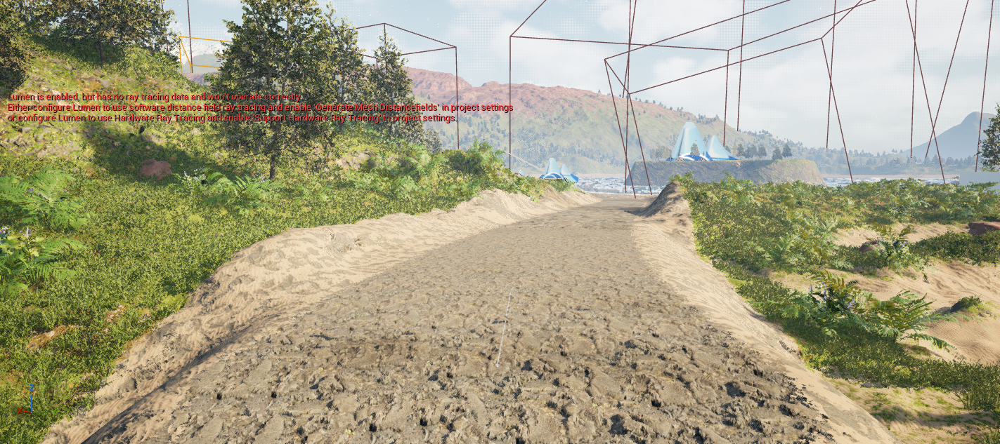

# Bauplätze und Straßen verändern

Ein Bauplatz verändert die Höhe unter einem Gebäude. Eine ShaderWorld-Straßentrasse kann ebenfalls das Gelände formen und Bodenmaterial beziehungsweise Vegetationsmasken beeinflussen. Ein darauf liegendes Asphaltmesh ist ein zusätzlicher Baustein.

## Den Dreckweg in der Reference-Welt ansehen

1. Öffne eine Projektkopie von `/ShaderWorld/Maps/Map_Reference`. [So findest du die Map](../reference/example-maps.md).
2. Suche im **World Outliner** nach `SplineRoadDemo` und wähle das Objekt aus. Mit **F** im Viewport fokussierst du die Auswahl; bei sehr großen Bounds kannst du anschließend näher heranfliegen.
3. Öffne im Details-Fenster die Komponente **SWSplineRoad**. Die Beispieltrasse hat Geländeformung aktiv, eine halbe Breite von `4 m` und einen Übergangsbereich von `4 m`.
4. Schau dir den Verlauf im Viewport an. Der sichtbare Dreckboden ist eine Gelände- und Materialwirkung entlang des Splines. Im untersuchten Straßenactor lagen Root, Spline und Hilfsanzeige vor; ein eigenes Asphalt-Straßenmesh wurde dort nicht gefunden.[^map-inspection]

Das Bild zeigt das ausgewählte Reference-Beispiel, einschließlich seiner sichtbaren Editor-Hilfskästen. Es belegt weder eine dauerhafte Vegetationsentfernung noch eine automatische Anbindung eines anderen Straßenplugins.

## Woher kommen die Straßen in CityBasics?

Der Dreckweg und der Asphalt im Tunnel entstehen auf unterschiedliche Weise. Im eigenen [CityBasics-Labor](city-basics-lab.md) wurden sie so aufgebaut:

| Sichtbarer Teil | Tatsächlicher Aufbau |
| --- | --- |
| Dreckzufahrten im Wald | Native ShaderWorld-**SWSplineRoadComponent**; sie formt das Terrain und schreibt in den Datenlayer **AltitudeBasedLayer**. |
| Roter Straßenkern und helle Ränder | Kernmaterial **RedGround**, seitlicher Streifen **Sand**; die zugehörige Layer-/Biomkonfiguration steuert die Darstellung. |
| Freie Trasse im Bewuchs | Die Trasse schreibt **Biom ID 3**, die im verwendeten Beispiel die bewuchsfreie Variante auswählt. Das ist eine Konfiguration dieser Biome und kein allgemeines „Biom 3 bedeutet überall Straße“. |
| Dunkle Fahrbahn im Tunnel | Ein langer, flach skalierter Unreal-**Cube** mit eigenem Asphaltmaterial. |
| Gelbe Mittellinien | Weitere schmale Cubes mit gelbem Material, knapp über der Fahrbahn. |

Diese Herkunft wurde im ursprünglichen Einrichtungscode gelesen. Die Tunnelmarkierungen sind in diesem Aufbau keine Decals; für die feste Fahrbahn wurde weder ein RVT-Straßensystem noch Road Creator Pro verwendet.[^basics-setup] Die Kollisions- und Durchfahrtsprüfung des Tunnels betrifft diese eigenen Meshes. Sie beweist keine Reifenphysik und keine automatische Erzeugung eines Asphaltmeshes durch den ShaderWorld-Spline.[^basics-proof]

Die Spline-Wirkung braucht das passende Terrainmaterial, einen passenden Datenlayer und eine darauf reagierende Biomkonfiguration. Ein **RedGround**-Wert allein macht deshalb nicht jedes beliebige Terrain rot und räumt auch nicht automatisch beliebige selbst platzierte Bäume weg. Dauerhafte Rodung nach Speichern und Laden bleibt ein eigener Test.

### Und Road Creator Pro?

Road Creator Pro ist im Projekt installiert; eine ältere Teststraße liegt in der flachen Testkarte. **Eine automatische Geländeanpassung zwischen Road Creator Pro und ShaderWorld wurde bisher nicht nachgewiesen.** Die aktuellen CityBasics-Dreckzufahrten kommen aus ShaderWorld, die Tunnelplatte aus unseren Cube-Meshes.[^rcp-inspection][^basics-setup]

Für eine spätere Straßenfunktion wäre eine gemeinsame Trasse denkbar: Dieselben Kontrollpunkte steuern einmal die ShaderWorld-Formung samt Boden-/Biomlayer und einmal das Straßenmesh aus Road Creator Pro. Das ist ein **Architekturvorschlag**, keine vorhandene oder getestete Integration. Zuerst müssten Weltpositionen, Höhen, Breiten, Kurvenverlauf, Kollision und Neuberechnung nach einer Laufzeitänderung an einer kurzen Beispielstraße gemeinsam geprüft werden.

## Das vorbereitete CityLab verstehen

Im ursprünglichen Lernprojekt liegt die Karte `/Game/Maps/ShaderWorldCityLab`. Sie enthält einen eigenen Hügelgenerator, einen vorgebauten Bauplatz und eine vorgebaute Straße. Der Generator überlagert zwei weiche Wellen mit 6 m und 4 m Amplitude: `600 × sin(X/5000) + 400 × sin(Y/6500)`; X, Y und das Ergebnis sind Zentimeter. Das ist eine einfache, wiederholbare Prüflandschaft. Diese Projektassets sind Voraussetzung dieses Abschnitts; sie sind nicht Bestandteil eines frischen Plugin-Projekts.

Das einfache Material macht die Form erkennbar. Der Bauplatz und die gerade Straße wurden im Editor und in PIE auf die erwartete Höhe geprüft.[^citylab-proof]

| Objekt | Vorbereitung im Labor | Erwartung |
| --- | --- | --- |
| Bauplatz | Mittelpunkt `(2500, 2000, 300)` cm, ebener Kern 12 × 12 m, danach weicher Übergang | Innerer Bauplatz liegt auf 3 m Höhe |
| Straße | Von `(-4000, -2000, 100)` bis `(4000, -2000, 100)` cm, 8 m eben, 4 m Übergang je Seite | Fahrstreifen liegt auf 1 m Höhe |
| Kollisionsanker | Kollision in 100 m Reichweite um den Ursprung | Bauabfragen funktionieren auch mit höherer Kamera im kleinen Testbereich |

## Einen Bauplatz während des Spiels setzen

Die interaktive Bedienung liegt in der gesonderten Karte **ShaderWorldPersistenceLab**:

1. Öffne `Content/Maps/ShaderWorldPersistenceLab` im ursprünglichen Lernprojekt.
2. Starte **Play** und klicke in den Spielbereich, damit die Tasten dort ankommen.
3. Ziele mit dem Mauszeiger auf das Gelände. Drücke **P**, um einen Bauplatz auf der getroffenen Höhe plus dem aktuellen Q/E-Höhenversatz anzulegen.
4. **Q** senkt den Höhenversatz für den nächsten Bauvorgang um 1 m, **E** erhöht ihn um 1 m. Die Tasten verschieben keine schon gesetzten Bauplätze.
5. Warte nach einer Änderung kurz auf Terrain und Kollision. Die sichtbare Form und die Physik aktualisieren sich asynchron.

Der Laborbauplatz besitzt 10 m Einflussradius und einen ebenen Kern von 12 × 12 m. Das ist eine bewusst einfache Testform.

## Eine Straße während des Spiels setzen

1. Ziele auf ihren Anfangspunkt und drücke **R**.
2. Ziele auf einen mindestens **1 m** entfernten Endpunkt und drücke erneut **R**.
3. Das Labor erzeugt eine gerade Trasse zwischen diesen beiden Weltpunkten. Unterschiedliche Endpunkthöhen ergeben eine Steigung.
4. Kontrolliere Bodenform und Übergänge. Der Laborstreifen ist 8 m breit, mit je 4 m weichem Übergang.
5. Folge anschließend der Anleitung [Speichern und Laden](save-and-load.md), damit die Änderungen nach einem Neustart erhalten bleiben.

P/R/Q/E sind eigene CityLab-Bindings.[^persistence-proof] Das Plugin bringt diese Bedienoberfläche nicht automatisch in jedes Spiel mit.

## Was die Tests abdecken

Der [CityLab-Bericht](../evidence/citylab-report.json) prüft je 14 Kollisionsproben in sechs Phasen: Editor, PIE, Straße verschoben, Bauplatz verschoben, Rücksetzung und erneut geladene Karte. Die größte gemessene Abweichung lag bei rund 0,82 cm bei 3 cm Toleranz. Die [Persistenzprüfung](../evidence/persistence-report.json) ergänzt später den Test über getrennte Spielprozesse.

Navigation, Verkehr, dauerhafte Vegetationsänderungen und die oben beschriebene gemeinsame Trasse mit Road Creator Pro bleiben weitere Schritte. Das eigene [CityBasics-Labor](city-basics-lab.md) ergänzt inzwischen eine feste Asphaltfahrbahn im Tunnel und prüft deren Kollision; das ist kein automatisch von der nativen SplineRoad erzeugtes Straßenmesh.

[^map-inspection]: [Einordnung der inspizierten Beispielwelten](../reference/example-maps.md).
[^citylab-proof]: [Bereinigter CityLab-Prüfbericht](../evidence/citylab-report.json).
[^persistence-proof]: [Persistenz- und UI-Nachweis](../evidence/persistence-report.json).
[^basics-proof]: [CityBasics-Bericht: Kollisionsproben und tatsächliche Durchfahrten auf der eigenen Tunnel-Fahrbahn](../evidence/citybasics-report.json).
[^basics-setup]: Projektlokales `Tools/setup_basics.py` im ursprünglichen UnrealMcpTest, am 28. Oktober 2026 gelesen. Die Einrichtung verwendet native ShaderWorld-SplineRoads und eigene Meshes aus `/Engine/BasicShapes/Cube`; das Skript und die Unreal-Assets werden hier nicht mitgeliefert.
[^rcp-inspection]: [Bereinigte Küsten-/Straßeninspektion vom 28. Oktober 2026](../evidence/coast-biome-road-inspection.json): Road Creator Pro und eine ältere Teststraße sind vorhanden. Ein erfolgreicher automatischer Integrationsversuch mit ShaderWorld liegt nicht vor.
