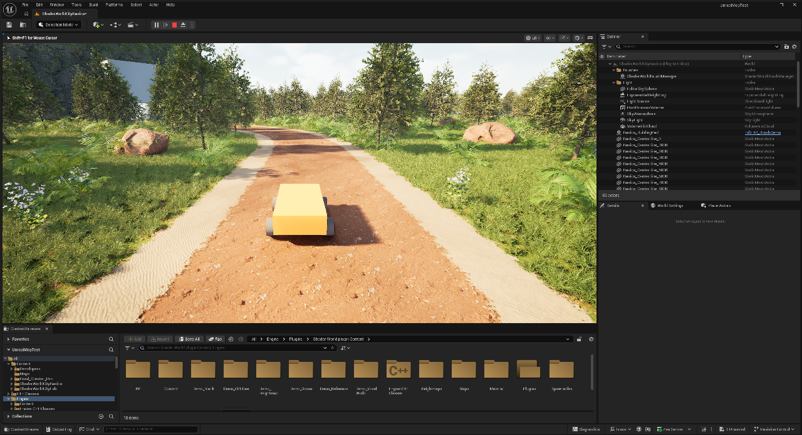
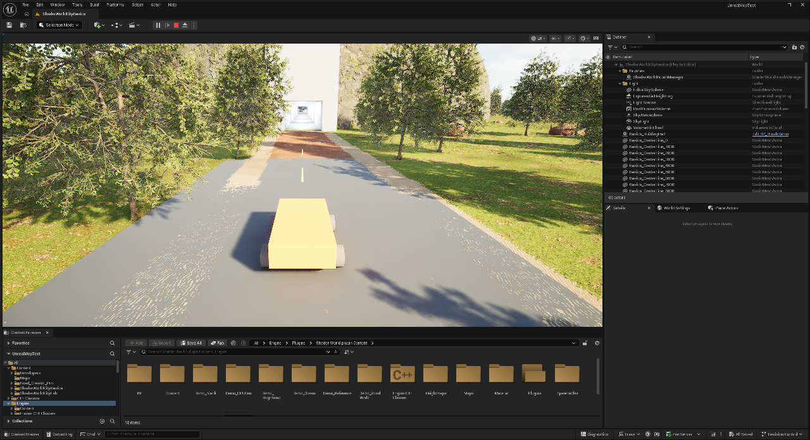

# CityBasics mit Insel, Berg und Tunnel aufbauen

**CityBasics ist aufgebaut und der Tunnel mit dem Testbuggy zweimal erfolgreich durchfahren.** In zwei frisch gestarteten eigenständigen Spielprozessen bestanden jeweils 65 Kollisionsproben und eine bodengebundene Durchfahrt. Die Editoransicht wurde außerdem gemeinsam angesehen. Der [bereinigte Prüfbericht](../evidence/citybasics-report.json) hält die Messwerte fest. Die manuelle F-/Maus-Bedienung des Fußmodus ist implementiert und kompiliert, wird von diesen automatischen Fahrtests aber nicht abgedeckt.[^basics-proof]

Das Ziel ist eine kleine, farbige City-Builder-Landschaft: Insel mit Strand und Wasser, übernommene Reference-Bodenmaterialien und Vegetation, ein eigener Berg, eine Zufahrt und ein Tunnel mit fester Fahrbahn. Im Spiel fährt ein einfacher Testbuggy durch beide Portale; **F** wechselt zum Erkunden zu Fuß und zurück. Beide Modi nutzen **CharacterMovement** und dieselbe Kollisionskapsel. Der Buggy ist kein Chaos-Fahrzeug mit Radaufhängung oder Reifenphysik.[^basics-implementation]

Die native Editoraufnahme zeigt die freigehaltene Dreckstraße. Der Buggy ist ein einfacher sichtbarer Testkörper.

Das Portal ist ein funktionaler erster Aufbau aus einfachen Meshes; Form, Oberflächen und Straßenübergang sind noch kein fertiges City-Builder-Design.

Nach der Korrektur der Zufahrts-Längentabellen bestand die gespeicherte Endfassung am **28. Oktober 2026** eine zusätzliche Prüfung: nochmals **65/65 Proben**, **133/133 Fahrproben am Boden** und **259,35 m** tatsächliche Durchfahrt. Die zwei ursprünglichen Läufe und die abschließende Kontrolle sind im [CityBasics-Bericht](../evidence/citybasics-report.json) getrennt erhalten.

## Was du brauchst

Du benötigst das ursprüngliche, lauffähig kompilierte Projekt **UnrealMcpTest**, Unreal Engine **5.8.4**, ShaderWorld **4.1** und die vorbereiteten CityBasics-Projektassets. Das öffentliche Wissens-Repository enthält diese Karte, die Materialien und den nativen Testbuggy nicht. Die Anleitung ist daher ein Laborprotokoll zum ursprünglichen Projekt und kein mitgeliefertes ShaderWorld-Komplettbeispiel.

Für die Material- und Biomgrundlage wird eine Projektkopie der **Reference**-Welt verwendet. Deren Material Collection und **SW_GreenBiom** bleiben die Ausgangsbasis. Eigene Generator- und Brush-Materialien liegen im Projekt unter `/Game/ShaderWorldCityBasics`. Die Plugin-Originale bleiben die Vorlage. Die [Beispielwelten](../reference/example-maps.md) und das [Quellenverzeichnis](../reference/sources.md) erklären ihre Herkunft.[^sources-index]

## Die vorbereitete Karte öffnen

1. Öffne im Content Browser **Content → Maps → ShaderWorldCityBasics**. Suche im World Outliner nach **BP_SWGround** und **BP_SWOcean**. Der erste Actor ist das Gelände, der zweite das Wasser.
2. Stelle den Viewport auf **Lit** und aktiviere **Realtime**. Warte auf Shaderkompilierung und Terrainaufbau. Wenn die Ansicht nicht nachzieht, aktiviere den Viewport oder starte kurz Play.
3. Wähle **BP_SWGround**. Prüfe im Details-Fenster **Bounded World**, **World Size = 1000** und **Generate Collision**. World Size wird in Metern angegeben; Transform-Positionen im Editor sind Zentimeter.
4. Kontrolliere unter **Producers** den Eintrag **Height**. Hier gehört der Inselgenerator **M_Basics_Island** hinein. Der sichtbare Boden bleibt über die übernommene Reference-Materialkonfiguration angebunden. Das Generatormaterial und das Oberflächenmaterial erfüllen verschiedene Aufgaben.
5. Prüfe den Daten-Producer **AltitudeBasedLayer**. Er verwendet die Projektkopie **M_Basics_BiomeLayer** des Reference-Materials **M_HeightLayer**. Dieser Datenlayer steuert die höhenabhängige Material-/Biomwahl.
6. Prüfe am Wasser und am Wasserhöhen-Sampler die gemeinsame Bezugshöhe **Z = 0**. Speichere nach eigenen Änderungen die Projektassets und die Karte.

Diese Werte beschreiben den eingerichteten Laboraufbau. Kollision und automatische Durchfahrt sind für die unten beschriebene Konfiguration zweimal geprüft. Änderungen an den Maßen oder Brushes benötigen eine neue Prüfung.[^basics-implementation]

## Insel und Strand auf dieselbe Höhe abstimmen

Der Inselgenerator lässt die zentrale Fläche bis zu einem Radius von **220 m** auf **Z = 300 cm** liegen. Danach fällt sie weich ab; ab etwa **360 m** liegt der Meeresboden auf **Z = −1800 cm**. Die Wasser-Bezugshöhe ist **Z = 0**. Damit liegen die zentralen Bau- und Fahrflächen drei Meter über dem Wasser.[^basics-implementation]

Für die Strandzuordnung wurde das Reference-Material **M_HeightLayer** in **M_Basics_BiomeLayer** kopiert. Öffne diese Kopie im Material Editor und suche die Parameter **Ocean Height** und **Add Sand to beach**. Im Labor sind ihre Werte **0** und **100**. Übernimm sie nicht ungeprüft in eine Welt mit anderer Meereshöhe: Materialgrenze und tatsächlicher Wasserstand müssen zusammenpassen. Anschließend **Apply** und **Save** ausführen und die Layer-Producers prüfen.

Die vorhandene Material Collection und **SW_GreenBiom** liefern die Boden- und Vegetationsbausteine. Das ist noch kein selbst entworfenes Biom und kein Nachweis, dass Vegetationsänderungen gespeichert werden. Küste und Vegetation gehören zur gemeinsam angesehenen Editorlandschaft. Eine genaue Abnahme der Strandgrenzen und Vegetationswirkung nach erneuter Erzeugung steht noch aus.

### Warum noch Waldpflanzen im Meer stehen

Die Meereshöhe wurde für CityBasics auf **0 cm** und der tiefe Meeresboden auf **−1800 cm** verlegt. Die übernommenen Wald-Spawnables behalten jedoch ihre alten Höhenintervalle: **SW_Tree ab −9150 cm**, **SW_Grass_Close** und **SW_Grass_Distant_mixed ab −9550 cm**. Diese Werte wurden im laufenden PIE ausgelesen. Der neue Meeresboden liegt innerhalb dieser erlaubten Bereiche. Der Ozean selbst hat keine Biome; der Bewuchs kommt vom Ground und dessen **SW_GreenBiom**. Die Umstellung der Meereshöhe hat die Pflanzenfilter also noch nicht mit umgestellt.[^coast-biome-inspection]

Im installierten Beispielbestand gibt es **SW_BiomOceanMap**. Es verwendet aber ebenfalls Black-Alder-Bäume, gewöhnliches Gras und Felsen, keine mitgelieferte Seegras-/Korallensammlung. Seine Waldvarianten beginnen erst bei **450 beziehungsweise 600 cm**. Sie unverändert einzusetzen würde auch unser nur **300 cm** hohes Plateau von diesem Bewuchs ausschließen.

**Die Höhenfilter sind inzwischen im Projekt korrigiert.** Der Ground verwendet unter **Biomes Manager → Biomes** die Projektkopie **SW_Basics_LandBiome**. Darin verweisen Baum, nahes und fernes Gras auf **SW_Basics_Tree**, **SW_Basics_GrassClose** und **SW_Basics_GrassDistant**. Alle drei haben **Altitude Range → Min = 150 cm**; die bisherigen Maximalhöhen und Dichtematerialien bleiben erhalten. Felsen behalten ihr eigenes Höhenintervall. Die Plugin-Originale wurden unverändert zurückgelesen.[^coast-correction]

Zum Nachvollziehen öffne die drei Spawnable-Assets unter **Content → ShaderWorldCityBasics → Spawnables** und prüfe jeweils **Altitude Range**. Öffne danach das neue Biom und kontrolliere seine Spawnable-Verweise sowie die Zuweisung im Ground-Biomes-Manager. Im aktuellen 4.1-Aufbau ist dieser Manager maßgeblich; das alte `Bioms`-Array ist schreibgeschützt. Nach eigenen Änderungen speichern und die Vegetation neu aufbauen. Die gespeicherten Assetwerte sind geprüft; die vollständige Sichtprüfung aller Unterwasserpflanzen und die Auswertung sämtlicher Instanzpositionen stehen noch aus.

Ein eigenes Meeresbiom kann anschließend andere Spawnables und Höhen-/Dichtemasken für Seegras, Steine oder Korallen verwenden. Die passenden Pflanzenmeshes und Regeln müssen wir selbst bereitstellen. Für Wellen unter Land und trockene Ausschlussbereiche siehe [Ozean und Küste](ocean-waves-and-foam.md).

## Den Berg als eigenen Brush verstehen

1. Suche im World Outliner **Basics_MountainBrush** und drücke im Viewport **F**, um ihn zu fokussieren.
2. Der Actor ist ein **BP_BrushDemo**. Er verwendet die Projektkopie **M_Basics_MountainBrush**, den Parameter **InfluenceRadius = 80** und die Zielhöhe **Z = 6000 cm**.
3. Der Radiusparameter entspricht **80 m**. Die Maskenform lautet `sqrt(1 − r²)`, wobei `r` der horizontale Abstand geteilt durch den Radius ist; außerhalb des Radius ist die Maske null. Sie hebt die Mitte zur Zielhöhe an und läuft am Rand in die Inselbasis aus.
4. Ändere für eigene Versuche zunächst nur einen Wert, etwa die Höhe. Lass den Viewport weiter rendern und warte auf die neue Geländeform. Setze den Laborwert danach zurück.

Die Zielhöhe von 60 m ist eine absolute Welthöhe. Sie bedeutet bei der 3-m-Inselbasis nicht 60 m zusätzliche Höhe. Die gewählte Kuppelmaske hat am Rand einen steilen Übergang; die Portalform muss zu diesem konkreten Hang passen.[^basics-implementation]

Zum Labor gehört außerdem **Basics_BuildingPad** seitlich des Berges: Mittelpunkt `(-14500, 6500, 400)` cm, Einflussradius **20 m**. Dieser vorgebaute Bauplatz dient zum Vergleichen von Landschaft und eingeebneter Baufläche. Die bekannten Laufzeit-P/R- und K/L-Funktionen gehören weiterhin zur gesonderten [Persistenzkarte](save-and-load.md).

## Zufahrten und unterirdischen Abschnitt trennen

Suche **Basics_SplineRoad_West** und **Basics_SplineRoad_East**. Ihre native **RoadSpline** formt die äußeren Zufahrten auf **Z = 300 cm**: **Half Width = 4 m**, **Falloff = 3 m**. Der westliche Spline endet vor dem Berg bei **X = −9000 cm**, der östliche beginnt bei **X = +9000 cm**. Die Zufahrten schreiben zusätzlich in **AltitudeBasedLayer**. Der Bodenstreifen ist eine Terrain-/Materialwirkung; die feste Tunnel-Fahrbahn ist ein eigenes Mesh.[^basics-implementation]

**Eine durchgehende Datenlayer-Maske unter dem Berg erwies sich als ungeeignet.** Der Versuch mit **Basics_Tunnel_VegetationMask** hatte zwar **Deform Terrain ausgeschaltet**, schrieb aber weiterhin **RedGround/Sand** und **Biom 3** in den XY-Korridor. Dadurch erschien die Material-/Biomspur **oben auf dem Berg**, obwohl der Spline unterirdisch lag. Deform Terrain steuert nur die Höhenverformung; es begrenzt die Datenlayer-Ausgabe nicht auf die Höhe des Splines.

Der Maskenspline ist deshalb jetzt mit **Road Enabled = aus** (`bRoadEnabled=false`) deaktiviert. Lass **Basics_Tunnel_VegetationMask** ausgeschaltet. Verwende für diesen Aufbau keine aktive Datenlayer-Maske entlang der gesamten unterirdischen Strecke. Material-/Biomänderungen an der Oberfläche brauchen örtlich begrenzte Bereiche, die tatsächlich an der Oberfläche liegen. Eine dauerhafte Rodung wird hier weiterhin nicht nachgewiesen.

Lass die normale Straßenverformung nicht einfach durch den ganzen Berg laufen. Sie würde das Heightfield zur Straße hin absenken und einen Einschnitt erzeugen. Auch ein Straßenmodus namens **Tunnel** baut weder einen Tunnelkörper noch automatisch zwei Portale.[^installed-brush-source]

### Wenn die Spline nur teilweise wirkt

Beim automatischen Einrichten waren die vier Splinepunkte bereits gespeichert, die interne Längentabelle enthielt aber noch die kurze Standardspline. Dadurch blieben Material- und Vegetationsmasken auf Teilen der Zufahrt aus. Das Setup schreibt inzwischen passende Tangenten und eine vollständige Längentabelle mit.

Bei manueller Bearbeitung im Editor die Splinepunkte mit den üblichen Spline-Werkzeugen ändern, damit Unreal die Kurve neu berechnet. Nach automatischen Änderungen nicht allein die sichtbare Linie kontrollieren: Auch die vollständige Trasse und der Bewuchs müssen nachziehen.

## Die beiden Portalöffnungen prüfen

Die Stempel heißen **Basics_PortalHole_West** und **Basics_PortalHole_East**. Ihre Mittelpunkte liegen bei **X = −8000 cm** und **X = +8000 cm**, jeweils **Y = 0**. Jeder Stempel ist im Grundriss **6 m lang und 10 m breit**. In X-Richtung umfasst er damit den jeweiligen Hangabschnitt zwischen **77 und 83 m** Abstand vom Bergzentrum. Seine innere Schnittkante liegt bei **X = −7700 beziehungsweise +7700 cm**.[^basics-implementation]

1. Wähle einen Portalactor. Sein Schablonenmesh ist eine projektlokale Kopie namens **SM_PortalHoleStamp**. Öffne dieses Mesh im Static-Mesh-Editor und prüfe **Allow CPU Access**. Speichere das Asset mit aktivierter Einstellung.
2. Prüfe an der Komponente **PortalHole** den Modus **StaticMeshComponent**, den Verweis auf das Schablonenmesh und **Enabled**. Der Stempel selbst ist unsichtbar und hat keine blockierende Kollision.
3. Die Lochkomponente muss dieselbe Terrainwelt bearbeiten wie der Berg. Ihre **Priority = 100** soll sie nach den formenden Bergbrushes anwenden. Ein später angewendeter Höhenbrush könnte die Öffnung sonst wieder überschreiben.
4. Kontrolliere die Löcher von der Zufahrt aus. Eine passende Draufsicht allein reicht nicht: Terrainreste dürfen den Eingang nicht verdecken, und die Schnittkante muss vom Portalbau überdeckt werden.
5. Prüfe beim übernommenen Oberflächenmaterial, ob es Terrainlöcher auswertet: **Masked** und **Vertex Color → R** als **Opacity Mask**. Ändere dafür bei Bedarf eine Projektkopie.

Die native Komponente projiziert die Mesh-Dreiecke auf **XY**. Die Z-Position des Stempels begrenzt keinen unterirdischen Hohlraum. Deshalb werden nur die beiden Hangdurchtritte gelocht; eine Schablone über der ganzen Strecke würde auch den Bergkamm öffnen. Die [Loch- und Tunnelgrundlagen](holes-and-mountain-tunnels.md) erläutern diese Grenze genauer.[^installed-brush-source]

### Warum Wasser gerade an den Portalen durchkam

Die Dämpfung steht inzwischen auf **1,0**, auch im laufenden PIE bestätigt. Laut Nutzer traten Wellen trotzdem am Tunnel auf. Der gelesene Plugin-Code erklärt einen passenden Mechanismus: Holebrushes schreiben einen sehr tiefen Lochwert in den Höhen-Cache. Der Ozean wertet diesen Wert als tiefes Wasser aus; die eigene Tunnelplatte ist kein Bestandteil dieser Terrainabfrage. Deshalb kann die Küstendämpfung an den Portalöffnungen volle Wellen zulassen. Das ist ein Codebefund, kein abgeschlossener GPU-Messversuch am konkreten Fehlerort.[^coast-correction]

Der Actor **Basics_Tunnel_AirPocket** enthält jetzt eine native **ShaderWorld Air Pocket Box**. Sein Mittelpunkt liegt bei **(0,0,0)**, Rotation null und Skalierung eins. **Box Extent = (9000,800,2000) cm** sind Halbausdehnungen: insgesamt **180 m Länge, 16 m Breite und 40 m Höhe**. Dieser großzügige Laborbereich deckt Tunnel und beide Portalöffnungen ab. Das vorhandene Ozeanmaterial hat den nötigen Water-Exclusion-Knoten bereits in seiner Opacity-Mask-Kette.

Der Bereich ist gespeichert und seine Eigenschaften wurden nach einem neuen PIE-Start zurückgelesen. Die Form ist im Spiel unsichtbar und erzeugt keine feste Kollision. Der Nutzer meldete danach an der betroffenen Stelle **„Bisher trocken“**. Das ist eine erste Sichtbestätigung; ein längerer Test über weitere Wellenphasen und Kamerafahrten bleibt offen. Weitere Schritte und Grenzen stehen unter [Ozean und Wasserausschlüsse](ocean-waves-and-foam.md).

## Boden, Wände und Decke sind eigene Geometrie

Der gebaute Tunnelkörper besteht aus einfachen soliden Meshes. Die eingerichteten Maße und die darunter beschriebenen Kollisionsproben passen zusammen:

| Bauteil | Eingerichtete Geometrie |
| --- | --- |
| **Basics_Tunnel_Floor** | Oberseite bei **Z = 300 cm**, 300 m lang, 14 m breit und 1 m dick |
| **Basics_Tunnel_Wall_South/North** | Innenflächen bei **Y = −400/+400 cm**; zusammen **8 m Innenbreite** |
| **Basics_Tunnel_Roof** | Unterseite bei **Z = 900 cm**; damit **6 m lichte Höhe** über der Fahrbahn |
| Wände und Dach | 170 m Länge; sie reichen über beide Hangdurchtritte hinaus |
| **Basics_PortalCap_West/East** | Mittelpunkte bei **X = ±8000 cm**, je **10 m lang und 14 m breit**, Unterseite **Z = 900 cm**, Oberseite **Z = 2200 cm**; überdecken die ausgeschnittenen Hangränder |

Prüfe an diesen Meshes eine blockierende Kollision, beispielsweise **BlockAll** mit **Query and Physics**. Der Boden muss den Buggy tragen, die Wände müssen seitlich blockieren und die Decke muss nach oben blockieren. Der unsichtbare Lochstempel darf diese Aufgabe nicht übernehmen.

Die Lochkollision folgt einem Raster. Beim nativen Standard von **100 cm Collision Resolution** können benachbarte Quads mit ausgeschnitten werden. Überdeckung von Portal, Dach und Boden muss deshalb am tatsächlichen Ergebnis geprüft werden. Im aktuellen Aufbau passen die geprüften Portalstellen und der zentrale Durchfahrtskorridor; daraus folgt keine Prüfung jeder Stelle am äußeren Mesh- oder Lochrand.[^installed-brush-source]

## Mit dem Testbuggy spielen

1. Öffne **World Settings → GameMode Override** und prüfe **CityLabDriveGameMode**. Dieser projektlokale Modus verwendet den **CityLabDrivePawn**.
2. Starte **Play**, klicke in den Spielbereich und warte, bis der Buggy auf fertiger Bodenkollision steht. Der vorgesehene Start liegt westlich des Berges bei **X = −13000 cm**.
3. Halte **W**, um vorwärtszufahren. **S** fährt rückwärts, **A/D** lenken während der Bewegung. Im Stand ist die Lenkung des einfachen Testbuggys eingeschränkt.
4. Fahre durch das Westportal, den Tunnel und das Ostportal. Prüfe dabei besonders die Übergänge zwischen Zufahrt und Tunnelboden.
5. Drücke **F**, um zur Ansicht zu Fuß zu wechseln. Bewege dich mit **WASD**, schaue dich mit der **Maus** um und prüfe die Portale aus Augenhöhe. Ein erneutes **F** schaltet an derselben Stelle zum Testbuggy zurück.
6. **R** setzt die Figur an ihren Start zurück. Beende Play, bevor du die Karte im Editor weiter bearbeitest.

Der F-Moduswechsel ist im Projektcode implementiert und kompiliert. Der automatische Nachweis steuert den Buggy direkt und prüft keine manuellen F-Tastendrücke oder Mausbewegungen. Probiere die Fußbedienung deshalb gesondert aus.

Der Buggy fordert ShaderWorld-Kollision in seiner Nähe an. **Prevent Falling Under Terrain** ist ausgeschaltet, damit er unter dem Berg bleiben kann. Seine sichtbaren Räder sind keine separaten Physikräder; die Kollisionskapsel und CharacterMovement bestimmen den Fahrweg.[^basics-implementation]

**R hat in dieser Karte die Bedeutung Zurücksetzen.** Das R/R-Anlegen einer Straße aus dem CityLab-Persistenzmodus gehört nicht zu dieser Bedienung. Auch CityBasics-Speichern/Laden ist hier noch kein abgenommener Laufzeitablauf.

## Was zweimal praktisch geprüft wurde

Die beiden Läufe starteten als frische eigenständige Spielprozesse mit `UnrealEditor.exe -game -RenderOffscreen`. Das ist **uncooked Development-Editor-Laufzeit** mit gerenderten Frames. Es ist ein eigenständiger Lauf außerhalb von PIE; ein verpackter Build wird damit nicht nachgewiesen.[^basics-proof]

| Prüfung | Ergebnis in beiden Läufen |
| --- | --- |
| Gesamte Kollisionsprüfung | **65 von 65 Proben bestanden** |
| Beide Portalöffnungen | Reine Terrainabfragen verfehlen dort das Terrain; Tunnelmeshes sind dabei ausgeschlossen |
| Berg über der Tunnelmitte | Terraintreffer bei **Z = 6000 cm**; der Bergkamm bleibt erhalten |
| Fahrbahn | Proben alle **5 m** zwischen **X = −13000 und +13000 cm** innerhalb von **3 cm** Toleranz zur Grundhöhe **300 cm** |
| Decke und Wände | Decke bei **Z = 900 cm**, Innenwände bei **Y = ±400 cm** getroffen |
| Platz für den Buggy | Die vollständige Kollisionskapsel passt per durchgehendem Sweep von West nach Ost |
| Blockierende Gegenproben | Seitliche Kapselbewegungen werden von beiden Wänden blockiert; der Boden trägt die Kapsel |
| Tatsächliche Durchfahrt | Jeweils rund **259,48 m** bodengebunden zurückgelegt, ohne Teleport während der Durchfahrt |

Die Bodenabfragen liegen bei **300 bis 302 cm**: Die aufgesetzten Mittellinienstreifen können zwei Zentimeter höher als die Grundfahrbahn getroffen werden. Das bleibt innerhalb der festgelegten 3-cm-Toleranz. Im ersten Lauf wurden **134 Bewegungs-Samples**, im zweiten **135** aufgezeichnet; **alle** melden Bodenkontakt.[^basics-proof]

Diese Messung prüft den gebauten Tunnel samt Zufahrt im zentralen Korridor. Sie beweist keine Fahrzeugsimulation mit Reifenphysik, keine beliebige Zufahrtskurve und keine vollständige Prüfung jeder äußeren Portalkante. Die Öffnungen bleiben XY-Ausschnitte im Terrain; der feste Innenraum entsteht durch die eigenen Boden-, Wand- und Dachmeshes.

## Was weiterhin offen bleibt

Die manuelle Bedienung mit **F**, **WASD** und **Maus** im Fußmodus muss noch gesondert ausprobiert werden. Die entsprechende Erweiterung ist kompiliert, aber die automatischen Durchfahrten testen diese Eingaben nicht. Auch der visuell beurteilte Landschaftsaufbau ersetzt keine Messung aller Strand- und Vegetationsgrenzen.

Die bestehende [Persistenzprüfung](save-and-load.md) gilt für deren Bauplätze und Straßentrassen. **Berg, Portalöffnungen und Biomkonfiguration von CityBasics wurden noch nicht zur Laufzeit gespeichert und in einem neuen Prozess wiederhergestellt.** Die beiden hier beschriebenen Kaltstarts laden die gebaute Ausgangskarte; sie sind kein SaveGame-Nachweis für neue CityBasics-Änderungen.[^basics-proof]

Weitere Versuche betreffen dauerhafte Vegetationsänderungen, Chaos-Fahrzeugphysik, NavMesh, Verkehr, einen verpackten Build und die Leistung einer größeren Welt. Der [allgemeine Prüfstand](../verification.md) ordnet die bisherigen Nachweise ein.

## Wenn das Ergebnis noch nicht passt

| Beobachtung | Nächste Prüfung |
| --- | --- |
| Berg, Straße oder Wasser erscheinen nicht | Lit/Realtime, Shaderkompilierung und Producers prüfen; auf gerenderte Frames warten. |
| Strand liegt deutlich über dem Wasser | Bezugshöhe des Ozeans und **Ocean Height** der Layer-Kopie gemeinsam kontrollieren. |
| Terrain versperrt das Portal | XY-Stempelfläche, Zielwelt, Brush-Reihenfolge und Maskierung des Oberflächenmaterials prüfen. |
| Der Berg wird zum offenen Graben | Keine höhenverformende Trasse durch den Berg führen; Außenzufahrten bei **X = ±9000 cm** enden lassen. |
| Eine RedGround-/Sandspur verläuft über den Berg | **Basics_Tunnel_VegetationMask → Road Enabled** ausschalten. Deform Terrain allein deaktiviert die Datenlayer-Ausgabe nicht. |
| Buggy fällt oder bleibt am Eingang hängen | Boden-/Wandkollision, Terrainreste, Rasterrand und Überdeckung getrennt prüfen. |
| Buggy wird auf den Berg gesetzt | **Prevent Falling Under Terrain** an Kollisionsanforderern prüfen; im Tunnel muss es aus sein. |
| Vegetation bleibt auf der Trasse | Datenlayer, zugehörige Material-/Biomwerte und erneute Erzeugung prüfen; keinen erfolgreichen Rodungstest annehmen. |

[^sources-index]: [Quellen und Herkunft der Reference-Inhalte sowie vorhandene Laborbelege](../reference/sources.md).
[^basics-implementation]: Projektlokale Einrichtung und nativer Testbuggy im ursprünglichen **UnrealMcpTest**. Die oben genannten Dateien werden nicht mit diesem öffentlichen Wissens-Repository ausgeliefert.
[^installed-brush-source]: Gelesene native ShaderWorld-4.1-Dateien zu HoleMesh, Brush-Komponenten, Terrainkollision, SplineRoad und Vertex-Factory; separat lizenziert und hier nicht mitgeliefert. Codebefunde und die separat ausgewiesenen praktischen Fahrtests haben unterschiedliche Prüfumfänge.
[^basics-proof]: [Bereinigter CityBasics-Bericht mit zwei bestandenen eigenständigen Kollisions- und Durchfahrtsläufen](../evidence/citybasics-report.json).

[^coast-biome-inspection]: [Lesende Küsten-, Biom- und Straßenprüfung](../evidence/coast-biome-road-inspection.json). Live-Parameter und Asset-/Codebefunde sind von noch nicht ausgeführten Korrekturversuchen getrennt.

[^coast-correction]: [Korrekturbericht mit Projektassets, Originalwerten und neuer PIE-Box](../evidence/coast-correction-report.json). Gespeicherte Werte, Nutzerbeobachtung und noch fehlende Sicht-/GPU-Prüfungen sind getrennt ausgewiesen.
