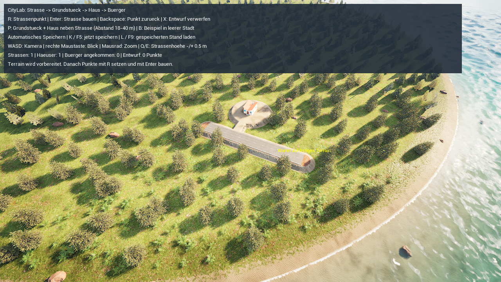
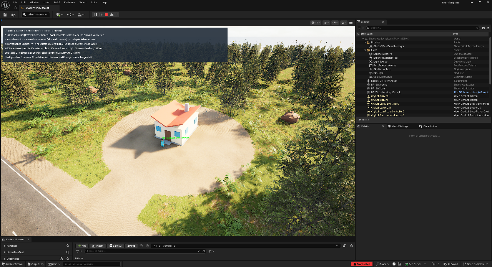
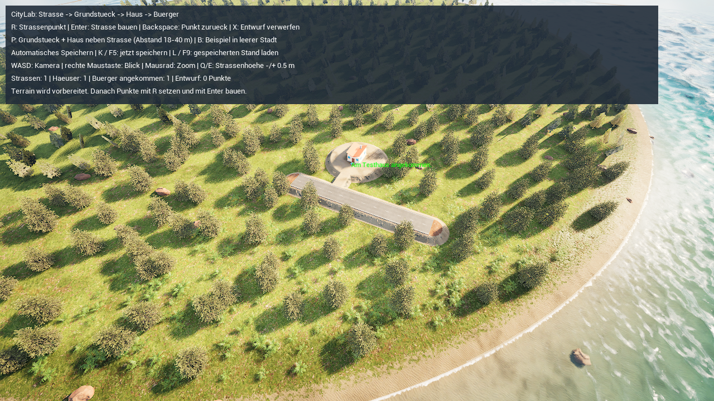

# Vom Straßenbau zum bewohnten Testhaus

Die kleine Spielschleife hat **drei getrennte gerenderte Spielprozesse bestanden**: Straße, gerodetes Grundstück und Testhaus anlegen, den Bürger unterwegs speichern, nach einem Neustart bis zum Haus weiterlaufen lassen und den angekommenen Zustand nach einem weiteren Neustart erhalten. Das ist ein eigener **uncooked** Test mit nativen Projekt-API-Aufrufen. **Zusätzlich bestanden R/Enter/P/L, automatisches Speichern ohne K und normales PIE-Autoload**: Nach Stop/Play waren zwei Grundstücke mit identischen IDs und zwei angekommene Bürger wieder da. Die PIE-Probe bleibt vom Drei-Prozess-Nachweis getrennt; ein verpackter Build ist nicht bestätigt.[^loop-proof]

*Native Aufnahme aus dem Erzeugen-Lauf: Der Bürger wurde nach rund 14,29 m Fortschritt gespeichert. Haus und Bürger verwenden UE-Grundformen. Die Aufnahme wurde visuell inspiziert; sie belegt keine manuelle Tasteneingabe.*[^midroute-frame][^image-manifest]

In der normalen Bedienung zeichnest du eine Straße während des Spiels, lässt daneben ein Grundstück ebnen und roden und setzt damit zugleich ein Testhaus samt Bürger. Die folgende Anleitung beschreibt diese implementierte Bedienung. Die eigentlichen Neustart-, Terrain- und Bürgernachweise sind weiter unten separat angegeben.

## Was benötigt wird

- Das ursprüngliche UnrealMcpTest mit gebauter projektlokaler C++-Erweiterung, UE 5.8.4 und ShaderWorld 4.1.
- Die bereits vorbereitete eigene Kopie des Road-Creator-Straßenmeshes und die Reference-basierten ShaderWorld-Boden-/Biomassets.
- Einfache UE-Grundformen für ein Testhaus mit Dach, Fenstern und Tür sowie einen blauen Bürger. **Externe Downloads oder ein zusätzliches Assetpaket sind für diesen Prototyp nicht nötig.** Die Formen zeigen Funktion und Maßstab; Figurenmodell, Animationen und Gebäudevarianten können später ergänzt werden.

Die Laufzeitlogik liegt in eigenen Projektklassen. **MCP wird zum Bauen und Spielen nicht benötigt**; es dient hier nur der Einrichtung und Prüfung im Editor. Die Wiederverwendung setzt die CityLab-Klassen und die genannten Assets im Projekt voraus. Das öffentliche OKF-Bundle liefert die Anleitung und ausgewählte Belege, weder das Unreal-Projekt noch lizenzierte Plugin-Assets.

## Die richtige Karte starten

1. Öffne im Content Browser **Content → Maps → ShaderWorldCityLoop** (`/Game/Maps/ShaderWorldCityLoop`).
2. Prüfe unter **World Settings → GameMode Override** den **CityLabLoopGameMode**; der C++-Klassenname lautet `ACityLabLoopGameMode`.
3. Starte **Play**, klicke in den Spielbereich und warte auf fertiges Gelände einschließlich Kollision. Das HUD soll „CityLab: Strasse -> Grundstueck -> Haus -> Buerger“ zeigen.
4. Bei der ersten Sitzung **ohne vorhandenen CityLabLoop-Spielstand** baut der Prototyp eine Beispielstraße. Nach der Geländeaktualisierung folgen automatisch ein Grundstück, ein Testhaus und ein Bürger. Mit vorhandenem Spielstand wird stattdessen dieser geladen.[^loop-code]

Diese Karte besitzt den eigenen Slot **CityLabLoop**. Die Karte **ShaderWorldRoadLab** und ihr Slot **CityLabRoads** bleiben getrennt. Die Beispielerzeugung darf einen vorhandenen, aber abgewiesenen Spielstand nicht als leere Stadt behandeln oder überschreiben.

## Eine eigene Straße ziehen

1. **WASD** bewegt die Kamera, die **rechte Maustaste** ändert den Blick und das **Mausrad** zoomt.
2. Zeige auf fertigen Boden und drücke **R**, um einen Straßenpunkt zu setzen. Wiederhole das für mindestens zwei Punkte.
3. **Q/E** senkt beziehungsweise erhöht den Höhenversatz der nächsten Straßenpunkte um **0,5 m**. Der Versatz verändert weder vorhandene Punkte noch die später automatisch bestimmte Grundstückshöhe.
4. **Backspace** entfernt den letzten Entwurfspunkt, **X** verwirft den Entwurf.
5. Drücke **Enter**, um die Straße zu bauen. Asphalt und ShaderWorld-Terrain sollen dieselbe Trasse verwenden; nach der Bauaktion brauchen Gelände, Kollision und Bewuchs Zeit zur Aktualisierung.
6. Beachte die Statusmeldung zum Bau und zur automatischen Speicherung.[^loop-code]

**B** fordert das Beispiel nur in einer **leeren Stadt ohne Straße und Grundstück** an. Bereits gebaute Straßen werden dadurch nicht ersetzt. Für weitere eigene Straßen erneut R-Punkte setzen und Enter drücken. Die bestehende [Straßenanleitung](runtime-roads.md) erläutert den gemeinsamen Terrain-/Mesh-Spline und dessen bisher getrennt bestätigte Grenzen.

## Grundstück, Testhaus und Bürger setzen

1. Wähle eine freie Stelle neben einer vorhandenen Asphaltstraße. Die Grundstücksmitte muss bei diesem Prototyp **mindestens 18 m und weniger als 40 m von der Straßenmittellinie** entfernt sein.
2. Halte zu anderen Grundstücksmitten **mindestens 26 m Abstand**. Das entspricht zwei Grundstücken mit je 12 m Radius und 2 m Abstand zwischen ihren Rändern.
3. Zeige auf den Boden an der gewünschten Mitte und drücke **P**. Bei einer ungültigen Stelle zeigt das HUD den Grund; es entsteht kein neues Grundstück.
4. Bei einer gültigen Stelle legt der Prototyp ein **Grundstück mit 12 m Radius** an, ebnet es, räumt Bewuchs über die NoGrowth-Maske frei und setzt das Testhaus. **Ausrichtung und Höhe kommen automatisch von der zugeordneten Straße.**
5. Ein **4 m breiter Zugang** verbindet Straße und Grundstück. Der Bürger folgt der Straße und anschließend diesem Zugang bis vor das Haus.
6. Warte auf Terrain und Kollisionsboden. Der Bürger soll erst mit gültigem Boden loslaufen. Seine Statusanzeige steht über der Figur; das HUD zählt angekommene Bürger.[^loop-code]

Das Haus wird gemeinsam mit dem Grundstück gesetzt; es gibt in diesem ersten Ablauf keinen zusätzlichen Hauskatalog oder separaten Figurenplatzierungsschritt. Ein weiteres P an einer anderen zulässigen Stelle erzeugt ein weiteres Grundstück mit Haus und Bürger.

## Speichern und nach Neustart laden

**CityLoop speichert automatisch nach einer Bauaktion und sofort bei der Ankunft eines Bürgers.** Während noch Bürger unterwegs sind, wird zusätzlich ungefähr **alle fünf Sekunden** gespeichert. **K/F5** fordert sofort eine Speicherung an. **L/F9** lädt den zuletzt gespeicherten Stand. Wegen Autosave ist L/F9 keine allgemeine Rückgängig-Funktion.[^loop-code]

Für den eigenen Neustartversuch:

1. Baue eine Straße und ein Grundstück oder verwende das erste Beispiel.
2. Beobachte den Bürger unterwegs, drücke **K/F5** und prüfe die Statusmeldung. Notiere den sichtbaren Bau- und Bürgerzustand.
3. Beende die Spielsession. Für die Prüfung eines echten Neustarts die Spielanwendung vollständig schließen und **dieselbe CityLoop-Karte in einem neuen Spielprozess** starten.
4. Vergleiche Anzahl und Position der Straßen, Grundstücke und Häuser. Der Bürger soll mit seiner gespeicherten Zugehörigkeit und seinem gespeicherten Fortschritt wiederhergestellt werden und weiterlaufen.
5. Lass ihn ankommen, speichere erneut und wiederhole den Neustart. Der angekommene Bürger soll am Ziel bleiben; wiederholtes Laden soll keine Duplikate erzeugen.

**Stop PIE → Play** prüft die neue Vorschau im gleichen Editorprozess. Diese normale Auto-Load-Probe ist mit zwei Grundstücken und zwei angekommenen Bürgern bestanden, einschließlich vorherigem Autosave ohne K und manuellem Laden mit L. Der [native CityLoop-Nachweis](../evidence/cityloop-report.json) verwendet zusätzlich drei verschiedene Betriebssystemprozesse und ausdrückliche Projekt-API-Speicheraufrufe. F5/F9, der neue manuelle K-Callback und das momentgenaue Autosave-Intervall bleiben separat offen.[^loop-proof]

## Was die Bürgerroute leistet

Der erste Bürger folgt einer aus der Straße und dem Hauszugang abgeleiteten Route. Bei fehlender Kollision soll er warten; bei einem Hindernis soll er anhalten und seinen Zustand anzeigen. Das verhindert einen bloßen Zielpositionswechsel als vermeintliche Laufbewegung. **Die Route ist noch keine allgemeine NavMesh-Wegsuche für eine Stadt.** Umwege, mehrere Straßenverbindungen und dynamische Navigation bleiben eigene Aufgaben der [Roadmap](../reference/city-builder-roadmap.md).

Gespeichert werden die logische Stadt und der Bürgerfortschritt. Straße, Grundstück und sichtbare Objekte werden daraus wiederhergestellt. Die Grundstücksmaske hält eine ganze Fläche frei; sie ist keine Verwaltung einzelner gefällter Bäume oder geernteter Ressourcen.

## Normale Bedienung und automatisches Laden

Zusätzlich zum nativen Drei-Prozess-Test wurde der normale Editorablauf mit **R/Enter**, **P** und **L** geprüft. Neben dem automatisch erstellten Beispiel entstand eine zweite Straße und ein zweites Grundstück mit Haus und Bürger. Ohne manuelles K wurden die Bauvorgänge automatisch gespeichert. Beide Bürger erreichten ihre Häuser; L lud den Stand, und nach normalem Stop/Play stellte der eigene CityLoop-Slot beide Grundstücke mit identischen IDs und zwei angekommenen Bürgern wieder her. Das ist ein PIE-Neustart im selben Editorprozess; der unabhängige Kaltstartnachweis steht oben.[^loop-proof]

*Native PIE-Aufnahme nach Stop/Play und automatischem Laden: Testhaus und blauer Bürger. Der Hauptagent hat den Frame visuell inspiziert.*[^normal-autoload-frame][^image-manifest]

Die Kamera wurde zum Setzen der Cursorpunkte über ActorTools bewegt; die dafür vorübergehend geänderten Kameragrenzen wurden anschließend zurückgestellt. WASD, rechte Maustaste, Mausrad und F5/F9 wurden in dieser Probe nicht abgenommen. Der neue K-Callback wurde nicht zusätzlich betätigt; der normale Speicherbeleg betrifft das automatische Speichern ohne K. Die momentgenaue Einhaltung des Fünf-Sekunden-Intervalls ist aus dem Code beschrieben, nicht als Zeitmessung abgenommen.

## Grenzen dieses ersten Prototyps

Der Aufbau ist für den kontrollierten Inselinnenbereich gedacht. Wasserstand und vollständige Weltgrenzen werden noch nicht als Bauverbote geprüft. Nachträglich gezeichnete Straßen können bestehende Häuser kreuzen; eine allgemeine Baukonfliktprüfung fehlt noch. Das Grundstücksebnen legt kein allgemeines Terraforming-Werkzeug fest.

## Was praktisch bestanden ist

Der erste Prozess erzeugte **eine Straße, ein Grundstück, ein Haus und einen Bürger**. Er speicherte nach **14,2878 m** Bürgerfortschritt. Der zweite Prozess stellte Identität, Grundstücks-/Routengeometrie und Fortschritt wieder her; der Bürger lief bis zum Haus bei rund **61 m** Gesamtweg. Der dritte Prozess lud diesen angekommenen Zustand und bestätigte ihn unverändert. Die jeweils geladenen Daten stammen nachweislich aus dem vorherigen Speicherprozess; die öffentlichen Belege enthalten statt Prozessnummern nur die geprüften Vergleichsergebnisse.[^loop-proof]

*Native Aufnahme aus dem dritten Spielprozess: derselbe wiederhergestellte Bauzustand und der bereits angekommene Bürger am Haus. Der Hauptagent hat diesen Frame visuell inspiziert. Ein Einzelbild ist keine Langzeit- oder Leistungsprüfung.*[^arrived-frame][^image-manifest]

Insgesamt bestanden **24/24 Checks** sowie **438 akzeptierte Terrain-Kollisionsproben** an sechs mehrfach gemessenen Positionen für Grundstück, Zugang und Straße. Der größte aufgezeichnete Höhenfehler betrug **0 cm** bei **5 cm Toleranz**. Die Zahl 438 beschreibt wiederholte akzeptierte Messungen, keine 438 verschiedenen Stellen oder vollständige Aufzeichnung aller erfolglosen Warteversuche. Die Bürgerbewegung besitzt **29 Positionsproben**, alle mit Bodenkontakt; die größte Abweichung vom vorgesehenen **4-cm-Bodenabstand** betrug **3 cm**; die Prüfformel zieht **90 cm Kapsel-Halbhöhe plus 4 cm Sollabstand** von der Figurenposition ab.[^loop-proof]

Die CPU-Instanzmessung ergab im **10-m-Baukern 252 → 0 Pflanzenursprünge**, bei unveränderten **2374** Ursprüngen im ausgewählten 30–50-m-Referenzbereich außerhalb des Straßenbereichs. Jede gemeldete Vorher-/Nachherphase wartete auf **drei gleiche vollständige Matrix-Fingerprints** und keine relevanten ausstehenden Async-Builds. Das misst Instanzursprünge, keine GPU-Maskenpixel oder überhängenden Äste. Die eigentliche Grundstücksfläche hat weiterhin 12 m Radius; der Kern wurde enger gewählt.[^loop-proof]

Dreimaliges Laden ohne doppelte Actors, ein abgewiesener Spielstand mit ungültigem Grundstücksradius und ein abgewiesenes überlappendes Grundstück sind ebenfalls bestanden. Die gemessenen Terrainproben isolieren ShaderWorld-Boden; sie sind keine eigene Abnahme aller Hauskollisionsflächen.[^loop-proof]

## Prüfstand und offene Bedienproben

| Prüfung | Tatsächlicher Stand | Grenze |
| --- | --- | --- |
| Normales Erststartbeispiel | Beispielstraße und Grundstück/Haus/Bürger über den normalen Spielercontroller bestätigt | Kleiner vorbereiteter Inselbereich |
| Straße zeichnen / Grundstück setzen | Native API und normale Slate-Tasten R/Enter/P bestanden; zweite Straße und zweites Grundstück erzeugt | Kamera für Cursorziele über ActorTools bewegt |
| Grundstück ebnen | Wiederholte Terrain-Kollisionsproben nach Erzeugen und Laden bestanden | Kontrollierter kleiner Inselinnenbereich |
| Grundstück roden | 252 → 0 Ursprünge im Kern; 2374 Referenzen erhalten; nach Laden erneut bestätigt | CPU-Instanzdaten; keine Äste-/GPU-Maskenmessung |
| Testhaus setzen | Ein Haus und Bürger im Drei-Prozess-Test; zwei Häuser/Grundstücke und Bürger in normalem PIE wiederhergestellt; drei Bilder inspiziert | Keine eigenständige Prüfung aller Hauskollisionsflächen |
| Bürger bewegen | 29 Positionsproben mit Bodenkontakt; zum Haus gelaufen | Festgelegte Route; absichtliches Hindernis/fehlender Boden noch nicht als Negativfixture geprüft |
| Unterwegs speichern | Rund 14,29 m Fortschritt nach echtem Neustart erhalten und fortgesetzt | Explizite native Save-/Load-Aufrufe |
| Angekommen laden | Rund 61 m Zielzustand nach weiterem Spielprozessneustart unverändert; normale PIE-Probe stellte zwei angekommene Bürger wieder her | Keine Langzeitsimulation |
| Wiederholt / ungültig laden | Dreimaliges Laden ohne Duplikate; ungültiger Grundstücksradius abgewiesen und vorhandene Stadt erhalten | Nicht jede beschädigte Spielstandsvariante getestet |
| Autosave, L und normales Play-Autoload | Ohne K automatisch gespeichert, beide Bürger angekommen; L und Stop/Play stellten denselben Stand mit zwei Grundstücks-IDs wieder her | Kein momentgenauer Nachweis des Fünf-Sekunden-Intervalls |
| Manueller K-Callback und F5/F9 | Implementiert | Diese CityLoop-Eingaben noch nicht gesondert betätigt |
| Verpacktes Spiel | Offen | Drei uncooked Spielprozesse ersetzen Cook/Shipping nicht |

Die technische OKF-Prüfung kontrolliert Dokumentformat und Verweise. Die fachlichen Ergebnisse stammen aus dem abgegrenzten [Drei-Prozess-Test und der zusätzlichen normalen PIE-Probe](../evidence/cityloop-report.json). Weitere offene Prüfungen werden getrennt ergänzt.

## Bei Problemen

| Beobachtung | Nächster Schritt |
| --- | --- |
| P setzt kein Grundstück | Fertigen Boden unter den Mauszeiger nehmen; zuerst eine Asphaltstraße bauen; Abstände von der Straßenmitte und zu anderen Grundstücken prüfen |
| Grundstückshöhe entspricht nicht dem Cursorpunkt | Das ist im Prototyp vorgesehen: Die Straße bestimmt die Höhe. Q/E verändert nur neue Straßenpunkte |
| Bürger bleibt zunächst stehen | Seine Statusanzeige prüfen und Terrain-/Kollisionsaktualisierung abwarten |
| Bürger meldet ein Hindernis | Zugang und Weg ansehen; der Prototyp sucht noch keinen Umweg |
| Bau ist sichtbar, Speichern meldet einen Fehler | HUD-Fehler dokumentieren und K/F5 erneut versuchen; den sichtbaren Bau nicht als gespeicherten Zustand werten |
| B baut kein Beispiel | B arbeitet nur in einer leeren Stadt. Für zusätzliche Bauten R/Enter und P verwenden |
| Nach Start erscheint ein Ladefehler | Fehler dokumentieren und den vorhandenen Spielstand erhalten; Karte und Slot prüfen |

[^loop-code]: Eigene CityLoop-Bedienung und Grundstücksvalidierung im ursprünglichen UnrealMcpTest am 28. Oktober 2026 gelesen. Build und gespeicherte GameMode-/Terrainmaterialzuweisungen nach echtem Kartenneuladen sind bestätigt. R/Enter/P/L, das Erststartbeispiel, normales Autosave ohne K und Play-Autoload wurden zusätzlich praktisch geprüft. Weitere beschriebene Eingaben sowie exaktes Autosave-Timing bleiben Codebefunde, soweit sie oben nicht ausdrücklich als geprüft genannt sind.
[^loop-proof]: [Bereinigter CityLoop-Nachweis](../evidence/cityloop-report.json), 28. Oktober 2026: drei verschiedene gerenderte uncooked Spielprozesse für Erzeugen, Fortsetzen und erneutes Laden des angekommenen Zustands; zusätzlicher Abschnitt `normal_pie_ui` für R/Enter/P/L, Autosave ohne K und Stop/Play-Autoload im selben Editorprozess.
[^midroute-frame]: [Unveränderte native Create-Aufnahme](../assets/images/cityloop-midroute.png), vom Hauptagenten visuell inspiziert.
[^arrived-frame]: [Unveränderte native Aufnahme nach Ankunfts-Neustart](../assets/images/cityloop-restarted-arrival.png), vom Hauptagenten visuell inspiziert.
[^normal-autoload-frame]: [Unveränderte native PIE-Aufnahme nach normalem automatischem Laden](../assets/images/cityloop-normal-autoload-house.png), vom Hauptagenten visuell inspiziert.
[^image-manifest]: [Bildherkunft, Dateigrößen und SHA-256](../evidence/image-manifest.json).
