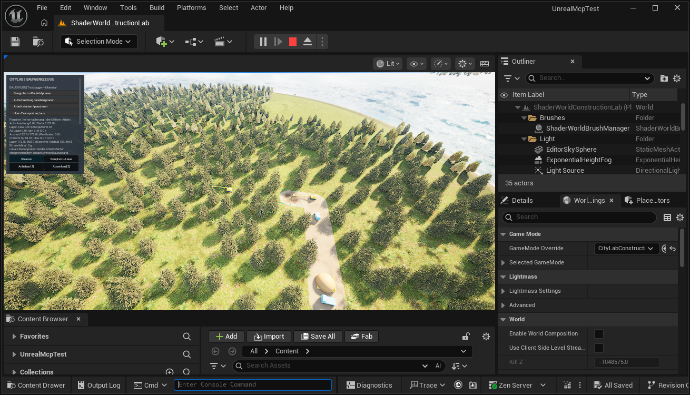

# Aushub aus dem Lager zum Aufschütten verwenden

Der Prototyp ergänzt die Baugrube um einen zweiten Standort: Ein eigener Lkw holt Erde am gemeinsamen Lager ab und liefert sie zur Aufschüttung. Dort hebt die Testmaschine das ShaderWorld-Terrain schrittweise an. **Planung allein erzeugt keine Erde und hebt keinen Boden.** Nur bereits angeliefertes Material darf eingebaut werden.[^model]

## Voraussetzungen und Bedienung

1. Öffne **Content → Maps → ShaderWorldConstructionLab** und starte **Play**. Verwende **CityLabConstructionGameMode**. Bestehende Stadtspielstände bleiben im normalen Slot **CityLabConstruction**.
2. Warte auf lokale Bodenkollision. Die Grube liegt bei **X −12000 / Y −5000 cm**. Ohne bisherigen Spielstand entsteht ihr Plan pausiert; Arbeit und Transport sind getrennte Schalter.
3. Wähle **Aufschuettung daneben planen**. Der zweite Standort liegt 50 m östlich bei **X −7000 / Y −5000 cm**. Sein Soll ist **+1,5 m** gegenüber der ebenen Basis. Ein bestehender Aufschüttplan wird nicht ersetzt. Das Planen ändert die gespeicherte Absicht, noch keine Konten oder Geländeform.
4. Schalte **Arbeit starten / pausieren** und **Lkw-Transport an / aus** ein. Die gemeinsame Pause betrifft beide Standorte und beide Lkw. Der Transportschalter hält die Transporte an; bereits angeliefertes Puffermaterial kann bei laufender Arbeit weiter eingebaut werden.
5. Beobachte beide Felder: Die Grube sinkt, der Lagerbestand wächst beziehungsweise wird wieder abgeholt, der zweite Puffer füllt sich und die Aufschüttung steigt. Die Platzhalter zeigen Ladungen und vorgeschriebene Fahrten; sie sind keine physikalischen Fahrzeuge.
6. Mit **K/F5** speichern beziehungsweise **L/F9** laden. Der normale Controller speichert Änderungen außerdem periodisch. Beende das Spiel beispielsweise während einer beladenen Fahrt und starte erneut: Ladung, Route, Wegfortschritt, Maschinenwechsel, Puffer und ausgeführte Zellhöhen müssen zum gespeicherten Stand zurückkehren. Zwischen letztem Autosave und Beenden kann regulär noch ungespeicherter Fortschritt liegen.

Ein bereits fertig gespeicherter Aushub mit **172,8 t im Lager** kann als Quelle für den zweiten Standort dienen. Die Grube muss dafür nicht erneut ausgegraben werden. Nach der Planung bleibt der bisherige Pausenzustand erhalten.[^model]

Native unveränderte PIE-Aufnahme nach normalem Speichern und Laden: Das Lager liegt vorne, die fertige Grube dahinter. Die zweite Maschine links wartet im noch bewachsenen Zielbereich. Dessen Freistellung beginnt erst mit der Arbeit beziehungsweise Materialabholung. Das Bild belegt diesen pausierten Aufbau, keinen fertigen Aufschüttkörper oder Pixelvergleich.

## Wo die Erde gerade ist

Für diesen Prototyp gilt zu jedem Arbeitsschritt:

**Ausgehoben = Grubenpuffer + Gruben-Lkw + Lager + Lager-Lkw + Aufschüttpuffer + eingebauter Boden.**

Alle Konten verwenden ganze Gramm. Das Beladen des zweiten Lkw bucht Material gleichzeitig aus dem Lager aus und auf das Fahrzeug. Entladen bucht es auf den Zielpuffer. Erst die Arbeit der zweiten Maschine bucht es vom Puffer in den Boden und ändert die Höhenprojektion. Eine Bestellabsicht ist kein Materialguthaben. Weil es nur einen Abnehmer-Lkw gibt, benötigt dieser Prototyp keine separate Vorabreservierung; die begrenzte Restnachfrage wird beim Laden berücksichtigt.[^model]

| Begrenzung | Verhalten |
| --- | --- |
| Grubenpuffer voll, 18 t | Bagger wartet auf Abtransport |
| Einer der Lkw voll, 12 t | Fahrt zum jeweiligen Ziel |
| Lager voll, 500 t | Gruben-Lkw behält Restladung; der zweite Lkw kann Lagerplatz freimachen |
| Lager leer | Zweiter Lkw wartet, die Aufschüttung verarbeitet höchstens bereits angelieferte Erde |
| Nur eine Teilladung verfügbar | Zweiter Lkw fährt auch damit los; er wartet nicht auf eine unerreichbare Vollladung |
| Zielpuffer voll, 18 t | Zweiter Lkw behält Restladung und wartet auf freien Puffer |
| Sollmenge der Aufschüttung erreicht | Keine weiteren Entnahmen für diesen Auftrag; der Lkw kehrt leer zurück und beendet seine Route |

Beide Standardpläne haben vier Zellen mit 4 m Zellmaß und 1,5 m Höhenänderung. Die bilinearen, auslaufenden Höhenbeiträge ergeben analytisch jeweils **96 m³**. Bei angenommenen **1800 kg/m³** können die **172,8 t Aushub** vollständig am zweiten Standort eingebaut werden. Für die lockeren Haufen gilt separat **1400 kg/m³**. Die verwendete Einbaudichte ist eine Modellannahme; Verdichtung, unterschiedliche Bodensorten und Materialverluste sind nicht simuliert. Ganze Gramm sind kein unabhängig gemessenes Meshvolumen.[^model]

## Speicherung und Grenzen

Das gemeinsame SaveGame-Format bleibt **5**. Sein Construction-Datensatz verwendet mit geplantem zweiten Standort **Recordversion 2**. Alte Grubenrecords der Version 1 bleiben ladbar und bekommen erst durch ausdrückliche Planung einen Abnehmer. Ältere Programmfassungen verstehen Recordversion 2 nicht und weisen ihn ab. Vor einem Rückwechsel der Programmfassung den gesicherten alten Spielstand erhalten.[^model]

Ein einzelner gespeicherter Datensatz besitzt beide Standorte und das gemeinsame Lager. Die acht Terrainbrushes, zwei Maschinen-/Lkw-Darstellungen und begrenzten Bewuchsmasken werden daraus rekonstruiert. Es gibt weiterhin Welt-/Generator-/Terrainprofilprüfungen und einen lokalen Kollisionsnachlauf. Der nächste Erdschritt wartet auf passende Kollisionshöhen. Das ist keine globale ShaderWorld-Fertigmeldung.[^model]

Dieser Ausbau ist ein begrenzter Kreislauf mit zwei Standorten und festen Routen. Freie Lagerwahl, mehrere Aufträge pro Fahrzeug, Straßenpfadsuche, Verkehr, getrennte Maschinenpausen und eine stadtweite Ressourcenwirtschaft sind weitere Aufgaben. Die getrennte Assetsuche verändert diese Logik nicht.

## Wenn die Arbeit steht

- **Beide Felder stehen:** Prüfe gemeinsame Pause und die Meldung zur Bodenkollision.
- **Aufschüttung bleibt flach:** Prüfe Lager, Lager-Lkw und Zielpuffer. Ohne Materiallieferung darf sie nicht steigen.
- **Planung abgewiesen:** Der Prototyp verlangt ebenen, kollidierenden Boden und freie Arbeitsbereiche außerhalb von Straßen, Grundstücken und bearbeiteten Geländeplänen.
- **Nach Laden doppelte Maschinen oder wechselnde Mengen:** Nicht einfach weitere Pläne anlegen. Der Neustarttest muss genau acht Brushes, zwei Darstellungen und unveränderte Modellfelder bestätigen.

## Prüfstatus

**29/29 native Tests** bestanden, davon 27 ohne und zwei mit bekannten Warnungen. Alle vier neuen Kreislauftests sind fehler- und warnungsfrei: vollständiger Wiedereinbau, exakte Fortsetzung gespeicherter Fahrt, Materialmangel/Teilladungen/kleines Lager und atomare Zurückweisung beschädigter Zustände.

**Uncooked und verpackt** bestanden jeweils zwei getrennte gerenderte Prozesse mit **6/6 und 10/10 Checks**. Gespeichert wurde bei **54 t Aushub = 18 t Grubenpuffer + 12 t Lager + 12 t fahrendem Lager-Lkw + 12 t Einbau**. Der zweite Prozess stellte sämtliche Modellfelder identisch wieder her, lud drei weitere Male und baute alle **172,8 t** ein. Alle übrigen Konten und Restmengen waren danach null; Bilanzfehler **0 g**. Beide Standorte wurden mit 18 unabhängigen Kollisionspunkten pro Durchlauf geprüft: 108 Proben im ersten und 270 im zweiten Prozess, alle passend; größte Abweichung **2,005 cm** bei **5 cm Toleranz**. Das beschleunigte Prüfprofil verwendet 6 t Arbeits- und 12 t Lade-/Entladeschritte; es verändert das normale Spielprofil nicht.

Im normalen PIE wurde der alte Version-1-Grubenrecord vollständig mit seiner Sicherung verglichen: **172,8 t Lager**, pausiert. Der neue Aufschüttplan verbrauchte noch nichts; Speichern und Laden erhielten alle Recordfelder exakt. 16 unbeteiligte Spielstände blieben byteidentisch. Diese Probe rief den Controllercallback über natives Unreal Python auf; sie behauptet keine physische Maus-/Tastenabnahme. Die ursprüngliche Kamera wurde zurückgestellt.

Game-/Editorbuild und SkipCook-Verpackung mit bestehenden unveränderten gekochten Assets bestanden. Kein neuer vollständiger Cook, Shipping-, Fahrzeugphysik- oder Großweltnachweis. Einzelwerte und Grenzen stehen im [bereinigten Prüfbericht](../evidence/fill-cycle-test.json).

[^model]: Gelesene und erweiterte eigene Projektimplementierung gemäß Quellenbeschreibung; tatsächlicher Laufzeitstatus im getrennten Prüfbericht.
