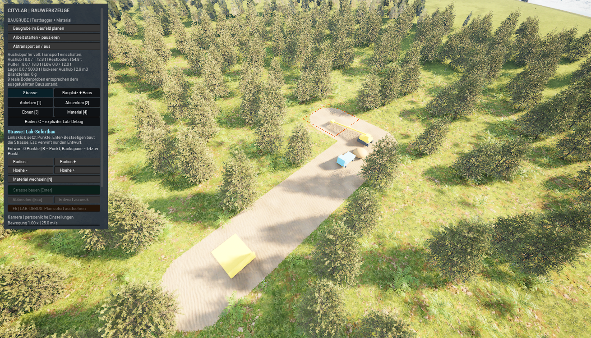
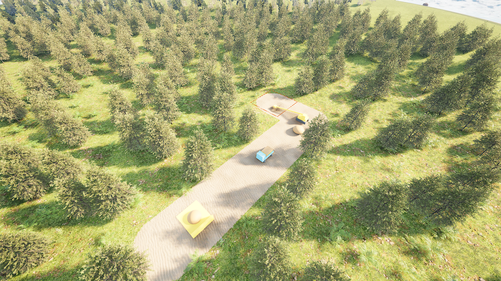
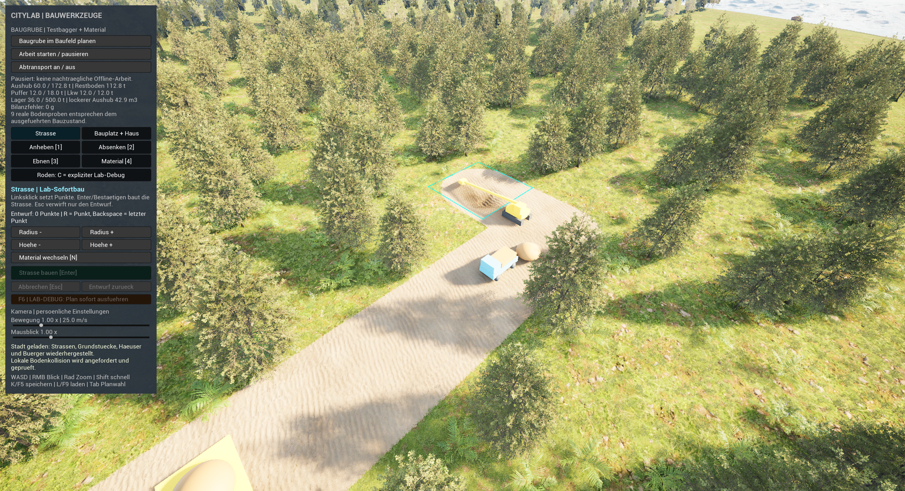
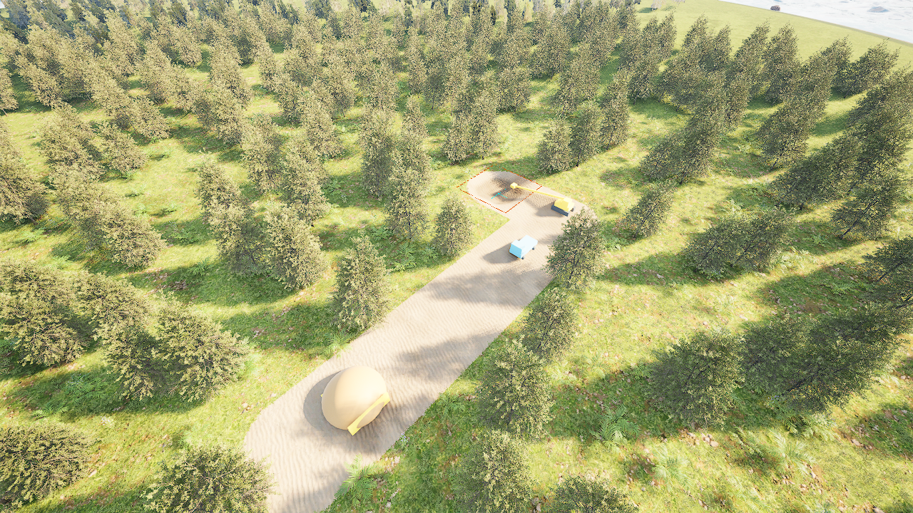

# Baugrube mit Testbagger, Puffer und Abtransport erproben

**Erweiterung:** Der [geschlossene Materialkreislauf](closed-material-cycle.md) ergänzt die hier dokumentierte Baugrube um eine zweite Aufschüttbaustelle. Alter Lagerbestand bleibt nutzbar; der neue Bericht belegt Wiedereinbau, gemeinsamen Materialhaushalt und Neustart während der Lagerfahrt.

**Dieses Labor zeigt einen kleinen vollständigen Arbeitskreislauf:** Ein Testbagger verändert den Boden schrittweise, Erde füllt einen begrenzten Puffer, und ein Lkw bringt sie zum Lager. Ein echter Neustart mitten in einer beladenen Fahrt und die anschließende Fertigstellung sind im verpackten Spiel geprüft. Die Maschinen bestehen aus Unreal-Grundformen; externe Assets sind dafür nicht nötig.[^acceptance]

## Starten und ausprobieren

1. Öffne im Content Browser unter **Content → Maps** die Karte **ShaderWorldConstructionLab**. Unter **World Settings → GameMode Override** muss **CityLabConstructionGameMode** stehen. Fehlt die Karte im ursprünglichen Testprojekt, erstellt **Tools/setup_construction_lab.py** bei gestopptem PIE eine eigene Kartenkopie samt eigenem Höhenmaterial. Das öffentliche Doku-Repository enthält das Unreal-Projekt und lizenzierte Assets nicht.
2. Starte **Play** und warte auf Gelände, Material und lokale Kollision. Die Kamera schaut auf das Baufeld bei **X = −12000 cm, Y = −5000 cm**, ursprünglich **Z = 300 cm**. Ohne Spielstand entsteht der Beispielplan **pausiert**, der **Transport bleibt aus**. Ein vorhandener Stand wird geladen.
3. Oben links findest du **Baugrube im Baufeld planen**, **Arbeit starten / pausieren** und **Lkw-Transport an / aus** (früher Abtransport). Die Plan-Schaltfläche dient zum Anlegen eines noch fehlenden Beispielauftrags. Es gibt vorerst genau eine Grube.
4. Drücke **Arbeit starten / pausieren**. Der Bagger arbeitet außerhalb des Grubenrandes. Erst die tatsächlich begonnene Arbeit gibt die begrenzte Baustelle samt Maschinen-/Transportkorridor über eine NoGrowth-Maske frei. Das ist eine Laborvereinfachung und erzeugt **kein Holz**.
5. Lasse den **Transport zunächst aus**. Bei **18 t Pufferinhalt** wartet der Bagger. Der Boden darf ab diesem Zeitpunkt nicht weiter sinken.
6. Drücke **Lkw-Transport an / aus** (früher Abtransport). Der blaue Lkw lädt höchstens **12 t**, fährt die feste Zufahrt, entlädt ins **500-t-Lager** und kehrt zurück. Sobald Puffer frei ist, arbeitet der Bagger weiter.
7. **Arbeit starten / pausieren** hält bei Bedarf den gesamten Arbeits-/Transportfortschritt an. Nur den Transport abzuschalten erhält Ladung und Fahrzeugposition ebenfalls.[^lab-integration][^acceptance]

Im Normalprofil blieben Materialmenge und Zellhöhen über weitere **57 Arbeitstakte** unverändert, solange der Puffer voll und der Transport ausgeschaltet war.[^acceptance]

Die Anzeige nennt ausgegrabene Menge, Restboden, Puffer, Lkw, Lager und Bilanzfehler. Planung allein verändert weder Gelände noch Bewuchs oder Konten. Die geerbte **F6-Sofortausführung** ist ein gesondertes Debugwerkzeug und führt diesen Arbeitskreislauf nicht aus.

Die native Aufnahme zeigt den gespeicherten Zwischenstand: **42 t ausgehoben = 18 t Puffer + 12 t fahrender Lkw + 12 t Lager**. Der Arbeitsplatz ist am oberen Bildrand, das Lager unten links. Das Bild ist unverändert; es stammt aus dem eigenständigen cooked Testprozess.[^acceptance]

## Mengen und Gelände verstehen

| Größe | Normales Labor | Tatsächlicher Nachweis |
| --- | --- | --- |
| Arbeitsbereiche | 2 × 2, jeweils 400 cm Zellmaß | Modell- und Laufzeitreadback |
| Beispielziel | 1,5 m Absenkung | Modellziel 150 cm Welthöhe; tatsächlicher Abschlussboden etwa 148–149 cm |
| Geländeform | 12 × 12 m auslaufender Bereich, 4 × 4 m Kern mit voller Endtiefe | Dreieckige/bilineare Höhenbasis; neun reale Kollisionsproben |
| Arbeit | Bis zu 1,5 t je mindestens 0,5 s, zusätzlich Kollisionswartezeit | Normalprofil im Code; automatisierte Abnahme verwendet ausdrücklich beschleunigtes Testprofil |
| Puffer / Lkw / Lager | 18 t / 12 t / 500 t | Beide Testprozesse und normaler UI-Planreadback |
| Dichten | 1800 kg/m³ gewachsen, 1400 kg/m³ locker | Explizite Laborannahmen, keine Geologiemessung |
| Gesamtmenge | Analytisch 96 m³ gewachsen = 172,8 t | Exakte ganzzahlige Grammkonten |

Die allgemeine Modellklasse hat kleinere Standardkapazitäten; die normale Planerstellung setzt ausdrücklich die hier genannten **18/12/500 t**. Der automatische Abnahmelauf beschleunigt Arbeit auf **6 t je Schritt**, Laden/Entladen auf **12 t je Schritt** und die Fahrt auf **20 m/s**. Er prüft denselben Bilanz-/Speichermechanismus, beweist aber keinen normalen realen Baudurchsatz.[^acceptance]

Jeder der vier dreieckigen Zellbeiträge hat das Flächenintegral **Zellmaß² = 16 m²**. Vier Beiträge mit 1,5 m Absenkung ergeben analytisch 96 m³. Das ist eine auslaufende Grube, keine senkrecht ausgeschnittene Quaderform. Ohne geplante zweite Baustelle erfüllen die drei Konten jederzeit:

**Ausgehobene Masse = Puffer + Lkw-Ladung + Lager.**

Mit geplantem zweiten Standort kommen Lager-Lkw, Zielpuffer und eingebauter Boden zur Bilanz hinzu; verwende dann die [erweiterte Gleichung](closed-material-cycle.md#wo-die-erde-gerade-ist).

Transfers sind auf ganze Gramm und die jeweils freie Kapazität begrenzt. Dieselben 172,8 t entsprechen bei der lockereren Dichte etwa **123,43 m³**. Der sichtbare Haufen veranschaulicht die Menge; sein Meshvolumen wurde nicht unabhängig vermessen.[^construction-model][^acceptance]

### Warum wir wenige Zentimeter Abweichung zulassen

ShaderWorld schneidet seine Höhenausgabe nach jedem Brush-Pass auf ganze Zentimeter ab. Im Vier-Brush-Labor können sich diese kleinen Verluste summieren. Unser erster Abschlussversuch mit **2 cm** Toleranz blieb im dritten Arbeitsbereich stehen und gilt als **fehlgeschlagen**. Der aktuelle Versuch verlangt **neun passende Ist-/Soll-Höhen**, **dreimal hintereinander**, mit höchstens **5 cm** Abweichung. Gemessen wurden beim Abschluss maximal **2,001 cm**. Der geprüfte Kollisionsrasterabstand beträgt **100 cm**, mit **129 Vertices je Patch**.[^native-height][^acceptance]

Ein Kollisionsauftrag kann außerdem vor dem asynchronen Höhen-Cache fertig sein. Solange die gemessenen Höhen nicht passen, bleibt der nächste Arbeitsschritt gesperrt; der begrenzte Bereich wird bei Bedarf alle zwei Sekunden erneut angefordert. Das ist eine lokale Bereitschaftsprüfung, keine globale GPU-Fertigmeldung.

Die **Materialbilanz ist im Arbeitsmodell auf ganze Gramm exakt**. Die quantisierte ShaderWorld-Oberfläche stellt dieses Modell näherungsweise dar. Die 96 m³ sind kein unabhängig vermessenes Volumen des quantisierten Kollisionsmeshes. Für längere Brushstapel oder andere Raster müssen Genauigkeit und Toleranz neu geprüft werden.

## Mitten in der Arbeit speichern und laden

Der eigene Slot heißt **CityLabConstruction**. Foundations, CityLoop und RoadLab behalten ihre eigenen Slots.

1. Beginne die Arbeit und aktiviere den Transport. Warte, bis eine beladene Fahrt unterwegs ist.
2. Pausiere bei Bedarf und notiere die Konten. **K/F5** speichert; Bedienänderungen speichern außerdem sofort. Für laufenden Arbeitsfortschritt gibt es zusätzlich einen periodischen Autosave mit mindestens **2 s Abstand** zwischen diesen periodischen Speicherungen.
3. Beende das Spiel vollständig und öffne die Laborwelt erneut. Der normale Controller lädt den vorhandenen Stand. **L/F9** lädt ihn zusätzlich auf Wunsch neu.
4. Vergleiche Arbeitsbereich, Bodenform, Bagger-/Lkw-Position, Phase und Materialkonten. Weiterarbeit wartet auf passende lokale Kollision. **Offlinezeit wird nicht nachgeholt.**

Die normale PIE-Vorschau stellte nach Stop/Play alle gespeicherten Modellfelder eines pausierten **60-t-Zwischenstands** identisch wieder her: **12 t Puffer + 12 t Lkw + 36 t Lager**. Ein absichtlich weltfremder Laborspielstand wurde abgewiesen und blieb über das Autosave-Zeitfenster bytegleich; danach wurde der gültige gesicherte Stand wiederhergestellt. Das ergänzt den getrennten echten Prozessneustart. Die Tastaturbedienung ist hier beschrieben, aber nicht pauschal für alle Fokuszustände neu abgenommen.[^acceptance]

SaveGame-Format **5** speichert das Baustellenmodell gemeinsam mit Straßen, Grundstücken, Terrainrecords und Rodungszuständen. Formate **1–4** bleiben gemäß ihren vorhandenen Featureprüfungen unterstützt; Welt-, Generator- und Terrainprofilidentität müssen passen. Das ist keine beliebige Migration zwischen fremden Welten. Ein abgewiesener Stand darf durch den neuen Baustellen-Autosave nicht ersetzt werden.[^lab-integration]

Im automatisierten Test wurde während einer beladenen Fahrt gespeichert. Der zweite Prozess stellte **alle serialisierten Modellfelder identisch** wieder her, lud den Stand **dreimal zusätzlich** ohne doppelte Brush-/Maschinen-/Maskeninstanzen und arbeitete danach fertig: **172,8 t im Lager, 0 t Restboden, 0 t Puffer, 0 t Lkw, 0 g Bilanzfehler**. Der Zielplan blieb unverändert. Beide Prozesse bestanden **14/14 beziehungsweise 15/15 Checks** in **24,7/113,8 s**.[^acceptance]

## Fehlersuche und Grenzen

- **Noch kein Plan/Boden nicht bereit:** Rendering, lokale Kollision und Shaderkompilierung abwarten. Die Plan-Schaltfläche darf erst auf fertigem, freiem, flachem Boden erfolgreich sein. Straßen, Grundstücke und ausgeführte Terraforming-Änderungen werden für das Beispiel ausgeschlossen.
- **Bagger arbeitet nicht:** Pause, Transportfreigabe und Pufferstand prüfen. Bei unpassender Kollision nennt die Anzeige Ist-/Soll-Höhen und hält weitere Arbeit an.
- **Lkw entlädt nicht:** Transport muss an und die Arbeit unpausiert sein. Ein volles Lager stoppt das Entladen; Material bleibt auf dem Fahrzeug.
- **Neue Grube an beliebigem Ort:** Dieses erste Labor besitzt einen festen Auftrag und eine feste geprüfte Route. Eine feste zweite Aufschüttbaustelle ist inzwischen als [geschlossener Kreislauf](closed-material-cycle.md) ergänzt und separat geprüft. Allgemeine Auftragsvergabe, freie Fahrzeugnavigation, geologische Materialschichten, Böschungsstabilität und Wasserhaltung fehlen weiterhin.
- **Viele Bäume oder große Welt:** Der getrennte Rodungstest fand etwa **20–22 ms CPU je Nachlauf-/Auswahlaufruf** in seiner Szene. Der volle Instanzscan braucht vor größerem Ausbau einen Index-/Poolfilter. Das ist keine FPS- oder GPU-Leistungszusage.[^clearing-cpu]
- **Bürger an neuer Grube:** Ein getrennter Versuch bestätigt sicheres Warten und Weiterlaufen nach Reparatur. Während der unabhängigen Kollisionsprüfung hielt dessen Testharness den Bürger zusätzlich fest. Daraus folgt keine allgemeine NavMesh-Wegfindung oder globale Produktionsbereitschaft.[^navigation]

Die [Architekturübersicht](../reference/construction-and-terrain-architecture.md) und [Roadmap](../reference/city-builder-roadmap.md) halten die weitergehenden Bauwelt-Themen fest.

[^acceptance]: [Baugruben-Prüfbericht](../evidence/construction-lab-test.json): native Tests, echte cooked Prozesse, tatsächliche Höhen, vollständiger Zwischenstand und abgegrenzte Grenzen.
[^construction-model]: Eigenes `CityLabConstructionModel.h/.cpp` mit fünf nativen Modelltests; Projektcode ist nicht im öffentlichen Bundle enthalten.
[^lab-integration]: Eigene Construction-/GameMode-/Persistenz-/UI-Quellen und `setup_construction_lab.py`; gespeicherte Einrichtung und Laufzeitnachweise getrennt im Prüfbericht.
[^native-height]: Lokal gelesene ShaderWorld-4.1-Quellen: `ShaderWorldUtilities.usf`, `ShaderWorldBrush.cpp` und `ShaderWorldBrushManager.cpp`; Ganzzahl-Höhenpässe, Pingpong-Stack und asynchroner Kollisionsauftrag.
[^clearing-cpu]: [Rodungs-CPU-Prüfbericht](../evidence/clearing-performance-test.json).
[^navigation]: [Bürger-/Terrain-Prüfbericht](../evidence/terrain-navigation-test.json).
