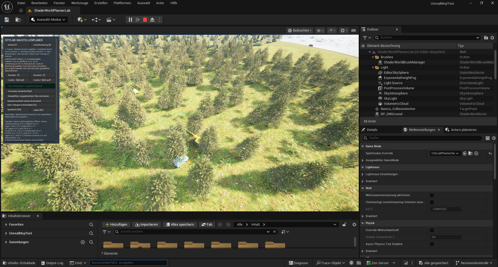

# Baugrube und Aufschuettung selbst planen

Das **Planerlabor** macht aus dem festen Beispiel einen platzierbaren Bauauftrag. Du waehlst Ort, Groesse und Tiefe beziehungsweise Anhebung. Eine gruene Vorschau zeigt ein gueltiges Baufeld. Erst die Bestaetigung speichert den Auftrag; erst der getrennte Arbeitsstart bewegt Erde.

## Voraussetzungen und Einstieg

- Unreal **5.8.4**, ShaderWorld **4.1**, aktueller kompilierter CityLab-Code und eingerichtetes Construction-Hoehenmaterial.
- Einmal `Tools/setup_planner_lab.py` bei gestoppter Vorschau ausfuehren. Das Skript kopiert die bestehende Construction-Karte nach **`/Game/Maps/ShaderWorldPlannerLab`** und setzt den Planer-Spielmodus. Den Ablauf fuehrt der Agent ueber die native Unreal-Schnittstelle aus.
- Die neue Karte oeffnen und **Play** starten. Das Labor verwendet ausschliesslich **`CityLabPlanner`**. Der fertige alte Kreislauf bleibt in seiner Construction-Karte und seinem eigenen Slot.
- Anfangs auf Gelaende und Kollision warten. Ein frischer Planer beginnt leer; es wird kein Beispielauftrag automatisch gebaut.

## Einen Auftrag setzen

1. **Grube** anklicken oder **1** druecken. Maus ueber ebenen, freien Boden bewegen. Die Vorschau folgt mit begrenzter Abfragerate. Gruen bedeutet aktuell gueltig; Rot zeigt den Grund der Ablehnung.
2. Mit **Linksklick** den Mittelpunkt fixieren. Nun kannst du die Maus zum Bedienfeld bewegen, ohne den Ort zu verlieren. Rechtsziehen dient weiterhin der Kamera und bestaetigt keinen Plan.
3. Mit **Groesse +/-** beziehungsweise **Komma/Punkt** ein, zwei oder drei Arbeitszellen je Seite waehlen. Mit **Hoehe +/-** beziehungsweise **Bild auf/ab** in Schritten von 0,25 m zwischen **0,5 und 2 m** wechseln.
4. Einflussflaeche, Ausgangshoehe, Sollhoehe und Materialmenge lesen. Dann **Plan bestaetigen + speichern** oder **Enter**. Die Bestaetigung prueft den Ort erneut und legt einen **pausierten** Auftrag an.
5. **Aufschuettung** beziehungsweise **2** waehlen und ein zweites freies Feld mit befahrbarer Verbindung zum gemeinsamen Lager planen. Die Anzeige nennt Bedarf, vorhandenen Lagerbestand und noch fehlendes Material.
6. **Maschinenarbeit starten** beziehungsweise **Leertaste** und separat **Lkw-Transport einschalten** beziehungsweise **H**. Der Bagger fuellt den begrenzten Quellpuffer; der erste Lkw faehrt zum Lager, der zweite liefert zum Aufschuettfeld. Nur angelieferte Erde hebt dort den Boden.

Eine fluechtige Vorschau verwirfst du mit **Esc**. Ein bestaetigter, noch ungearbeiteter Auftrag kann bei pausierter Arbeit storniert werden. Einen begonnenen Aushub kann man dadurch nicht zurueckzaubern. Stornierung der unbegonnenen Grube entfernt auch ihr noch ungearbeitetes Aufschuettfeld. Materialkonten werden dabei nicht gutgeschrieben.

## Was bedeutet die Groesse?

| Zellen je Seite | Raster | Gesamter Hoeheneinfluss | Integral fuer die Mengenrechnung |
| --- | --- | --- | --- |
| 1 | 4 x 4 m | 8 x 8 m | 16 m2 |
| 2 | 8 x 8 m | 12 x 12 m | 64 m2 |
| 3 | 12 x 12 m | 16 x 16 m | 144 m2 |

Die Raender laufen weich auf den Ausgangsboden aus. Deshalb ist die Menge **nicht Einflussbreite mal Einflussbreite mal Tiefe**. Das Hoehenmodell integriert die ueberlappenden Zellformen. Bei zwei Zellen je Seite und 0,75 m ergeben sich **48 m3 beziehungsweise 86,4 t** bei angenommener In-situ-Dichte von 1.800 kg/m3. Der kleinste Einzelzellauftrag besitzt eine Spitze statt eines ausgedehnten ebenen Grubenbodens. Diese Formen sind ein pruefbares Labormodell; freie Boeschungen und Maschinenformen folgen spaeter.

## Speichern und fortsetzen

Bestaetigte Plaene und laufende Aenderungen werden automatisch gespeichert. **F5/K** speichert ausdruecklich, **F9/L** laedt. Gespeichert werden Auftrag, Zellfortschritt, Maschinenfahrt, beide Lkw-Ladungen, Puffer, Lager und Materialkonten. Die Pause und der Transportschalter bleiben erhalten. Es gibt keine nachtraegliche Offline-Erdarbeit.

Die noch nicht bestaetigte Mausvorschau bleibt fluechtig. Wenn ein Spielstand wegen falscher Weltbindung oder beschaedigter Daten abgewiesen wird, bleibt automatisches Speichern gesperrt. Ein Fehler darf keinen leeren Ersatzspielstand erzeugen.

## Wenn die Vorschau rot bleibt

- **Boden noch nicht bereit:** Kamera in die Naehe bewegen und gerenderte Frames sowie Kollision abwarten.
- **Boden uneben:** Dieser Slice akzeptiert maximal 2 cm Hoehenabweichung ueber dem ganzen Einflussbereich. Auf der flachen Laborflaeche beginnen; Hangbau benoetigt spaeter echte Startproben und eine andere Mengenbeschreibung.
- **Zufahrt blockiert:** Das Labor erzeugt eine feste, mitgepruefte Route. Standort versetzen. Es gibt hier keinen allgemeinen Strassenpfadfinder oder physikalischen Lkw-Verkehr.
- **Strasse, Haus, Grundstueck oder geaenderter Boden:** Baufeld und Korridor muessen frei davon bleiben. ShaderWorld-Vegetation darf erst durch die beginnende Lab-Arbeit freigestellt werden; dabei entsteht noch kein Holz.
- **Unterwasserbau:** Basis und Sollboden muessen mindestens 0,5 m oberhalb des mittleren Meeresspiegels bleiben. Das prueft keine Wellenhoechststaende und ersetzt keine Wasserhaltung.
- **Aufschuettung wartet:** Sie braucht tatsaechlich angelieferten Aushub. Bei mehr Bedarf als verfuegbarer Erde bleibt sie unvollstaendig. Die Anzeige und die Konten sollen genau das zeigen.

## Naechster Slice

Die vereinbarte Richtung ist: **Jedes Scaping-Werkzeug erzeugt einen Plan, den Maschinen ausfuehren.** Anheben, Absenken und Ebnen werden mit dieser Auftrags-/Materialverwaltung verbunden; Materialmalerei braucht zusaetzlich ihre fachliche Ressource und Arbeit. Die bisherigen Foundations-Sofortwerkzeuge sind in diesem Slice noch getrennte Debugwerkzeuge. Weitere Materialien, mehrere Baustellenpaare, freie Routen und variable Boeschungen sind offen.

## Pruefstatus

[Pruefbericht](../evidence/construction-planner-test.json): **36/36 native Tests** bestanden, 34 ohne und zwei mit bekannten Warnungen. Je **vier gerenderte Prozesse uncooked und cooked** prueften die ungearbeitete Einzelgrube, das ungearbeitete Paar, einen gespeicherten beladenen Lkw und den Abschluss mit **86,4 t Einbau / 0 g Bilanzfehler**. Drei weitere Loads erhielten den gesamten Record. Lokale Hoehenproben benutzen ein 5-cm-Gate; groesster passender Messfehler rund 3,002 cm. Initiale Warteproben sind kein akzeptierter Bauzustand. N3 besitzt Mengen-/Vorschau- und nativen Modellnachweis; die gerenderte Erdarbeit nutzt N2, die erste gespeicherte Einzelgrube N1.

Im normalen Planerlabor wurden beide Auftraege ueber die echten Controller-APIs bestaetigt, gespeichert und dreimal vollstaendig identisch geladen. Ungearbeitetes Gelaende blieb passend, 16 andere Slots unveraendert. Die native Slate-Vorschau wurde visuell geprueft. **Die physische Maus-/Tastaturbedienung ist noch offen:** Die native Klick-/Tastensimulation meldete Uebermittlung, bestaetigte aber keinen Auftrag; sie wird nicht als bestandene Eingabeprobe gewertet. Die obige Bedienfolge beschreibt die implementierten Tasten/Buttons. Bei sehr schnellem erneutem Laden wartet das Backend erst auf Bereitschaft; die Abnahme laedt deshalb mit echten Warteschritten.

Der cooked Nachweis nutzte die bestehende Construction-Testkarte mit explizitem Planer-Spielmodus. Die neu gespeicherte PlannerLab-Karte ist im normalen Editor geprueft; fuer ihre eigene Verpackung ist ein neuer Cook erforderlich. Der vorhandene SkipCook-Test ist kein Nachweis eines neu gekochten Kartenassets.

