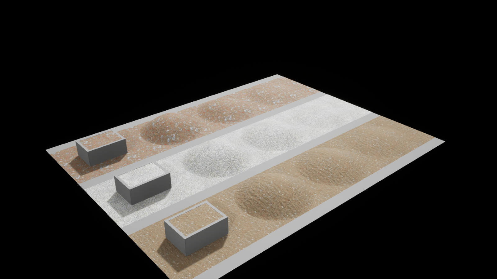
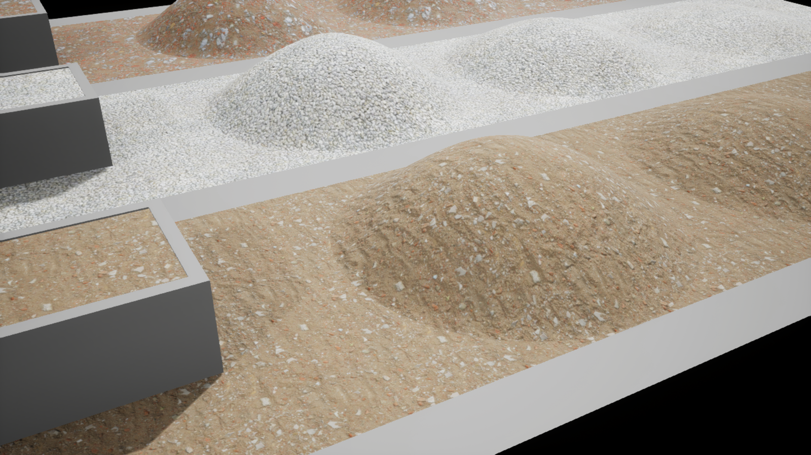
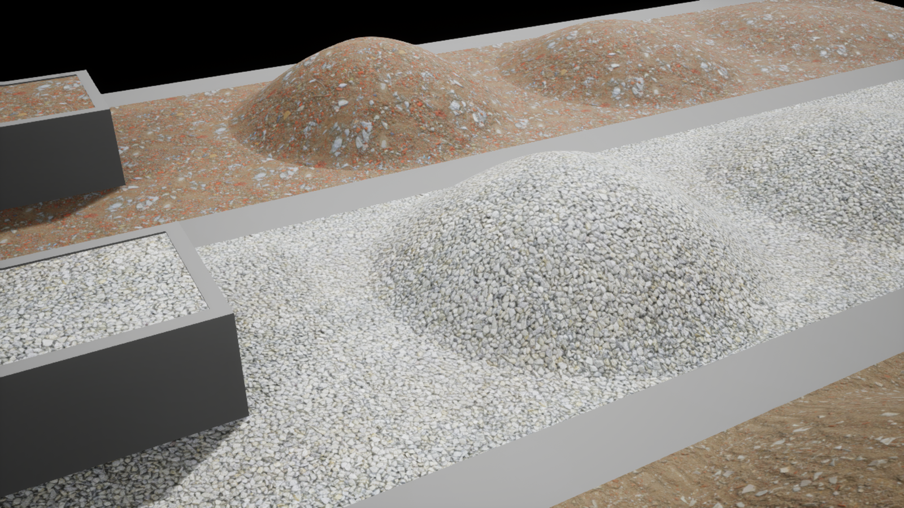
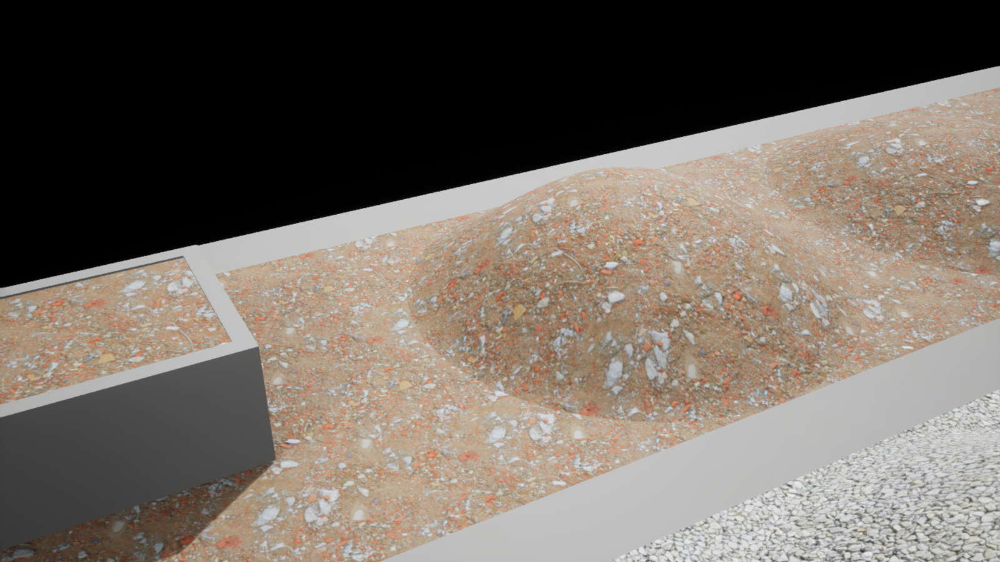

# Erdmaterialien auf Boden, Haufen und Füllungen vergleichen

Die eigene Karte `/Game/EarthMaterialEvaluation/Maps/EarthMaterialEvaluationLab` vergleicht drei Oberflächen auf Bodenstreifen, drei statischen Haufenhöhen und gefüllten generischen Mulden. **Import, unabhängiger gespeicherter Editor-Reload und begrenzter Rendervergleich sind abgeschlossen.** Die Übersicht und drei Detailbilder wurden von koordinierendem und Dokumentationsagenten visuell geprüft; das ist keine menschliche oder Gameplay-Abnahme.[^earth-proof]

Im Vordergrund liegt Ground Rubble, in der Mitte der helle Kies und hinten der rötlichere Bauschutt. Die Bilder sind unveränderte Unreal-Renderoutputs; ihre Herkunft und Hashwerte stehen im [Bildmanifest](../evidence/image-manifest.json).

Voraussetzung ist das projektlokale UnrealMcpTest mit Unreal **5.8.4**. ShaderWorld **4.1** ist im Projekt vorhanden; diese neutrale Materialkarte testet keine neue ShaderWorld-Terrainfunktion. Das öffentliche Bundle enthält keine Fab-Rohtexturen, Archive, Projektdateien oder Unreal-Assets.

## Drei unterschiedliche Materialfamilien

Die Einordnung verbindet die Agentensichtung der tatsächlich heruntergeladenen Basecolor-JPGs mit dem abschließenden gerenderten Vergleich.

| Oberfläche | Sichtbarer Quellinhalt | Sinnvoller erster Einsatz | Hersteller-Kachel |
| --- | --- | --- | --- |
| Ground Rubble | Erde mit Ziegel-, Keramik- und Betonstücken sowie einzelnen Abfallteilen | Gemischter Baustellenboden und entsprechender Mischaushub; kein sauberer Mutterboden | 2,5 × 2,5 m |
| Construction Gravel | Neutraler grau/beiger gebrochener Kies; unter der Laborbeleuchtung sehr hell | Kiesfläche, Kieshaufen und Kiesfüllung | 3 × 3 m |
| Construction Rubble | Rötere, gröbere Ziegel-/Betonmischung | Eigener Bauschutthaufen und Schuttfüllung | 2,5 × 2,5 m |

Alle drei Sets waren beim Erwerb am **29. Oktober 2026** kostenlos. Nach ausdrücklicher menschlicher Zustimmung wurde die **Fab Standard License** im offiziellen Websiteablauf für jedes Set akzeptiert; der Dialog zeigte den Stand **6. April 2025**. Kostenlos bedeutet hier nicht CC0. Der bereinigte Bericht dokumentiert die Erwerbsquelle und Archiv-Hashes; reine Dateiinventare sind keine eigenständigen Lizenznachweise.[^fab-license][^fab-download]

Sand, Lehm und humoser Mutterboden bleiben eigene Materialfamilien. Ein Schuttmaterial für sämtliche Bodenarten würde diese Unterschiede verdecken. Die drei ausgewählten Sets bilden einen begrenzten Vergleich für Baustellenmischboden, Kies und Bauschutt.

## Gerenderter Vergleich

**Ground Rubble** wirkt als schutthaltiger Aushub mit gemischten Bruchstücken. Die Farb- und Normaldetails funktionieren in diesem Versuch, ersetzen aber kein sauberes Mutterbodenmaterial.

**Construction Gravel** ist als erster heller Kies-/Schotterlook gut nutzbar. In der neutralen Laborbeleuchtung erscheint er sehr weiß bis kreidig; Farbe und Belichtung später in der tatsächlichen Spielszene abstimmen. Die gezeigte Ansicht ist keine farbkalibrierte Materialtreueprüfung.

**Construction Rubble** zeigt gut unterscheidbaren röteren Ziegel-/Betonbruch. Auch hier bleiben die einzelnen Brocken Oberflächendetails: Die Haufensilhouette ist glatt, nicht aus geometrischen Einzelsteinen aufgebaut.

## Material, Haufenform und Ladung getrennt planen

Für veränderliche Mengen ist eine gemeinsame Materialbasis auf eigener Haufen- und Füllgeometrie sinnvoll. Die Textur beschreibt die Oberfläche; das Mesh liefert die sichtbare Form. Ein fertiger Scan-Haufen kann als feste Dekoration dienen, passt seine Menge aber nicht automatisch an einen Lagerbestand an.

Ein Material erzeugt weder Aushubvolumen noch Kollision, lose Körner oder eine gespeicherte Massenbilanz. Auch ein deformierbarer Haufen ist ohne gesonderten Anschluss kein Beleg für Laden oder Transport. Die Materialkarte verwendet eine **generische statische Mulde**, kein integriertes Fahrzeug. Der [Maschinenarbeitsplan](../reference/scaping-machine-work-plan.md) und der [Materialkreislauf](closed-material-cycle.md) bleiben getrennte Gameplay-Aufgaben.

## Tatsächlich importierte Daten

Die Offlineprüfung öffnete alle **27 JPGs** vollständig: jeweils **2048 × 2048 Pixel, RGB**. Alle Hashwerte passten zum Akquisitionsinventar; die Quelldateien blieben unverändert. Die mitgelieferten Hersteller-JSONs nennen weiterhin 8192-Pixel-Master und beweisen deshalb nicht die Auflösung der erworbenen 2K-Dateien.[^earth-proof]

Pro Material wurden Basecolor, Normal, Roughness, AO und Displacement als fünf Texturen importiert, zusammen **15**. Displacement bleibt eine **Referenz**; Parallax und geometrische Höhenverformung sind nicht verbunden. Metallic verwendet den geplanten konstanten Wert **0**. Das ist eine Materialentscheidung, kein gemessener Metallkanal.

Der Commandlet-Import endete am **29. Oktober 2026 um 17:57:33 UTC** mit `complete`, ohne Fehler oder Warnungen im eigenen Importbericht. Ein unabhängiger Dateiaudit bestätigte **30 nichtleere Unreal-Pakete** mit gültiger Package-Kennung: 15 Texturen, drei Materialinstanzen, zwei Master-/Neutralmaterialien, neun Meshes und eine Karte. Er prüfte erneut 15 Textur- und neun Geometriequellen sowie Config-/Manifest-Hashes und rekonstruierte den normalisierten Input-Digest. Der anschließende unabhängige Editor-Verifier lud Karte und Assets neu und bestätigte **19 Mesh-Actors, neun Meshes, drei Materialinstanzen und 15 Texturen**, alle Materialzuweisungen sowie Farb-/Normal-/Rauheits-/AO-Parameter. Texturgröße, sRGB, Kompression, deaktiviertes virtuelles Streaming, AO-Schalter und UV-Tiling wurden aus gespeicherten Daten zurückgelesen; alle drei Normaltexturen haben tatsächlich `Flip Green Channel = true`. Im finalen Verifierlauf blieben alle 30 eigenen Paketdateien bytegleich, ohne neue Saves oder PIE/Gameplay.[^earth-proof]

Die Geometrie hat eine UV-Referenz von **250 cm**. Daher beträgt `UVTiling` für Ground Rubble und Construction Rubble **1**, für die 300-cm-Kieskachel **250/300 = 0,833333…**. Alle berichteten Actors haben Skalierung eins. Die XY-Projektion auf Haufen verliert an steilen Flanken effektive Texeldichte; eine gleichmäßige Dichte auf jeder Schrägfläche ist nicht belegt.

## Normalmaps: konkreter Pixelbefund vor allgemeiner Vorgabe

Die aktuelle Fab-Launcher-Anleitung setzt ohne Konventionssuffix DirectX voraus. Die Quixel-Baking-FAQ nennt OpenGL für ihre Ausgangsnormalmaps. Diese Quellen betreffen unterschiedliche Verarbeitungsschritte und zertifizieren die drei konkreten Website-ZIPs nicht.[^fab-normal][^quixel-normal]

Für die erworbenen Dateien wurde deshalb die Normalrichtung mit den Gradienten der zugehörigen Displacement-Map verglichen. Bei positiver X-Kalibrierung ergaben sich native OpenGL-Y-Korrelationen von **0,9611** für Ground Rubble, **0,9246** für Construction Gravel und **0,9011** für Construction Rubble; alle fünf Maßstäbe bestätigen das Vorzeichen. Die klare **OpenGL-Inferenz** begründet die Empfehlung `Flip Green Channel = true` in Unreal. JPEG-Verluste, unterschiedliche Map-Aufbereitung, Höhenpolarität und Tangentenbasis begrenzen diese Methode. Der finale unabhängige gespeicherte Editor-Readback bestätigt diesen Propertywert bei allen drei Normaltexturen.[^earth-proof]

## Im eigenen Editor vergleichen

Die folgende Bedienfolge dient der eigenen Wiederholung. Der vorliegende Nachweis stammt aus automatisiertem gespeichertem Readback und den tatsächlich gerenderten Bildern, nicht aus einer physischen Klick-/Tastaturprobe:

1. Die gespeicherte Karte `EarthMaterialEvaluationLab` im eigenen Projekt öffnen; normale CityLab-Spielkarten und Spielstände gehören nicht zu diesem Versuch.
2. Die Kamera `EarthMaterialEvaluation_Camera` für den Überblick verwenden. Die drei Materialreihen an Bodenstreifen, niedrigen/mittleren/hohen Haufen und den generischen Mulden vergleichen.
3. In den drei Materialinstanzen die Farb-, Normal-, Rauheits- und AO-Zuordnung sowie `UVTiling` prüfen. In den Normaltexturen Normalmap-Kompression, deaktiviertes sRGB und aktiviertes `Flip Green Channel` zurücklesen.
4. Auf vertauschte Rauheit, falsche Stein-/Ziegelskala, invertierte Vertiefungen, sichtbare Kachelwiederholung und verzogene steile Flanken achten. Eine Gesamtansicht ersetzt keine Nahsichtprüfung.
5. Für unverfälschte Wiederholung die eigene Karte ohne Speichern von Teständerungen neu laden. Die Materialkarte ist keine neue normale SaveGame-Schleife.

## Korrigierte Versuche und verbleibende Grenzen

Zwei frühere Commandlet-Versuche scheiterten vor dem Speichern eigener Assets. Zuerst wurden am Static-Switch falsche Pinbezeichnungen verwendet; die geprüften Eingänge heißen `True`/`False`. Danach meldete ein UE-5.8.4-Materialinstanz-Setter `false`, obwohl er den Wert anwendete. Das korrigierte Werkzeug bewertet deshalb den nachfolgenden Getter-Readback der Texturparameter, von `UVTiling` und des AO-Schalters. Die Fehlversuche bleiben als eigene negative Befunde dokumentiert.[^earth-proof]

Beim ersten Editor-Readback war eine Height-Textur noch im Aufbau; die Dimensionsprüfung brach korrekt ab. Nach fertigem Texturbau bestand die Wiederholung. Vor automatischen Texturgrößenprüfungen den Buildabschluss abwarten; eine noch nicht fertige Renderressource nicht als beschädigte Quelle deuten.

Zwei Directional Lights hatten zunächst dieselbe Forward-Shading-Priorität. Nur beim eigenen Key-Licht wurde `forward_shading_priority` von **0 auf 1** gesetzt und ausschließlich die eigene Materialkarte gespeichert. Danach wurden gespeicherter Readback und finale Übersicht erneut erfolgreich geprüft. Der neue Kartenhash ist im Beleg dokumentiert; die übrigen 29 eigenen Paketdateien blieben bytegleich. Hilfswerkzeuge müssen die tatsächlichen Actorlabels und exponierten Propertynamen verwenden; korrigierte Namensannahmen sind kein Fehler der Quellmaterialien.

Der abschließende Schutzvergleich bestätigte **315 geschützte Datei-Hashes** ohne Abweichung; zusätzlich blieben **887 fremde Contentdateien und 152 Paketdateien nach Metadaten** unverändert. Diese zusätzlichen Metadatenvergleiche sind keine Bytehash-Prüfung jener Dateien. Der eigene Editor wurde geordnet beendet; das native Log ist um **18:09:08 UTC** geschlossen. Ein gesonderter OS-Exitcode wird hier nicht behauptet.[^earth-proof]

Die Detailbilder zeigen feine Oberflächenwirkung, doch glatte Silhouetten und die sichtbare Streckung an steilen Haufenflanken bleiben Grenzen. ShaderWorld-Materiallayer, reale Fahrzeugfüllungen, dynamische Haufen, Schaufelkollision, Körnerphysik, normaler Gameplaybetrieb, Leistungsziele und Cook/Packaging wurden hier nicht abgenommen. Der [Prüfstand](../verification.md) trennt diese Grenzen von den vorhandenen CityLab-Abnahmen.

[^earth-proof]: [Bereinigter Erdmaterialbericht](../evidence/earth-material-evaluation.json): Quellen-/Texturprüfung, vollständiger Import, finaler gespeicherter Editor-Readback, vier visuell geprüfte unveränderte Renderbilder und abgegrenzter Dateischutzvergleich.
[^fab-license]: [Fab Standard License](https://www.fab.com/eula); tatsächlicher Erwerb und individuelle Dialogbestätigung sind im bereinigten Bericht dokumentiert.
[^fab-download]: [Offizieller Fab-Downloadablauf](https://dev.epicgames.com/documentation/fab/purchasing-and-downloading-assets-in-fab).
[^fab-normal]: [Fab-Launcher-Aufbereitung](https://dev.epicgames.com/documentation/fab/setting-up-assets-for-fab-in-launcher), Abschnitt Normal Maps Convention.
[^quixel-normal]: [Quixel-FAQ zum Baking](https://dev.epicgames.com/community/learning/courses/y73/unreal-engine-capturing-reality-asset-processing/dXLx/unreal-engine-capturing-reality-frequently-asked-questions-faq?locale=es-es).
