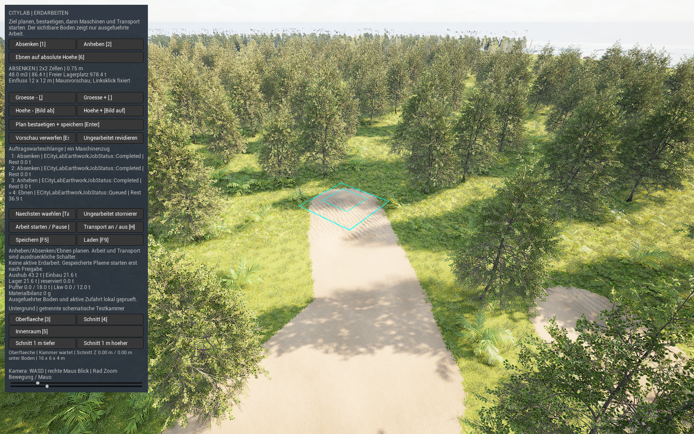
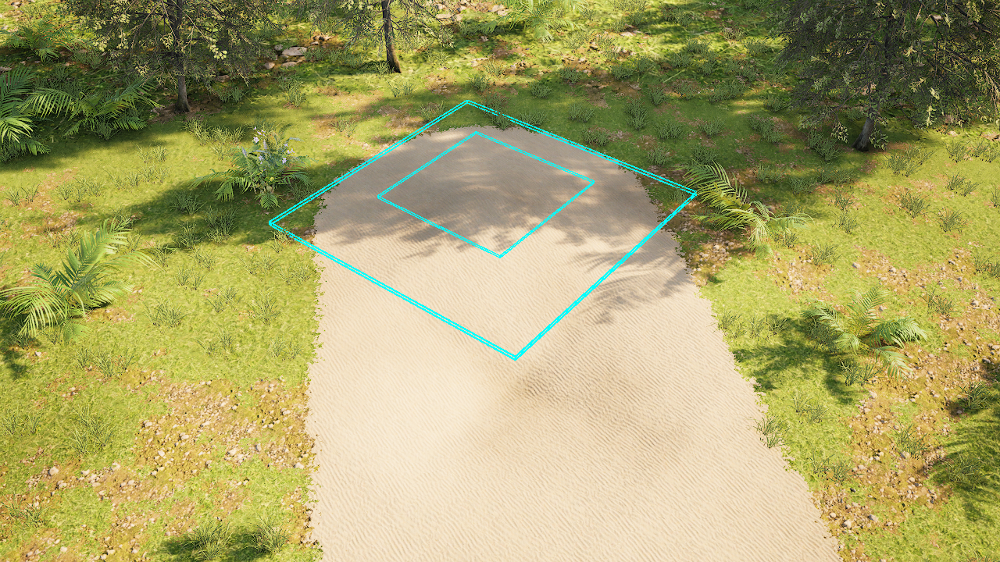
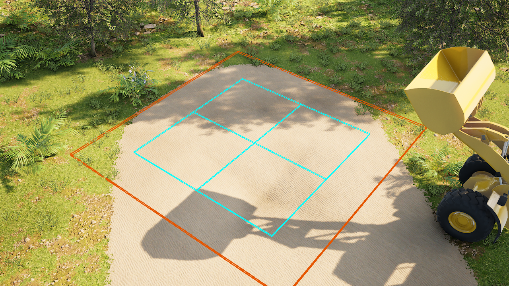
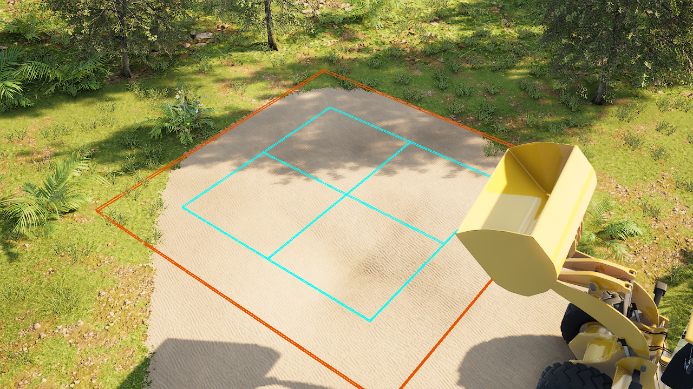
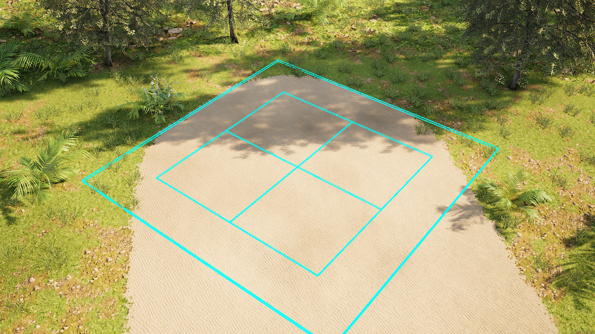

# Unebenen Boden durch Maschinen ebnen

**Ebnen** ergänzt das eigene Erdarbeitslabor um eine feste, absolute Zielhöhe. Ein Buckel liefert Aushub, eine Mulde benötigt Einbaumaterial. Beide Mengen gehören zum selben gespeicherten Auftrag und werden getrennt angezeigt. **52 native Tests und der vollständige gerenderte Uncooked-Neustartlauf sind bestanden:** 12/12 Createchecks und 16/16 Resumechecks. Zwei frühere gerenderte Versuche scheiterten am unveränderten Höhengate; ihre Ursachen und Korrekturen bleiben unten dokumentiert. Die erfolgreiche Laborfassung verwendet das eigene Material v2 und exakt 50 cm Kollisionsabstand. Zusätzlich bestand die normale Controller-API 15/15 Checks. Auch der frisch verpackte Development-Lauf bestand vollständig 12/12 + 16/16. Auch die getrennte sichtbare Demo ist mit 12/12 nativen und 9/9 externen Checks samt agentengeprüfter Slate-Aufnahme bestanden. Physische Eingaben und eine menschliche Abnahme werden nicht behauptet. [Bereinigter Bericht](../evidence/flatten-machine-earthworks-test.json). Die vorhandenen Erfolge für [Anheben und Absenken](machine-earthworks.md) gehören zu dessen eigener Fassung.

## Voraussetzungen und Bedienfolge

Benötigt werden Unreal **5.8.4**, ShaderWorld **4.1**, die neu gebaute CityLab-Fassung und das zugehörige eigene Ebnenmaterial. Die Karte ist **/Game/Maps/ShaderWorldEarthworksLab**, der normale Spielstand bleibt **CityLabEarthworks**. Vor einem Versuch den vorhandenen Stand erhalten. Automatisierte Prüfungen benutzen eigene isolierte Slots.

Die folgende Bedienfolge beschreibt den Codevertrag. Normale Controller-APIs für Zielvorschau, Bestätigung und Laden sind in PIE geprüft; das tatsächliche Slate-Bild ist in der normalen sichtbaren Demo geprüft. Physische Maus- und Tasteneingaben sind nicht abgenommen.

1. Die Karte öffnen, **Play** starten und auf verfügbaren Boden sowie Kollision warten. **Ebnen auf absolute Hoehe [6]** wählen; dadurch kehrt die Ansicht zur Oberfläche zurück.
2. Die Maus über ein freies, begrenztes Arbeitsfeld bewegen. Anfangs folgt die Zielhöhe dem örtlichen Boden. **Linksklick** fixiert Ort und Höhe.
3. Mit **Komma/Punkt** die Größe von **1 bis 3 Zellen je Seite** wählen. Mit **Bild ab/auf** die absolute Zielhöhe in **0,25-m-Schritten** verstellen. Anders als bei Anheben/Absenken bedeutet der Wert eine Welt-Z-Höhe, keinen Betrag relativ zu jedem Bodenpunkt.
4. Zielhöhe, Aushub, Einbau, zusätzlichen Lagerbedarf und freien Lagerplatz lesen. Der Zielunterschied darf an keiner gespeicherten Ausgangsprobe **2 m** überschreiten. Straßen, Grundstücke, Tunnel, Lager und geschützte Zufahrten bleiben Ausschlussbereiche.
5. **Plan bestaetigen + speichern [Enter]** legt den Plan zunächst inert ab. Er verändert noch keinen Boden und schreibt keinen künftigen Aushub gut.
6. Mit **Space** die Arbeit und mit **H** den Transport einschalten. Der Auftrag trägt zuerst seine gesamten Abtragsbereiche ab und lagert die Erde tatsächlich ein. Erst danach liefert derselbe Lkw Material zum Auffüllen.
7. Mit **K/F5** speichern und mit **L/F9** laden. Ein begonnener Auftrag erhält seine Mengen und Geometrie; ein neuer Zielzustand nach ausgeführter Arbeit benötigt einen Gegenauftrag. Der nächste Warteschlangenauftrag startet weiterhin ausdrücklich.

## Eigene Karte für Ebnen einrichten

Ebnen verlangt in dieser Laborfassung **exakt 50 cm Kollisionsabstand** auf der eigenen EarthworksLab-Karte. Der Wert **Collision Resolution** bedeutet hier Abstand in Zentimetern; ein kleinerer Wert ergibt ein dichteres Raster. Anheben und Absenken bleiben mit ihrer bisherigen 100-cm-Konfiguration separat nutzbar. Die neuen Guards sind gebaut; die eigene Karte ist mit 50 cm gespeichert und nach Neuladen bestätigt.[^collision-spacing-source]

Die Einrichtung verändert ausschließlich die eigene, passend markierte Karte und das eigene Material. Andere Laborkarten und Pluginoriginale erhalten ihre Einstellungen.

1. Eigene Änderungen sichern, **PIE beenden** und **/Game/Maps/ShaderWorldEarthworksLab** öffnen. Die Editor-Sitzung darf keinen anderen Auftrag bearbeiten.
2. In Unreals Python-Konsole zuerst den eigenen Materialhelfer ausführen:

   ```python
   import runpy, unreal
   runpy.run_path(unreal.Paths.project_dir() + "Tools/setup_flatten_material.py", run_name="__main__")
   ```

3. Anschließend den begrenzten Kollisionshelfer ausführen:

   ```python
   runpy.run_path(unreal.Paths.project_dir() + "Tools/setup_earthworks_collision.py", run_name="__main__")
   ```

4. Der Helfer verlangt genau ein kollidierendes Terrain und eine bekannte 50-/100-cm-Ausgangseinstellung. Er erhält den ursprünglichen Wert als Metadatum, speichert 50 cm und lädt zur Rückprüfung erst die feste Construction-Quelle und dann EarthworksLab neu. Eine abweichende eigene Konfiguration wird abgewiesen und soll zuerst geprüft werden.
5. Erst nach bestätigtem Kartenreadback und bereitem Terrain erneut Play starten. Gespeicherte Kartenrückprüfung, vollständige Uncooked-/Development-Cooked-Neustartläufe und normale Controller-API sind bestanden. Die normale sichtbare Demo ergänzt den agentengeprüften Slate-Nachweis; physische Eingaben bleiben separat ungeprüft.

50 cm statt 100 cm bedeuten bei vergleichbarer Flächenabdeckung ungefähr **viermal so viele Flächenproben**. Das ist kein gemessener FPS- oder Großweltnachweis. Das 5-cm-Prüfgate bleibt unverändert; die feinere Karte ersetzt seine tatsächliche Abnahme nicht.

## Die getrennte Demo starten

Die vorbereitete Demo verwendet einen bytegleich aus dem erfolgreichen Cooked-Lauf übernommenen Ready-Spielstand unter **Saved/FlattenDemoUser**. Ihr eigener Slot heißt **CityLabEarthworks**. Diese Datenablage ist vom normalen Laborstand getrennt; der Launcher ersetzt keinen vorhandenen Spielstand und setzt späteren Fortschritt nicht automatisch zurück.

1. Im Projektverzeichnis PowerShell öffnen. Der abgenommene verpackte Spielbuild, sein Demo-Manifest und der vorbereitete Demospielstand müssen bereits vorhanden sein.
2. Den vorhandenen Launcher ausführen:

   ```powershell
   .\Tools\launch_flatten_demo.ps1
   ```

3. Das normale sichtbare Spiel öffnet das vorbereitete Buckel-/Muldenprofil. Die Warteschlange enthält drei fertige Profilaufträge und den ausgewählten vierten Auftrag **Ebnen**, N2, absolute Zielhöhe **300 cm**, noch ohne ausgeführte Arbeit. Im Lager liegen **21,6 t echte Erde**; Arbeit ist pausiert und Transport aus.
4. Für diesen bereits ausgewählten Auftrag laut Controllervertrag **Space** für Arbeit und **H** für Transport einschalten. Die Werkzeugdetails oben dürfen zunächst **Absenken** zeigen: Sie beschreiben die nächste neue Planung. **Ebnen [6]** öffnet eine neue Vorschau und ist zum Starten des vorhandenen vierten Auftrags nicht erforderlich.
5. **F5/F9** speichern beziehungsweise laden ausschließlich den eigenen Demospielstand. Absichtlich erspielter Fortschritt bleibt dort erhalten. Fehlende oder geänderte Paketdateien führen zur Meldung des Launchers; bestehende Spielstände werden dabei nicht neu besät oder überschrieben.

Der Launcher prüft vor dem Start SHA-256 für **das Spielprogramm und sämtliche fünf Pak-/IoStore-Dateien**. Die veränderbare Demodatei gehört nicht zu dieser unveränderlichen Paketversiegelung. Die optionale Ausführung mit **-Audit** ergänzt ausschließlich einen lesenden Bericht und eine native SHOWUI-Aufnahme; sie startet keine Arbeit, sendet keine Eingaben, speichert nicht und beendet das Spiel nicht.

Diese normale sichtbare **Development-Cooked-Demo** bestand **12/12 native Checks in 4,902078 s** und **9/9 externe Prüfungen**. Ihr vollständiger Modellzustand und ursprünglicher nativer Modellhash entsprechen exakt dem erfolgreichen Cooked-Ready-Checkpoint. Die externe Rückprüfung bestätigte **109 unveränderte ursprüngliche Save-Dateien** und die weiterhin versiegelten sechs Paketdateien. Das beschleunigte Profil dient dem Laborversuch; es misst keine normale Maschinenproduktivität.



Die unveränderte **1600 × 1000-SHOWUI-Aufnahme** wurde vom koordinierenden und Dokumentationsagenten visuell geprüft. Sichtbar sind das eigene Terrain, die Slate-Leiste, ausgewählter Queueauftrag **4: Ebnen**, **21,6 t Lager** und **0 g Materialbilanz**. Die oberen Werkzeugdetails zeigen noch **Absenken**; das ist keine bereits aktivierte neue Ebnenvorschau. Dieser Bild- und Zustandsnachweis ersetzt keine tatsächliche physische Tastatur-/Mausbedienung und keine menschliche Abnahme.

## Welche Fläche eben wird

| Größe | Ebene Kernfläche | Gesamte Einflussfläche |
| --- | --- | --- |
| N1 | 4 × 4 m | 8 × 8 m |
| N2 | 8 × 8 m | 12 × 12 m |
| N3 | 12 × 12 m | 16 × 16 m |

Um den Kern liegt je Seite eine **2 m breite Schulter**. Dort läuft die Änderung zum ursprünglichen Boden aus. Die gesamte Einflussfläche soll deshalb kein gleich hoher Block werden. Dieses neue Ebnenprofil unterscheidet sich von den bisher verwendeten einzelnen Höhenbeiträgen für Anheben und Absenken.

Der Plan friert den gemessenen Ausgangsboden auf einem **1-m-Raster** ein. Jede Rasterkachel besitzt zwei fest angeordnete Dreiecke. Die Zieländerung ist innerhalb jedes Dreiecks linear; auf der Kernfläche führt sie im Modell zur absoluten Zielhöhe, an der Außenkante zu keiner Änderung. Die Vorschau und ihre erneute Prüfung akzeptieren das Feld nur, wenn tatsächliche **50-cm-Kollisionsproben** höchstens **5 cm** vom eingefrorenen Dreiecksprofil abweichen. Im Kern muss auch der vorausberechnete Endboden innerhalb von 5 cm zur absoluten Zielhöhe liegen. Vor Bestätigung beziehungsweise Arbeitsstart dürfen die ursprünglichen Rasterproben außerdem nicht mehr als **3 cm** abgewichen sein. Diese lokalen Stichproben erlauben keine Aussage über beliebige kleinere Unebenheiten zwischen allen geprüften Punkten. Eine gültige Rasterbeschreibung allein beweist noch nicht die fertig projizierte physische Fläche.[^flatten-runtime]

## Material und Arbeitsfolge

Die Mengen stammen aus derselben geplanten Form, die anschließend auf das Terrain projiziert wird. Die Dreiecke werden an der Grenze zwischen Abtrag und Einbau geteilt. Beide räumlich getrennten Anteile besitzen ihr eigenes Volumen. Entgegengesetzte alte Höhenbeiträge werden vor dieser Rechnung zusammen betrachtet; ihre Überlappung darf nicht doppelt als Abtrag und Einbau berechnet werden.[^flatten-model]

Beim Start müssen zwei Bedingungen gleichzeitig gelten:

- Im Lager ist Platz für **den vollständigen Aushub**, auch wenn der spätere Einbau viel davon wieder verbraucht.
- Der zusätzliche Bedarf **Einbau minus Aushub**, mindestens null, liegt bereits als echter Bestand im gemeinsamen Lager.

Diese Startprüfung verändert den tatsächlichen Bestand noch nicht. Geplanter Aushub bleibt bis zur Lkw-Entladung zukünftige Arbeit. Erst wenn alle Abtragsmengen eingelagert und Puffer sowie Lkw geleert sind, reserviert der Auftrag den vollständigen Einbaubedarf aus dem dann vorhandenen Bestand. Überschuss bleibt nach Abschluss im Lager. Ein reiner Abtrags- oder Einbauauftrag nutzt denselben Ablauf mit nur einer wirksamen Phase; eine bereits passende Fläche benötigt keine Erdbewegung.

**Die Erdarbeit ist im Labor als verteilter Flächenfortschritt dargestellt.** Während der Abtragsphase sinken alle Abtragsbereiche proportional zur erreichten Menge; während der Einbauphase wachsen entsprechend alle Einbaubereiche. Die Fahrzeugdarstellung nennt repräsentative Arbeitsorte. Sie bildet keine einzeln simulierten Schaufelladungen oder lokal vorrückenden Baggerspuren ab.

Die gemeinsame Bilanz verwendet ganzzahlige Gramm und dieselbe definierte Bodendichte. Die integrierten Mengen werden je Abtrags- beziehungsweise Einbauphase einmal auf Gramm gerundet. Das ist eine genaue Bilanz dieses Modells; eine unabhängige Vermessung des quantisierten ShaderWorld-Terrainmeshvolumens ist damit nicht verbunden. Ein tatsächlich von null verschiedener Phasenanteil, der auf 0 g gerundet würde, wird abgewiesen.

## Speichern und bestehende Aufträge

Das übergeordnete SaveGameformat bleibt **6**. Der interne Earthworks-Snapshot erhält erst mit einem Ebnenplan **Version 2**. Historien mit ausschließlich Anheben/Absenken dürfen weiterhin Version 1 verwenden; ihr bisheriger Raster- und Fingerprintvertrag bleibt im geprüften Quellcode erhalten. Eine unveränderte Kopie eines tatsächlichen alten Version-1-Spielstands mit ungearbeitetem Absenkplan wurde zusätzlich über den normalen PIE-Autoload geladen; sie wurde dabei nicht neu geschrieben. Dieser Einzelfall beweist keine Migration jedes archivierten Binärspielstands.

Gespeichert werden unter anderem absolute Zielhöhe, Ausgangs- und Referenzraster, getrennte erforderliche und erreichte Abtrags-/Einbaugramm, Einlagerungen, Materialbezug, Ladungen und Fahrzustand. Der vollständige Uncooked-Lauf stellte beide beladenen Fahrzustände nach einem echten Prozessneustart exakt wieder her. Drei weitere Loads bewahrten Zustand und eindeutige Projektion; beide gespeicherten Fortsetzungen endeten mit identischen Auftragsverläufen und Materialkonten. Vor weiterer Erdarbeit wartet die Komponente auf ihren lokalen Kollisionsnachweis.

## Fehlerhilfe und derzeitiger Prüfstand

### Erster negativer Terrainversuch und Korrektur

Der erste gerenderte uncooked Lauf blieb in der Abtragsphase stehen: Am geprüften Punkt **(-11800, -5000) cm** lag der reale Boden weiter bei **336,00 cm**, erwartet waren **324,02 cm**. Der lokale 5-cm-Nachweis hielt die weitere Arbeit deshalb an. Der isolierte Prüfprozess wurde gezielt beendet; ein fertiger nativer Abschlussbericht entstand in diesem Versuch nicht. Die Fehlermeldung des äußeren Prüfers über den fehlenden Bericht darf nicht als bestandene Runde oder pauschaler Absturz des Spiels gelesen werden.

Die anschließende Quellenprüfung zeigte eine konkrete Ursache: Der untersuchte ShaderWorld-4.1-Pfad überträgt Vektorparameter über einen dreikomponentigen FVector. Die ursprüngliche vierte Komponente bleibt dadurch nicht erhalten. Das erste eigene Material las die Rasterseite aus **FlattenGrid.w**; statt der benötigten **13** kam **1** an. Seine Schutzbedingung ließ die eingehende Höhe dann unverändert.[^vector-parameter-source]

Das eigene **Materialbackend v2** liest Rasterbreite und -höhe direkt aus der Deltatextur und verlangt eine quadratische Textur. Der Vektor enthält fachlich nur noch Ursprung X/Y und Rasterabstand. Der Einrichtungshelfer migriert ausschließlich einen exakt erkannten eigenen v1-Graphen; unbekannte oder abweichende vorhandene Materialien werden erhalten. Die Korrektur betrifft das eigene Material und seinen Helfer, keinen Pluginpatch oder C++-Neubuild. Material v2 veränderte im zweiten Lauf tatsächlich das Terrain. Dieser Lauf scheiterte an der separaten unten beschriebenen 100-cm-Kollisionsgrenze. Beide negativen Läufe bleiben im [Bericht](../evidence/flatten-machine-earthworks-test.json) erhalten.


### Zweiter negativer Versuch: physisches 100-cm-Raster

Mit Material v2 blieb der zweite gerenderte Lauf erneut in der Abtragsphase stehen: Am Punkt **(-11850, -5150) cm** lagen **293,00 cm Ist** gegenüber **299,00 cm Soll** vor. Das 5-cm-Gate hielt die Arbeit an. Auch dieser isolierte Prozess wurde gezielt beendet, ohne fertigen nativen Abschlussbericht.

Die CPU- und GPU-Formeln können übereinstimmen, während das physische Dreiecksmesh dazwischen eine andere Höhe besitzt: Die 100-cm-Kollision verbindet bereits abgeschnittene Vertexhöhen über die Grenze von Abtrag und Einbau. Ein solcher Verlauf entspricht im Dreiecksinneren nicht immer dem kontinuierlich interpolierten und erst danach abgeschnittenen Änderungsfeld. Eine unabhängige synthetische Rechnung zeigte für den kontrollierten Profiltyp rund **6,128 cm** Unterschied; sie ist keine zweite Messung des konkreten 293/299-cm-Punkts.

Die aktuelle Korrektur verwendet ausschließlich im eigenen EarthworksLab 50 cm Abstand. Vorschau, erneute Planprüfung und das atomare Laden von Ebnenrecords verlangen diesen Wert exakt. Bestehende Anheben-/Absenkenfälle dürfen weiterhin 100 cm verwenden. Die neuen Guards und die gespeicherte Kartenrückprüfung bestanden. Die dritte Uncooked-Runde bestand anschließend vollständig mit 12/12 Create- und 16/16 Resumechecks. Die beiden früheren Negativbefunde bleiben erhalten; das 5-cm-Gate wurde nicht gelockert. Auch der frische Development-Cooked-Lauf bestand anschließend vollständig.

Auch bei 50 cm bleibt der Nachweis begrenzt: Die 50-cm-Kernproben liegen dann auf physischen Kollisionsvertices. Die zusätzlichen 25-/75-cm-Schulterproben prüfen weiterhin Punkte dazwischen. Die insgesamt 377 unabhängigen Prüfpositionen belegen weder jede feinere Zwischenhöhe noch beliebige steile Mischprofile oder unabhängig vermessenes Meshvolumen.

| Meldung oder Verhalten | Vorgehen |
| --- | --- |
| Zielhöhe mehr als 2 m vom erfassten Boden entfernt | Zielhöhe näher an den Boden legen oder eine kleinere Fläche wählen. |
| Nicht genug freier Lagerplatz | Zuerst vorhandenen Bestand verbrauchen oder den Auftrag verkleinern. Auch bei netto kleinem Bedarf muss zunächst der gesamte Abtrag Platz finden. |
| Zusätzlicher Bedarf nicht vorhanden | Vorher tatsächliche Erde einlagern. Ein wartender Abtragsplan finanziert den Auftrag nicht. |
| Aushub fertig, Auffüllen beginnt noch nicht | Restliche Ladungen und den Puffer vollständig zum Lager bringen; Transport muss eingeschaltet sein. |
| Ausgangsboden verändert | Einen ungearbeiteten Plan mit frischer Vorschau revidieren. Ausgeführte Arbeit bleibt bestehen. |
| Physischer Boden passt zwischen Rasterpunkten nicht | Die Fläche darf noch nicht als abgenommen gelten. Unabhängige Bodenproben und Darstellung prüfen. |
| Arbeit wartet dauerhaft, die geplante Änderung erscheint überhaupt nicht | Eigenes Materialbackend v2 und seinen Rastergrößenbezug prüfen. Der erste v1-Versuch verlor die vierte Vektorkomponente. Das Höhengate erhalten; keine Arbeit ohne passende reale Kollision freigeben. |
| Ebnen verlangt genau 50 cm Kollisionsabstand | Die eigene Karte mit dem beschriebenen Kollisionshelfer einrichten und speichern/neuladen. Nicht andere Karten pauschal umstellen. |

Die erste kompilierte Gesamtsuite bestand **52/52 Tests in 3,6806469 s**: **50 ohne Warnungen**, zwei mit den bekannten Warnungen aus Testwelt-Cleanup und absichtlicher Ablehnung alter AppliedPaint-Daten; kein Test fehlgeschlagen, nicht ausgeführt oder noch laufend. Die sechs neuen Ebnenfälle sind ohne Warnungen und Fehler erfolgreich. Sie prüfen das absolute Ziel, getrennte Dreiecksmengen, überlappende frühere Änderungen, echten Fehlbestand, Puffer, Phasenwechsel, beladene Fahrten, wiederholtes logisches Laden, Null-/Einzelphasen, beschädigte Snapshots und den alten Version-1-Vertrag.

Die ersten Builds bestanden in **78,25 s für Editor** und **69,14 s für Game**. Auch die folgenden Builds nach den Darstellungs- und Demostandänderungen bestanden: **Editor 59,30 s**, **Game 72,36 s**. Auch die anschließenden Builds mit 50-cm-Kollisionsguard bestanden: Editor 168,47 s und Game 184,08 s. Der anschließende Neubuild mit zusätzlicher optionaler, rein lesender Demo-Prüfung bestand ebenfalls: Editor 49,04 s und Game 69,80 s. Der Buildbeleg ist von den unten aufgeführten tatsächlichen Demo- und verpackten Laufzeitberichten zu unterscheiden. Mengenmodell und Modelltests blieben seit dem nativen Bericht unverändert; eine zusätzliche native Wiederholung nach den UI-/Ready-Änderungen wird nicht behauptet. Die native Suite belegt Mengenmodell und kontrollierte Fixtures. Sie bestätigt weder die neue GPU-Projektion noch echte Prozessneustarts, physische Eingaben oder das verpackte Ebnen.

Der anschließende vollständige **Cook/Stage/Archive** für Development/Win64 bestand mit **BuildCookRun 135,22 s**, rund **137 s AutomationTool** und **Exit 0**. Der Cook meldete **0 Fehler und fünf bekannte geerbte Level-Blueprint-Warnungen**; diese Warnungen bleiben erhalten. Ein zusätzlicher Snapshot erfasst die 13 finalen Quellen nach dem Auditbuild samt Cook, während der historische Uncooked-Snapshot unverändert bleibt. Der getrennte gerenderte verpackte Laufzeitbericht liegt inzwischen erfolgreich vor; der Cookbeleg allein wäre dafür nicht ausreichend.

Der Helfer **Tools/verify_flatten.py** prüfte zwei getrennte gerenderte Prozesse mit eigenen Slots und eigener Pythonrechnung für die vorzeichenabhängigen Dreiecksmengen und Konten. Nach den beiden negativen Versuchen bestand die dritte Runde mit Material v2 und exakt 50 cm physischer Kollision vollständig: **Create 12/12 in 149,660905 s**, **Resume 16/16 in 137,881385 s**, äußerer Prüfer Exit 0. Die tatsächliche, quantisierte Ausgangsform erforderte **18.072.546 g Abtrag** und **18.835.039 g Einbau**; bei **21.600.000 g echtem vorhandenen Lagerbestand** betrug der zusätzliche Bedarf **762.493 g**. Diese Werte sind von der idealen symmetrischen nativen Modellfixture zu unterscheiden.

Die erste Phase speicherte den ungearbeiteten Ready-Stand und je eine beladene Abtrags-/Einbaufahrt mit **12 t im Lkw**. Der frische zweite Prozess stellte beide vollständigen Checkpointrecords exakt wieder her, setzte die jeweilige Restarbeit fort und bestand **drei weitere Loads** ohne doppelte Geometrie oder Buchung. Beide Wege endeten mit identischen Aufträgen und Materialkonten. Der gesamte Abtrag war vor dem ersten Einbaubezug tatsächlich eingelagert. Planung blieb inert; Außenkontrollen blieben erhalten. Alle **1.768 beobachteten Bilanzen** hatten **0 g Fehler**; **19 beobachtete normale Save-Dateien** blieben per Hashvergleich unverändert.

| Endkonto beider Fortsetzungen | Exakter Wert |
| --- | --- |
| Lagerbestand | **20.837.507 g** |
| Reservierung, Baustellenpuffer, Lkw | jeweils **0 g** |
| Insgesamt ausgehoben und eingelagert, einschließlich der drei Profilaufträge | jeweils **61.272.546 g** |
| Insgesamt eingebaut und bezogen, einschließlich der Profilaufträge | jeweils **40.435.039 g** |
| Bilanzfehler | **0 g** |

Die Höhenprüfung erfasste **377 verschiedene Positionen**: ein 50-cm-Kernraster, Schulterpunkte mit 25-/75-cm-Versatz und Außenkontrollen. Über beide Prozesse bestanden **79 akzeptierte Messsätze mit 29.783 wiederholten Einzelmessungen**. Der größte Fehler zur unabhängig erwarteten lokalen Höhe betrug **2,126816 cm** bei unverändertem **5-cm-Gate**. Am fertigen Kern lag die größte gemessene Abweichung zur absoluten Zielhöhe **300 cm** bei **2,000046 cm**. Die 50-cm-Kernpunkte sind auf dieser Karte physische Kollisionsvertices; Schulterpunkte prüfen zusätzlich einige Zwischenhöhen. Das ist kein durchgehender Oberflächen-, beliebiger Profil- oder unabhängiger Meshvolumennachweis.

Die folgenden vier Originalaufnahmen wurden unverändert übernommen und vom koordinierenden sowie vom Dokumentationsagenten visuell geprüft. Sie zeigen das eigene Spielterrain und den jeweiligen erreichten Zustand. Die farbigen Linien sind Planmarkierungen; die Bilder enthalten weder Messpunkt-Overlay noch normales Bedienfeld. Höhen und Materialmengen werden durch die getrennten Berichte belegt. Herkunft, Bytezahlen und SHA-256 stehen im [Bildmanifest](../evidence/image-manifest.json). Die eigenen Quellen und Berichtshashes sind im [Bericht](../evidence/flatten-machine-earthworks-test.json) festgehalten; Rohberichte und Spielstände bleiben außerhalb des öffentlichen Bundles.

### Frisch verpackter Development-Lauf bestanden

Nach dem vollständigen Cook liefen zwei neue innere Game-Prozesse mit **RequiresCookedData = true**. Sie bestanden **12/12 Createchecks in 125,035661 s** und **16/16 Resumechecks in 102,710287 s**, äußerer Prüfer Exit 0. Beide beladenen Checkpoints wurden im frischen Prozess vollständig identisch geladen; beide Restarbeiten endeten mit denselben Aufträgen und Konten. Drei weitere Loads erhielten den Stand und die eindeutige Projektion. Der unabhängige Python-Prüfer bestätigte dieselben tatsächlichen **18.072.546 g Abtrag / 18.835.039 g Einbau** und dieselben Endkonten wie Uncooked: **20.837.507 g Lager**, Reservierung/Puffer/Lkw jeweils 0 g.

Alle **1.712 beobachteten Cooked-Bilanzen** hatten 0 g Fehler; **19 beobachtete normale Save-Dateien** blieben per Hashvergleich unverändert. **77 akzeptierte Messsätze mit 29.029 wiederholten Höhenmessungen** an **377 verschiedenen Positionen** bestanden das 5-cm-Gate. Maximaler lokaler Fehler und Abweichung des fertigen Kerns blieben **2,126816 cm** beziehungsweise **2,000046 cm**. Diese Messung gilt für die begrenzte 50-cm-Laborkarte. Sie erweitert den Nachweis auf die frisch verpackte Development-Fassung; Shipping, beliebige Mischprofile, durchgehende Oberflächen, unabhängiges Meshvolumen und Leistung sind damit nicht geprüft. Die folgende Bildfolge bleibt ausdrücklich die bereits visuell geprüfte Uncooked-Runde.

### Normale Controller-API separat geprüft

Ein eigener frischer Editor-/PIE-Lauf bestand **15/15 Checks in 112,656 s**, mit normalem Controller außerhalb des Verifiermodus. Er lud zuerst eine bytegleiche Kopie des tatsächlichen alten Version-1-Absenkstands, danach den vorbereiteten Version-2-Ready-Stand mit vier Aufträgen, **21,6 t echtem Vorrat**, pausierter Arbeit und ausgeschaltetem Transport. Eine normale Zielvorschau auf **325 cm absolute Höhe** ließ den vollständigen Maschinenzustand unverändert. Bestätigen fügte ausschließlich einen fünften ungearbeiteten Ebnenauftrag hinzu und speicherte nur die isolierte Kopie; vorhandene Aufträge, Geometriefortschritt und Konten blieben identisch.

Drei normale Loads stellten den bestätigten Gesamtzustand und seinen kanonischen SHA-256 jeweils exakt wieder her. Das Projektionsbackend wurde wieder bereit, ohne den Zustand weiterzuarbeiten. Die **19 beobachteten normalen Save-Dateien**, der Originalstand und der Ready-Ursprung blieben unverändert; PIE wurde tatsächlich beendet, der Editor endete nativ mit Exit 0. Der Lauf benutzte die vorherige gebaute Guardfassung. Spätere Demo-/Auditänderungen sind dadurch nicht mitgeprüft.

Die drei zusätzlichen 933 × 452-PNGs dieses API-Laufs enthalten nur den Spielterrain-Viewport; daraus folgt keine Abnahme der Slate-Leiste oder physischer Eingaben. Sie werden hier nicht als weitere UI-Bilder übernommen; der tatsächliche normale Slate-Nachweis stammt aus der getrennten sichtbaren Demo oben. Ein früherer UI-Prüfversuch scheiterte an seiner Capture-Anforderung: Die SHOWUI-Aufnahme zeigte einen alten blauen Editor-Viewport statt der beabsichtigten laufenden Oberfläche. Dieser erhaltene Harnessbefund ist weder ein Funktionsfehlernachweis des Ebnenwerkzeugs noch ein gültiges Erfolgsbild.

### Bildfolge des erfolgreichen Uncooked-Laufs

**Vor dem Ebnen:** Das vorbereitete Buckel-/Muldenprofil innerhalb des markierten Arbeitsfelds.



**Abtragscheckpoint:** Erreichter Zwischenstand während der gespeicherten beladenen Abtragsfahrt. Der Bericht erfasst zu diesem Zeitpunkt 12 t im Lkw.



**Einbaucheckpoint:** Erreichter Zwischenstand nach vollständiger Einlagerung des Abtrags und während der gespeicherten beladenen Einbaufahrt. Der Bericht erfasst erneut 12 t im Lkw.



**Nach dem kalten Neustart fertiggestellt:** Erreichter Kern mit auslaufenden Schultern; die Zielhöhe ist separat durch lokale Kollisionsproben geprüft.



Die Anleitung ist für diesen begrenzten Laborvertrag **stable**: Mengenmodell, Uncooked-/Development-Cooked-Neustarts, normale Controller-API und sichtbare Demo mit Slate-Leiste sind durch getrennte Belege gedeckt. Physische Maus-/Tasteneingaben und menschliche Prüfung sind nicht erfolgt. Keine allgemeine Bodenarten-, Verdichtungs-, Grundwasser-, Großwelt-, Leistungs- oder Schaufelphysikabnahme ableiten.

[^flatten-model]: Eigener Mengenmodell- und Testcode gemäß Quellenbeschreibung, unabhängig lesend geprüft. Ausgeführte erste Gesamtsuite und Grenzen stehen im [bereinigten Bericht](../evidence/flatten-machine-earthworks-test.json).
[^flatten-runtime]: Eigene Runtime- und Verifierquellen gemäß Quellenbeschreibung; der vollständige Uncooked-Lauf ist bestanden; normale Controller-APIs sind separat 15/15 geprüft; Uncooked, frisches Development-Cooked und sichtbare Demo mit Slate-Pixeln sind bestanden; physische Eingaben und menschliche Prüfung sind nicht erfolgt.
[^vector-parameter-source]: Separat lizenzierter lokaler 4.1-Code gemäß Quellenbeschreibung, nur lesend geprüft; keine Pluginänderung.
[^collision-spacing-source]: Separat lizenzierter lokaler 4.1-Code gemäß Quellenbeschreibung; Abstand und physische Rasterprojektion sind Quellbefunde. Die begrenzte 50-cm-Korrektur bestand die vollständige Uncooked-Neustartabnahme.
