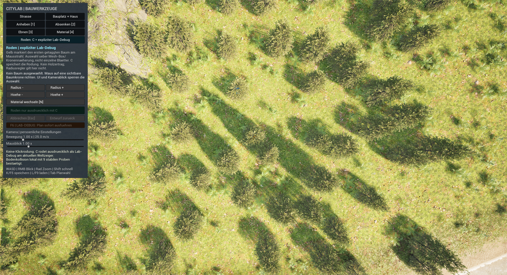
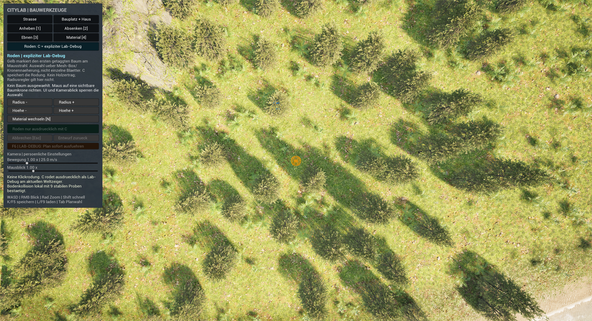
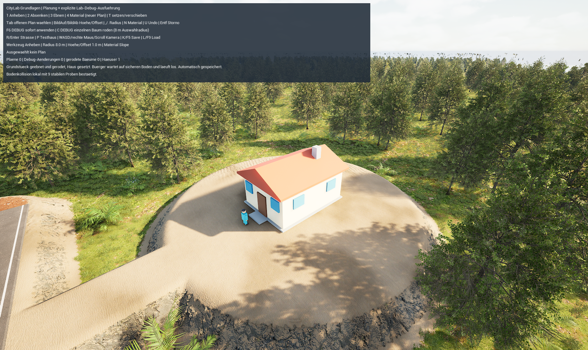
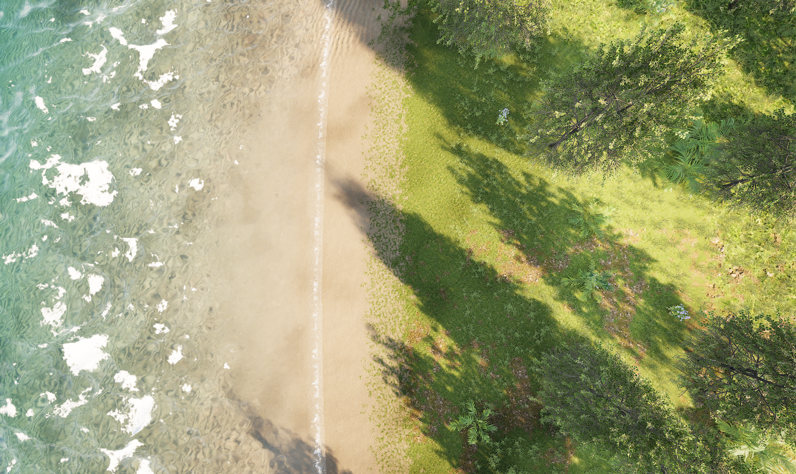
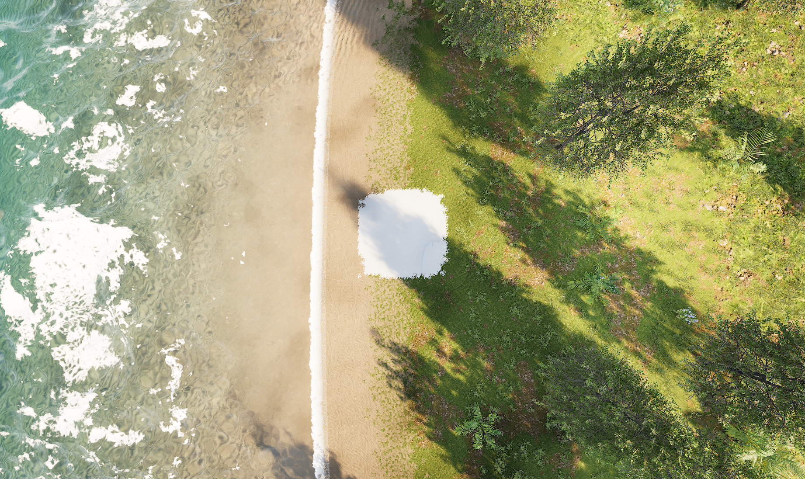
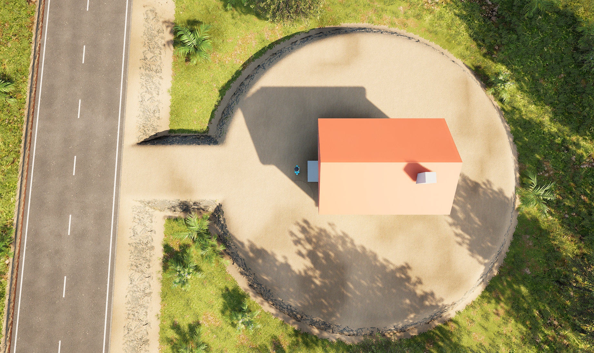

# Foundations mit Planung, Biomen und Einzelrodung kennenlernen

**Foundations besitzt getrennte Neustart-, Paint- und Rodungsnachweise.** Die frühere Black-/Zero-Flow-Fassung erreichte je **29/29 und 12/12 Checks** in zwei frischen uncooked und zwei frischen verpackten Spielprozessen. Im normalen PIE blieb der Snow-Bereich nach **T/F6/K/L** sichtbar; das geschützte Grundstück blieb Sand und ohne nachgewachsenen Bewuchs im geprüften Bild. Kern-/Seitenmasken und die CPU-Daten von Waldkontrolle und Einzelrodung bestanden zusätzlich die nativen Tests. Diese Rodungswerte sind kein Beleg für das Verschwinden desselben Baums im GPU-Spielbild. Ältere Spline- und White-Datamap-Läufe bleiben als historische Versuche mit bekannten Lücken dokumentiert.[^foundations-proof][^normal-ui]

Die getrennte Lernkarte **`/Game/Maps/ShaderWorldFoundations`** ist eine Kopie der vorhandenen CityLoop-Grundlage. Ihr eigener Spielmodus heißt **CityLabFoundationsGameMode**, ihr Spielstand-Slot **CityLabFoundations**. Die [bisherige CityLoop-Karte](city-builder-loop.md) und ihr Slot bleiben getrennt. Das öffentliche Wissensbundle enthält die Anleitungen, aber nicht das native Unreal-Projekt und seine Kartenassets.[^controls]

**Neue Bedienfassung mit begrenzter Abnahme:** Die [Baukamera-/Toolbar-Anleitung](build-controls.md) zeigt die finale lesbare Leiste und erklärt persönliche Regler sowie kontextbezogenes Bestätigen. Die damaligen elf nativen Tests, normale Slate-Fokus-/Planbestätigung, Esc-Abbruch, Bauplatzvorschau und PIE-Wiederherstellung sind erfolgreich. Nach der Baumkorrektur bestanden zwölf native Tests und erneut zwei cooked Prozesse mit 29/29 Checks in 120,5 s und 12/12 in 70,8 s; die Rodungsbilder sind eine getrennte Backendprobe im normalen PIE. Längeres reales WASD/Shift/RMB und Alt-Tab bleiben offen; die nachfolgenden älteren Bilder bleiben ihre eigenen Nachweise.[^build-controls]

## Aktueller Rodungsbefund: Datenzustand und Spielbild trennen

Der Nutzer meldete: **C zeigt eine erfolgreiche Rodung, aber der Baum steht noch.** Die früheren Prüfungen zählten CPU-Instanztransforms mit nicht-null Skalierung. Ihr Wert 0 belegte keinen bereits aktualisierten Renderpuffer. Außerdem suchte C den nächsten Stamm innerhalb von 8 m um einen Bodenpunkt; der Baum unter dem Zeiger war damit nicht eindeutig ausgewählt. Die alten Prozessläufe bleiben CPU-/Physik-/Persistenznachweise. Die vorhandenen Snow- und freigehaltenen Grundstücksbilder sind getrennte, tatsächlich inspizierte Aufnahmen.[^tree-fix]

**Die Korrektur ist gebaut und ihr Backend sichtbar geprüft.** Editor und Game wurden erfolgreich gebaut; **12/12 native Tests** bestanden, zehn ohne und zwei mit den bekannten Warnungen. Das Development-Paket wurde mit bereits gekochten Assets neu verpackt; zwei frische cooked Spielprozesse bestanden **29/29 Checks in 120,5 s** und **12/12 in 70,8 s**. Diese Paketläufe prüfen CPU-Zustand, Physik, Regeneration und Speichern/Laden, keine Einzelbaum-Pixel.[^tree-fix]

So ist die neue Rodung vorgesehen; **C-Eingabe und gelbe Mausvorschau sind noch praktisch abzunehmen**:

1. Wähle **Roden** und bewege den Zeiger in den Spielbereich außerhalb der Leiste.
2. Richte ihn auf die gewünschte Baumkrone. Der Code wählt den nächsten Mausstrahl-Eintritt gegen die **transformierte Meshbox** eines vorhandenen getaggten Baums, begrenzt durch einen vorgeschalteten Visibility-Blocker. Ein 8-m-Bodenfallback entfällt.
3. Eine gelbe Box mit Stammring und Eintrittspunkt soll die Auswahl ungefähr mit **5 Hz** zeigen. **C berechnet den Treffer frisch**; der Radiusregler gilt dafür nicht. Die Box ist eine Näherung, kein pixel- oder dreiecksgenaues Treffen von Blättern.
4. Drücke **C** ausdrücklich für die Lab-Rodung. Die Meldung unterscheidet gespeicherten Zustand und laufende Darstellungsaktualisierung. Daraus entstehen noch kein Holz und keine Maschinenarbeit.[^vegetation][^controls][^tree-fix]

Die neue **Bildprobe verwendete native Konsole und Backend-API**, keine tatsächliche C-Taste oder Mausvorschau. Der erste Ray-Baum wurde exakt bestimmt und sein Stamm im Bild orange markiert; der Kontrollnachbar trägt eine blaue Markierung. Im Aufblick war die Zielkrone vorher sichtbar und nach Backendrodung sowie erneutem Backendladen verschwunden. Die Kontrollkrone blieb sichtbar.[^tree-fix]

| Vor der Backendrodung | Nach der Backendrodung |
| --- | --- |
|  |  |

Die drei unveränderten normalen PIE-Aufnahmen zeigen denselben Zielbereich. Die orange Stammmarkierung liegt in der Bildmitte; die blaue Markierung hilft, den erhaltenen Nachbarbaum zu vergleichen. Das sind qualitative Bildbelege des Backendpfads, keine erfolgreich ausgeführte C-Bedienfolge und keine verpackte Bildabnahme.[^tree-before][^tree-after][^tree-loaded]

Nach geändertem CPU-Hide oder Restore wird pro betroffenem visuellen Pool ein nativer **SWUpdateTree**-Refresh vorgemerkt. **RenderRefreshRequests = 1** in der ersten A/B-Probe belegt eine Anforderung, keine GPU-Fertigmeldung; das sichtbare Ergebnis stammt aus den Bildern. `InspectResource` liefert für nicht gerodete IDs nur einen leeren Defaultwert. Der Kontrollbaum wurde deshalb separat mit `FindNearestResource`, gleicher Ressourcen-ID/Transformation und dem Bild geprüft. Der normale Nutzerstand mit **13 Rodungen** wurde wiederhergestellt, der gespeicherte Spielstand blieb byteidentisch; das ist kein zusätzlicher Bildtest beliebiger älterer Rodungsstände.[^tree-fix]

## Die eingerichtete Karte öffnen

1. Öffne im ursprünglichen Projekt den Content Browser und suche **Content → Maps → ShaderWorldFoundations**. Fehlt die Karte, ist die neue Einrichtung noch nicht abgeschlossen.
2. Öffne **World Settings** und kontrolliere **GameMode Override = CityLabFoundationsGameMode**.
3. Suche im World Outliner **BP_SWGround** und **BP_SWOcean**. Für dieses Labor liegen Ground und Wasserbezug auf **Z = 0 cm**; das zentrale Inselplateau liegt bei **Z = 300 cm**. Aktiviere einen Echtzeit-Viewport und warte auf Shader- und Geländeaufbau.
4. Unter **Content → CityLab → Biomes** liegen die fünf eigenen Biomassets **SW_Biom_Wald**, **SW_Biom_Wiese**, **SW_Biom_Fels**, **SW_Biom_Strand** und **SW_Biom_Meeresboden**. Im Ground findest du unter **Biomes Manager → Biomes** deren Zuweisung. Im alten, schreibgeschützten **Bioms**-Array richtet man ShaderWorld 4.1 nicht ein.
5. Starte **Play**. Im neuen Quellstand ersetzt die Leiste **CITYLAB | BAUWERKZEUGE** den bisherigen Text-HUD. Die bisherige Abnahme und offenen Bediengrenzen stehen in [Baukamera und Werkzeugleiste](build-controls.md). Während eine Bauabfrage auf lokale Bodenkollision wartet, warte auf deren Statusmeldung, bevor du weiterplanst.

Der Setupbericht bestätigt nach einem echten Kartenneuladen die fünf Managerzuweisungen, acht Spawnable-Kopien, fünf Dichtematerialien und das eigene Biom-Layermaterial: insgesamt **19 eigene Assets**. Die Assets wurden vor der Kartenzuweisung gespeichert; die Einrichtung fordert keinen gleichzeitigen Live-Rebuild an. Dieser Readback prüft Eigenschaften und Materialgraph, noch keine vollständige sichtbare Verteilung oder Baumkollision. Die [CityBasics-Anleitung](city-basics-lab.md) erklärt die Ausgangslandschaft und deren frühere, getrennte Tests.[^setup-readback][^basics][^controls][^biomes]

## Die Baukamera und Werkzeugleiste verwenden

Die neue [Bedienanleitung](build-controls.md) führt durch **WASD**, relative Rechtsmaussteuerung, höhenabhängigen Zoom und die persönlichen Regler **Bewegung** (0,25–4×) und **Mausblick** (0,25–3×). Mausblick 1× baut auf der vorhandenen Engine-Mauseinstellung **0,14** auf; die Werte gehören in persönliche GameUserSettings und nicht in den Stadtspielstand. **Shift** beschleunigt die Bewegung zusätzlich um 3×. Die frühere feste Bewegung mit 25 m/s und der feste 6-m-Scrollschritt beschreiben diese neue Fassung nicht mehr.[^build-controls]

Die zuletzt geprüfte schräge Bauübersicht zeigte Straßen, Haus und Küste. Die neue Kamera-/Toolbarintegration bestand normale Slider-, Fokus-, Planbestätigungs- und PIE-Restore-Prüfungen; eine längere reale Kamerafahrt beziehungsweise Rechtsmausbedienung ist noch offen. Geländeplan-Bestätigung und **F6** bleiben getrennt: Bestätigen speichert die Planung; F6 führt sie ausdrücklich als sofortigen Lab-Debug aus. Straßen- und Testhausbestätigung bleiben gesondert beschrifteter Lab-Sofortbau.[^camera-input][^build-controls]

## Das geschlossene Testhausdach ansehen

Die native **PIE-Spielaufnahme über `FScreenshotRequest` per Konsole** vom **28. Oktober 2026 um 11:24 UTC** zeigt das Testhaus, sein geschlossenes oranges Satteldach und den Bürger am Eingang. Die frühere Foundations-Suite umfasst **acht erfolgreiche Automationtests**, darunter **ClosedGableRoof**; sie lief kontrolliert mit NullRHI und ersetzt keine gerenderte Bildprüfung. Die Dachfläche wurde zusätzlich in dieser unveränderten Aufnahme geprüft. Das Bild ist kein Editorfenster-Capture und bestätigt weder alle Kamerawinkel noch die spätere Paintdarstellung.[^roof-frame][^image-manifest][^native-tests]

## Erst planen, dann ausdrücklich ausführen

Die Planung speichert einen gewünschten Eingriff und zeigt eine Vorschau. Sie erzeugt noch keinen Gelände-Brush, verändert keinen Boden und rodet keinen Baum. Erst **F6** führt den aktiven Plan sofort als **Lab-Debug** aus. Das ist eine Lernhilfe; Arbeitskräfte, Maschinen, Zeitbedarf und eine Bilanz für Aushub oder Baumaterial sind nicht implementiert.[^world-edits]

| Taste | Wirkung laut aktuellem Code |
| --- | --- |
| **1 / 2 / 3 / 4** | Anheben / Absenken / Ebnen / Oberflächenmaterial für einen neuen Plan auswählen; vorhandene Pläne bleiben erhalten |
| **Tab** | Offene Pläne der Reihe nach auswählen, auch nach dem Laden |
| **Linksklick / T** | Im Geländewerkzeug nur den Plan setzen/verschieben; im Straßen-/Testhauswerkzeug gilt der in der neuen Bedienanleitung beschriebene Kontext |
| **Enter / Bestätigen** | Geländeplan speichern, keine Erdarbeit; Straße/Testhaus dagegen ausdrücklich als Lab-Sofortbau bestätigen |
| **Esc** | Aktiven Entwurf/Vorschau verwerfen oder ungearbeiteten Geländeplan stornieren; Entwurf bleibt von gebauter Welt getrennt |
| **Bild auf / Bild ab** | Höhe beziehungsweise Ebenen-Offset in 0,5-m-Schritten ändern |
| **Komma / Punkt** | Werkzeuggröße verkleinern/vergrößern; 1 bis 40 m, anfangs 8 m; bei Höhen- und Paintbrushes ist dies die halbe Kantenlänge des quadratischen Bereichs |
| **N** | Oberflächenmaterial durchschalten: Slope, Grass, Sand, RedGround, Snow |
| **U / Strg+Z** | Letzte Planbearbeitung zurücknehmen; bereits ausgeführte Welt bleibt bestehen |
| **Entf** | Einen noch unbearbeiteten Plan stornieren |
| **F6** | Aktiven Plan ausdrücklich und sofort als Lab-Debug anwenden |
| **C** | Einen getaggten Baum frisch am Mausstrahl gegen seine Meshbox auswählen und ausdrücklich roden; kein 8-m-Bodenfallback. Geometrie-/Backendbildprobe bestanden, tatsächliche C-/Preview-Bedienung offen |
| **R** | Straßenwerkzeug wählen und einen Entwurfspunkt hinzufügen; Enter bestätigt das jeweils aktive Werkzeug |
| **P** | Geerbtes Testhaus-Laborwerkzeug bedienen |
| **K oder F5 / L oder F9** | Im eigenen Foundations-Slot speichern/laden |

Bei **Anheben** und **Absenken** verwendet der Code den Betrag der eingestellten Änderung. Bei **Ebnen** ist der Wert ein Offset gegenüber der Bodenhöhe am Planmittelpunkt: Auf dem 3-m-Plateau bedeutet ein Offset von +1 m eine Zielhöhe von 4 m. Ein erneuter Druck auf eine Werkzeugtaste beginnt einen weiteren Plan. Bestehende offene Pläne bleiben über **Tab** auswählbar; **Entf** storniert ausdrücklich. Beim Laden wird der neueste offene Plan ausgewählt. Ein ausgewählter Ebenenplan behält beim Verschieben mit **T** seine absolute Zielhöhe; **Bild auf/ab** verändert diese Zielhöhe. Fehlt die Bodenkollision, zeigt das HUD zunächst die absolute Zielhöhe statt eines ungemessenen Offsets. Ein bereits ausgeführter Eingriff wird nicht plan-rückgängig gemacht.[^controls]

Ein erster Versuch beginnt auf einer freien, flachen Stelle: **1 → T**, Vorschau und Status ansehen und Parameter ändern. Für einen reinen Planungstest lasse **F6** weg und prüfe, dass Terrain und Bewuchs unverändert bleiben. Zur Debugausführung braucht **M_CityLab_WorldEdit** fertige Shader; der Code fordert sie vor Ausführung und Laden an und meldet fehlende Bereitschaft. Der native API-Weg und die normale **T/F6/K/L**-Paintbedienung wurden geprüft; daraus folgt keine vollständige Prüfung jeder Maus- und Tastenfolge. Straßen- und Testhausfunktionen bleiben Debugwerkzeuge ohne Maschinen- oder Materialwirtschaft.[^controls][^world-edits][^normal-ui]

**Aktuelle Materialmalerei: ein quadratischer LayerMask-Brush.** Werkzeug **4** verwendet `USW_LayerMaskBrushComponent` mit `MaskForIDs`. Die **Engine-Black-Textur** liefert dabei konstant null für den Flow-Selektor; sie ist keine Flächenmaske. Nur der Materialkanal R erhält die Auswahl, Flow-, Slope- und Biom-ID bleiben auf −1. Der Größenwert bestimmt die **halbe Kantenlänge**: 8 m bedeutet einen 16 × 16 m großen Bereich mit nativem Randauslauf. Auch die Höhenwerkzeuge verwenden einen quadratischen Wirkbereich mit Auslauf. Der in Code und Vorschau geführte Wert heißt weiterhin Radius; er bezeichnet hier keinen kreisförmigen Paintstempel. `Slope` ist der bestehende Name der felsigen Oberflächenwahl.[^world-edits][^paint-flow-selector]

**Straßen und Grundstücke haben Vorrang.** Der Brush läuft vor dem strukturellen Straßen-/Pad-Pass. Die Datenregeln erhalten dort Oberflächenmaterial und NoGrowth in **Kern und Seitenbereich**. In den aktuellen uncooked und cooked Tests blieben beide geprüften Maskenbereiche nach Paint, echter Regeneration und erneutem Laden frei. Im normalen PIE blieb auch das geschützte Hausgrundstück nach einem zweiten Paintauftrag sichtbar Sand und ohne nachgewachsenen Bewuchs. Male auf freiem Terrain; auf Straßen und Grundstücken ist kein Übermalen ihrer Strukturregeln zugesagt.[^paint-transition][^foundations-proof][^normal-ui]

Der Wechsel hat einen konkreten Grund: Eine frühere normale PIE-Probe färbte den Boden weiß, ließ im bereits gerodeten Hausgrundstück aber Bäume und Gras nachwachsen. Der alte Paintbackend verwendete eine R-only-Spline. Der native Road-Layer-Pass wählte dabei einen einzigen Gewinner für sämtliche Kanäle; die Paint-Spline verdrängte die Grundstücksmaske, obwohl sie selbst keine neue Biom-ID schreiben sollte. Die eigenen Dichtematerialien lasen den Biomkanal korrekt. Die frühere Aussage, reines Materialmalen lasse vorhandene Vegetationsmasken unverändert, war für diese Überlappung zu weitgehend.[^paint-transition]

Ein zweiter Fehler betraf die Datamap: **White ist hier keine vollständige Deckung.** Der native Materialgraph wählt unter dem Flow-Schwellwert 0,5 das GroundMaterial, darüber das FlowMaterial. Konstantes Weiß wählte deshalb die deaktivierte Flow-ID −1; die erste LayerMask-Fassung zeigte trotz passender Eigenschaften keine Snow-Fläche. Ein Vergleich an derselben Stelle zeigte nach alleiniger Umstellung auf Black die weiße Fläche. Der aktuelle Projektcode verwendet Black, und beide Neustartprüfungen verlangen diesen Wert ausdrücklich. Die abschließende normale PIE-Probe bestätigte die kompilierte Standardfassung ohne nachträgliche Brushparameteränderung und mit sichtbarem Snow nach Speichern und Laden.[^paint-flow-selector][^normal-ui]

## Den sichtbaren Paint- und Ladevorgang vergleichen

Die folgenden unveränderten Spielaufnahmen zeigen den tatsächlichen **normalen PIE-Test der kompilierten Fassung**. An der freien Küstenstelle wurde Snow mit **4 m halber Kantenlänge** geplant und über **T → F6** ausgeführt, anschließend mit **K → L** gespeichert und geladen. Der Actor verwendete von Beginn an Engine Black, GroundMaterial-ID 7 in diesem Profil und Flow-/Slope-/Biom-ID −1. Die gemessene Bodenhöhe blieb bei rund 95 cm. Es gab keine nachträgliche MCP-Änderung der Brushparameter.[^normal-ui]

**Vorher:** An der später bemalten Stelle liegt noch das vorhandene Küstenmaterial.[^paint-before-frame]

**Nach Speichern und Laden:** Die weiße Snow-Fläche bleibt am selben Ort sichtbar.[^paint-reloaded-frame]

**Geschütztes Grundstück:** Ein zweiter tatsächlicher Paintauftrag hebt den strukturellen Vorrang nicht auf. Das Hausgrundstück bleibt in der geprüften Aufnahme Sand und ohne nachgewachsenen Bewuchs; die Grundstückshöhe liegt bei 500 cm.[^protected-pad-frame][^normal-ui]

Das sind qualitative Sichtprüfungen ausgewählter normaler PIE-Frames. Wasser und Vegetations-LOD können zwischen Aufnahmen variieren. Die Bilder behaupten keine pixelweise Gleichheit und keine gesonderte GPU-Sichtabnahme des verpackten Spiels.[^normal-ui][^image-manifest]

## Fünf verständliche eigene Biomvorlagen

Das neue Setupskript erstellt Kopien unter **`/Game/CityLab/Biomes`**. Es dupliziert Biom-, Spawnable- und Dichtematerialvorlagen in das Projekt und ändert diese Kopien. Die Pluginoriginale sind Ausgangsmaterial. Die gespeicherte und erneut geladene Installation betrifft **Foundations**; die ältere Stadtkarte verwendet weiterhin ihre eigene Konfiguration.[^biomes]

Die Höhen unten sind **Ground-relative Zentimeter**, in diesem Labor bei Ground Z = 0 zugleich die angegebenen Welthöhen. Eine andere Ground- oder Meereshöhe benötigt eine erneute Abstimmung. Die Hangneigung wird an den tatsächlichen Spawnables begrenzt; die übergeordnete Regionenwahl allein bestätigt keine geeignete Pflanzstelle.

| Projektbiom | Biom-ID | Erlaubte Höhe | Erlaubter Hang | Vorgesehener Inhalt |
| --- | --- | --- | --- | --- |
| **SW_Biom_Wald** | 0 | +150 bis +100000 cm | 0–35° | Eigene Baumkopie, nahes und fernes Gras |
| **SW_Biom_Wiese** | 1 | +150 bis +2000 cm | 0–30° | Nahes und fernes Gras; keine Baumressourcen |
| **SW_Biom_Fels** | 2 | +150 bis +100000 cm | 20–85° | Felsen aus dem vorhandenen Bestand |
| **SW_Biom_Strand** | 4 | −150 bis +150 cm | 0–25° | Sehr wenige Felsen; keine Waldpflanzen |
| **SW_Biom_Meeresboden** | 5 | −100000 bis −150 cm | 0–65° | Vorhandene Felsen unter Wasser |

**ID 3 bleibt für den Straßen-/Freihaltebereich reserviert.** Die neuen Dichtefilter sollen genau ihre jeweilige Biom-ID lesen und daher dort keine neue Vegetation erzeugen. Eine bloße Planung schreibt diese Maske nicht. Gezielte Einzelrodung wird über den eigenen Rodungszustand gespeichert.[^biomes]

Die eingerichtete Regionenwahl liest die generierte relative Höhe: unter −150 cm Meeresboden, von −150 bis unter +150 cm Strand, oberhalb +2000 cm Fels. Auf dem übrigen Land liegt die Wiesenregion im Bereich **X < −8500 cm und Y > +7500 cm**, sonst die Waldregion. Das beschreibt die zurückgelesene Materiallogik; die sichtbare Verteilung bleibt Teil der Laufzeitabnahme. Diese bewusst einfache Einteilung ist eine nachvollziehbare Laborvorlage. Sie ersetzt keine Klimasimulation und nutzt noch keine frei malbaren vollständigen Biome.

An den exakten Höhengrenzen bleiben die Spawnable-Intervalle maßgeblich; das Skript arbeitet beispielsweise mit einer Strandregion unter +150 cm und Landpflanzen ab +150 cm. Die roten und grünen Reference-Materialkanäle bleiben separat angeschlossen. Das neue Biom heißt also nicht automatisch, dass zugleich alle Bodentexturen neu gestaltet werden.[^biomes]

**Meeresboden bedeutet hier keine neue Unterwasser-Pflanzenbibliothek.** Die Vorlage verwendet vorhandene Steine. Seegras, Kelp, Korallen und geeignete Tier- oder Pflanzenassets werden dadurch nicht mitgeliefert. Der frühere [Küstenbefund](city-basics-lab.md#warum-noch-waldpflanzen-im-meer-stehen) beschreibt den installierten Beispielbestand und die Höhenkorrektur.[^basics]

## Was die Einzelrodung speichert

**C** ist ein ausdrücklich ausgelöster Debugeingriff. Der Code sucht nur Baum-Spawnables mit dem Projekt-Tag **CityLab.TreeResource**. Gras und Felsen sind keine auswählbaren Holzressourcen. Ein gerodeter Baum erhält einen gespeicherten logischen Datensatz. Der frühere native API-Weg bestand den CPU-Instanz-/Regenerations- und Neustarttest. Das bestätigte weder die Wahl des am Bildschirm gemeinten Baums noch seine Entfernung aus dem tatsächlich gezeichneten Puffer. Die neue Geometrie-/Backendkorrektur ist geprüft; die tatsächliche C-/Preview-Bedienung bleibt offen; Holzproduktion, Werkzeugverschleiß und Maschinenarbeit fehlen.[^vegetation][^controls][^foundations-proof]

ShaderWorld kann beim Weiterlaufen, bei Reichweitenwechseln oder bei einem Neuaufbau andere Laufzeitindizes vergeben. Deshalb speichert CityLab keine HISM-Indexnummer als dauerhafte Ressourcenkennung. Die eigene Kennung verwendet Welt-, Generator- und Terrainprofilidentität, Spawnable- und Meshasset sowie den ursprünglichen, auf 10 cm gerasterten XY-Stammort. Eine geänderte Geländehöhe allein soll die Identität erhalten. Bei der Zuordnung sind bis zu 25 cm XY-Abweichung für erneut berechnete, gepackte Koordinaten vorgesehen. Diese Toleranz ist eine Implementierungsentscheidung, noch kein für alle Weltgrößen bestätigter Grenzwert.[^vegetation]

Die Baumkomponente **CityLabResourceHISMComponent** blendet gespeicherte Rodungen vor dem Einfügen beziehungsweise Nachführen neuer visueller ShaderWorld-Transformpuffer aus. Ein zusätzlicher Nachlauf alle 0,25 Sekunden prüft betroffene Baumtypen und die zugehörigen visuellen und Kollisionspuffer. Ohne Rodungsrecords endet dieser Nachlauf sofort. Ursprüngliche Matrix, CPU-Matches mit nicht-null Skalierung, Kollisionsmatches und Laufzeit der Nachprüfung sind auslesbar. Im früheren Regenerationsfenster blieben die CPU-Matches des gerodeten Baums in beiden Pools bei 0, die des Kontrollbaums erhalten. Ein Bildnachweis desselben Einzelbaums fehlte damals. Die neue normale PIE-Backendprobe ergänzt ihn für einen exakt markierten Zielbaum vor/nach Rodung und nach erneutem Laden, mit sichtbarem Kontrollnachbarn.[^vegetation][^foundations-proof]

**Produktionsgrenze bei Baumkollision:** Der Incoming-Filter greift im aktuellen Projekt auf dem visuellen ShaderWorld-Pfad. Die getrennten Proximity-Kollisionspools werden nativ über andere Methoden befüllt und anschließend durch unseren Nachlauf bereinigt. Im ersten Regenerationsversuch erschien dabei vorübergehend ein Kollisionsmatch des in den CPU-Daten bereits ausgeblendeten Baums; ein späteres Sample war wieder frei. Zwischen Pluginbefüllung und Nachlauf ist deshalb eine kurzzeitig wiederkehrende Baumkollision möglich. Die **0,25 s** sind das konfigurierte Prüfintervall, kein zugesagter Höchstwert. Eine durchgehend kollisionsfreie Produktionslösung benötigt einen geeigneten vollständigen Hook oder eine andere abgesicherte Kollisionsverwaltung. `SWAddInstances` ist zwar virtuell, die Batchaktualisierung ist es nicht; außerdem erzeugt ShaderWorld die Proximity-Pools mit seiner eigenen Komponentenklasse. Ein zusätzlicher Override nur unserer visuellen Komponente schließt diese Lücke nicht.[^collision-hook-limit]

Der Save-Slot verwendet das projektlokale **Spielstandformat 4**. Der aktuelle Test speicherte acht Änderungsrecords: sechs ausgeführt, einer nur geplant und einer storniert, mit fünf Höhenbackends und einem LayerMask-Materialbackend. Je drei Ladevorgänge in beiden Prozessen erzeugten keine Duplikate. Rodungsrecord und Kontrollbaum waren nach dem frischen Spielstart erhalten. Alte Backend-v1-Höhenrecords und ungearbeitete Planungen können im geprüften Migrationsfall normalisiert werden; alte **ausgeführte Paintrecords** werden abgewiesen, statt den fehlerhaften Splineeingriff still wiederherzustellen. Das physische Rückladen eines älteren Zustands mit weniger Rodungen bleibt eine eigene offene Probe.[^vegetation][^world-edits][^foundations-proof]

## Bestandene Prüfungen und bekannte Grenzen

Die **acht damaligen Foundations-Automationtests** sind erfolgreich: drei für Bauabfragen/Umwege/Dach, zwei für Tunnelprofil/Wasserregistrierung, zwei für Vegetationskennung/-puffer und einer für Backendmigration. Sechs liefen ohne Warnung. Der Umwegtest meldete die bekannte Warnung beim Aufräumen ohne World Context; der Migrationstest warnte bei der absichtlich geprüften Ablehnung eines alten ausgeführten Paintrecords. Es gab keine Fehler oder nicht ausgeführten Tests. Diese NullRHI-Code-/API-Tests bleiben vom gerenderten Zwei-Prozess-Test getrennt.[^native-tests]

| Prüfung | Tatsächlich belegter Stand | Grenze |
| --- | --- | --- |
| Biominstallation | 5 Profile und 19 Assets nach echtem Kartenneuladen zurückgelesen | Nicht sämtliche sichtbaren Biomgrenzen abgenommen |
| Native Automation | Aktuell 12/12 einschließlich Kamera/Toolbar und Mausstrahl-Boxgeometrie, zehn ohne und zwei mit bekannten Warnungen | Kontrollierte Code-/API-Tests; echte C-/Preview-Bedienung und Backendbilder bleiben getrennte Nachweise[^tree-fix] |
| Aktuelle uncooked Fassung | 29/29 und 12/12 Checks in 2 frischen gerenderten Prozessen; rund 127,1 und 70,1 s | Native Projekt-API-Abnahme mit Black-Datamap; keine vollständige manuelle Bedienrunde |
| NoGrowth-Überlappung | Ausgangs-Core: uncooked 436 Pflanzenursprünge/3 Bäume, cooked 442/3; Seite 29 beziehungsweise 31. Nach Maskierung, Paint/Regeneration und je 3 Loads beide Bereiche jeweils 0 | Separate native Testmasken werden je Prozess neu erzeugt, nicht als zusätzliche Spielstandrecords gespeichert |
| Wald- und Einzelbaumkontrolle | Frühere CPU-Pools: Kontrolle 1/1, Rodung 0/0; neue normale PIE-Backendbilder zeigen markierte Zielkrone nach Rodung/Laden weg, Kontrolle erhalten | Tatsächliche C-/Mauspreview und Paket-Pixel offen; Kollisionsnachlauf bleibt Produktionsgrenze[^tree-fix] |
| Hohe Baukamera | Normale PIE-Probe etwa 5 km über Boden: 9 Proben, 4 stabile Durchläufe, inerte Planung möglich | Gleicher Editorprozess, vor Paintbackendwechsel; keine globale Bereitschaftsgarantie[^normal-ui] |
| Aktuelle verpackte Fassung | 29/29 und 12/12 Checks in 2 frischen cooked Spielprozessen; rund 118,6 und 66,1 s | Tatsächliches natives Game-Programm mit CookedData und Black-Datamap; nur aktuelle Foundations-Fassung |
| Vorhandenes CityLoop | Format-4-Regression mit 24/24 Checks in 3 Prozessen | Getrennte Karte, keine neue Cook-Abnahme anderer Karten |
| Normale PIE-/GPU-Paintbedienung | T/F6/K/L: Snow nach Ausführung und Laden sichtbar, strukturelles Grundstück bleibt Sand/ohne nachgewachsenen Bewuchs im Bild; kompiliertes Black-Backend | Ausgewählte Frames im PIE; keine vollständige Eingaben- oder separate verpackte Pixelabnahme |

Die NoGrowth-Probe hatte tatsächlich Pflanzen vor der Maskierung und war damit nicht bloß ein leerer Kontrollbereich. Der Verifier erzeugt dazu je Prozess eine separate native Testmaske mit 12 m Kern-Halbbreite und 8 m Seitenbereich. Sie wird nicht als zusätzlicher Record gespeichert. Der Paintzustand und seine Wiederherstellung werden darauf erneut geprüft; daraus folgt keine allgemeine SaveGame-Unterstützung beliebiger zusätzlicher Maskenactors.[^foundations-proof]

Eine normale PIE-Probe bestätigte Planung aus etwa **5 km Höhe**, Parameteränderung mit Undo, zwei getrennt auswählbare Pläne und dieselbe absolute Ebenenzielhöhe nach normalem PIE-Neustart. Ein geladener Ebenenplan behielt beim Verschieben vom 300-cm- auf 500-cm-Boden seine absolute Zielhöhe. Die aktuelle Paint-GPU-Darstellung bestand zusätzlich T/F6/K/L und den geschützten Grundstücksvergleich. Offen bleiben insbesondere separate verpackte Pixel-/Bedienproben, Reichweitenfahrt und der ältere physische Rodungszustand.[^normal-ui][^save]

Die Bauabfrage fordert lokale Kollision an und wartet auf neun stabile Proben. Das ist eine **Kollisionsheuristik**, keine Zusage des Plugins, dass sämtliche asynchronen Geländearbeiten beendet sind. Bodenänderungen können zwischen Proben weiterlaufen. Die begrenzten Fußgänger-Korridorabfragen prüfen Höhen und Hindernisse auf vorgegebenen lokalen Wegen; sie liefern keine globale Navigation, freie Stadtpfadsuche oder allgemein abgenommene NavMesh-Lösung.[^world-edits]

Bei Tunneln gilt weiterhin: Die trockene Komponente beschreibt einen Wasserausschluss. Sie baut keine Wand und repariert kein offenes Dach. Ein überdeckter Tunnel braucht eine geschlossene Hülle beziehungsweise geschlossenes umgebendes Gelände; Geländearbeiten dürfen diese Abdeckung nicht ungeprüft öffnen. Die Air-Pocket-Ränder sollen im geschlossenen Bereich liegen, weil zu große Ausschlussvolumen offenes Meer trockenlegen können. Siehe [wiederverwendbare Tunnelkomponente](reusable-tunnel-component.md).[^tunnel]

**Die Scanmessung ist eine begrenzte Diagnose.** In den aktuellen 55 uncooked Samples über 30,04 s kostete der zuletzt gemeldete Rodungsnachlauf **0,9/15,9/39,4 ms** (Minimum/Stichprobenmittel/Maximum). Die 56 cooked Samples über 30,25 s ergaben **2,6/15,2/23,1 ms**. Beide erfassten bis zu **153939 Instanzen** in zwei Pools. Der Verifier scannt zusätzlich selbst. Eine frühere uncooked Messung mit parallelem C++-Build erreichte 177,9 ms; diese alte Spitze ist kein aktueller FPS-Benchmark. Die Werte bilden weder alle Scans noch vollständige Framezeiten oder eine große Welt ab.[^foundations-proof]

Die Mauszielvorschau ergänzt bis zu fünf weitere Treepool-Scans pro Sekunde; deren Kosten wurden noch nicht vermessen. Vor einer größeren Welt hat deshalb die Verringerung der Vollscans Vorrang. Ein bloßes Überspringen wäre verfrüht: Native `RestoreInstance`-Aufrufe können den visuellen Transform außerhalb der vorhandenen Publishfilter ändern. Zuerst muss dieser Vertrag mit unserer eigenen Zustandsverwaltung geklärt werden. Initiale Rodung, älterer Restore, Indexwechsel und Kollisionsnachlauf müssen dabei erhalten bleiben. Diese Optimierung ist noch nicht eingebaut. Mehrspielerbetrieb, echte Maschinenarbeit und Materialmengen bleiben weitere eigene Aufgaben.

[^controls]: Projektlokaler Code `CityLabFoundationsGameMode.h/.cpp` und `CityLabLoopGameMode.h/.cpp`, oben als beschreibende Quelle erfasst; nicht im öffentlichen Bundle enthalten.
[^build-controls]: [Neue Baukamera-/Toolbaranleitung mit finalem Leistenbild](build-controls.md): elf native Tests, begrenzte normale Slate-/PIE-Abnahme und getrennte Paketregression; längere reale Kameraeingaben bleiben offen.
[^camera-input]: Früherer Datei-/CDO-Readback der projektweiten MouseX-/MouseY-/Mouse2D-Basis 0,14 bei gestopptem PIE sowie inspizierte schräge Bauübersicht. Die früheren festen 2500 cm/s und 600 cm je Scrollschritt beschreiben die neue höhenabhängige Kamera nicht; diese und ihre persönlichen Regler werden separat geprüft.
[^vegetation]: Projektlokaler Code `CityLabVegetationState.h/.cpp` und `CityLabVegetationTests.cpp`, oben als beschreibende Quelle erfasst; Laufzeitwirkung für den geprüften Umfang zusätzlich im öffentlichen Bericht.
[^biomes]: Projektlokales Skript `Tools/setup_city_biomes.py`, oben als beschreibende Quelle erfasst; Profile, Höhen-/Hangregeln und Zielzuweisung.
[^setup-readback]: [Bereinigter Bericht, Abschnitt setup_readback](../evidence/foundations-report.json): fünf Profile und 19 Assets nach echtem Kartenneuladen; Eigenschaftsprüfung getrennt vom Laufzeittest.
[^native-tests]: [Bereinigter Bericht, Abschnitt automation](../evidence/foundations-report.json): acht erfolgreiche Tests, sechs ohne und zwei mit erklärten Warnungen; NullRHI-Prüfumfang beachten.
[^foundations-proof]: [Bereinigter Foundations-Bericht](../evidence/foundations-report.json): aktuelle uncooked und cooked LayerMask-Neustartnachweise, NoGrowth-/Regenerationsprobe, begrenzte Scanmessung und getrennte normale PIE-/GPU-Abnahme.
[^roof-frame]: [Unveränderte native PIE-Spielaufnahme über FScreenshotRequest](../assets/images/foundations-roof.png), von Codex visuell geprüft.
[^image-manifest]: [Bildherkunft, Dateigröße und SHA-256](../evidence/image-manifest.json).
[^loop-regression]: [Bereinigter Teilbericht, Abschnitt cityloop_format4_regression](../evidence/foundations-report.json): Create 9/9, Resume 7/7 und Arrived 8/8 Checks in drei unterschiedlichen Prozessen mit Spielstandformat 4.
[^collision-hook-limit]: ShaderWorld-4.1-Codebefund: `SWHISMComponent.h:89–90`, `ShaderWorldActor_Spawnables.cpp:330,338,420` und `SWStructs.cpp:2733–2737,2949–2953`; der private Regenerationsbericht zeigt zuerst ein Kollisionsmatch, danach null. Kein Nachweis eines maximalen Verzögerungswerts.
[^paint-transition]: Aktueller nativer LayerMask-Brush nach beobachtetem NoGrowth-Splinefehler; aktuelle uncooked und cooked Tests bestätigen Kern/Seite, normale PIE-Frames den geschützten Grundstücksvergleich.
[^paint-flow-selector]: [Bereinigter Bericht, paint_mask_regression.zero_flow_selection_fix und normal_ui](../evidence/foundations-report.json): nativer Materialgraph-Befund, Black-Diagnosevergleich sowie aktuelle native und kompilierte PIE-Nachweise getrennt dokumentiert.
[^normal-ui]: [Bereinigter Bericht, Abschnitt normal_ui](../evidence/foundations-report.json): frühere 5-km-Plan-/Undo-/Auswahlprüfung und aktuelle kompilierte Black-Fassung mit normalem T/F6/K/L, sichtbarem Snow nach Laden und geschütztem Grundstück; keine separate verpackte Pixelabnahme.
[^paint-before-frame]: [Unveränderte native PIE-Aufnahme vor dem Paintauftrag](../assets/images/foundations-paint-before.png); Herkunft im Bildmanifest.
[^paint-reloaded-frame]: [Unveränderte native PIE-Aufnahme nach Speichern und Laden](../assets/images/foundations-paint-reloaded.png); Snow sichtbar.
[^protected-pad-frame]: [Unveränderte native PIE-Aufnahme des geschützten Grundstücks](../assets/images/foundations-protected-pad.png); Sand und bewuchsfreie Grundstücksfläche im geprüften Frame.
[^world-edits]: Projektlokaler Code `CityLabWorldEdits.h/.cpp`, `CityLabPersistence.h/.cpp` und `CityLabBuildQueries.h/.cpp`, oben als beschreibende Quelle erfasst.
[^basics]: [CityBasics-Grundlage und frühere Prüfgrenzen](city-basics-lab.md).
[^loop]: [Getrennte CityLoop-Karte](city-builder-loop.md).
[^tunnel]: [Trockene Tunnelkomponente und ihre Grenzen](reusable-tunnel-component.md).
[^save]: [Spielstände und Neustartprüfungen](save-and-load.md).

[^tree-fix]: [Bereinigter Rodungsbericht](../evidence/tree-clearing-test.json): erfolgreiche Builds, 12/12 native Tests, zwei cooked Daten-/Physik-/Speicherprozesse und getrennte normale PIE-Bildprobe per nativer Konsole/Backend-API. Keine ausgeführte C-/Mauspreview-Abnahme, kein Paket-Pixelbeleg; Refreshzähler ist keine GPU-Fertigmeldung.
[^tree-before]: [Unveränderte native PIE-Aufnahme vor Backendrodung](../assets/images/tree-clearing-before.png).
[^tree-after]: [Unveränderte native PIE-Aufnahme nach Backendrodung](../assets/images/tree-clearing-after.png).
[^tree-loaded]: [Unveränderte native PIE-Aufnahme nach erneutem Backendladen](../assets/images/tree-clearing-loaded.png).
