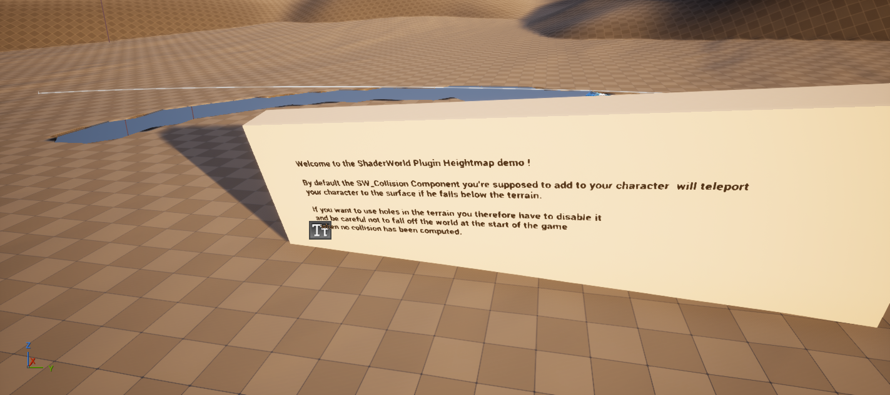

# Löcher im Gelände und Eingänge für Bergtunnel

ShaderWorld kann eine Fläche aus dem Gelände ausschneiden und dort auch die Terrainkollision entfernen. Ein solcher Ausschnitt ist ein Baustein für einen Tunneleingang. Den befahrbaren Tunnel mit Boden, Wänden und Decke musst du zusätzlich als Geometrie anlegen.[^installed-hole-source]

Die Holebrush-Beispiele wurden in der mitgelieferten Heightmap-Karte angesehen. Anschließend wurde die Bauweise im eigenen [CityBasics-Labor](city-basics-lab.md) umgesetzt: Zwei getrennte Spielprozesse bestanden je 65 Kollisionsproben und eine rund 259,48 m lange bodengebundene Durchfahrt. Die Fahrbahn, Wände und Decke sind eigene Meshes; zwei Terrainproben belegen die Portalöffnungen, eine weitere den erhaltenen Bergkamm.[^basics-proof]

Die Aufnahme zeigt die untersuchte Heightmap-Demo, keinen abgenommenen Bergtunnel.[^heightmap-view]

## Voraussetzungen

Du brauchst Unreal Engine 5.8.4 mit aktiviertem ShaderWorld 4.1. Die Beispiele sind Plugin-Inhalte. Dieses Dokumentations-Repository enthält weder das Plugin noch seine Karten. Für diesen Rundgang ist kein eigener C++-Code nötig.

## Die vorhandenen Löcher ansehen

1. Öffne im Content Browser die Einstellungen und aktiviere **Show Plugin Content** und bei Bedarf **Show Engine Content**. Öffne `/ShaderWorld/Maps/Map_Heightmap`.
2. Speichere für eigene Änderungen zuerst eine Kopie über **Save Current Level As** in deinem Projekt. In unserem Testprojekt heißt die Kopie `/Game/Maps/ShaderWorldTour_Map_Heightmap`.
3. Lass den Viewport in **Lit** mit **Realtime** laufen. Warte, bis Shaderkompilierung und Terrainaufbau fertig sind. Ein pausierter oder inaktiver Viewport kann die Aktualisierung verzögern.
4. Suche im World Outliner nach **BP_HoleBrush**, wähle ihn aus und drücke **F**, um ihn zu fokussieren. Wähle in seinen Komponenten **SW_HoleMeshBrush**. Prüfe **Enabled**. Schalte die Komponente probeweise aus, warte auf die Aktualisierung und schalte sie wieder ein. Der zugehörige Ausschnitt sollte verschwinden und zurückkehren.
5. Suche danach **SplineHoleBrush** und fokussiere ihn ebenfalls. Seine Spline und die Komponente **ProceduralHoleMeshComponent** beschreiben eine andere Lochform. Verschiebe zum Experimentieren einen Splinepunkt ein kleines Stück in der horizontalen Ebene und beobachte den veränderten Grundriss. Setze die Änderung anschließend zurück.

Das allgemeine Prinzip aus Gelände, Brush Manager und XY-Fußabdruck beschreibt auch die Herstellerdokumentation. Die konkreten Hole-Komponenten werden dort auf der verlinkten Einführungsseite nicht Schritt für Schritt erklärt.[^brush-docs]

## Die Form steuern

**BP_HoleBrush** verwendet ein Static Mesh als Schablone. In der Demo heißt die Komponente **MeshForBrush**. Ihre Geometrie wird von oben auf die XY-Ebene projiziert. Die Größe änderst du über das verwendete Mesh und dessen Skalierung; die angezeigte **Width** der Hole-Komponente wird daraus berechnet. Sie ist kein frei einstellbarer Radius.[^installed-hole-source]

Öffne bei einem eigenen Schablonenmesh dessen Static-Mesh-Editor und suche in den Asset-Details nach **Allow CPU Access**. Aktiviere die Einstellung und speichere das Mesh vor dem Verpacken. Der Brush benötigt seine Vertexdaten auch zur Laufzeit. Verwende dafür eine projektlokale Kopie des Assets. Das Schablonenmesh sollte selbst keine blockierende Kollision im späteren Durchgang haben.[^installed-hole-source]

**SplineHoleBrush** erzeugt seine Schablone prozedural aus der Spline. Hier entfällt der CPU-Zugriff auf ein Static-Mesh-Asset. Auch diese Variante erzeugt einen horizontalen Ausschnitt und kein dreidimensionales Abzugsvolumen.[^installed-hole-source]

## Darstellung und Kollision prüfen

Für die sichtbare Öffnung muss das Terrain-Oberflächenmaterial die Lochmaske aus **Vertex Color → R** als **Opacity Mask** verwenden und auf **Masked** stehen. Das Material der untersuchten Heightmap-Demo ist bereits entsprechend vorbereitet. Wenn du ein eigenes Material übernimmst, übernimm auch diese Maskierung; ändere dazu eine Projektkopie.[^installed-hole-source]

Für die Physik prüfst du am Terrain-Actor, in dieser Karte **BP_SWHeightmap**, dass **Generate Collision** eingeschaltet ist. Die Kollision wird um Spieler beziehungsweise Kollisionsanforderer herum erzeugt. Eine weit entfernte Editoransicht garantiert deshalb noch keine fertige Kollision am Loch.[^installed-hole-source]

Falls dein Spieler eine **SW_Collision**-Komponente trägt, prüfe dort **Prevent Falling Under Terrain**. Für unterirdische Wege muss diese Einstellung aus sein: Sie kann einen Spieler unter der Oberfläche sonst wieder nach oben teleportieren. Der aktuelle native Standard ist aus; ältere Demo-Hinweistexte beschreiben noch ein anderes Standardverhalten.

Erfolgreich ist der Versuch erst, wenn die Öffnung sichtbar ist und dort keine unsichtbare Terrainfläche blockiert. Für eine genaue Abnahme müssen Bodenabfragen außerhalb der Öffnung das Terrain treffen und innerhalb der Öffnung dessen Kollision verfehlen. Ein darunterliegendes Tunnel- oder Bodenmesh darf dabei natürlich einen eigenen Treffer liefern. Im [CityBasics-Bericht](../evidence/citybasics-report.json) wurden reine Terrainstrahlen von den Fahrbahn-/Wand-/Deckenprüfungen getrennt. Die Bodenproben treffen den eigenen Tunnelboden, nicht eine von ShaderWorld erzeugte unterirdische Terrainfläche.

## Einen Eingang in einen Berg planen

ShaderWorld-Terrain beschreibt eine Höhe je XY-Position. Der Holebrush schneidet den gesamten horizontalen Fußabdruck aus; seine Z-Position begrenzt keinen unterirdischen Hohlraum. Eine senkrecht gestellte Portalscheibe ist daher keine geeignete Bohrschablone. Eine Schablone entlang der ganzen Tunnelstrecke würde auch die Bergoberfläche darüber öffnen.[^installed-hole-source]

Ein daraus abgeleiteter Aufbau für einen City Builder ist:

1. Lege die Trasse und die gewünschte Einfahrtshöhe fest. Führe die Zufahrt bis zum Hang und ebne dort nur den benötigten Vorplatz.
2. Öffne mit einem kleinen Holebrush den Grundriss am Hangdurchtritt. Prüfe die Öffnung aus der späteren Fahrperspektive, nicht nur von oben.
3. Setze einen Portalrahmen und das erste Tunnelstück so ein, dass sie die ausgeschnittenen Terrainränder überdecken. Passe Form und Überdeckung gemeinsam an.
4. Verlängere den Tunnel mit eigenen Meshes für Wände, Decke und Fahrbahn. Diese brauchen passende Kollision. Unterirdische Straßensegmente sollen die Geländeoberfläche darüber nicht nach unten ziehen; **Deform Terrain** muss aus sein. Eine Datenlayer-Ausgabe kann dennoch Material und Vegetation oben auf dem Berg verändern: Im Labor wurde der durchgehende unterirdische Maskenspline deshalb vollständig deaktiviert.
5. Wiederhole die Portalöffnung am Ausgang. Prüfe Fahrzeugdurchfahrt, Kollision und Navigation auf beiden Übergängen sowie im Tunnel.

Diese Bauweise wurde im [CityBasics-Labor](city-basics-lab.md) mit einem einfachen Tunnelprofil umgesetzt und zweimal bodengebunden durchfahren. Das ersetzt keine Prüfung anderer Portalformen oder Fahrzeuggrößen.

| Ähnlich benannte Funktion | Was sie für den Tunnel leistet |
| --- | --- |
| Road **Tunnel mode** | Regelt Höhenkonflikte kreuzender Straßen. Erzeugt keinen Tunnelkörper und keine automatische Bohrung durch einen Berg. |
| **AirPocket** | Hält Wasserabfragen und entsprechend maskiertes Wasser aus einem Innenraum heraus. Erzeugt keine Terrainöffnung und keine feste Tunnelwand. |
| Glastunnel aus **Map_Reference** | Zeigt Spline-Meshes und Unterwasserfunktionen. Das ist kein automatisch erzeugter Bergtunnel. |
| **Map_VoxelMap** | Enthält ein Voxel-/Octree-Beispiel. Ein fertiges Voxel-Höhlensystem wurde im untersuchten Bestand nicht belegt. |

Diese Abgrenzungen ergeben sich aus dem installierten Code und den Beispielassets.[^installed-tunnel-source] Der Hersteller führt Terrainlöcher und die Unterwasser-Glastunneldemo ebenfalls als getrennte Funktionen auf.[^shaderworld-product]

## Wenn Wasser an einer Portalöffnung erscheint

Vor Einbau der Ausschlussbox meldete der Nutzer Wellen **nur am Tunnel**. Der Ozean liest die Höhen des ShaderWorld-Terrains; unsere eigene Tunnel-Fahrbahn aus Static Meshes ersetzt diese Höhen nicht. **Shallow Attenuation = 1** wurde bereits gespeichert und in PIE bestätigt. Das allein ist noch kein Nachweis für einen trockenen Tunnel.[^coast-correction]

Der gelesene Code zeigt einen wichtigen Sonderfall: **SW_HoleMeshBrushComponent** schreibt in den geöffneten Bereichen **−7.000.000 cm (−70 km)** in den Höhen-Cache. Der Ozean-Shader decodiert diesen Wert als normale vorzeichenbehaftete Höhe, ohne den Hole-Sonderfall abzufangen. Für seine Küstendämpfung wird das Portal damit zu sehr tiefem Wasser. Bei dieser Tiefe liefert die Dämpfungsfunktion volle Wellenstärke, auch wenn **Shallow Attenuation** auf **1** steht.[^installed-hole-ocean-source]

Dieser Codepfad passt plausibel zur auf den Tunnel begrenzten Beobachtung. Er ist noch keine gültige GPU-Messung an der betroffenen Stelle: Der erste Abfrageaufruf meldete `valid = 0` und lieferte damit keinen belastbaren Nachweis des tatsächlichen Cache-Inhalts.[^coast-correction] Die Öffnung einfach wieder mit Terrain zu schließen würde außerdem den benötigten Durchgang beseitigen; die eigene Fahrbahn bleibt ein separates Mesh.

Die native **ShaderWorld Air Pocket Box** ist inzwischen am Actor **Basics_Tunnel_AirPocket** eingerichtet und mit der Karte gespeichert. Eine neu gestartete PIE-Sitzung enthält die Komponente mit Mittelpunkt **(0, 0, 0) cm**, Rotation **0**, Skalierung **1** und **Box Extent = (9000, 800, 2000) cm**. Das sind Halbausdehnungen von **90 m längs**, **8 m quer** und **20 m vertikal**; die Box umfasst Tunnel und Portalbereiche. **Hidden in Game** ist eingeschaltet. Das Ozeanmaterial enthält bereits den erforderlichen Water-Exclusion-Anschluss.[^coast-correction]

Nach dem Neustart der Vorschau meldete der Nutzer an der zuvor betroffenen Stelle **„Bisher trocken“**. Damit liegt eine erste Sichtbestätigung vor. Sie ersetzt keine Langzeitprüfung über verschiedene Wellenphasen und keine vollständigen GPU- oder Wasserabfragen. Die [Ozeananleitung](ocean-waves-and-foam.md) beschreibt den aktuellen Box-Aufbau und trennt diese Nachweise. Der vorhandene Durchfahrtsbericht bestätigt feste Tunnelkollision und Bewegung; er prüft keine Wasserfreiheit. Auch ein Laufzeit-SaveGame mit der neuen Box wurde noch nicht geprüft.[^coast-correction]

## Häufige Ursachen für ein falsches Ergebnis

| Beobachtung | Als Nächstes prüfen |
| --- | --- |
| Keine sichtbare Änderung | Realtime-Viewport, fertige Shader, Enabled und Zuordnung zum Brush Manager. |
| Gelände bleibt sichtbar, Kollision fehlt | Masked-Oberflächenmaterial und Vertex Color R als Lochmaske. |
| Sichtbares Loch, aber der Spieler kommt nicht hindurch | Fertige lokale Terrainkollision und zusätzliche Meshkollision im Ausschnitt. |
| Spieler springt auf den Berg zurück | Prevent Falling Under Terrain am Spieler prüfen. |
| Loch funktioniert im Editor, später nicht | Allow CPU Access des Schablonenmeshes vor dem Cook prüfen. |
| Bergdecke verschwindet über der ganzen Trasse | Holebrush auf die Portale begrenzen und den Tunnelkörper separat bauen. |
| Wellen werden am Portal sichtbar, obwohl Shallow Attenuation 1 ist | Hole-Höhenwert im Ozean-Datenpfad und gezielten Air-Pocket-Ausschluss prüfen; die Tunnel-Fahrbahn liefert dem Ozean keine Terrainhöhe. |

Speicherbare Tunnel brauchen später eigene Daten für Trasse, Profil, Portalformen und Mesh-Auswahl. Das bestehende [Spielstandlabor](save-and-load.md) speichert bisher nur Bauplätze und Straßentrassen.

[^basics-proof]: [Bereinigte CityBasics-Kollisions- und Durchfahrtsprüfung](../evidence/citybasics-report.json).
[^heightmap-view]: [Aufnahme der untersuchten Heightmap-Beispiele](../assets/images/heightmap-holes.png).
[^brush-docs]: [ShaderWorld: Blueprint Brush System – Landmass](https://universgen.gitbook.io/shader-world/fundamentals/kick-start/blueprint-brush-system-landmass).
[^shaderworld-product]: [Offizielle ShaderWorld-Produktbeschreibung](https://www.fab.com/listings/ee4bcbaf-36ea-4dd9-aade-068e1a8a4794).
[^installed-hole-source]: Lokale Quellcodeprüfung von ShaderWorld 4.1: `SW_HoleMeshBrushComponent.h/.cpp`, `ShaderWorldActor_Collision.cpp`, `SWPatchVertexFactory.ush` und das Heightmap-Oberflächenmaterial. Die lizenzierten Plugin-Dateien werden nicht mit diesem Bundle verteilt.
[^installed-tunnel-source]: Lokale Quellcode- und Assetprüfung von ShaderWorld 4.1: `SWSplineRoadComponent.h`, `ShaderWorldSplineRoads.usf`, `ShaderWorldAirPocketComponents.h/.cpp`, `ShaderWorldVoxelActor.cpp` und die Tunnelbeispiele. Die lizenzierten Plugin-Dateien werden nicht mit diesem Bundle verteilt.
[^coast-correction]: [Küsten-/Tunnelkorrektur vom 28. Oktober 2026](../evidence/coast-correction-report.json). Box mit der Karte gespeichert und im neu gestarteten PIE ausgelesen; erste Nutzerantwort „Bisher trocken“. Kein Langzeitnachweis oder vollständiger GPU-Messbericht.
[^installed-hole-ocean-source]: Gelesene ShaderWorld-4.1-Quellen: `Source/ShaderWorld/Private/Brushes/SW_HoleMeshBrushComponent.cpp`, Zeilen 206–235, und `Shaders/Private/ShaderWorldComputeProducers.usf`, Zeilen 95–130. Die lizenzierten Dateien werden nicht mitgeliefert; der Codebefund ersetzt keine GPU-Messung im aktuellen Spielprozess.
