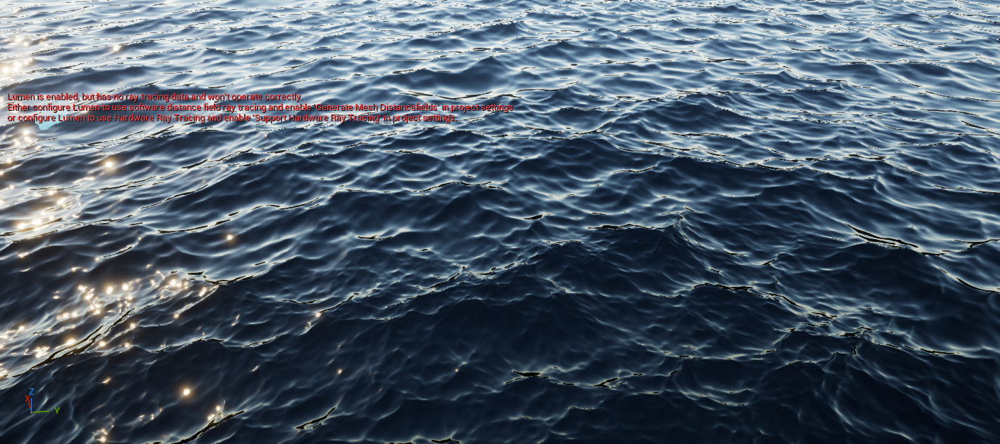
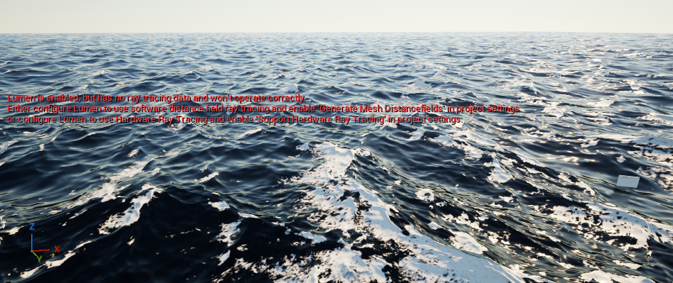

# Ozean, Wellen und Schaum im Editor einstellen

In ShaderWorld 4.1 lässt sich das Meer direkt an einem Ozean-Actor einstellen. Für den hier beschriebenen Versuch wurde `/ShaderWorld/Maps/Map_OceanOnly` als `/Game/Maps/ShaderWorldTour_Map_OceanOnly` in das Testprojekt kopiert. Die Projektkopie zeigte nach Aktivieren von Schaum, Einstellen von 18 m/s Wind und einem Rebuild sichtbare weiße Schaumkämme. 18 m/s entsprechen rund 65 km/h.[^ocean-proof]

## Die richtige Karte und den Ozean finden

1. Öffne im **Content Browser** den Projektordner **Content → Maps** und doppelklicke auf **ShaderWorldTour_Map_OceanOnly**. Falls diese Projektkopie bei dir fehlt, folge zuerst der Anleitung zu den [Beispielkarten](../reference/example-maps.md).
2. Suche im **Outliner** nach **BP_SWOcean** und wähle diesen Actor aus. Im untersuchten Level ist sein Typ **ShaderWorldActor**. Die Welt enthält außerdem Licht, Kamera und einen separaten Niagara-Actor.
3. Öffne rechts **Details**. Falls dort ein Suchtext steht, lösche ihn zunächst, damit alle Einstellungen erscheinen.
4. Klappe **World Settings → Producers** auf. Öffne den Eintrag, dessen **Layer Name** den Wert **Height** trägt.
5. Klappe in diesem Eintrag **Compute Producer** auf. Hier liegen die Einstellungen des Ozeans. Der verwendete Typ heißt **Ocean Spectrum (compute)** beziehungsweise `ShaderWorldSpectrumProducer`.

Der Eintrag `Height` gehört zur aktuellen Producer-Struktur. Ältere Anleitungen führen stärker über ein Generatormaterial. Bei einem aktiven Ocean-ComputeProducer wird das Höhenmaterial dieses Eintrags durch den ComputeProducer ersetzt; ein alter Materialname allein erklärt deshalb nicht den sichtbaren Seegang.[^ocean-api][^ocean-proof]

*Ausgangsansicht der OceanOnly-Kopie. Wasserbewegung und Blickwinkel beeinflussen das einzelne Bild.*

## Schaum einschalten und den Wind verstärken

1. Bleibe im aufgeklappten **Compute Producer**. Aktiviere unter **Foam** das Kontrollkästchen **Foam**. Im Code heißt diese Eigenschaft `bFoam`.
2. Stelle unter **Spectrum** den Wert **Wind Speed** auf **18**. Die Einheit ist **Meter pro Sekunde**, nicht km/h.
3. Lösche bei Bedarf den Details-Suchtext und suche nach **Rebuild**. Aktiviere das Kontrollkästchen **Rebuild** unter **World Settings** am Ozean-Actor einmal.
4. Lass den Viewport aktiv und warte, bis Shaderkompilierung und Neuaufbau abgeschlossen sind. **Rebuild** ist ein Auslöser und springt nach der Verarbeitung wieder auf **aus**. Im geprüften Versuch wurde dieser Rücksprung bestätigt.
5. Betrachte das Meer in der normalen **Lit**-Ansicht. Starte bei Bedarf **Play**, damit fortlaufend Frames gerendert werden. Im geprüften Zustand waren weiße Schaumkämme sichtbar.[^ocean-proof]

Das Einschalten von Schaum benötigt einen Neuaufbau der Wasserressourcen. Nur den Haken zu setzen und anschließend ein unverändertes Bild zu betrachten, reicht als Funktionsprüfung nicht aus. Falls **Rebuild** noch aktiv bleibt, zuerst die Verarbeitung und gerenderte Frames abwarten.

*Geprüfter Zustand: Schaum aktiv, Wind Speed 18 m/s, Rebuild verarbeitet.*

## Was die Regler bewirken

| Einstellung im ComputeProducer | Bedeutung |
| --- | --- |
| **Wind Speed** | Bestimmt die Windstärke und beeinflusst Wellenlängen sowie Seegang. Im Versuch: 18 m/s. |
| **Wind Direction** | Bestimmt die Ausbreitungsrichtung der Wellen. |
| **Amplitude** | Skaliert die Wellenhöhe. |
| **Choppiness** | Schiebt Wasser horizontal zu den Wellenkämmen und schärft sie. Der Wechsel zwischen null und einem positiven Wert benötigt laut installierter API einen Rebuild. |
| **Shallow Attenuation** | Dämpft die Wellen anhand der Tiefe über dem gelieferten Terrain. `1` bedeutet an der Wasserlinie vollständig gedämpft, `0.95` lässt dort 5 % des vertikalen Ausschlags übrig, `0` schaltet diese Dämpfung ab. |
| **Max Attenuation Depth** | Tiefe in Zentimetern, ab der wieder volle Wellen gelten. `0` deaktiviert diese zusätzliche Tiefengrenze; die durch **Shallow Attenuation** gesteuerte Küstendämpfung bleibt wirksam. |
| **Foam Coverage** | Beeinflusst, wie leicht sich Schaum an zusammengedrückten Wellenkämmen bildet. Höher bedeutet mehr Schaum. |

Die Bedeutung der zusätzlichen Regler stammt aus der installierten API.[^ocean-api] Diese Seite belegt keinen separaten praktischen Test jeder Reglerkombination. Schaum kann außerdem an flachen Küsten entstehen. Dafür muss der Ozean passende Geländedaten erhalten; die reine OceanOnly-Karte ist kein Nachweis für fertige Uferinteraktion mit einer Stadt.[^detail-panel][^ocean-proof]

## Warum kann Wasser unter einer Insel liegen?

Der Ozean bildet eine eigene Oberfläche. Terrain darüber schneidet diese Oberfläche nicht automatisch zu einer Küstenkontur aus. Dass sich das Wasser unter dem Land fortsetzt, ist deshalb etwas anderes als sichtbares Wasser **über** dem Inselboden. Für einen Tunnel unter dem Meer ist außerdem ein gezielter trockener Innenraum nötig.

Im aktuellen [CityBasics-Labor](city-basics-lab.md) liegt der mittlere Meeresspiegel bei **Z = 0 cm**, das Inselplateau bei **Z = 300 cm**. Der Ozean verwendet **Wind Speed = 14 m/s**, **Amplitude = 1** und **Max Attenuation Depth = 0**. **Shallow Attenuation** wurde inzwischen von `0.95` auf **`1.0`** gesetzt und gespeichert; der anschließende PIE-Readback bestätigt `1.0`. Die Abhängigkeiten waren bereits richtig verbunden: Das Terrain hat den Ozean als **Data Receiver**, der Ozean das Terrain als **Data Source**.[^coast-correction] Die offizielle Anleitung beschreibt diese Richtung unter **Advanced → Dependencies**.[^detail-panel][^coast-inspection]

Vor Einbau der Ausschlussbox hat der Nutzer die Beobachtung eingegrenzt: **Die Wellen wurden nur am Tunnel sichtbar.** Damit steht besonders das Zusammenspiel von Portalöffnungen und Ozean im Vordergrund. Eine gültige GPU-Messung der Höhe beziehungsweise Wassertiefe an genau der betroffenen Stelle liegt noch nicht vor.[^coast-correction]

Der gelesene Shader behandelt eine Position über Land als negative Wassertiefe. Bei `0.95` bleiben dort rechnerisch 5 % Restbewegung. **Das allein erklärt keinen Durchbruch durch ein 3 m hohes Plateau:** Dafür wäre bei wirksamer 5-%-Dämpfung ein ungedämpfter vertikaler Ausschlag von mehr als 60 m nötig. Außerhalb des verfügbaren Terrain-Caches behandelt derselbe Code die Position dagegen als tiefes Wasser und lässt volle Wellen zu. Das ist ein Ansatz für die Diagnose, kein Nachweis, dass gerade diese Cache-Grenze den gemeldeten Fehler verursacht.[^coast-water-code]

### Neuer Codebefund: Der Holebrush erscheint dem Ozean als tiefer Meeresboden

Die Portalöffnung wird nicht nur als sichtbare Maske gespeichert. Im gelesenen ShaderWorld-4.1-Code setzt der Holebrush die betroffenen Höhenwerte auf **−7.000.000 cm**, also **−70 km**. Dieser besondere Wert kennzeichnet das Loch. Der Ozean liest denselben Terrain-Höhen-Cache für seine Küstendämpfung.[^coast-water-code]

Die anschließende Verarbeitung erklärt einen plausiblen Mechanismus:

1. Der Holebrush schreibt den negativen Lochwert in die Höhen-Textur.
2. **SW_GroundTexelHeight** im Ozean-Shader decodiert die RGB-Kanäle als vorzeichenbehaftete Höhe. Der gelesene Abschnitt enthält keine gesonderte Behandlung des Hole-Werts.
3. **SW_WaterDepth** interpretiert die große negative Höhe als sehr tiefen Meeresboden. **SW_ShallowWeight** liefert für diese Tiefe volle Wellenstärke — **auch bei Shallow Attenuation = 1**.
4. Unsere eigene Tunnel-Fahrbahn ist ein separates **Static Mesh**. Sie gehört nicht zur **Data Source** des Ozeans und ersetzt dort die Lochhöhe nicht durch ihre Oberkante bei 3 m.[^coast-water-code][^coast-correction]

Das ist ein **belegter Codepfad und ein plausibler Mechanismus an den Portalöffnungen**, keine abgeschlossene Messung des aktuellen GPU-Zustands. Die erste Anforderung einer GPU-Abfrage meldete `valid = 0`; das ist kein verwendbarer Höhenwert und kein Nachweis von Wasserfreiheit. Eine reine Erhöhung der Dämpfung behebt den gelesenen Sonderfall nicht. Aus dem gespeicherten Wert `1.0` folgt deshalb noch kein behobener Tunnelfehler.[^coast-correction]

Außerhalb des Terrain-Caches können ebenfalls volle Wellen entstehen. Für die nun auf den Tunnel eingegrenzte Beobachtung ist der Hole-Wert jedoch der konkretere neue Untersuchungsansatz. Die [Loch- und Tunnelanleitung](holes-and-mountain-tunnels.md) erklärt die Folgen für den Aufbau.

## Wasser im Tunnel gezielt ausschließen

ShaderWorld 4.1 enthält dafür Komponenten namens **ShaderWorld Air Pocket Box**, **ShaderWorld Air Pocket Capsule** und **ShaderWorld Air Pocket Spline Tube**. Eine Box eignet sich als Ausgangspunkt für einen geraden Raum, die Spline Tube für einen gekrümmten Tunnel. Die Komponenten beschreiben einen Bereich, in dem Wasser ausgeschlossen werden soll; sie erzeugen keine Tunnelwände und ersetzen keine Kollision.[^coast-water-code]

Zwei Wirkungen müssen getrennt geprüft werden:

- **Spielabfragen:** Das WaterSubsystem liefert für Punkte in einer registrierten Air Pocket keinen Wasseranbieter, solange die Abfrage Air Pockets nicht ausdrücklich ignoriert.
- **Sichtbare Oberfläche:** Das Wassermaterial muss als **Masked** arbeiten und den Materialknoten **ShaderWorld Water Exclusion** an **Opacity Mask** anschließen. Nur die Komponente zu platzieren garantiert diese visuelle Wirkung nicht.[^coast-water-code]

Am aktuell verwendeten **M_Ocean_Material** wurde der Anschluss geprüft: Das Material ist **Masked** und verwendet **Material Attributes**. Der Knoten **ShaderWorldWaterExclusion_0** ist über **Multiply_0** mit **Opacity Mask** in **MakeMaterialAttributes_0** verbunden; dessen Attribute gehen an den Materialausgang. Die erforderliche Materialanbindung ist damit bereits vorhanden.[^coast-inspection]

Im CityBasics-Labor ist die native Box inzwischen **eingebaut und mit der Karte gespeichert**. Eine anschließend neu gestartete PIE-Sitzung enthält die Komponente mit den gespeicherten Eigenschaften. So lässt sich der Aufbau nachvollziehen:

1. Öffne `/Game/Maps/ShaderWorldCityBasics` und suche im **Outliner** nach **Basics_Tunnel_AirPocket**.
2. Prüfe die native **ShaderWorld Air Pocket Box** am Actor. Mittelpunkt und Rotation sind **0**, die Skalierung ist **1**.
3. Die **Box Extent**-Werte sind **X = 9000**, **Y = 800**, **Z = 2000 cm**. Das sind **Halbausdehnungen**; die gesamte Box misst **180 × 16 × 40 m**. Sie deckt den Tunnel und die Portalbereiche ab.
4. **Hidden in Game** ist eingeschaltet. Das versteckt die Hilfsform im Spiel und deaktiviert nicht ihren Wasserausschluss. Die Objekteigenschaften wurden im neu gestarteten PIE erneut ausgelesen.[^coast-correction]

Der erste Sichttest des Nutzers an der zuvor betroffenen Stelle lautet: **„Bisher trocken“**.[^coast-correction] Das ist eine erste praktische Bestätigung nach Einbau der Box. Eine längere Beobachtung über verschiedene Wellenphasen, sämtliche Kamerapositionen, vollständige Wasserabfragen innerhalb und außerhalb der Box sowie ein verpackter Build stehen weiterhin aus. Auch die neue Box wurde noch nicht über die eigene Laufzeit-SaveGame-Funktion gespeichert und in einem getrennten Spielprozess rekonstruiert.

Auch Wasserabfragen für Auftrieb brauchen einen eigenen Test: Der gelesene CPU-Ozeanprovider berechnet Tiefwasserwellen **ohne Küstendämpfung**. Die gerenderte Oberfläche und eine abgefragte Wasserhöhe können an Land oder am Ufer deshalb unterschiedliche Ergebnisse liefern. Sichtprüfung und Gameplay-Abfrage sollten am selben Ort getrennt gemessen werden; ein ruhiges Bild beweist dort noch keine passende Auftriebsantwort.[^coast-water-code]

## OceanOnly und Reference unterscheiden

Die große Reference-Welt enthält bereits Terrain, Ozean, Vegetation, Straßenbeispiele und Tunnel. Beide untersuchten Karten referenzieren einen SpectrumProducer, das Ozeanmaterial und die Wasserlinien-/Unterwasseranbindung. **OceanOnly** macht das Wasser isoliert untersuchbar. Ihr zusätzlicher Niagara-Test heißt `NS_WaterTest`; der alte Assetpfad `/ShaderWorld/Demo_Ocean/VFX/NS_WaterTest` wird auf `/ShaderWorld/Demo_Ocean/FX/NS_WaterTest` weitergeleitet.

Die untersuchte Niagara-Schnittstelle kann für CPU-Partikel Wasserhöhe, Oberflächennormale, Geschwindigkeit und Eintauchstatus abfragen.[^ocean-api] Auftrieb, replizierter Seegang und weitere Unterwasserfunktionen werden für 4.1 offiziell beschrieben. Ihr Vorhandensein bedeutet noch keinen abgenommenen Boots-, Multiplayer- oder Überflutungstest in diesem Projekt.[^fab-ocean]

## Wenn das Bild nicht reagiert

- Kontrolliere, ob **BP_SWOcean** ausgewählt ist und du den **Height**-Eintrag dieses Actors bearbeitest.
- Prüfe nach einer Schaumumschaltung, ob **Rebuild** ausgelöst und verarbeitet wurde.
- Warte auf Shaderkompilierung und verwende einen aktiven Echtzeit-Viewport oder **Play**. ShaderWorld braucht gerenderte Frames.
- Vergleiche die normale **Lit**-Ansicht mit den Bildern. Debug-Ansichten können das Wasser anders darstellen.

Der OceanOnly-Versuch bestätigt die Editoransicht, die dort genannten Parameter und sichtbaren Schaum nach dem Rebuild. Die Tunneldiagnose ergänzt ausgelesene PIE-Einstellungen und den gelesenen Hole-/Ozean-Codepfad. Die Air-Pocket-Box ist gespeichert und im neu gestarteten PIE vorhanden; der erste Nutzer-Sichttest meldet „Bisher trocken“. Eine Langzeitabnahme, vollständige GPU-Messungen, ein verpackter Build, Leistungsmessungen und schwimmende Schiffe fehlen weiterhin.[^ocean-proof][^coast-correction]

[^ocean-proof]: [Beobachtungsbericht zum Ocean-Test](../evidence/ocean-report.json).
[^fab-ocean]: [Offizielle ShaderWorld-Produktseite](https://www.fab.com/listings/ee4bcbaf-36ea-4dd9-aade-068e1a8a4794).
[^detail-panel]: [Offizielle Dokumentation: Detail Panel](https://universgen.gitbook.io/shader-world/fundamentals/kick-start/detail-panel).
[^ocean-api]: Lokale Prüfung von ShaderWorldComputeProducer.h, ShaderWorldActor_Build.cpp und NiagaraDataInterfaceShaderWorldWater.h in der lizenzierten Installation von ShaderWorld 4.1. Die Plugindateien werden nicht mitgeliefert.
[^coast-inspection]: [Frühere Küsten-/Straßeninspektion vom 28. Oktober 2026](../evidence/coast-biome-road-inspection.json): Abhängigkeiten und Wasser-Materialgraph geprüft. Die damalige Dämpfung war noch `0.95`; den folgenden Korrekturstand belegt der separate Bericht.
[^coast-correction]: [Küsten-/Tunnelkorrektur vom 28. Oktober 2026](../evidence/coast-correction-report.json): Dämpfung `1.0`, gespeicherte native Box und Eigenschaften im neu gestarteten PIE; Nutzerantwort „Bisher trocken“. Erste Sichtbestätigung, keine Langzeitabnahme oder vollständige GPU-Höhenmessung.
[^coast-water-code]: Gelesene ShaderWorld-4.1-Quellen: `ShaderWorldComputeProducer.h`, Zeilen 213–222; `ShaderWorldComputeProducers.usf`, Zeilen 95–130; `SW_HoleMeshBrushComponent.cpp`, Zeilen 206–235; `ShaderWorldAirPocketComponents.h`; `ShaderWorldWaterExclusion.h`; `ShaderWorldWaterSubsystem.cpp`, Zeilen 62–72; `ShaderWorldOceanWaterProvider.h`, Zeile 42. Relative Verzeichnisse stehen in den Quellenmetadaten. Lizenzierte Dateien werden nicht mitgeliefert; diese Befunde ersetzen keinen Laufzeittest.
