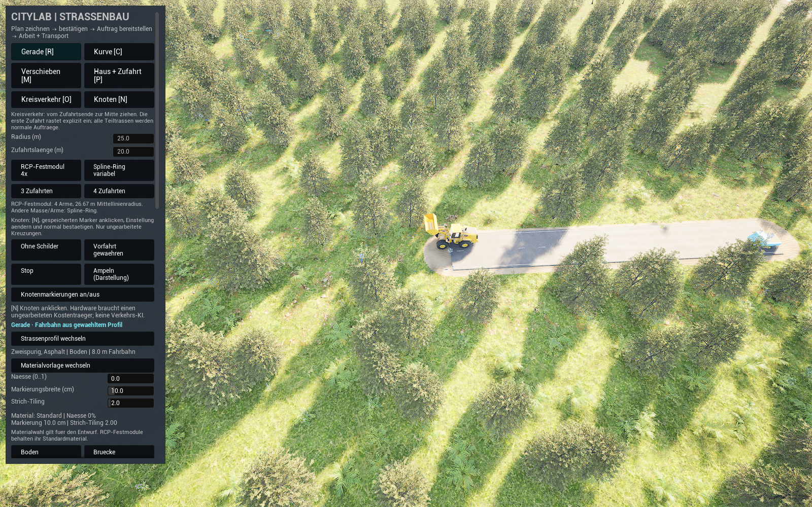
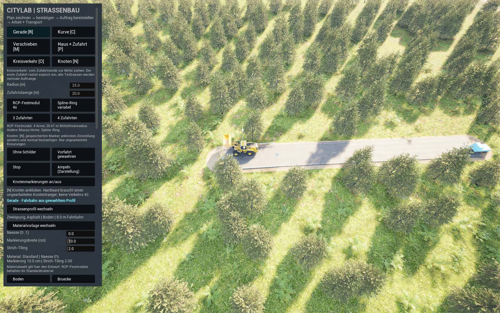

# RCP-Straßenprofile und Kreuzungen von Maschinen bauen lassen

**Diese Anleitung ist ein Entwurf für die neue Fassung.** Die Bedienfolge ist im eigenen Code vorhanden. Die getrennte Stage2-API-Abnahme mit Maschinen und Kaltstart ist bestanden; neue Mausbedienung, Stage3 und sichtbarer Starter werden weiter geprüft. Der bislang geprüfte `Start CityLab.cmd` gehört weiterhin zu seiner bisherigen RoadConstruction11-Demo, bis eine ausdrücklich geprüfte neue Starterquittung vorliegt. Mit einem älteren Starter fehlen die neuen Regler. Keine vorhandene Save löschen, um einen Versionsfehler zu umgehen.[^integration-proof][^old-road]

## Ein kurzer erster Bauversuch

Nach Freigabe der neuen Demo soll der Einstieg so aussehen. Der genaue neue Starter und geprüfte Speicherort werden erst nach ihrem tatsächlichen Startbeleg hier eingetragen.

1. **Gerade [R]** oder **Kurve [C]** wählen. Unter **Strassenprofil wechseln** das gewünschte Profil einstellen; zuerst eine kurze Bodenstraße ab einer vorhandenen erreichbaren Straße planen.
2. Mit linker Maus vom Anschluss zum Endpunkt ziehen. Danach loslassen und die vollständige Vorschau abwarten. Ein weißes freies Ende ist erlaubt; beide Enden brauchen keinen vorhandenen Straßenanschluss. Rot und Gelb zeigen den konkreten Grund im Vorschautext.
3. Bei einer Kurve die blauen Griffe bearbeiten. Vor Bestätigung lassen sich Profil, Materialvorlage, Nässe, Markierungsbreite und Strichabstand beziehungsweise Zubehör ändern. Der Entwurf soll dabei noch keine Erde, Ware oder Bäume verändern.
4. **Plan bestätigen + speichern [Enter]** wählen. Jetzt existiert ein gespeicherter Auftrag. Das ist noch keine fertige Straße.
5. Die passende Auftragskarte anklicken, **Ausgewählten Auftrag bereitstellen [J]**, dann **Arbeit [Leertaste]** und **Transport [H]** einschalten. Rodung, Erdarbeit und Baustofflieferungen brauchen Zeit und erreichbare Arbeit. Ein ausgewählter neuer Auftrag soll getrennt erkennbar sein.
6. In der Bilanz Erde, Kies, Asphalt und **Fertigteile** beobachten. Speichern über den sichtbaren Knopf beziehungsweise **F5/K**, Laden über den sichtbaren Knopf beziehungsweise **F9/L**. Ein getrennter Stage2-API-Versuch bestand den kalten Neustart mit beladenem Fertigteil-Lkw und drei weiteren normalen Loads. Die Mausbedienfolge bleibt gesondert zu prüfen.

Die genannten Schritte sind bis zur Laufzeitfreigabe eine lesbare Beschreibung des implementierten Sollablaufs. Das vom Nutzer gemeldete Problem mit mehreren Aufträgen ist ausdrücklich noch kein durch diese Seite gelöster UI-Fall.[^implementation][^integration-proof]

## Welche Einstellung was verändert

| Werkzeug | Gedachte Verwendung | Grenze im aktuellen Entwurf |
| --- | --- | --- |
| Straßenprofil | Ein-, zwei-, drei-, vier- und geteilt vierspurig sowie Kiesweg | Geometrie und Zubehör folgen dem konkreten Profil; die angezeigte Meshbreite ist keine garantierte nutzbare Fahrspurbreite. |
| Materialvorlage | Vorhandene gekochte Asphaltvarianten auswählen | Keine statische Shaderkompilierung im laufenden Spiel; feste RCP-Kreismodule behalten ihr Standardmaterial. |
| Nässe, Markierungsbreite, Strich-Tiling | Dynamische Werte des Entwurfs einstellen | Zahlen und Materialkennung müssen mit dem bestätigten Netz gespeichert werden; neuer Kaltbeleg ausstehend. |
| Gehwege, Leitplanken, Leuchten, Bänke | Bezahlte Ausstattung entlang der gebauten Abschnitte | Erst vollständig gelieferte Fertigteile erlauben den betreffenden Aufbau. Keine kostenlose Lampe durch Umschalten. |
| Knoten [N] | Ungearbeiteten gespeicherten Knoten auswählen, Vorfahrt/Stop/Ampeldarstellung und Markierung planen | Eigener Knoten-/Finanzierungsvertrag; keine allgemeine Verkehrs-KI oder fertig simulierte Ampelschaltung. |
| Kreisverkehr [O], Spline-Ring | Variablen Radius, Zufahrtslänge und drei oder vier Arme planen | Ein geometrisch passender Ring ist noch kein erreichbarer bezahlter Bau. |
| Kreisverkehr [O], RCP-Festmodul | Originalen modularen Kreis mit vier Armen nutzen | Fester Mittellinienradius etwa 26,67 m, Boden/Zweispur/Standardmaterial; Einstieg an geradem nivelliertem Zweispurende. Andere Breiten/Formen über den Spline-Ring. |
| Boden / Brücke / Tunnel | Abschnittstyp des Entwurfs wählen | Brücke und Tunnel bleiben der getrennten Stage4-Abnahme zugeordnet; Knopf im Code belegt noch keine durchfahrbare Brücke oder physische Tunnelöffnung. |

Stage2 bestätigt eine wirklich gebaute Bodenstraße, bezahlte Ausstattung, vier Materialbilanzen und exakte kalte Zustände; alle weiteren Profile, Knoten, Ringe, Materialvarianten und Mausgesten brauchen ihre eigenen Nachweise. Die frühe eigene Adapterprobe bestätigt nicht automatisch alle Profile und sämtliche Teile dieser Tabelle.[^stage1][^integration-proof]

## Was RCP, ShaderWorld und CityLab übernehmen

RCP liefert die lizenzierten Meshes und Materialvorlagen. CityLab erzeugt daraus eigene rekonstruierbare Komponenten und behält Netz, Profile, Plan und Baufortschritt als maßgebliche Spieldaten. ShaderWorld übernimmt Gelände, Bewuchs und Bodenkollision. Gespeichert werden diese erklärbaren Zustände; flüchtige Meshkomponenten werden beim Laden daraus wieder aufgebaut.[^integration-plan]

Die direkte Neuaufbauroute des unveränderten RoadCreator-Blueprints hat im ersten gekochten Versuch alle 20 Zyklen verfehlt. Das ist kein allgemeines Verbot von Construction Scripts zur Laufzeit. Die eigene Adapterroute wurde deshalb separat aufgebaut und bestand nach einer realen inneren Nahtkorrektur ihren engen Lebenszyklusversuch. Der neue Manager-/Terrain-/Maschinenweg hat nun seine begrenzte Stage2-API-Abnahme bestanden; das überträgt sich nicht auf weitere Werkzeuge.[^stage1]

Vier Ressourcen haben getrennte Bestände und Buchungen. Lkw und Puffer bleiben begrenzt. Zubehör und Knotenhardware müssen ihren Fertigteilbedarf bezahlt und geliefert bekommen; Erde ersetzt keine Fertigteile. Die historischen begrenzten Start-/Lagerrouten sind kein fertiges allgemeines Depot- und Fuhrparksystem. Freie Fahrzeugauswahl, Wegsuche zu beliebigen Depots und umfassender Baustellenverkehr bleiben offen.[^integration-plan]

## Speichern, alte Stände und Grenzen

Die neue Snapshotversion ist 2; die neue Inhaltsbindung enthält zusätzlich den vollständigen Toolkit-Katalog und die native Rezeptrevision. Alte Stände werden nicht still umgedeutet. Ein ausdrücklicher Copy-Import ist nur für bekannte gepinnte Original11-Bytes vorgesehen und muss sein eigenes normales Speichern/Laden/Kaltstartpaar bestehen. Das echte Original bleibt erhalten. Noch ist diese neue Importabnahme nicht erfolgt.[^integration-proof]

Die vollständige 90-seitige Handbuchrecherche bleibt eine Herstellerrecherche. Aktuell sind 907 Vendorpakete vorhanden; eine konkrete RCP-Releasekennung und vollständige Abdeckung des letzten Herstellerreleases sind weiter unbekannt. Eigene vorbereitete Kopien korrigieren Zugriff/Kollision und ausdrücklich betroffene Zubehörmaterialien, ohne Vendorpakete zu verändern.[^stage1]

## Was im Stage2-Versuch tatsächlich zu sehen war

Das Original zeigt das bewaldete Labor, Straße, Baumaschine und die damalige lange Seitenleiste. Die Fertigteilladung und die drei zusätzlichen gespeicherten Pläne sind über Zustandsmessungen belegt; aus diesem Ausschnitt allein lassen sie sich nicht ablesen.

## Erwartetes Bild und Fehlerhilfe

Nach bestandener Freigabe sollen Vorschau und gebautes Ergebnis denselben Profil-/Materialvertrag zeigen; Maschinen arbeiten den gespeicherten Plan ab. Die Originalbilder aus Stage2 wurden von einem Agenten visuell geprüft. Sie zeigen noch den langen Seitenbereich: wichtige Bauknöpfe liegen außerhalb des sichtbaren Ausschnitts. Eine kompakte kontextabhängige Leiste ist separat vorbereitet und noch nicht abgenommen.

Das Bild bestätigt den sichtbaren Ausschnitt. Exakte Zustände und Bodenkollision stammen aus den getrennten Messungen; keine menschliche Abnahme.

- **Neue Profil-/Materialknöpfe fehlen:** gestartetes Programm und neue Starterquittung prüfen; nicht durch Save-Reset ersetzen.
- **Vorschau wartet:** den konkreten Status lesen. Ein stiller Mauszeiger allein bestätigt keine fertige native Terrain-/Bewuchs-/Kollisionsarbeit.
- **Arbeit beginnt nicht:** Auftrag ausdrücklich wählen/bereitstellen, Arbeit und Transport einschalten, Zugang und die getrennten Restmengen prüfen.
- **Kein Zubehör sichtbar:** bezahlten Fertigteilfortschritt prüfen. Ein gesetzter Haken ist ein Planwunsch.
- **Bindung oder Version wird abgewiesen:** passenden Build samt Profil und Save erhalten. Nur den ausdrücklich geprüften Copy-Import verwenden; keine Hashes oder Versionsfelder handändern.

## Getrennte Prüfdetails

Für diese vorbereitete Baseline sind Editor14 und Game4 gebaut sowie 137 native Tests bestanden: 135 sauber, zwei bekannte Warnungen. 29 eigene CPU-Geometriemessungen sind vorhanden. Bei 21 nicht-Nanite-Originalen sind die referenzierten Dreieckspositionen exakt gleich; bei acht Nanite-Originalen unterscheiden sich ursprüngliches Fallback und vollständige eigene CPU-Geometrie ausdrücklich. Keine Gleichheitsbehauptung für diese acht Quellen und daraus noch kein gerendertes Bild oder Szenenkollisionstreffer.[^integration-proof]

Stage2 lief in zwei frischen gekochten Prozessen: **32 Create- und 95 Resume-Prüfungen bestanden**. Während echten Teilabtrags wurden drei weitere Profilaufträge geplant, ohne laufende Ladung oder Erdarbeit umzuschreiben. Der kalte Stand enthielt 533.594 g Fertigteile auf dem Weg zur Baustelle; vollständiger nativer Zustand und sechs Exportgruppen blieben beim Kaltstart und drei weiteren Loads exakt. Danach wurde nur der Hauptauftrag fertiggestellt; die drei wartenden Aufträge blieben unverändert. 3.595 Bilanzbeobachtungen, vier Nullfehlerbilanzen und endliche 12-t-/18-t-Grenzen bestanden. 566.055/566.055 Bodentreffer in 21 Rastern: größter Fehler etwa 1,82 cm bei 5 cm Grenze; gemessene Absenkung bis 50 cm. Das ist eine API-Abnahme des Produktionsmanagers, keine neue Eingabe-/UI-Abnahme.

Der erste echte Stage3-Versuch scheiterte bereits an der Vorschau des festmodularen Kreisverkehrs am vorhandenen Startstraßenende. Der unveränderte ungeregelte Endknoten sollte erstmals den neuen Zufahrtsauftrag als Kostenträger erhalten; die alte Prüfung verlangte dafür fälschlich einen bereits vorhandenen ungearbeiteten Straßenauftrag. Der enge Fix samt Positiv-/Negativregression ist in die nachfolgende Quellfassung übernommen. Deren Editor16-Build ist erfolgreich; neuer nativer und gekochter Stage3-Nachweis stehen noch aus. Normale Spielstände, Quellen und Pakete blieben erhalten.

Der erste bekannte Legacy-Copy-Import scheiterte an der Schema-Prüfung: Der authentifizierte alte Save hatte das damalige Standardfeld Version 1 nicht ausgeschrieben. Ein enger Fix darf diesen alten Standard nur für die ausdrücklich gepinnten Originalbytes wiederherstellen; normales Laden bleibt streng. Der korrigierte Import und sein neues Kaltpaar sind noch nicht bestanden.

Für den nachfolgenden Ausbau ist zusätzlich ein eigenes GroundTransition-Material vorbereitet und in einem sauberen Commandlet-Lauf erneut gelesen worden. Graph, Metadaten und unveränderte fremde Inhalte/Saves passen. Das bestätigt weder gerenderte Masken noch unterdrückten Bewuchs. Ebenso ist Editor16 in 111,03 s gebaut; das ist kein neuer Spielnachweis.

Offen bleiben neue Stage3-Knoten-/Ring-/Nahtphysikprüfung, korrigierter bekannter Legacy-Copy-Import, echte normale Bediengesten und geprüfter sichtbarer Starter. Stage4-Bauwerke und zusätzliche Verlaufspunkte bleiben eigene Abnahmen.

[^integration-proof]: Bereinigter neuer Integrationsbeleg im Quellenobjekt integration-proof; noch ausstehende Prüfungen sind dort ausdrücklich offen.
[^stage1]: Begrenzte historische Stage1-Proben, Bestand und bekannte Fehler im Quellenobjekt stage1.
[^integration-plan]: Architektur und verbleibende Systeme im Quellenobjekt integration-plan.
[^old-road]: Die früheren Belege behalten ihre eigene Version und ihren begrenzten Umfang.
[^implementation]: Die Bedienbeschreibung stammt aus Quelllektüre, nicht aus beobachteten neuen Spielklicks.
