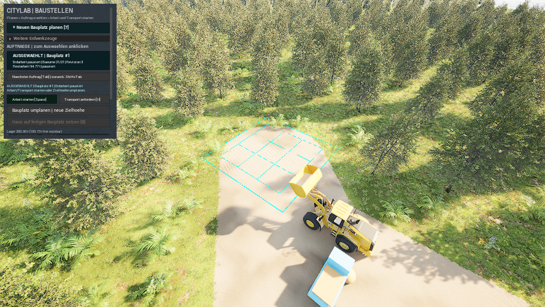

# Einen begonnenen Bauplatz umplanen

**Begrenzte Spielprüfung bestanden:** Teilrodung, Umplanung bei beladenem Lkw, kalter Neustart, drei normale Loads und die bekannte UI2-Kopiermigration sind in der neuen SiteReplan3-Fassung geprüft. Auch der aktuelle übernommene Spielerstand besteht die normalen F5/F9-Funktionen und einen kalten zweiten Prozess mit vollständigem Datenvergleich. Der bisherige UI2-Build und sein Spielerstand bleiben erhalten. Die älteren Nachweise der [Bauvorbereitung](site-preparation.md) und [Savebindung](stable-save-binding.md) gelten jeweils für ihre damalige Fassung.[^evidence]

## Ziel und Voraussetzungen

Du möchtest nach begonnener Rodung oder Erdarbeit eine andere Zielhöhe einstellen und anschließend weiterarbeiten. Der 12 × 12 m große Bauplatzkern bleibt am selben Ort; auch die gespeicherte Zufahrt wird erhalten. Ein bereits gebautes Haus schließt dieses Umplanen aus. Die Funktion gehört zur eigenen Projektkarte **`/Game/Maps/ShaderWorldSitePreparationLab`**, nicht zu einer allgemeinen ShaderWorld-Funktion.[^source]

Die Bedienung setzt den begonnenen ausgewählten Bauplatz, einen verfügbaren Maschinenzug und die fertige lokale Bodenkollision voraus. Ein anderer begonnener Bauplatz oder ein Maschinenzug an einem anderen Auftrag sperrt die Revision. Für einen übernommenen UI2-Spielerstand ist vorab die gesonderte Migration unten nötig.[^source][^migration]

## Bauplatz umplanen

1. **Den vorhandenen Bauplatz auswählen.** Seine Auftragskarte muss als ausgewählt erscheinen. Einen noch offenen neuen Entwurf zuerst über **Entwurf verwerfen [Esc]** schließen. Danach gelten die Aktionen unter den Karten für den gewählten Auftrag.
2. **Arbeit und Transport anhalten.** **Arbeit pausieren [Space]** betätigen, falls die Arbeit läuft. Falls Transport angefordert ist, zusätzlich **Transport stoppen [H]** betätigen. Arbeitspause allein hält den Lkw nicht an. Auf die fertige lokale Bodenkollision warten.
3. **Bauplatz umplanen | neue Zielhoehe** anklicken. Die Vorschau zeigt **BAUPLATZ UMPLANEN | Restarbeit**. Der Standort ist bereits festgelegt; keinen neuen Bodenpunkt wählen. Größe und Zufahrt lassen sich hier nicht verändern.
4. **Die neue Zielhöhe einstellen.** **Hoehe - 25 cm** und **Hoehe + 25 cm** ändern die absolute Zielhöhe schrittweise. **Auf Bodenhoehe**, **50 cm tiefer**, **1 m tiefer** und **50 cm hoeher** beziehen sich auf den beim Öffnen der Revision festgehaltenen Bodenpunkt. In der Vorschau die resultierende Höhe sowie Abtrag, Auffüllung und tatsächlich verfügbares Material prüfen.
5. **Plan bestaetigen + speichern [Enter]** betätigen. Die Implementierung übernimmt die Revision und speichert sie. Die Bestätigung selbst bewegt weder den Boden noch Erde. Arbeit und Transport bleiben danach pausiert. Auf die ausdrückliche Erfolgsmeldung zum Speichern achten.
6. **Gezielt weiterarbeiten.** **Arbeit starten [Space]** und bei Bedarf **Transport anfordern [H]** betätigen. Verbliebene Bäume werden nach der bisherigen Reihenfolge gerodet; die Erdarbeit setzt am tatsächlichen Boden an. Überschüssige Erde muss zurück ins Lager. Ein neuer Plan ist kein zusätzlicher Materialbestand.
7. **Den neuen Stand sichern und später fortsetzen.** Über den Speicherknopf oder `F5` speichern. Erst nach erfolgreichem Speichern schließen und dieselbe freigegebene neue Fassung mit ihrer Datenablage wieder öffnen. `F9` lädt den gespeicherten Stand erneut. Das normale Laden ist über die Controller-APIs und einen kalten zweiten Prozess geprüft.[^source][^migration]

**Entwurf verwerfen [Esc]** verwirft nur die unbestätigte neue Zielhöhe. Der alte Auftrag und seine ausgeführte Arbeit bleiben bestehen. Nach einer bestätigten Revision gibt es in diesem Ausbau kein Rückgängigmachen bereits ausgeführter Bodenarbeit; eine weitere Zieländerung benötigt eine neue Revision.[^source]

## Wenn eine Aktion gesperrt ist

Ein deaktivierter Umplanen-Knopf kann auf einen noch offenen Entwurf, laufende Arbeit, ausstehende Bodenkollision, einen anderen aktiven Bauplatz oder ein bereits gebautes Haus hinweisen. Die Statusmeldung prüfen und den passenden Zustand herstellen. Diese Laborfassung erlaubt höchstens **16 frühere Planabschnitte pro Auftrag**; die Grenze verhindert weitere Revisionen, ohne alte Abschnitte zu verwerfen.[^source]

**Neuplanen noetig** bedeutet, dass sich der Ausgangsboden seit der Planung geändert hat. Die Arbeit bleibt gesperrt, bis der Bauplatz mit einer aktuellen Vorschau neu bestätigt wurde. Fehlendes echtes Füllmaterial oder zu wenig freier Lagerplatz kann die neue Revision ebenfalls verhindern. Wird die Revision vor ihrer Übernahme abgewiesen, bleibt der bisherige Auftrag erhalten.[^source]

Diese Revision ist für die erhaltene eigene Bodenarbeit am selben Bauplatz vorgesehen. Sie ist keine allgemeine Übernahme beliebiger fremder Geländeänderungen oder eines geänderten Höhengenerators. Bei einem unerwarteten Wechsel der Weltgrundlage die ursprüngliche Fassung und ihren Stand erhalten; dafür ist eine eigene geprüfte Kompatibilitätsentscheidung nötig.[^source][^migration]

**Speichern fehlgeschlagen:** Eine bereits übernommene Revision kann im laufenden Spiel vorhanden sein, obwohl das anschließende Speichern scheitert. Die Fehlermeldung beachten, die Ursache beheben und über den Speicherknopf oder `F5` erfolgreich sichern. Nicht allein aus einer veränderten Auftragskarte auf einen gesicherten Neustartstand schließen.[^source]

## Was erhalten bleibt

Die Implementierung erhält die eingefrorenen Baumkennungen, deren Reihenfolge und den bereits gerodeten Anfang. Bereits ausgeführte Bodenabschnitte behalten ihren Plan und ihren Fortschritt. Jeder Abschnitt wird weiterhin mit eigenem Gelände-Brush projiziert; dadurch bleiben auch Übergänge zwischen Rasterpunkten erhalten. Nur die neue Restarbeit wird vom aktuellen Boden aus geplant.[^source]

Beim Abtasten der aktuellen Bodenkollision können gerundete Höhen entstehen. Solche neuen Messwerte dürfen die ursprüngliche absolute Höhenreferenz bereits ausgeführter Abschnitte nicht ersetzen. Die alte Referenz und die darauf bezogenen bisherigen Höhenänderungen müssen unverändert zusammenbleiben; die neue Messung dient der Restplanung.[^source][^reference-probe]

Ein früher gerenderter Vorabversuch hat genau diese Grenze sichtbar gemacht: Nach einer Revision sprang die **rechnerisch erwartete Höhe**, obwohl die geprüften physischen Materialkonten und die erhaltene Arbeit gleich blieben. Die strenge Prüfung brach ab. Die Korrektur verwendet für die erhaltene Ausführung weiter deren ursprüngliche absolute Referenz. Der nachfolgende SiteReplan3-Lauf und die native Komponentenregression bestehen. Aus dem Fehlversuch wird kein gemessener physischer Bodensprung abgeleitet.[^reference-probe][^evidence]

Tatsächlich bewegte Grammwerte bleiben in der Bilanz: Lager, Baustellenpuffer und Lkw-Ladung werden durch die Bestätigung nicht gefüllt oder geleert. Ein beladener Lkw behält seine Ladung, die gespeicherte Route, seine Fahrtphase und die Position auf dieser Route. Reservierungen für die neue Restarbeit werden aus dem vorhandenen Bestand neu bestimmt. Neue Transportentscheidungen erfolgen an den Routenendpunkten. Die erhaltenen Konten und der tatsächliche beladene Fahrtcheckpoint sind im gerenderten Lauf unabhängig verglichen.[^source][^evidence]

## Bekannten UI2-Spielerstand übernehmen

Die neue Fassung schreibt in dieser Karte **Format 9**. Für neue Revisionen ergänzt der Erdarbeits-Snapshot 3 die erhaltenen Planabschnitte. Ein unverändert übernommener alter Stand behält dagegen seine bisherigen Snapshot-1/2-Nutzdaten; die Migration führt keine Arbeit aus und fügt keine künstliche Vorgeschichte hinzu.[^migration]

Die Übernahme ist ein ausdrückliches Werkzeug der Projektbetreuung, kein automatischer Vorgang beim Laden und noch kein Knopf im Bau-Menü. Sie ist ausschließlich für den bekannten **UI2-Format-8-Stand** mit seiner geprüften Weltgrundlage abgenommen:

1. Im passenden alten Spiel erfolgreich speichern und die Sitzung schließen. Danach den aktuellen Stand und die zugehörige alte Anwendung unverändert aufbewahren.
2. Eine Kopie der Quelle in einer getrennten Datenablage prüfen. Das Werkzeug verlangt das eingefrorene UI2-Inhaltsprofil und ein vollständiges Rezept für die neue Fassung. Alle 366 Quellpakete samt Begleitdaten, Abhängigkeiten, Welt, Konfiguration, Engine, ShaderWorld und Shader müssen unverändert passen. Nur acht ausdrücklich benannte eigene Erdarbeits-/Bauvorbereitungs-Quelldateien dürfen sich ändern; alle 16 Terrainquellen werden einzeln verglichen.
3. Ausschließlich in einen **neuen, noch nicht vorhandenen Ziel-Slot** übernehmen. Die Quelle bleibt unverändert. Die acht vollständigen Nutzdatengruppen einschließlich Kennungen, Reihenfolgen, Weltursprung, Prozessnachweis und Grammkonten müssen gleich bleiben. Geändert werden nur Formatversion und tatsächliches Kompatibilitätsprofil; das bestehende Bindungsschema bleibt 1.
4. Erst nach bestandener getrennter Übernahme-, Lade- und Neustartprüfung die neue Fassung mit dem neuen Ziel verwenden. Für die alte Anwendung die ursprüngliche Quelle behalten. Ein Zurückkopieren des Format-9-Ziels über die alte Quelle ist kein unterstützter Rückweg.[^migration]

Normales Laden bleibt streng: Ein unbekanntes Profil, eine andere Welt oder geänderte Assets werden nicht still passend gemacht. Ein unvollständiges oder veraltetes Migrationsrezept erlaubt keine Übernahme. Die frühere Format-7-Bridge bleibt ein eigener historischer Prüfpfad in den dafür erhaltenen Fassungen; sie wird durch dieses neue Rezept nicht erweitert.[^migration][^profile]

## Geprüfter Umfang und verbleibende Grenzen

Die finale native Suite besteht **79 Tests**: 77 sauber und zwei bekannte Warnungen, kein fehlgeschlagener Test. Enthalten ist eine neue Komponentenregression an **290 Positionen** für die unveränderliche Referenz. Der frische vollständige SiteReplan3-Cook besteht in **79,82 s**, ohne Fehler und mit sechs geerbten Level-Blueprint-Warnungen.[^evidence]

Der gerenderte Create-Lauf besteht **17 Checks in 33,07 s**. Er plant nach echter Teilrodung neu und wechselt später während einer beladenen Fahrt von Abtrag zu Auffüllung. Am gespeicherten pausierten Checkpoint sind alle **21 Bäume** gerodet, zwei frühere Planabschnitte erhalten und die Planrevision ist 3. Der Lkw behält **3 t** bei **300 von 8.850 cm** Fahrstrecke; weitere **1,5 t** liegen im Baustellenpuffer. Lagerbestand **200 t**, bisheriger Abtrag **4,5 t** und Bilanzfehler **0 g** bleiben konsistent. Die Bestätigung lässt die ausgeführte Höhe unverändert. Unabhängige Kollisionsspuren an **1.089 Positionen im 50-cm-Abstand** bestehen drei stabile Durchgänge; höchstens **0,840576 cm** Abweichung bei unveränderter 5-cm-Grenze.[^evidence]

Das unveränderte **888 × 500**-Original des erfolgreichen pausierten Create-Checkpoints wurde vom Agenten visuell geprüft. Das Bild zeigt Spiel und Baustellenleiste; die Zahlen- und Kollisionsaussagen stammen aus den getrennten nativen Prüfungen.[^evidence]

Der kalte Resume-Lauf in einem anderen Prozess besteht **18 Checks in 412,86 s**. Vollständige acht Nutzdatengruppen sind beim Start und nach **drei normalen Loads** exakt gleich; danach laufen Arbeit und Transport bis **Bauplatz bereit** weiter. Lkw, Puffer und Reservierung sind am Ende leer. Die unabhängige Kollisionsprüfung besteht erneut an 1.089 Positionen in drei stabilen Durchgängen, maximal **1,271766 cm** Abweichung. Die Schlussbilanz lautet exakt:

**200.000.000 g Anfangsbestand + 4.500.000 g Abtrag = 109.729.993 g Lager + 94.770.007 g Einbau; Bilanzfehler 0 g.**[^evidence]

Die getrennte Kopie des tatsächlichen UI2-Spielerstands besteht die ausdrückliche Migration mit **zehn Checks in 1,01 s**. Alle acht Nutzdatengruppen, Weltursprünge und der gespeicherte ursprüngliche Prozessnachweis bleiben exakt erhalten; die vorhandenen **14 gerodeten Ressourcen und ein Haus** werden nicht verändert oder weiterbearbeitet. Unbekanntes Profil und vorhandenes Ziel werden atomar abgewiesen. Diese Migration bestätigt keinen allgemeinen Konverter für andere Quellen.[^evidence]

Der übernommene aktuelle Spielerstand besteht zusätzlich zwei gewöhnliche Prozesse mit jeweils **60 s** Laufzeit: erst normale Speichern-/Laden-Funktionen hinter `F5`/`F9`, danach ein kalter Start. **Vier plus zwei vollständige Rohdaten-Snapshots** erhalten alle acht Gruppen exakt. Beide Prozesse enden regulär mit **Exit 0**, ohne CSV-Aufzeichnung oder Controller-Verifikationsmodus. Ursprüngliche Quelle, Profil, alle zuvor vorhandenen Spielstände und das geprüfte Paket bleiben unverändert. Das ist ein API- und Lebenszyklusnachweis; er behauptet keinen physischen Tastendruck und keinen sichtbaren normalen Fensterstart.[^evidence]

**Der normale sichtbare Start ist separat bestanden.** Der freigegebene Launcher öffnet die passende SiteReplan3-Anwendung mit richtigem GameMode auf SitePreparationLab und eigener SiteReplanDemoUser-Ablage. Eine native Fenster-/Prozessabfrage bestätigt das antwortende Hauptfenster; das Startlog bestätigt vollständiges Kartenladen ohne Error-/Fatal-Meldung. Dieser normale Start verwendet weder Offscreen- noch Auditmodus. Er ist kein Pixelnachweis des normalen Fensters, keine physische Eingabeprüfung und keine menschliche Spielabnahme.[^evidence]

Zwei frühere Fehlversuche bleiben dokumentiert: Der erste Audit erwartete bei noch ungearbeiteter Erde fälschlich keinen zusätzlichen alten Planabschnitt; die Modellregel erhält jede bestätigte Revision. Der zweite Versuch fand die oben erklärte echte Änderung der rechnerischen Referenzhöhe. Die Prüfkriterien wurden beibehalten, der Auditvertrag beziehungsweise die Referenzwahl korrigiert und die getrennte neue Fassung erneut geprüft.[^evidence]

Die **200 t** sind der ausdrücklich deklarierte Anfangsbestand ausschließlich dieser isolierten Create-/Resume-Welt. Beim Umplanen entsteht kein Material; die normale Spielwelt und die kopierte Spielerquelle erhalten keinen solchen Bestand. Weitere Richtungswechsel während einer Auffüllfahrt sind nativ geprüft, aber nicht zusätzlich als gerenderter Spielablauf abgenommen. Normale Controller-APIs, gerenderte Bilder, physische Tastendrücke und menschliche Prüfung bleiben getrennte Nachweisarten.[^evidence]
