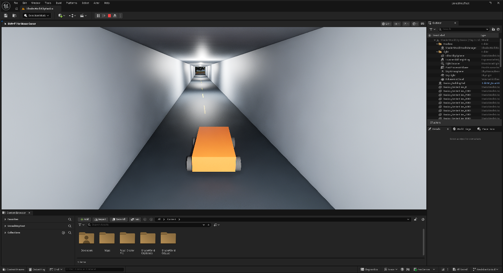

# Einen Tunnel mit eingebautem Wasserausschluss verwenden

Ein Tunnel, der im ShaderWorld-Ozean trocken bleiben soll, braucht **einen ausdrücklichen Wasserausschluss**. Der Tunnelboden allein verdrängt kein Wasser. Unsere eigene Komponente **CityLab Tunnel (Dry)** integriert diesen Ausschluss laut Projektcode fest in den Tunnelaufbau: Die native Air-Pocket-Funktion ist bereits enthalten und ihre Größe folgt den Tunnelmaßen.[^own-tunnel-component]

**Stand: implementiert und native API getestet.** Der Projekt-Build und zwei native Automationtests sind bestanden. Die Karte ist auf die neue Komponente umgestellt, gespeichert, erneut geladen und im neu gestarteten PIE geprüft. Ein frischer Spielprozess hat anschließend 65/65 Kollisionsproben und rund 259,44 m bodengebundene Durchfahrt bestanden. Die manuelle Blueprint-Bedienfolge wurde bislang nicht geprüft. Eine neue native PIE-Aufnahme zeigt den sichtbaren Tunnelinnenraum trocken; das ist ein einzelner inspizierter Frame.[^component-proof] Der frühere Sichtnachweis gilt für die zuvor separat eingerichtete Box.[^previous-box-proof]

*Native PIE-Aufnahme vom 28. Oktober 2026 nach Umstellung, Kartenneuladen und neuem PIE-Start: freier Boden, Wände und Testbuggy. Ein inspizierter Frame; kein Langzeit- oder GPU-Wasserhöhennachweis.*[^component-proof]

## Voraussetzungen

Benötigt wird das ursprüngliche **UnrealMcpTest** mit der eigenen C++-Erweiterung und ShaderWorld 4.1. Erst nach erfolgreichem Modul-Build und Laden der Klasse kann die Komponente im Editor erscheinen. Sie ist **keine mitgelieferte ShaderWorld-Komponente**; dieses öffentliche Dokumentations-Repository enthält den Projektcode und die Unreal-Assets nicht.

Das Tunnelasset braucht weiterhin eigene Geometrie und Kollision für Boden, Wände und Decke sowie passende Terrainöffnungen an den Portalen. Die [Bergtunnel-Anleitung](holes-and-mountain-tunnels.md) beschreibt diesen Aufbau. Das verwendete Wassermaterial muss den **ShaderWorld Water Exclusion**-Knoten in seiner **Opacity Mask** auswerten. Im aktuellen **M_Ocean_Material** wurde dieser Anschluss bereits geprüft.[^ocean-guide]

## Im Blueprint verwenden

1. Öffne einen eigenen Actor-Blueprint für ein gerades Tunnelstück. Wähle **Add Component** und suche **CityLab Tunnel (Dry)**. Wenn der Eintrag fehlt, zuerst Build und geladene Projektklasse prüfen.
2. Richte die Komponente so aus, dass **ihre lokale X-Achse längs durch den Tunnel** zeigt. Der Ursprung liegt **in der Mitte des freien Tunnelquerschnitts**, mittig zwischen Boden und Decke sowie mittig zwischen den Portalen. Verwende Skalierung **1** und ändere die Maße über die Eigenschaften.
3. Trage die freie Passage ein: **Passage Length**, **Passage Width** und **Passage Height**, jeweils in **Zentimetern**. Gemeint sind freie Länge, Breite und Höhe; die Wandstärke gehört nicht zur Durchfahrt.
4. Stelle den Überstand vor den Portalen sowie seitliche und vertikale Zugaben ein. Daraus wird die geerbte Box-Größe berechnet. Sie muss die Stellen umfassen, an denen Wasser ausgeschlossen werden soll.
5. Kompiliere und speichere den Blueprint, platziere ihn im Level und speichere die Karte. Prüfe die schreibgeschützte Anzeige **Air Pocket Half Extent Cm** (`AirPocketHalfExtentCm`). Sie zeigt die berechneten Halbausdehnungen; das geerbte Shape-Feld **Box Extent** ist in dieser eigenen Komponente ausgeblendet. Der Code aktualisiert die Größe bei Editoränderungen, beim Laden und bei der Komponentenregistrierung.
6. Ändere Profilmaße zur Laufzeit aus Blueprint über **Configure Tunnel** (`ConfigureTunnel`). Die Eigenschaften sind für Blueprint-Code schreibgeschützt; dafür gibt es keine direkten Set-Nodes. **Refresh Tunnel Air Pocket** (`RefreshTunnelAirPocket`) berechnet den Ausschluss aus dem aktuellen Profil erneut. Wer Profilfelder direkt in C++ ändert, muss danach Refresh aufrufen. Die tatsächliche Blueprint-Bedienfolge ist noch nicht manuell geprüft.[^own-tunnel-component]

## Maße des geraden Labortunnels

| Eigenschaft | Standardwert im Code | Zweck |
| --- | --- | --- |
| `PassageLengthCm` | **17000 cm = 170 m** | Freie Länge entlang der lokalen X-Achse |
| `PassageWidthCm` | **800 cm = 8 m** | Freie Innenbreite |
| `PassageHeightCm` | **600 cm = 6 m** | Freie Höhe zwischen Fahrbahn und Decke |
| `PortalOverlapCm` | **500 cm = 5 m** | Zusätzlicher Ausschluss an jedem Längsende |
| `SidePaddingCm` | **400 cm = 4 m** | Zusätzlicher Ausschluss auf jeder Seite |
| `VerticalPaddingCm` | **1700 cm = 17 m** | Zusätzlicher Ausschluss ober- und unterhalb der Passage |

Die Berechnung der **Halbausdehnungen** im Code lautet:

- **X:** halbe Passagelänge + Portalüberstand = **9000 cm**.
- **Y:** halbe Passagebreite + seitliche Zugabe = **800 cm**.
- **Z:** halbe Passagehöhe + vertikale Zugabe = **2000 cm**.

Die Box ist damit insgesamt **180 × 16 × 40 m** groß. Diese großzügige Laboreinstellung dient dem ersten Aufbau. Bei einem fertigen Tunnelasset muss der Ausschluss die Portale zuverlässig abdecken, soll aber benachbarte offene Wasserflächen nicht unbeabsichtigt trocken schneiden.

Im Labortunnel liegen die Fahrbahn bei **Z = 300 cm** und die Deckenunterseite bei **Z = 900 cm**. Der Komponentenmittelpunkt liegt deshalb bei **Z = 600 cm**. Im Labor bleibt der bestehende Actor **Basics_Tunnel_AirPocket** am Weltursprung **(0, 0, 0) cm**; seine neue Komponente **Tunnel** hat **Relative Location = (0, 0, 600) cm**. Die alte separate Komponente **DryTunnel** ist entfernt. Die Eigenschaften wurden im Editor, nach tatsächlichem Neuladen der gespeicherten Karte und im neu gestarteten PIE zurückgelesen.[^component-proof] Die bisher separat geprüfte Box war am Ursprung **Z = 0** zentriert. Ihr alter Nachweis darf nicht als Prüfung der neuen Platzierung übernommen werden.[^previous-box-proof]

## Welche Arbeit die Komponente übernimmt

`UCityLabTunnelComponent` erbt direkt von der nativen **ShaderWorldAirPocketBoxComponent**. Die Air Pocket ist damit Teil der Tunnelkomponente; ein Nutzer soll keine zweite Ausschlusskomponente von Hand hinzufügen müssen. Die geerbte Box hat keine feste Kollision und bleibt im Spiel unsichtbar. Die feste Tunnelkollision kommt weiterhin aus den Tunnelmeshes.[^own-tunnel-component]

Die Komponente erzeugt **keine Tunnelmeshes oder Holebrushes** und ist zunächst für einen geraden Abschnitt gedacht. Ein Kurventunnel benötigt einen eigenen Aufbau beziehungsweise einen Ausschluss entlang seiner Kurve; eine einzelne lange Box folgt keinem Spline. Auch SaveGame-Daten für Trasse, Tunnelprofil und Wiederaufbau gehören bisher nicht zu dieser Komponente.

## Wenn die Einrichtung nicht passt

| Beobachtung | Nächste Prüfung |
| --- | --- |
| **CityLab Tunnel (Dry)** fehlt bei **Add Component** | Eigene Projektklasse erfolgreich bauen und laden; ein frisches ShaderWorld-Projekt enthält sie noch nicht. |
| Nach einer Blueprint-Laufzeitänderung stimmt die Box nicht | Profilwerte gemeinsam über **Configure Tunnel** setzen; sie sind für direkte Blueprint-Zuweisungen schreibgeschützt. |
| Wasser bleibt im Innenraum sichtbar | Komponentenlage, Ausschlussgrenzen und Water-Exclusion-Anschluss im tatsächlich verwendeten Wassermaterial prüfen. |
| Wasser verschwindet neben dem Tunnel | Padding verkleinern und die Grenze innerhalb geschlossenen Terrains oder der Tunnelhülle halten. |
| Keine Tunnelwände oder kein befahrbarer Boden entstehen | Eigene Meshes und deren Kollision ergänzen; die Komponente liefert ausschließlich den Wasserausschluss. |
| Bei weit herausgezoomter oder hoher Kamera erscheint Wasser wieder | Die Render-Reichweite **sw.Water.AirPocketRange** prüfen; Details unten. |

Für die City-Builder-Kamera ist eine weitere Codegrenze wichtig: **sw.Water.AirPocketRange** steht standardmäßig auf **30000 cm = 300 m**. Entscheidend ist der dreidimensionale Mindestabstand der ersten Renderkamera zur umschließenden Begrenzungsbox der Ausschlussgruppe. Außerhalb dieser Reichweite erhält das Wassermaterial die Gruppe nicht mehr; CPU-Wasserabfragen können den Ausschluss weiterhin berücksichtigen. **0 bedeutet nicht unbegrenzt**, sondern nur Gruppen, deren Begrenzungsbox die Kamera enthält. Bei hohem Zoom muss die Reichweite ausreichend sein. Eine Erhöhung für unsere City-Builder-Kamera wurde bisher nicht praktisch abgenommen.[^installed-render-range]

## Was geprüft wurde und was noch offen ist

Der native Build und beide Automationtests sind erfolgreich. Sie liefen in einem frischen Prozess mit **NullRHI**, also ohne gerendertes Ozeanbild.[^component-proof]

| Prüfung | Ergebnis und Grenze |
| --- | --- |
| Profil und Größen | Standardmaße, sofortige Änderung über ConfigureTunnel, Größenanzeige und ungültige Eingaben geprüft |
| Editor-/Lade-Callbacks | Reflektierte Property-Änderung und Archive-Rundlauf mit PostLoad geprüft; letzteres ist kein gespeicherter Karten-/Package-Ladetest |
| Wasserabfragen | Echtes ShaderWorld-WaterSubsystem mit kontrolliertem ebenem Wasserprovider; Punkte innen/außen, Rotation, Verschiebung, Skalierung einschließlich Spiegelung geprüft |
| Registrierung und Laufzeitänderung | Eine Registrierung, Bewegung, Verkleinerung ohne Duplikate und Entfernen des Ausschlusses geprüft |
| Gespeicherte Laborkarte und neues PIE | **Bestanden:** genau eine neue Tunnelkomponente, sechs Profilwerte, Halbausdehnungen, Relative Location Z = 600 cm, Rotation/Skalierung und ausgeschaltete Kollision nach tatsächlichem Kartenladen und neuem PIE geprüft |
| Durchfahrt nach Umstellung | **Bestanden:** frischer Spielprozess, 65/65 Kollisionsproben, 134/134 Bewegungs-Samples am Boden, rund 259,44 m ohne Teleport während der Durchfahrt; CharacterMovement, keine Chaos-Fahrzeugphysik |
| Gerenderter Innenraum | **Ein neuer PIE-Frame inspiziert:** sichtbarer Tunnel trocken; keine Abnahme aller Wellenphasen oder Kamerarouten |
| Blueprint-Klickfolge | **Noch nicht manuell geprüft** |

Die bisherige manuelle Box ist mit der Karte gespeichert, nach einem PIE-Neustart ausgelesen und mit der ersten Nutzerantwort **„Bisher trocken“** belegt. Das bestätigt den Ansatz an der damaligen Stelle, aber nicht die neue Komponente an **Z = 600 cm**.[^previous-box-proof]

Der [Komponentenbericht](../evidence/tunnel-component-report.json) ist für diesen Prüfumfang **passed_with_limits**. Dauerhaft sichtbare Trockenheit und echte Ozean-Wasserabfragen brauchen weitere Nachweise. Ein gespeichertes Level ist außerdem kein Nachweis für die eigene Laufzeit-SaveGame-Funktion.

[^own-tunnel-component]: Eigene Projektimplementierung `Source/UnrealMcpTest/CityLabTunnelComponent.h/.cpp` im ursprünglichen UnrealMcpTest, im Quellcode gelesen. Die beschriebene Schnittstelle und Maße sind im Code vorhanden. Nativer Build, API-Tests und gespeicherte Karten-/PIE-Eigenschaften sind geprüft; der neue sichtbare Innenraum ist in einem einzelnen PIE-Frame geprüft, eine Langzeit-/GPU-Prüfung steht noch aus. Projektcode wird hier nicht mitgeliefert.
[^previous-box-proof]: [Bisheriger Korrekturbericht der separaten Box](../evidence/coast-correction-report.json): Mittelpunkt `(0, 0, 0) cm`, Halbausdehnungen `(9000, 800, 2000) cm`, gespeichert, nach neuem PIE-Start ausgelesen und erste Nutzerantwort „Bisher trocken“.
[^ocean-guide]: [Ozean und Wasserausschlüsse](ocean-waves-and-foam.md): Materialanschluss, Codebefunde und Grenzen der Wasserabfragen.
[^component-proof]: [Komponentenbericht mit bestandenem Build und zwei nativen Tests](../evidence/tunnel-component-report.json). Native Automation mit NullRHI und kontrolliertem Wasserprovider; zusätzlich gespeicherte Karte nach echtem Neuladen und Eigenschaften im neuen PIE geprüft. Ein neuer PIE-Frame zeigt den sichtbaren Innenraum trocken. Ein frischer Spielprozess bestand 65/65 Kollisionsproben und rund 259,44 m bodengebundene Durchfahrt.
[^installed-render-range]: Gelesene ShaderWorld-4.1-Quellen: `SWSceneViewExtension.cpp`, Zeilen 6–10 und 143–155, sowie `ShaderWorldAirPocket.cpp`, Zeilen 69–86. Kamerafilter für das Materialpaket, kein entsprechender Filter der CPU-Wasserabfragen. Lizenzierte Quellen werden nicht mitgeliefert; kein neuer Zoomversuch.
