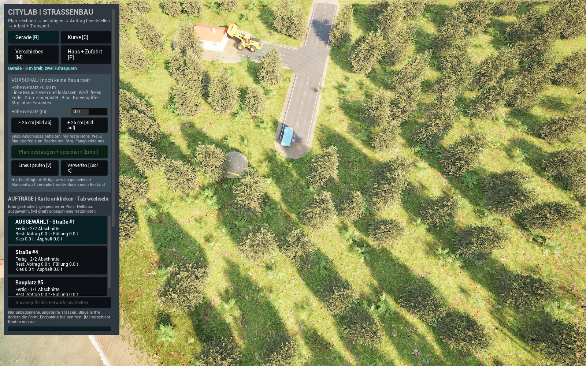
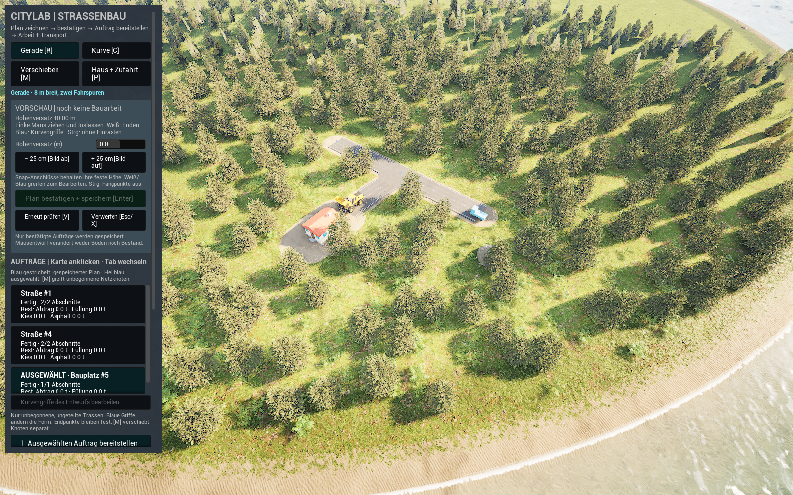
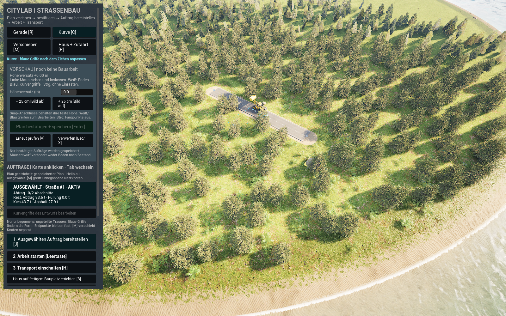

# Straßen zeichnen und von Maschinen bauen lassen

## Schnell starten

1. Im Unreal-Projektordner **`Start CityLab.cmd` doppelklicken**. Dieser Einstieg bleibt gleich und öffnet die geprüfte Straßen-Demo. Läuft das Fenster bereits, dieses weiterverwenden.
2. **R** für eine Gerade oder **C** für eine Kurve wählen. Mit der **linken Maustaste von einer vorhandenen Straße ins Gelände ziehen und loslassen**. Bei der Kurve anschließend die blauen Griffe formen.
3. Kurz die **automatische Vorschauprüfung** abwarten. **Ein weißes freies Ende ist richtig**; Grün bedeutet nur eingerastet. Gelb bedeutet, dass Terrain oder Bewuchs noch rechnen. Bei einem echten Fehler die angezeigte Ursache beheben.
4. Mit **Enter den Plan bestätigen**. Dadurch entsteht ein gespeicherter Auftrag; Maschinen beginnen noch nicht von selbst.
5. Die neue **Auftragskarte wählen**, mit **J bereitstellen**, dann **Leertaste für Arbeit** und **H für Lkw-Transport**. Die Schaltflächen sind Umschalter: Nach dem Laden zuerst lesen, ob Arbeit/Transport bereits eingeschaltet sind.
6. **F5 oder K speichern**, **F9 oder L laden**; alternativ die direkten Schaltflächen nutzen. Vor dem Schließen die Speichermeldung prüfen.[^controls-source][^runtime-source][^current-road-fix]

Die Demo enthält wieder die bekannte **T-Kreuzung, Hauszufahrt und das Testhaus**. Der geneigte T-Anschluss ist jetzt durchgehend asphaltiert. Du baust von diesem übernommenen Stand aus weiter; der Launcher setzt deinen neuen Demo-Spielstand beim nächsten Start nicht zurück. Während der Maschinenanfahrt kann kurz **Zufahrt fehlt** stehen, obwohl das Fahrzeug bereits fährt; das Label allein bedeutet keine unterbrochene Verbindung.[^current-road-fix]

## Stand und Prüfdetails

**Aktueller Stand vom 30. Oktober 2026: RoadConstruction8 besteht die Eingabe- und Straßenbauprüfung.** Native Tests, Builds, Cook, T-Anschluss und 32/32 normale Spiel-UI-/Bauchecks sind bestanden; auch die neu fertig gebaute Straße besteht den kalten Neustart. Die getrennte Demo mit erhaltener T-Kreuzung und Haus ist über **Start CityLab.cmd** geprüft geöffnet. Die früheren automatisierten Bau-, Bilanz- und Neustartnachweise bleiben für ihren damaligen Umfang gültig und werden unten als RoadConstruction6-Historie erhalten. Sie ersetzen die aktuelle Eingabe- und T-Nahtprüfung nicht.

## Geprüfte Korrektur: RoadConstruction8

**Der begrenzte Fix ist implementiert, frisch gebaut und im normalen Spiel geprüft.** Editor5 und Game4 bestehen in **74,26/73,51 s**. Die finale native Suite besteht **107 Tests**, davon **105 sauber** und **zwei mit bekannten Warnungen**, in **118,11 s**. Der frische Cook8 besteht in **93,15 s BuildCookRun**, UAT gesamt etwa **95 s**, Exit 0. Diese Nachweise allein belegen noch keine funktionierende normale Straßenbedienung.[^current-road-fix]

- **Speichern/Laden:** Ein eigener Eingabeprozessor behandelt F5/F9 vor den Engine-Debugbefehlen. Die bekannten Konflikte werden ausschließlich am eigenen Straßencontroller entfernt; K/L und die Schaltflächen bleiben erhalten. Die neue Spielprüfung verwendet tatsächliche Slate-F5/F9-Ereignisse: exakt gespeichert/geladen, Lit-Ansicht erhalten, kein F9-Debugbild ausgelöst. Es wurde kein globaler Startschalter zur Unterdrückung der Debugbindungen verwendet.
- **Vorschau:** Bei laufender Terrain-/Bewuchsarbeit bleibt derselbe Entwurf ausstehend und prüft die Bereitschaft alle **0,5 s** automatisch erneut. Es werden dabei keine neuen Bodenraster pro Frame angelegt. Gelb bedeutet Warten; ein weißes freies Ende ist zulässig, Grün am Endgriff bedeutet lediglich Einrasten. Loslassen während einer tatsächlichen Neuberechnung und anschließendes Bestätigen ohne V sind inzwischen im Spiel geprüft: derselbe Entwurf wird im beobachteten Fall nach rund 1,75 s freigegeben. Das ist eine Messung dieses Versuchs, keine feste Wartezeit für alle Welten.
- **T-Kreuzung:** Straßenstücke werden an den drei Anschlüssen zugeschnitten. Für die unterstützten T-Formen folgt die neue Abdeckung ihren tatsächlichen Höhen und verwendet dieselben Dreiecke für die Kollision. Gefrorene Bodenraster und Materialkonten werden dadurch nicht nachträglich verändert. Eine erste RoadConstruction7-Fassung hatte trotz passender Eckpunkte falsch orientierte Dreiecke; der normale Test fand **0/9** Abdeckungstreffer und **3/6** Nahttreffer. Diese Fassung ist verworfen. Die Orientierung wurde an der Engine-Referenz korrigiert und um einen nativen Regressionstest ergänzt; die neue gerenderte Naht-/Bodenprüfung ist inzwischen bestanden.

Der bekannte RoadConstruction6-Zustand wurde in einer getrennten Kopie für Cook8 übernommen: vollständiger nativer Zustand nach Rückprojektion der ausdrücklich erneuerten Inhalts- und Baumkennungen exakt, normales strenges Laden bestanden, Original und alle vorherigen Saves unverändert. Das ist keine allgemeine Migration beliebiger zukünftiger Builds. Der übernommene T-/Hauszustand besteht inzwischen auch das getrennte normale kalte Funktionspaar.[^current-road-fix]

**T-Kreuzung und kaltes Laden bestanden:** Zwei normale Spielprozesse mit Exit 0 liefern **vier+zwei vollständige Zustandsaufnahmen**. Netz, Bauzustand, Bodensites, Rodungen, Häuser und übrige Metadaten sind exakt; nur für Kamerakomponenten gilt 1e-8. Vier Messdurchgänge an derselben T-Kreuzung bestehen jeweils **9/9 Kollisionsmittelpunkte, 6/6 Nahtstrahlen und 25/25 Bodenproben**. Größte Kollisionsabweichung **0,000237 cm**, größter Nahtrest **0,000233 cm**, tatsächlicher Höhenunterschied über das 1 cm breite Naht-Probenpaar **0,039290 cm**. Die bisherigen Prüfgates bleiben erhalten. Das normale Paar verwendet Speicher-/Ladefunktionen, keine physischen F-Tasten.[^current-road-fix]



*Unverändertes originales 1600 × 1000-Spielbild, von Agenten visuell geprüft. Die T-Fläche ist in dieser Weitansicht durchgehend asphaltiert; die Nahtgenauigkeit stammt aus den separaten Messungen. Das Bild belegt weder eine menschliche Eingabenprüfung noch den Abschluss der neuen Straßenbauprüfung.[^image-origin]*

**Eingabe und echter Straßenbau bestanden: 32/32 Checks.** Die normale verpackte Spielprüfung zieht mit tatsächlichen Slate-Mausereignissen von einem eingerasteten Start zu einem freien weißen Ende. Ein echtes Laden während des Ziehens erzwingt die Terrainneuberechnung; nach dem Loslassen bleibt der Entwurf exakt erhalten und wird ohne V erneut freigegeben. Enter bestätigt genau einen zunächst inaktiven Auftrag. F5/F9 speichern und laden den vollständigen Zustand ohne Ansichtswechsel oder Debug-Screenshot. Diese Prüfung speist Ereignisse in die Anwendung ein; sie ist keine OS-Mausautomation oder menschliche Abnahme.[^current-road-fix]

Anschließend starten tatsächliche **J → Leertaste → H**-Ereignisse Maschine, Arbeit und Lkw. Eine Straße wird mit normalen Produktionsraten in der isolierten Welt fertig; die gesamte native Prüfung dauert **602,921449 s**. **2.230 Bilanzbeobachtungen**, höchstens **12 t Lkw-Ladung** und **18 t Puffer**, am Ende leere Ladung/Puffer sowie **0 g Kontenfehler** für Erde, Kies und Asphalt. Das unveränderte **5-cm-Bodengate** besteht; F5 speichert den fertigen Zustand exakt. Konten in Gramm sind keine unabhängige Volumenmessung des Meshes.[^current-road-fix]

**Auch die neu gebaute Straße lädt kalt exakt:** Ein weiteres normales Paar mit zwei getrennten Prozessen, Exit 0, prüft den tatsächlich fertig gespeicherten Zustand aus der 32er-UI-Prüfung. **Vier+zwei vollständige Zustandsaufnahmen**, alle fünf Gruppen und Metadaten exakt, Kamera mit derselben **1e-8**-Komponententoleranz; Quellen, Paket und vorherige Spielstände bleiben unverändert. Dieses Paar ruft Speicher-/Ladefunktionen auf; die tatsächlichen Slate-F5/F9-Ereignisse sind getrennt darüber belegt.[^current-road-fix]

**Demo und Einstieg bestanden:** `Start CityLab.cmd` öffnet jetzt standardmäßig die geprüfte **RoadConstruction8**-Demo mit erhaltener T-Kreuzung, Hauszufahrt und Haus. Ihr Spielstand wurde genau einmal aus dem kalten T-Teststand kopiert. Der normale sichtbare Start bestätigt passende Karte, GameMode, eigene Datenablage und antwortendes Fenster; ein zweiter Start wird abgewiesen. Der Launcher kopiert den Startstand später nicht erneut. Der [Git-Plan](../reference/citylab-source-control-plan.md) bleibt ein gesonderter Entwurf; die vollständige Road-Creator-Pro-Integration folgt später.[^current-road-fix]

## Bekannte Fehler im normalen Spiel

**Historische Diagnose an RoadConstruction6 vor dem neuen Fix.** Die folgenden Befunde und damaligen Ausweichwege bleiben erhalten. Die aktuelle Korrektur und ihre begrenzte neue Abnahme stehen darüber.

- **F5/F9 kollidieren mit Unreal-Debugtasten.** UE 5.8 bindet F5 an `viewmode shadercomplexity`, F9 an `shot showui` und F3 an `viewmode lit`. Der Elternagent drückte im laufenden Spiel F5; das Log bestätigte `Set new viewmode: ShaderComplexity`. F3 stellte die normale Lit-Ansicht sichtbar wieder her. Daraus folgt nicht, dass F5 niemals zugleich gespeichert hat; bestätigt ist der zusätzliche Ansichtswechsel. Für diese Demo vorerst **K zum Speichern**, **L zum Laden** oder die direkten Schaltflächen **Speichern/Laden** verwenden. K/L und die Schaltflächen rufen laut eigenem Code die Speicherfunktionen auf; ihre physischen Tastendrücke wurden hier nicht geprüft. Die alten F5/F9-Automationen riefen Controllerfunktionen auf und konnten diesen Engine-Tastenkonflikt deshalb nicht erkennen. `-NoDebugExecBindings` könnte laut `PlayerInput.cpp` die Engine-Debugbindungen beim Start unterdrücken; das wurde hier weder angewendet noch geprüft.[^normal-ui-followup]
- **Rote Vorschau kann nach einer frühen Prüfung hängenbleiben.** Die UI versucht die volle Boden-/Bewuchsprüfung einmal nach dem Loslassen und löscht dabei schon ihren Ausstehend-Zustand. War ShaderWorld gerade beschäftigt, genügt späteres Stillhalten allein nicht. **V / Erneut prüfen** stößt einen neuen Versuch an, ist aber keine belegte Reparatur: Im aktuellen Live-Versuch blieb die Vorschau auch danach blockiert. Welches native Bereitschaftsgate dort weiter offen ist, wurde im laufenden Frame nicht ermittelt. Der Bauaudit wartet vor Planung ausdrücklich auf Bereitschaft und deckt diesen Bedienfall nicht ab. Ein grüner Griff bedeutet nur eingerasteter Netzanschluss; ein freies Ende darf weiß bleiben.[^normal-ui-followup]
- **Die T-Abdeckung folgt der Steigung noch nicht.** Sie wird im eigenen Darstellungs-Code als flache Fläche auf Knoten-Z + 5 cm gelegt. Im gemeldeten Beispiel ergibt der Quell-/Zustandsvergleich am 6,5 m entfernten Anschlussrand ungefähr 335 cm für die Abdeckung gegenüber 307 cm für die Fahrbahn: **rund 28 cm sichtbare Stufe**. Diese Werte sind ein Quellen-/Zustandsbefund, keine unabhängige Pixelmessung. Die Abdeckung hat `NoCollision`; erfolgreiche Terrain-Kollisionsproben beweisen daher keine passende sichtbare T-Naht.[^normal-ui-followup]

Der damalige Diagnose-Nachtrag enthält noch keinen Fix oder Neubuild. Die neu implementierte Korrektur ist separat oben geprüft; die folgenden RoadConstruction6-Belege werden dadurch nicht zu Nachweisen der neuen Fassung.[^evidence]

**Der begrenzte Straßenablauf ist mit Speichern und kaltem Neustart geprüft.** Straße planen, Griffe bearbeiten, bestätigen, Maschinen bereitstellen, Material holen und abschnittsweise bauen lassen; anschließend Hauszufahrt, Grundstück und Testhaus. Die finale Fassung besteht **99 native Tests**, einen frischen Cook und **35/35 + 61/61 gerenderte Produktionsprüfungen**. Dazu kommt das normale F5-/F9-/Kaltstartpaar mit vier plus zwei vollständigen Zustandsaufnahmen. Dieser historische Nachweis gilt für **RoadConstruction6** und seinen eigenen Spielstand. Sie beschreibt die Bedienung nach Quellcode und geprüften Produktions-Controller-APIs; eine physische Maus-/Tasten- oder menschliche Spielabnahme wird daraus nicht abgeleitet.[^evidence] Frühere [RoadLab-Straßen](runtime-roads.md) und [Bauplatz-Spielstände](stable-save-binding.md) behalten ihre eigenen Nachweise.[^controls-source][^runtime-source]



*Unverändertes originales 1600 × 1000-SHOWUI-Bild aus dem zweiten normalen Spielprozess. Straße, Hauszufahrt, Haus und fertige Auftragskarten sind sichtbar. Beide Agenten haben die Aufnahme visuell geprüft. Dass derselbe Zustand exakt geladen wurde, belegt das getrennte normale Speicher-/Ladepaar; das Bild allein misst keine Gramm oder Kollisionshöhen.[^evidence][^image-origin]*

## Ziel und Voraussetzungen

Zum direkten Ausprobieren im Unreal-Projektordner **`Start CityLab.cmd`** doppelklicken. Er öffnet die getrennte **RoadConstruction8**-Demo mit ihrer eigenen Datenablage. Alternativ in PowerShell:

```powershell
.\Tools\launch_road_construction_demo.ps1
```

Die neue Demo wurde genau einmal mit der geprüften T-/Hauskopie vorbereitet. Du siehst deshalb bereits Straße, Hauszufahrt und Haus und kannst von diesem Netz aus weiterbauen. Der Launcher prüft Programm-/Paketdateien und die eigene Ablage; er besät oder überschreibt den Spielstand nie erneut. Die frühere RoadConstruction6-Demo lässt sich ausdrücklich mit `-PreviousBuild` wählen. Alte Demoablagen und ihre Daten bleiben getrennt.[^current-road-fix]

Im passenden Projektbuild kannst du alternativ **`/Game/Maps/ShaderWorldRoadConstructionLab`** öffnen und das Spiel starten. Benötigt werden Unreal **5.8.4**, ShaderWorld **4.1** und die vorhandenen RCP-, Erdmaterial- und Fahrzeugimporte. Das öffentliche OKF enthält ihre Beschreibung, keine kopierten lizenzierten Modelle oder Texturen.[^plan][^materials][^vehicles]

Links erscheint **CITYLAB | STRASSENBAU**. Warte nach dem Start, bis Insel, Bewuchs und Bodenkollision bereit sind. Eine frische Laborwelt beginnt mit kurzer vorhandener Zufahrt und Depot/Lager; die vorbereitete Demo enthält zusätzlich den abgeschlossenen Teststand. Startinfrastruktur und die endlichen Anfangsvorräte sind eine ausdrücklich eingerichtete Laboranlage. Neue Straßen schließen an der tatsächlich erreichbaren Netzfront an.[^runtime-source][^evidence]

Die Kartenfassung nutzt die projekteigene Terrain-Unterklasse **`CityLabRoadTerrainActor`**. Ihre Übernahme betrifft nur diese gewidmete Straßenkarte; rekursive Einstellungs-/Transform-/Peer-Vergleiche und gespeicherter Kartenreadback sind bestanden. **1.066 geschützte Dateien und 329 normale Spielstände blieben bei der Übernahme unverändert**; neues Manifest mit 411 Paketen, altes Profil unverändert. Die damalige Spiel-/Neustartabnahme gehört zu **RoadConstruction6**; die neue RoadConstruction8-Abnahme steht separat oben. Frühere Pakete behalten ihre Fehlerbelege und werden nicht zur finalen Fassung umgedeutet.[^terrain-readiness][^evidence]



*Originales 1600 × 1000-SHOWUI-Bild aus dem erfolgreichen Create35/35, unverändert und von zwei Agenten visuell geprüft. Links ist ein aktiver Abtragsauftrag ausgewählt; Arbeit und Transport sind für den Speichercheckpoint ausgeschaltet. Die sichtbare asphaltierte Zufahrt ist vorhandene Startinfrastruktur. Das Bild zeigt noch keine neu fertig gebaute Straße. 12 t Lkw-Ladung/5,25 t Puffer werden durch den Bericht belegt, nicht aus Pixeln abgeleitet. Keine physische Eingabe oder menschliche Abnahme.[^evidence][^image-origin]*

Der neue Slot heißt **`CityLabRoadConstruction`**. Andere CityLab-Karten und normale alte Spielstände werden nicht automatisch dafür übernommen; die bekannte RoadConstruction6-T-Kopie ist die ausdrücklich geprüfte Ausnahme. Für die ersten Schritte kurze, flache Verlängerungen der Startstraße verwenden; extreme Höhen oder große Kurven erschweren die Fehlersuche.

## Eine erste Gerade zeichnen

1. **Gerade [R]** wählen. Den Mauszeiger über ein Ende der vorhandenen Straße setzen, linke Maustaste drücken, einige Meter ins angrenzende Gelände ziehen und loslassen. Ein grüner Endgriff zeigt einen eingerasteten Anschluss. Die Vorschau umfasst die vollen **8 m Fahrbahnbreite**.
2. Nach dem Loslassen die Anzeige **VORSCHAU | noch keine Bauarbeit** lesen. Erst jetzt werden Boden, Rodung und Materialbedarf genauer geprüft. Während des Ziehens wird die Form geprüft; eine passende Farbe allein bestätigt noch keine fertige Bodenprüfung.
3. Bei Bedarf den weißen Start- oder Endgriff erneut mit links ziehen. **Bild auf/ab** ändert den Höhenversatz in Schritten von **25 cm**; alternativ den Wert **Höhenversatz (m)** bearbeiten. Eingerastete Anschlüsse behalten ihre feste Höhe. **Strg** während des Formens schaltet das Einrasten vorübergehend aus.
4. Warten, bis die Vorschau freigegeben ist. Während Terrain und Bewuchs rechnen, bleibt der Entwurf gelb ausstehend und prüft automatisch weiter; **Erneut prüfen [V]** ist zusätzlich möglich. Ein freies weißes Ende ist zulässig und muss nicht grün einrasten. Bei einem echten Formfehler den angezeigten Grund beheben; eine zu steile, zu enge oder zu lange Straße wird nicht durch Bestätigen erzwungen.
5. **Plan bestätigen + speichern [Enter]** anklicken. Jetzt entsteht ein gespeicherter Auftrag und eine Auftragskarte. Eine blau gestrichelte Kontur hält den bestätigten Plan sichtbar; der ausgewählte Plan erscheint hellblau. Noch wird keine neue Straßenoberfläche eingebaut.[^controls-source][^runtime-source]

**Verwerfen [Esc/X]** löscht ausschließlich den noch unbestätigten Mausentwurf. Werkzeugwechsel verwirft ihn ebenfalls. Ein bereits bestätigter Auftrag bleibt erhalten; dafür gibt es später die gesonderte Stornieren-Aktion.

## Die Maschinen ausdrücklich starten

Diese drei Aktionen haben verschiedene Aufgaben:

| Aktion | Was danach vorbereitet oder eingeschaltet ist |
| --- | --- |
| Auftragskarte anklicken, dann **Ausgewählten Auftrag bereitstellen [J]** | Genau dieser bislang unbegonnene Auftrag wird dem freien Maschinenzug zugewiesen. Die echte Zufahrt und der Ausgangsboden werden erneut geprüft. Arbeit und Transport bleiben zunächst aus. |
| **Arbeit starten [Leertaste]** | Maschine fährt auf ihrer geprüften Route zum Arbeitsstand und darf anschließend roden beziehungsweise bauen, soweit Boden und Material freigegeben sind. |
| **Transport einschalten [H]** | Der Lkw holt den benötigten Baustoff am gemeinsamen Lager ab oder fährt gelösten Boden zum Lager. Er besitzt eine begrenzte tatsächliche Ladung. |

Für den ersten Versuch deshalb **Auftragskarte → J → Leertaste → H** verwenden. Bei einer später geladenen laufenden Baustelle zuerst die Beschriftungen prüfen: Die Schalter sind Umschalter; erneutes Drücken kann eine bereits laufende Arbeit oder einen eingeschalteten Transport anhalten. Während der tatsächlichen Maschinenanfahrt nach **J** kann die Phasenanzeige noch **Zufahrt fehlt** lauten. Dieses Label allein beweist keine unterbrochene Netzverbindung; Fahrzeugbewegung und den konkreten Auftrag prüfen. Ein Auftrag im Plan ist noch kein aktiver Maschinenauftrag. Es arbeitet **ein gemeinsamer Maschinenzug**; ein weiterer Auftrag startet nicht automatisch.[^runtime-source]

Normalen Lkw fehlt kein heimlicher Weg über die Wiese: Sie dürfen nur die vorhandene Startstraße, fertige Straßen und ausreichend fertiggestellte Kieszufahrten benutzen. Innerhalb eines Straßenauftrags wächst die nutzbare Zufahrt abschnittsweise. Fehlt eine Verbindung zur Baufront, wartet die Baustelle. Ein bloß gezeichneter Anschluss oder eine gerodete Fläche ist noch keine freigegebene Straße.

## Kurve, T-Anschluss und Verschieben

**Kurve [C]** wie eine Gerade von Start bis Ende ziehen. Nach dem Loslassen die beiden blauen Griffe **K1** und **K2** verschieben. Die Hilfslinien zeigen, wie die Griffe Anfang und Ende der Kurve beeinflussen. An einem eingerasteten vorhandenen Ende wird die anfängliche Richtung passend vorgeschlagen; die Griffe lassen sich anschließend bearbeiten. Nach jeder Änderung loslassen, die neue Bodenprüfung abwarten und ausdrücklich bestätigen.[^controls-source]

Für einen **T-Anschluss** ein Straßenende an der Mitte einer bestehenden Straße einrasten lassen. Der Fangpunkt erzeugt bei Bestätigung einen echten gemeinsamen Netzknoten. Ein nur optisches Kreuzen zweier Linien verbindet sie nicht. Vierarmige Kreuzungen gehören noch nicht zu diesem Werkzeugumfang.

**Verschieben [M]** bearbeitet Netzknoten eines bereits bestätigten, aber **noch nie bereitgestellten** Straßenauftrags: Knoten greifen, ziehen, loslassen, Vorschau prüfen und mit Enter speichern. Die kurze Startinfrastruktur und bereits begonnene Trassen sind geschützt. Ein innerer Knoten, der durch eine T-Aufteilung innerhalb einer ursprünglichen Kurve entstanden ist, bleibt in diesem Slice auf dieser Kurve; sein Verschieben wird abgewiesen. Eine gespeicherte ungearbeitete Straße ist damit etwas anderes als eine noch offene Mausgeste.[^runtime-source]

### Die Form eines gespeicherten ungearbeiteten Entwurfs ändern

1. Seine Auftragskarte anklicken. Der Auftrag muss noch **unbegonnen** sein, seine Trasse darf noch keinen inneren T-Abzweig haben. Dann wird unter den Auftragskarten **Kurvengriffe des Entwurfs bearbeiten** verfügbar. Die Aktion hat keinen eigenen Tastaturkurzbefehl.
2. Die Schaltfläche anklicken. Die gespeicherte Form wird als Bearbeitungsvorschau geöffnet. Beide Enden erscheinen grau und bleiben an ihren vorhandenen Anschlüssen; auch ihre Höhe bleibt fest. Nur die beiden blauen Griffe **K1/K2** lassen sich ziehen. Die Höhenregler sind dabei gesperrt.
3. Einen blauen Griff bewegen, loslassen und die neue Boden-/Materialprüfung abwarten. Bei Bedarf **Erneut prüfen [V]** verwenden. Neue Form und Materialbedarf bleiben bis zur Bestätigung eine Vorschau.
4. Mit **Enter** übernehmen. Es bleibt derselbe Straßenauftrag mit denselben Kanten-/Auftragskennungen und unveränderten physischen Materialkonten; neu berechnet wird der noch ungearbeitete Plan. Die neue Form wird gespeichert, ohne Maschinenarbeit zu starten.

**Esc/X**, Werkzeugwechsel oder die Auswahl eines anderen Auftrags verwerfen die offene Formänderung und erhalten die bisher bestätigte Straße. Für eine reine Endpunktverschiebung separat **Verschieben [M]** verwenden. Begonnene Trassen, Hausplätze, Startinfrastruktur und durch einen T-Abzweig geteilte Kurven lassen sich mit dieser Aktion nicht umformen. Auch das ist derzeit ein gelesener Bedienvertrag, noch keine bestandene sichtbare UI-Abnahme.[^controls-source][^runtime-source]

Mit **Unbegonnenen Auftrag stornieren [Entf]** lässt sich ein gewählter unbegonnener Auftrag entfernen. Begonnene Aufträge sowie die zusammengehörige Haus-/Zufahrtsplanung sind gegen diese einfache Stornierung geschützt. Umbau bereits ausgeführter Straßen ist ein späterer eigener Auftragstyp.

## Haus mit eigener Zufahrt vorbereiten

1. **Haus + Zufahrt [P]** wählen und den Hausmittelpunkt mit links neben einer Straße setzen beziehungsweise ziehen. Der Kern ist **12 × 12 m** groß. Sein Mittelpunkt muss **13 bis 35 m** seitlich von der Straßenmitte liegen; überlappende Hausplätze werden abgewiesen.
2. Die Vorschau zeigt Hausfläche und eine **8 m breite Zufahrt**, die vor dem Haus endet. Die Höhe lässt sich mit dem Höhenversatz ändern. Prüfung abwarten und **Enter** drücken.
3. Zuerst die **Zufahrt** auf ihrer Auftragskarte auswählen und mit **J → Leertaste → H** bauen lassen. Die Hausplanung besteht aus getrennten, verbundenen Aufträgen; Bestätigung setzt noch kein Haus.
4. Danach den **Hausplatz-Auftrag** auswählen und erneut bereitstellen sowie Arbeit/Transport einschalten. Er rodet und ebnet die Fläche mit demselben Maschinenzug und denselben realen Soil-Konten.
5. Erst wenn Zufahrt, Rodung und Hausboden fertig sowie die lokalen Bodenproben ausreichend eben sind: **Haus auf fertigem Bauplatz errichten [B]** verwenden.[^runtime-source]

Ein sichtbares Hausmesh ist das Ergebnis der letzten Aktion. Bürgerwege, Hauswirtschaft, freie Baugrundrisse und eine allgemeine Verkehrssimulation sind keine zugesagten Funktionen dieses Straßen-Slice.

## Boden, Baustoffe und sichtbare Oberflächen

Die neue Laboranlage beginnt einmalig mit **100 t Soil**, **400 t Gravel** und **200 t Asphalt**, zusammen **700 t**. Das sind deklarierte endliche Anfangsbestände des Lagers. Laden oder Neustarten soll sie nicht erneut schenken. Die gesamte Lagerkapazität beträgt in diesem Labor **2.000 t**, die Lkw-Ladung **12 t**, der gemeinsame Baustellenpuffer **18 t**. Die Anzeige rechnet für die Lesbarkeit in Tonnen; die Konten werden getrennt in Gramm geführt.[^runtime-source]

| Phase | Was verbraucht oder gewonnen wird | Was du erwarten sollst |
| --- | --- | --- |
| Rodung | Gespeicherte Bäume im Arbeitsbereich werden tatsächlich entfernt. | Keine fertige Straße allein durch Bestätigen des Plans. |
| Abtrag | Gelände wird gesenkt; gelöster **Soil** landet im begrenzten Puffer und wird abgefahren. | Bei vollem Puffer oder blockierter Abfuhr wartet die Maschine. |
| Auffüllung | Wirklich gelieferter **Soil** wird verbraucht; Gelände wächst zum Zielprofil. | Fehlender Boden kann nicht durch Kies oder eine geplante spätere Grube ersetzt werden. |
| Kies | **Gravel** wird geliefert und als Tragschicht eingebaut. | Kiesoberfläche wächst entsprechend dem verbuchten Fortschritt. |
| Asphalt | **Asphalt** wird geliefert und auf der fertigen Tragschicht eingebaut. | RCP-Fahrbahn mit ihrer vorhandenen Oberfläche erscheint nach Einbaufortschritt. |

Der Modellansatz ist **20 cm Kies bei 1.800 kg/m³** und **10 cm Asphalt bei 2.300 kg/m³** über der 8-m-Fahrbahn. Erdbewegung verwendet **1.600 kg/m³** als feste Modell-Dichte. Das sind PoC-Mengenansätze; keine Körnerphysik, Verdichtung oder Asphaltproduktion. Die Bodenform folgt tatsächlichen gespeicherten Höhenänderungen, während das RCP-Mesh die Fahrbahn darstellt. Terrain und Oberfläche haben denselben Arbeitsfortschritt als Grundlage.[^runtime-source]

**GroundRubble** dient als gemischte Erd-/Aushubansicht, **ConstructionGravel** als Kiesansicht. Für Asphalt wird das vorhandene RCP-Material verwendet. **ConstructionRubble** ist ein unterscheidbares Bauschuttmaterial aus dem Inventar; es wird hier weder verbraucht noch als Asphaltrohstoff umbenannt. Ein Materialbild erzeugt keinen Ressourcenbestand.[^materials][^runtime-source]

## Speichern, Laden und Neustart

**F5 speichert, F9 lädt** den eigenen Straßen-Slot. Tatsächliche Slate-Tastenereignisse sind in RoadConstruction8 geprüft: Der Zustand bleibt exakt, die Lit-Ansicht erhalten und F9 löst keinen Engine-Debug-Screenshot aus. **K/L** und die direkten Schaltflächen **Speichern/Laden** bleiben laut Controller-/Panel-Vertrag verfügbar; ihre physischen Tasten wurden hier nicht gesondert geprüft. Bestätigte Planungen und wichtige Bedienaktionen speichern ebenfalls, laufende geänderte Arbeitszustände regelmäßig. Vor einem gezielten Neustart ausdrücklich speichern und die Erfolgsmeldung prüfen.[^runtime-source][^current-road-fix]

Gespeichert werden bestätigte Straßen und Kurven, ihre stabilen Netzkennungen und T-Aufteilungen, Auftragsauswahl, Haus-/Zufahrtspläne, Rodung, bereits ausgeführter Boden, Phasenmengen, getrennte Lager-/Puffer-/Lkw-Konten, tatsächliche Routen und Fahrzeugfortschritt sowie Kamerapose. **Eine noch unbestätigte Mausgeste wird nicht gespeichert.** Nach dem Laden gibt es daher keine halbfertige Griffbearbeitung, wohl aber einen bestätigten ungearbeiteten Plan.

Die Wiederaufnahme ist zunächst **streng an denselben finalen Build und dessen Inhaltsbindung** gekoppelt. Ein anderer Build oder geänderte gebundene Quellen können den Stand abweisen. Die ältere Bauplatzmigration schaltet für diese neue Karte keine Übernahme frei. Passenden Build und Spielstand gemeinsam erhalten; alte Slots nicht umbenennen oder in den neuen Slot kopieren.[^runtime-source][^old-save]

Der historische RoadConstruction6-Resume-Test erhält die beladene innere Erdfahrt, den teilweise ausgeführten Boden und sämtliche Materialkonten exakt; drei normale Loads erzeugen weder doppelte Ladung noch neuen Anfangsbestand. Die anschließende echte Fortsetzung beendet Straße, Zufahrt und Hausplatz. Gesonderte kalte Checkpoints mit Kies-/Asphaltladung bleiben eine spätere Zusatzprüfung.[^evidence]

## Warum nach einer Kamerafahrt noch „wird vorbereitet“ stehen kann

Für eine sichere Planung reichen sichtbarer Boden und vorhandene Kollision allein nicht. Die Bodenarbeit muss lokal bereit sein, und die beteiligten Baumquellen dürfen keine laufenden Dichte-, Auslese-, Arbeits-, Kollisions- oder Meshaufbau-Aufgaben mehr haben. Nach einer größeren Kamerafahrt daher kurz stillhalten und die automatische Freigabe abwarten; **V** kann zusätzlich erneut prüfen. Die Prüfungen werden nicht durch Bestätigen übersprungen.[^terrain-readiness]

Die ersten Versuche fanden zusätzlich einen genau abgegrenzten Bereitschaftsfehler: ShaderWorld behält bei vollständig ausgeblendeten Geländeringen mitunter eine Exportabsicht. Sein Exportpfad überspringt solche unsichtbaren Ringe, bevor er diese Absicht löscht; die allgemeine Prüfung meldet dann weiter „beschäftigt“, obwohl sichtbarer Boden und relevante Baumwarteschlangen bereits bereit sind. Zwei eigene Testprozesse wurden dafür zur Diagnose gestoppt, ohne sie als bestanden zu zählen.[^terrain-readiness][^evidence]

Die vorbereitete Projektkorrektur **liest** deshalb beide Sichtbarkeitszustände eines Rings: Der offene reine Exportwunsch blockiert nur dann nicht, wenn tatsächlicher und gewünschter Zustand jeweils **genau sechs unsichtbare Abschnitte** enthalten. Ist ein Abschnitt sichtbar oder soll sichtbar werden, fehlen die Arrays, haben sie eine unerwartete Größe oder lässt sich ein Ring nicht zuordnen, gilt diese eng begrenzte Ausnahme nicht. Erzeugung, ausstehende Bearbeitungen, Neuaufbau und die zusätzlichen Bewuchsprüfungen bleiben erhalten. Native Flags werden nicht gelöscht; beim späteren Sichtbarwerden bleibt der Exportauftrag bestehen.[^terrain-readiness]

Diese Änderung ist auf die eigene Straßen-Terrainklasse begrenzt und keine globale GPU-Fertigmeldung. Native Regression, Kartenumstellung sowie Bereitschafts-/volle Vorschauprüfungen im finalen Create/Resume und normalen Kaltstartpaar sind bestanden. Die ersten drei cooked Versuche bleiben ausdrücklich verworfen.[^evidence]

## Wenn die Baustelle nicht loslegt

| Anzeige oder Beobachtung | Nächster sinnvoller Schritt |
| --- | --- |
| Nur Vorschau, keine Auftragskarte | Maus loslassen, Fehler in der Vorschau beheben und **Enter** bestätigen. |
| Auftrag vorhanden, aber kein aktiver Maschinenzug | Richtige Karte anklicken und **J** bereitstellen. Ein anderer aktiver Auftrag muss zunächst fertig werden. |
| Bereitgestellt, alles steht | Schaltflächen lesen und bei ausgeschaltetem Zustand **Arbeit** und **Transport** einschalten. |
| Baustelle nicht erreichbar | Am vorhandenen Netz anfangen und zuerst die verbindende Zufahrt fertigstellen; nicht über Wiese abkürzen. |
| Boden/Bewuchs/Kollision wird vorbereitet | Nach Kamerafahrt kurz ruhen lassen; der ausstehende Entwurf prüft automatisch weiter. **V** ist zusätzlich möglich. Bei dauerhaftem Warten passenden neu geprüften Straßenbuild und konkrete Meldung prüfen; Bestätigen ersetzt keine Bereitschaftsprüfung. |
| Falsches oder fehlendes Material, voller Puffer | Konten für Erde/Kies/Asphalt sowie Lkw und Puffer lesen. Passenden Transport ermöglichen; es gibt kein automatisches Nachfüllen. |
| Straße ungültig | Kürzer/flacher zeichnen oder Kurvenradien vergrößern. Neue Trasse mindestens **4 m**, höchstens **120 m**, maximal **12 % Steigung**, mindestens **12 m Kurvenradius**. |
| Verschieben abgewiesen | Auftrag muss unbegonnen sein; Startstraße, begonnene Trassen und innere T-Teilknoten sind geschützt. |
| Kurvengriff-Knopf deaktiviert | Eine unbegonnene Straße mit noch ungeteilter Trasse auswählen. Bereitgestellte Aufträge, Hausplätze, T-geteilte Kurven und bereits gerodete Trassen sind geschützt. |
| Haus lässt sich nicht errichten | Hausplatz-Auftrag auswählen; Zufahrt und Platz vollständig bearbeiten lassen, dann Bodenfreigabe abwarten und **B** erneut versuchen. |
| Tastaturkürzel reagieren nicht | Texteingabe/Regler verlassen, Spielansicht fokussieren und Maus aus der linken Leiste bewegen. Die Schaltflächen direkt benutzen. |
| Laden wegen Profil/Build abgewiesen | Exakt passende Paketfassung und eigene Datenablage verwenden. Keine Altstände ersetzen oder Bindungsprüfung umgehen. |

## Historischer RoadConstruction6-Prüfstand

Die erneut ausgeführte **99er-Suite** gehört zur nach der Abschnitts-ID-Korrektur eingefrorenen finalen Quellfassung. Sie lief unter **NullRHI** ohne gerenderte Spielwelt und endete regulär mit **Exit 0**. **97 Tests sind sauber**, zwei ältere Tests haben ihre bekannten Warnungen. Alle **20 neuen Straßentests** sind sauber: sechs Netz-, sechs Bau-/Material- und acht Terrain-/Bereitschaftstests. Die Bereitschaftsregression prüft Hidden-Ring-Ausnahme, sichtbare Übergänge, unvollständige Arrays, laufende Produktion und unveränderte native Flags.[^evidence]

Der neue Lauf dauerte **114,922 s**; normale Projekt-Saves und geschützte Quellen blieben unverändert. Zugehöriger Editorbuild12: **58,97 s**, Gamebuild7: **73,27 s**, beide erfolgreich. Frühere erfolgreiche native 98er-/99er-Läufe und ihre Builds bleiben historisch; sie werden der neueren Quellfassung nicht zugerechnet. Der frische **Cook6 besteht in 81,55 s**, Exit 0, null Fehler/sieben geerbte Level-Blueprint-Warnungen.[^evidence]

Der erste vollständige 98er-Lauf scheiterte am Fangpunktfall zweier Snaps auf derselben bestehenden Kante. Nach Korrektur bestand die ganze 98er-Suite. Dieser Zwischenstand, drei frühe cooked Versuche und zwei gescheiterte Kartenumstellungsversuche bleiben gesondert verzeichnet. Der dritte Kartenübernahmeversuch bestand anschließend; sein erfolgreicher Zustand und der neue 411-Paket-Nachweis ersetzen die früheren Fehlerbelege nicht.[^evidence]

Der vollständige **Cook4 bestand in 76,12 s**, Exit 0, null Fehler und sieben geerbte Level-Blueprint-Warnungen. Im folgenden gerenderten Versuch bestanden **16 Prüfungen**: Bereitschaft, echte volle Vorschauen, T-Abzweigung, tatsächliche kubische Trasse und wirkungslose Bestätigung von Boden/Material. Die Kontrollmessung an **9.231 Positionen in drei Durchgängen** lag maximal **0,011033 cm** vom eingefrorenen Ausgangsboden entfernt, bei unverändertem 5-cm-Gate. Das belegt nur diesen Bestätigungszustand, noch keine ausgeführte Straßenarbeit.[^evidence]

Danach wurde die vorgegebene Änderung eines gespeicherten Kurvenentwurfs korrekt abgewiesen: Sie erzeugte etwa **9,403 m Radius** bei vorgeschriebenen **12 m**. Der Fehler lag in der Testvorgabe; der Entwurf war laut vorherigem Check bearbeitbar. Nur die vorgegebenen Griffbewegungen und ihre Prüfbehauptungen wurden auf eine gültige Form mit mindestens etwa **14,769 m Radius** geändert. Die Produktionsgrenzen und Arbeitsraten blieben gleich. Auch die Reihenfolge zum Lesen des Fehlertexts wurde im Prüfer korrigiert; der alte Vorschautext ist kein Nachweis einer gescheiterten Bearbeitbarkeitsprüfung. Dieser gesamte vierte Spielversuch bleibt fehlgeschlagen. Die anschließende neuere Prüfung fand zusätzlich einen echten Produktionsfehler, siehe unten. Der frühere vierte Versuch bleibt von der späteren Abnahme getrennt.[^evidence]

**Fünfter Spielversuch – echter Identitätsfehler:** Nach gültiger Griffbearbeitung und voller Vorschau bekam derselbe unbegonnene Auftrag neue Abschnittskennungen. Korrigiert wurde die eigene Straßenplanung: Überlebende Abschnitte eines noch wartenden, nie gestarteten Auftrags behalten nach ihrer Reihenfolge die bisherigen IDs, bevor das neue Bodenraster versiegelt wird. Nur zusätzliche Abschnitte erhalten neue IDs; begonnene Historie bleibt geschützt. Hausplatzstart behält seine Site-ID. Der fehlerhafte Versuch bleibt erhalten; keine Produktionsgrenze, Rate oder Auditbehauptung wurde gelockert.[^evidence]

**Finaler sechster Spielversuch – Create35/35 bestanden:** Der erste Prozess endet nach **91,123 s** mit 35 erfolgreichen Checks und regulärem Exit 0. Gespeicherte Kurven behalten beim Bearbeiten/Verschieben ihre Identität und physischen Konten; Abbrechen eines unbegonnenen Entwurfs entfernt seine Pläne. Eine unverbundene Straße ist plan-/speicherbar, ihr Start wird atomar abgewiesen. Maschinen fahren tatsächlich vom Depot, roden schrittweise und beginnen mit Abtrag. Der Speichercheckpoint enthält **zwölf dauerhaft gerodete Bäume**, drei Aufträge und **17.250.000 g Abtrag = 12.000.000 g im Lkw + 5.250.000 g im Puffer**. Die ursprünglichen 100/400/200 t liegen bis dahin weiterhin im Lager; Erde, Kies und Asphalt haben jeweils **0 g Bilanzfehler**. Der mit 12 t Erde beladene Lkw steht in einer inneren Fahrt bei etwa 24 m von 30 m Routenlänge. Arbeit/Transport sind vor F5 pausiert. Die tatsächliche gespeicherte Gesamtaufnahme stimmt exakt mit dem Live-Zustand überein.[^evidence]

Der erste Prozess enthält **124 Bilanzbeobachtungen** und neun akzeptierte lokale Bodenbatches mit **91.347 Kollisionsproben**, maximal **0,999603 cm** Abweichung. Diese Zahlen gehören ausschließlich zum Create-Checkpoint. Der folgende zweite Prozess prüft die tatsächliche Fortsetzung, statt sie daraus abzuleiten.[^evidence]

## Historische RoadConstruction6-Fortsetzung und Abschluss

Der zweite gerenderte Prozess besteht **61/61 Checks in 962,462 s**, regulärer **Exit 0**. Die beladene innere Erdfahrt, sämtliche gespeicherten Gruppen und der Ausgangsstand bleiben beim kalten Laden und anschließend **drei normalen F9-Funktionsloads** exakt. Das anfängliche Warten auf Bodenkollision verändert den Checkpoint nicht. Erst die ausdrücklich eingeschaltete Fortsetzung führt restlichen Abtrag, Kies und Asphalt aus und erweitert die vorbereitete Netzfront. Danach werden Hauszufahrt und Hausplatz getrennt bereitgestellt und gebaut; vor fertiger Zufahrt/Platz wird der Hausbau abgewiesen. Am Ende steht genau ein tatsächlicher Haus-Actor.[^evidence]

Der abgeschlossene Gesamtstand enthält **16 gerodete Bäume**, eine fertige Straße, fertige Hauszufahrt und fertigen Hausplatz. Die fünf gespeicherten Auftragsrecords bestehen aus **drei abgeschlossenen Aufträgen und zwei stornierten Testentwürfen**; fünf Records bedeuten nicht fünf gebaute Straßen. Lkw und Puffer sind leer. Die drei Materialgleichungen schließen exakt in Gramm:

| Material | Anfangsbestand | Zusätzlich aus Abtrag | Tatsächlich eingebaut | Im Lager | Bilanzfehler |
| --- | ---: | ---: | ---: | ---: | ---: |
| Erde | 100.000.000 g | 126.188.650 g | 24.646.811 g | 201.541.839 g | 0 g |
| Kies | 400.000.000 g | 0 g | 69.576.180 g | 330.423.820 g | 0 g |
| Asphalt | 200.000.000 g | 0 g | 44.451.448 g | 155.548.552 g | 0 g |

Die Resume-Prüfung enthält **2.582 Bilanzbeobachtungen** und **290.826 akzeptierte lokale Kollisionsproben in 30 Batches**, maximal **2,431767 cm** zum jeweiligen Sollzustand. Mit Create sind das **39 akzeptierte Batches/382.173 wiederholte Proben**, unverändertes **5-cm-Gate**. Das sind keine 382.173 verschiedenen Weltpositionen. Exakte Gramm sind Modellkonten, keine unabhängige Mesh-Volumenmessung.[^evidence]

## Historisches normales RoadConstruction6-Speichern und Weiterstarten

Ein zusätzlicher normaler Spieltest verwendet dieselbe abgeschlossene Welt außerhalb des Produktions-Auditmodus: **zwei getrennte kalte Prozesse mit je 45 s Laufzeit**, beide regulär mit Exit 0. Im ersten werden die normalen Controllerfunktionen hinter F5/F9 aufgerufen und vier vollständige native ExportText-Aufnahmen verglichen; der zweite kalte Prozess liefert zwei weitere. **Netz, Baustellenmodell, Bodensites, Rodungen und Häuser sowie die übrigen gespeicherten Metadaten bleiben exakt**. Nur Kamerakomponenten haben die erklärte Toleranz 1e-8. Ein- und Ausgabedatei haben denselben SHA-256; bestehende Saves und versiegelte Paketdateien bleiben unverändert. Das ist ein normaler Funktions-/Datenvergleich, keine Aufzeichnung physischer Tasten und keine Behauptung über größere Genauigkeit als der native Textexport.[^evidence]

Die eigenständige Demo wurde anschließend genau einmal in ihre eigene Ablage übernommen und regulär sichtbar gestartet. Ein separater nativer Fenster-/Prozessbeleg besteht **zehn Checks**: exaktes Programm, Karte, GameMode und Datenablage, normales Fenster ohne Offscreen/Audit, antwortendes Hauptfenster, Karte vollständig geladen und keine Error-/Fatal-Meldung. Das ist kein zusätzlicher menschlicher Pixel- oder Eingabenachweis; die oben gezeigte Abschlussaufnahme stammt aus dem getrennten normalen Kaltstarttest.[^evidence]

## Grenzen und spätere Prüfungen

Eine Trasse wird in höchstens **16 Arbeitsabschnitte zu jeweils maximal 8 m** geteilt; ihre Gesamtlänge bleibt zusätzlich auf 120 m begrenzt. Straßenrodung und lokale Maschinenarbeit sind an den jeweiligen gespeicherten Arbeitsstand gebunden: im Straßenkorridor **19 m**, am Hausplatz **26 m** begrenzte Reichweite. Das ist keine allgemeine Offroad-Navigation. Die lokalen Kollisionsprüfungen sind keine globale Streaming- oder GPU-Fertigstellungszusage.[^runtime-source]

Brücken, Tunnel, vierarmige Kreuzungen, weitere Straßenbreiten, freie Offroad-Wege, Fahrspur-/Verkehrs-KI, Umbau begonnener Straßen und größere Netze folgen später. Die vorhandene Untergrundansicht und Tunnelkomponente behalten ihren eigenen getrennten Prüfstand.[^plan]

Die **RoadConstruction8-Korrektur ist im oben genannten begrenzten Umfang abgenommen**: reale Slate-Ereignisse für den geprüften geraden Straßenbau, beide normalen Kaltpaare, T-Messungen und sichtbarer Demo-Start. Die historischen RoadConstruction6-Produktionsbelege bleiben ihrer Fassung zugeordnet. **Offen bleiben** eine menschliche Bedienabnahme, OS-Eingabeprüfung sämtlicher Werkzeuge, gezielte POM-Nahsicht-/Kurven-/T-Materialpixelprüfung, weitere kalte Checkpoints mit Kies-/Asphaltladung sowie Leistung und Streaming großer Straßennetze. Das neue Originalbild bestätigt qualitativ die T-Gesamtansicht; Kollisions- und Nahtgenauigkeit belegen Messungen. Frühere Fehlschläge bleiben im Beleg erhalten.

[^plan]: [Straßenarbeitsplan](../reference/road-construction-work-plan.md).
[^controls-source]: Gelesener eigener Controller und Slate-Panel; Details im Quellenobjekt `controls-source`.
[^runtime-source]: Gelesener eigener Manager, Speicherpfad und Modelle; Details im Quellenobjekt `runtime-source`.
[^materials]: [Erdmaterialvergleich](earth-material-evaluation.md), frühere gesonderte Materialabnahme.
[^vehicles]: [Fahrzeugvergleich](vehicle-asset-evaluation.md), frühere gesonderte Assetabnahme.
[^old-save]: [Historische Bauplatz-Savebindung](stable-save-binding.md), keine Migration des neuen Straßen-Slots.

[^evidence]: [Bereinigte native, Produktions-, Normal- und Fensterabnahme mit historisch erhaltenen Fehlern](../evidence/road-construction-test.json).

[^terrain-readiness]: Gelesene native und eigene Bereitschaftsprüfung; Quellenobjekt `terrain-readiness`, tatsächliche verworfene Versuche im [bereinigten Straßennachweis](../evidence/road-construction-test.json).

[^image-origin]: [Bildmanifest mit Herkunft, Originalgröße und SHA-256](../evidence/image-manifest.json).

[^normal-ui-followup]: [Nachtrag zu aktuellen Bedienfehlern im Straßennachweis](../evidence/road-construction-test.json), Abschnitt `normal_ui_followup_2026_10_30`; Nutzerbericht, begrenzte Agentenbeobachtung und gelesene Quellen getrennt.

[^current-road-fix]: [Bereinigter Straßennachweis](../evidence/road-construction-test.json), Abschnitt `road_build_fix_2026_10_30`; neue Quellen, Builds, tatsächliche Slate-Eingabe, Bau-/Kaltstart-/Launcherabnahme und erhaltene Fehlschläge getrennt.
