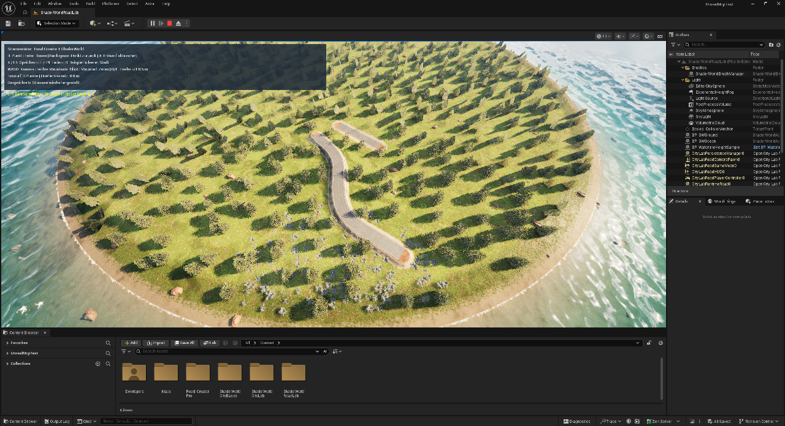
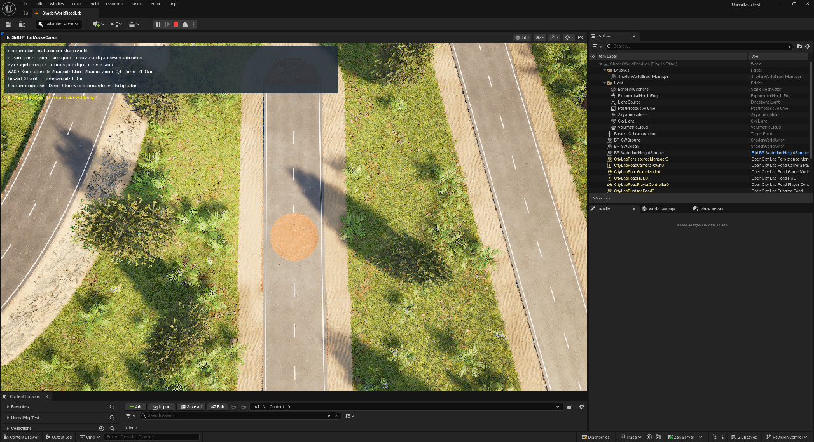
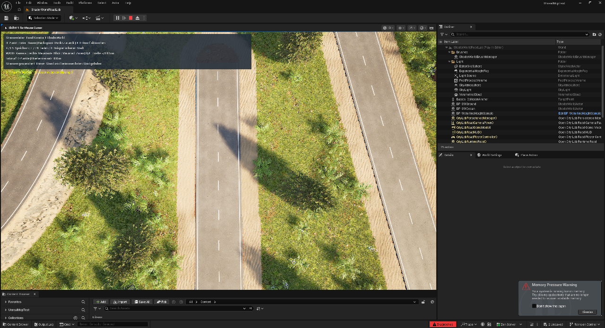

# Straßen im Spiel bauen, speichern und neu laden

Das eigene **RoadLab** verwendet **dieselbe Spline** für ShaderWorld-Gelände und Asphalt. Gespeichert wird die logische Trasse; Terrainwirkung und Meshes werden daraus neu aufgebaut. **Erzeugen/Speichern und Laden in einem neuen Spielprozess sind bestanden**, einschließlich Kollision und gemessener Pflanzenursprünge. Auch R/Enter, Entwurfskorrektur, Q/E und K/L wurden per nativen Slate-Tasten geprüft; ein normaler PIE-Neustart stellte den Stand automatisch wieder her. Kameraeingaben und F5/F9-Aliasse bleiben offen.[^road-proof]

*Normale PIE-Ansicht nach der Bedienprobe und erneutem Play am 28. Oktober 2026: zwei wiederhergestellte Straßen, HUD-Meldung „Gespeicherte Strassen wiederhergestellt“. Die zweite Trasse wurde bei der Bedienprobe gesetzt und unterscheidet sich vom nativen Testfixture. Ein inspizierter Frame ist keine Dauerprüfung.*[^autoload-frame][^image-manifest]

## Die richtige Karte starten

1. Verwende das ursprüngliche **UnrealMcpTest** mit gebauter C++-Erweiterung, ShaderWorld 4.1 und vorbereitetem RCP-Mesh. Dieses Doku-Repository enthält Klassen und Unreal-Assets nicht.
2. Öffne **Content → Maps → ShaderWorldRoadLab** (`/Game/Maps/ShaderWorldRoadLab`).
3. Prüfe in **World Settings** den eigenen **CityLabRoadGameMode**. Starte **Play**, klicke in den Spielbereich und warte auf Terrain und Kollision. Das HUD zeigt die Straßensteuerung.

RoadLab ist eine **CityBasics-Kopie**. Nur hier entfernt das Einrichtungsskript die `Basics_`-Demobauten außer **Basics_CollisionAnchor**: alter Berg, Tunnel und vorgebaute Straßen. Insel, Wald und Ozean bleiben erhalten.[^roadlab-setup]

Der normale Start soll nach der Terrainvorbereitung den separaten Slot **CityLabRoads** laden. Fehlt er, entsteht die Beispielstraße zur Laufzeit. **Sie ist erst mit K/F5 gespeichert.** **B** fordert das Beispiel erneut an, wenn keine Straße existiert. Ein fehlgeschlagener Load meldet einen Fehler, statt eine Ersatzstraße einzuschleusen. Normales PIE-Autoload wurde zusätzlich geprüft; den Nachweis über getrennte Spielprozesse liefert der native Verifikationsmodus.[^roadlab-code][^road-proof]

## Eine Trasse zeichnen

1. **WASD** bewegt die Kamera, die **rechte Maustaste** steuert den Blick und das **Mausrad** zoomt entlang der Blickrichtung.
2. Zeige auf fertiges Gelände und drücke **R**. Die Abfrage überspringt Baum-/Propkomponenten; ohne gültigen Bodentreffer entsteht kein Punkt.
3. Setze weitere Punkte mit **R**: mindestens **2 m** Abstand in der Draufsicht, höchstens **64 Punkte** je UI-Trasse.
4. **Q/E** senkt/erhöht den Versatz für die **nächsten** Punkte um **0,5 m**. Bereits gesetzte Punkte bleiben stehen. Unterschiedliche Höhen ergeben eine Steigung; Brücken entstehen dadurch nicht.
5. **Backspace** entfernt den letzten Entwurfspunkt, **X** verwirft den Entwurf. Gebaute Straßen bleiben erhalten.
6. Drücke mit mindestens zwei Punkten **Enter**. Die glatte Trasse bekommt **8 m Breite** und je **3 m** weichen Terrainübergang.
7. Warte auf Terrain, Kollision und Vegetation; sie aktualisieren sich asynchron. Beachte die Statusmeldung.[^roadlab-code]

Diese Tasten gelten für **RoadLab**. Das frühere **ShaderWorldPersistenceLab** nutzt R/R für Zweipunkttrassen; im **CityBasics**-Buggy setzt R das Fahrzeug zurück.

## Speichern und nach Neustart laden

1. Drücke **K/F5** und prüfe die Speichermeldung für **CityLabRoads**.
2. Baue zum Vergleich eine weitere Straße. **L/F9** ersetzt bei erfolgreichem Laden ungespeicherte Änderungen durch den gespeicherten Stand.
3. Beende das Spiel und starte **dieselbe RoadLab-Karte** neu. Der vorhandene Slot soll Terraintrassen und Asphalt automatisch wiederherstellen.

Die Bedienprobe bestätigte **K/L**, anschließend **Stop PIE → Play** und denselben automatisch geladenen Stand ohne Duplikate. IDs, Splinepunkte, Tangenten und Straßeneinstellungen waren identisch. Ein PIE-Neustart bleibt vom separaten nativen Zwei-Prozess-Test unterschieden; **F5/F9** sind bisher nur die im Code gelesenen Aliasse.[^roadlab-code][^road-proof]

## Gelände und Asphalt teilen dieselbe Trasse

| Teil | Eigene Umsetzung |
| --- | --- |
| Gelände | Native ShaderWorld-**SWSplineRoadComponent** mit Höhenverformung |
| Boden/Bewuchs | **AltitudeBasedLayer**, RedGround-Kern, Sandrand, **Biom ID 3** im blauen Kanal für die bewuchsfreie Reference-Variante |
| Asphalt | Eigene native **USplineMeshComponent**-Segmente an derselben Spline |
| Kurve | Kontrollpunkte und gespeichertes **bSmoothSpline** |

**Road Creator Pro liefert das lizenzierte Meshasset.** Unser Projektcode baut Unreal-SplineMeshes zur Laufzeit; der RCP-Editorbuilder wird dafür nicht im Spiel aufgerufen.[^roadlab-code]

Die Projektkopie **SM_CityLab_RCP_TwoLane** liegt unter `/Game/ShaderWorldRoadLab/Meshes`, benötigt **Allow CPU Access** und stammt von einem ungefähr **12 × 9 × 0,2 m** großen Mesh. Sie wird auf **8 m Breite** angepasst und in höchstens **12 m** lange Abschnitte aufgeteilt. Auf waagerechten Abschnitten liegt die Oberseite nominell **3 cm über der Spline**; geneigte Querschnitte folgen dem Spline-Rahmen.[^roadlab-setup][^roadlab-code]

**Biom ID 3 ist keine allgemeine Baumfällung.** Sie braucht den passenden Layer und die Reference-Spawnkonfiguration. Beliebige selbst platzierte Bäume sind nicht erfasst.[^terrain-road-basics]

## Nahsicht: Boden erscheint durch den Asphalt

Der orangefarbene Fleck wurde auch in einer nativen PIE-Aufnahme aus rund **30 m Kamerahöhe über der Straße** reproduziert. Die Ursache liegt im aktiven **POM-/Reliefpfad des Reference-Terrainmaterials**: Dieser kombiniert eine Anhebung der Oberfläche mit einer optischen Tiefenberechnung. Bei fast senkrechtem Blick wird diese Tiefenberechnung für sehr kleine Parallaxe ausgeblendet; die Anhebung bleibt jedoch bestehen. So kann Boden oberhalb unseres nur **3 cm** höher liegenden Asphalts sichtbar werden. Der Fleck hängt dadurch vom Blick und Bildmaßstab ab. Die bestandenen Kollisionstests erfassen diese zusätzlichen Materialeffekte nicht.[^terrain-relief][^pom-proof]

*Native PIE-Vergleichsaufnahmen vom 28. Oktober 2026 aus derselben 30-m-Ansicht: Referenzebene 0,75 mit Fleck, Referenzebene 1,0 ohne Fleck. Zusätzliche korrigierte Ansichten bei 3 und 100 m wurden inspiziert. Das sind konkrete Sichtproben, keine vollständige Prüfung aller Entfernungen und Blickwinkel.*[^pom-proof][^image-manifest]

### POM-Referenzebene im RoadLab korrigieren

Die eigene Instanz **MI_RoadLab_Terrain** unter `/Game/ShaderWorldRoadLab/Materials` setzt **POM: Reference Plane = 1,0** statt des Reference-Standardwerts **0,75**. Dadurch entfällt die zusätzliche Anhebung; das POM-Relief bleibt unterhalb der nominellen Terrainoberfläche. **EnablePOM** und **EnableReliefDepth** bleiben eingeschaltet. Die Korrektur betrifft das **Terrainmaterial der gesamten RoadLab-Karte**, auch neben den Straßen. Eine ausschließlich auf Straßen begrenzte Maske ist damit nicht implementiert.[^terrain-relief][^pom-proof]

1. Beende **Play** und öffne **Content → Maps → ShaderWorldRoadLab**.
2. Wähle den kollisionsführenden Terrainactor **BP_SWGround**. Unter **Material** muss die eigene **MI_RoadLab_Terrain** liegen. **Material LOD1PLUS** behält **M_Reference_NO_PDO_WPO**.
3. Öffne **MI_RoadLab_Terrain**. Aktiviere den skalaren Override **POM: Reference Plane** und setze ihn auf **1,0**. Kontrolliere **EnablePOM = true** und **EnableReliefDepth = true**. Die ursprünglichen ShaderWorld-Assets werden dafür nicht geändert.
4. Speichere Instanz und RoadLab-Karte. Falls du die Actor-Zuweisung geändert hast, löse am Terrainactor **Rebuild** aus und warte auf die Fertigstellung.
5. Lade die gespeicherte Karte tatsächlich neu und kontrolliere erneut **BP_SWGround → Material → MI_RoadLab_Terrain**. Ein gespeicherter Instanzwert allein beweist noch nicht, dass die Karte diese Instanz dauerhaft verwendet.
6. Starte **Play**, warte auf die geladenen Straßen und betrachte dieselbe Asphaltstelle fast senkrecht von oben, beim Heranzoomen und aus einem schrägen Blickwinkel. Erwartet wird durchgehender Asphalt bei weiterhin sichtbarer POM-Bodenstruktur neben der Straße.
7. Zum Rücksetzen **Material** am Terrainactor wieder auf **M_Reference_Material** setzen, **Rebuild** auslösen und die Karte speichern.

Der reversible Vergleich aus **derselben 30-m-Ansicht** zeigte mit **Reference Plane = 0,75** den Fleck und mit **1,0** geschlossenen Asphalt. Die korrigierten Ansichten bei **3 und 100 m** blieben ebenfalls geschlossen. Nach echtem **Kartenneuladen und neuem PIE** wurde die gespeicherte Materialzuweisung am Terrainactor bestätigt; im normalen PIE waren drei Straßen geladen. Das war ein Neustart der Vorschau **im selben Editorprozess**, kein neuer eigenständiger Spielprozess. Die Materialkorrektur ändert keine Kollisionshöhen oder Saveformatversion; die früheren Zwei-Prozess-Kollisionsprüfungen wurden dafür nicht erneut ausgeführt.[^pom-proof]

### Warum diese Einstellung hilft

**Code-/Assetbefund:** Der aktive POM-Pfad berechnet die Anhebung aus **(1 − Referenzebene) × Relieftiefe**. Auf ebenem Boden ergeben die gelesenen Werte **0,12 × 200 cm = 24 cm Relieftiefe** und bei Referenzebene 0,75 daher **6 cm Anhebung**. Das überragt die nominelle Asphaltzugabe von 3 cm. Die POM-Funktion verwendet außerdem **MinParallaxPixels = 0,5**: Ist die seitliche Projektion des Blickstrahls kleiner als diese Bildschirmschwelle, fällt der Tiefenversatz aus. Bei fast senkrechtem Blick ist diese Projektion nahe null. Mit Referenzebene 1 wird die zusätzliche Anhebung null; die optischen Details dürfen weiter in den Boden reichen.[^terrain-relief]

Die zuerst gelesenen älteren **DisplacementAmount-/DisplacementManage**-Parameter speisen in diesem Mastermaterial **nicht den aktiven WPO-Ausgang**. Ihre 30-/50-cm-Werte oder der dort gefundene 18-m-Radius erklären den Fleck daher nicht. Das wurde im Verlauf der Eingrenzung korrigiert. Die tatsächlichen Parametervergleiche bleiben erhalten:

| Vergleich in eigener RoadLab-Materialinstanz | Ergebnis und Bedeutung |
| --- | --- |
| **DisplacementAmount = 1**, **DisplacementAmountSlope = 1** | Fleck blieb. Diese gesetzten Legacy-Overrides steuern den aktiven POM-WPO-Pfad nicht; sie wurden aus der endgültigen Instanz entfernt. |
| **EnableReliefDepth = false** | 30-m-Vergleichsbild ohne Fleck, schaltet aber den Reliefpfad ab. Diese breite Änderung wurde für die endgültige Lösung nicht beibehalten. |
| **POM: Reference Plane = 1**, beide Effekte eingeschaltet | Reversibler 30-m-Vergleich und zusätzliche korrigierte 3-/100-m-Ansichten ohne Fleck; gespeicherte Actor-Zuweisung nach Kartenneuladen/neuem PIE bestätigt. |

**Alpha bleibt unverändert:** Dieser Kanal enthält im vorhandenen Biomgenerator bereits Werte von 0,5 bis 1. Er wurde nicht als vermeintlich freier Straßenmaskenkanal umbelegt. Eine spätere unabhängige Straßenmaske braucht eine ausdrücklich reservierte Datenbelegung.[^terrain-relief]

Beim automatisierten Speichern war zunächst nur die Instanz dauerhaft gespeichert, die Materialzuweisung in der Karte jedoch noch nicht. Erst das tatsächliche Kartenneuladen machte diesen Unterschied sichtbar. Nach Korrektur der Kartenspeicherung wurde die Actor-Zuweisung nochmals zurückgelesen; dieser zusätzliche Nachweis ist im Bericht getrennt erhalten.[^pom-proof]

Zwei frühere Diagnoseversuche endeten mit Abstürzen: ein direkter Parentwechsel an einer aktiven Terrain-Materialinstanz im D3D12-Pfad und danach ein Materialgraph-Kopierversuch mit einer HLSL-Translator-Assertion im **ShaderWorldLayerSample**-Pfad. Beide speicherten keine neue Karten-/Materialfassung und gelten nicht als bestandene Vergleiche. Die endgültige Korrektur verwendet eine reguläre Materialinstanz ohne solche Parent- oder Graphänderungen. Eine vor dem Absturz ungespeicherte dritte Straße wurde anhand zuvor ausgelesener Punkte neu aufgebaut, gespeichert und wieder geladen; ihre historische ID wurde dabei nicht erhalten. Cook und verpackter Build bleiben offen.[^pom-proof]

## Was tatsächlich geprüft wurde

Der [bereinigte Bericht](../evidence/runtime-roads-report.json) ist **passed_with_limits**: Zwei Prozesse bestanden **18/18 beziehungsweise 19/19 Checks**. IDs, Kontrollpunkte, Stil und Glättung waren identisch; beide stellten **zwei Straßen mit 16 Meshsegmenten** her.

Je Prozess bestanden **72 Kollisionsproben**: 13 Grundterrain, 23 nach Bau/Laden, 13 nach Rücknahme, 23 nach erneutem Laden. Die Straßenphasen enthalten getrennte Treffer auf **ShaderWorldCollisionComponent** und **SplineMeshComponent**. Größter Höhenfehler: **0,204 cm Terrain**, **0,077 cm Asphalt**, bei **3 cm Toleranz**.[^road-proof]

| Pflanzenphase, in beiden Prozessen | Ursprünge im Kern | Referenzbereich |
| --- | ---: | ---: |
| Vor Straßen | 999 | 8615 |
| Nach Bau/Laden | 0 | 8615 |
| Nach Rücknahme/Nachwachsen | 999 | 8615 |
| Nach erneutem Laden | 0 | 8615 |

Pro Phase wurden drei gleiche Fingerprints der vollständigen gültigen Instanzmatrizen abgewartet. Der Kern liegt höchstens **3,5 m** von der Trasse in XY entfernt, die Referenzen **10–30 m**. Gezählt wurden **Instanzursprünge** aus dem CPU-Spiegel der ShaderWorld-Renderdaten: keine Äste, Kronen oder Überhänge und keine GPU-Maskenpixel. Stabile CPU-Daten sind kein Renderthread-Fertigstellungsnachweis.[^road-proof]

Die Bedienprobe nutzte echte **native Slate-Klicks und Tastenereignisse** für **R/Enter**, **Backspace**, **X**, **Q/E** (0 → 50 → 0 cm) und **K/L**. Zwischen den zwei Cursorpunkten wurde die Kamera per **ActorTools** versetzt; **WASD, rechte Maustaste und Mausrad** wurden damit nicht bedient. Ein früher R-Versuch wurde während noch fehlender Bodenkollision korrekt abgewiesen; nach Terrainbereitschaft gelang der erneute Versuch.[^road-proof]

Die unabhängige Regression der älteren **ShaderWorldPersistenceLab**-Karte bestand danach ebenfalls: zwei frische Prozesse mit **Format 2**, zwei Pads/zwei Terraintrassen und je **26 ursprünglichen plus 26 geänderten Terrainproben**. Dieser Zusatz prüft den bestehenden Bauplatzpfad nach dem Pad-Shader-Fix, keine Asphaltmeshes.[^road-proof]

## Spielstand und Fehlerfälle

Die ursprüngliche RoadLab-Abnahme verwendete **Format 2**. Es speichert Kontrollpunkte, Maße, Reihenfolge, **RCP_TwoLane** und **bSmoothSpline**. Meshsegmente entstehen neu; beliebige Assetpfade sind keine erlaubten Stile. Der Loader prüft Karten-/Generator-/Terrainidentität und Datensätze, bereitet Ersatzobjekte vor und übernimmt sie erst nach erfolgreicher Vorbereitung.[^roadlab-code]

Die aktuelle CityLoop-Erweiterung schreibt **Format 3** mit zusätzlichen Grundstücks-/Bürgerdaten und lädt die alten Formate 1/2 weiter. Der Straßenablauf und sein Slot bleiben getrennt. RoadLab bestand nach dieser Erweiterung erneut zwei frische Prozesse mit 144/144 Kollisionsproben und denselben Freiräum-/Nachwachsprüfungen; die alte Bauplatzkarte bestand ebenfalls zwei frische Prozesse. Den neuen verbundenen Ablauf beschreibt [CityLoop](city-builder-loop.md).[^format-three-regression]

Wiederholtes Laden erzeugte keine Duplikate. Fehlender Slot, falsche Formatversion, ungültiger Stil und erzwungener Oberflächen-Baufehler ließen die bestehende Stadt erhalten. **Format 1** wurde mit einer **synthetischen Testdatei** als lineare Terraintrasse ohne Mesh eingelesen; eine archivierte Datei aus einer alten ausführbaren Spielversion wurde nicht getestet. Separate Generator-/Seed-Konflikte bleiben Codebefunde.[^road-proof]

## Wenn etwas nicht passt

| Beobachtung | Prüfen |
| --- | --- |
| Buggy statt Straßen-HUD | RoadLab-Karte und **CityLabRoadGameMode** |
| R setzt keinen Punkt | Fertige Terrainkollision, Bodentreffer, 2 m Punktabstand |
| Nur Entwurfslinien | Mindestens zwei Punkte, **Enter**, Statusmeldung |
| Terrain ohne Asphalt | Vorbereitete Meshkopie, CPU-Zugriff, Buildfehler |
| Nach Neustart nur Beispiel | Speichermeldung für **CityLabRoads**, dieselbe Karte |
| Bewuchs auf der Trasse | Layer/Biom und Neuerzeugung; keine allgemeine Rodung erwarten |
| Bodenfleck beim Heranzoomen | [POM-Referenzebene und RoadLab-Materialinstanz](#nahsicht-boden-erscheint-durch-den-asphalt); reine Kollisionsprüfung reicht nicht |

Zwei frühere Timeouts hatten konkrete Ursachen: **IsTreeFullyBuilt** war im untersuchten ShaderWorld-NewRender-Pfad kein passendes Fertigsignal. Unser Verifier verwendet nun **IsAsyncBuilding plus drei stabile Matrix-Fingerprints** und liest gemeinsame Instanzdaten unter **DataLock**, statt nur **GetInstanceCount**. Danach blockierte unser Manager ohne Pad-Instanz an **PadMaterial->IsComplete()**; diese Abfrage startet keine Kompilierung. Die eigene Integration prüft den Pad-Shader nun nur bei **PadActors.Num() > 0**. Der anschließende Zwei-Prozess-Test bestand; daraus folgt kein allgemeiner ShaderWorld-Fehlerbefund.[^test-gates]

Der Prototyp enthält **keine Kreuzungen, Verkehrssimulation, Brücken-/Tunnelgenerierung, Kurvenüberhöhung oder Fahrspurplanung**. Cook/Shipping und die genannten Kamera-/Aliastasten bleiben offen. Die [erste PIE-Aufnahme mit einer Straße](../assets/images/runtime-road-first-pie.png) und die [Aufnahme des nativen Create-Laufs](../assets/images/runtime-road-create-verified.png) bleiben als frühere Sichtbelege erhalten. Die Vorbereitungsmeldung im Create-Bild gehört zu dessen Testmodus.[^first-frame][^create-frame]

[^road-proof]: [Bereinigter RoadLab-Bericht](../evidence/runtime-roads-report.json): getrennte Create-/Load-Prozesse, Kollisionsproben, logische Daten, Pflanzenursprünge und Nachweisgrenzen.
[^roadlab-code]: Eigene RoadLab-/SplineMesh-/Persistenzklassen im ursprünglichen UnrealMcpTest gelesen und nativ geprüft; Projektcode nicht mitgeliefert.
[^roadlab-setup]: Eigenes `Tools/setup_runtime_roads.py`; Skript und lizenzierte Unreal-Assets nicht mitgeliefert.
[^test-gates]: UE-Header `HierarchicalInstancedStaticMeshComponent.h`, `SWBuiltTreeReception`/NewRender in ShaderWorld und eigene Verifier-/Managerlogik; frühere Diagnoseberichte und erfolgreicher Folgelauf getrennt betrachtet.
[^first-frame]: [Erster PIE-Frame](../assets/images/runtime-road-first-pie.png), keine Bedienungs- oder Dauerprüfung.
[^create-frame]: [Native Aufnahme des Create-Laufs](../assets/images/runtime-road-create-verified.png), ein inspizierter Frame des automatisierten Tests.
[^image-manifest]: [Bildherkunft, Dateigröße und SHA-256](../evidence/image-manifest.json).
[^terrain-road-basics]: [Geländeform, Bodentextur und Straßenmesh](building-pads-and-roads.md).
[^autoload-frame]: [Native CaptureEditorImage-Aufnahme nach normalem PIE-Autoload](../assets/images/runtime-road-normal-autoload-pie.png), ein inspizierter Frame nach der Slate-Bedienprobe; kein separater Prozess- oder Langzeitnachweis.

[^terrain-relief]: Aktiven ShaderWorld-4.1-POM-WPO-/PDO-Pfad, POM: Reference Plane und MinParallaxPixels in den installierten Materialgraphen/Funktionen gelesen; Legacy-DisplacementManage vom tatsächlich angeschlossenen Ausgang unterschieden.
[^pom-proof]: [Bereinigter POM-Renderbericht](../evidence/road-pom-render-report.json): Parametervergleich, native Bilder, gescheiterte Diagnoseversuche und Grenzen der Materialkorrektur.
