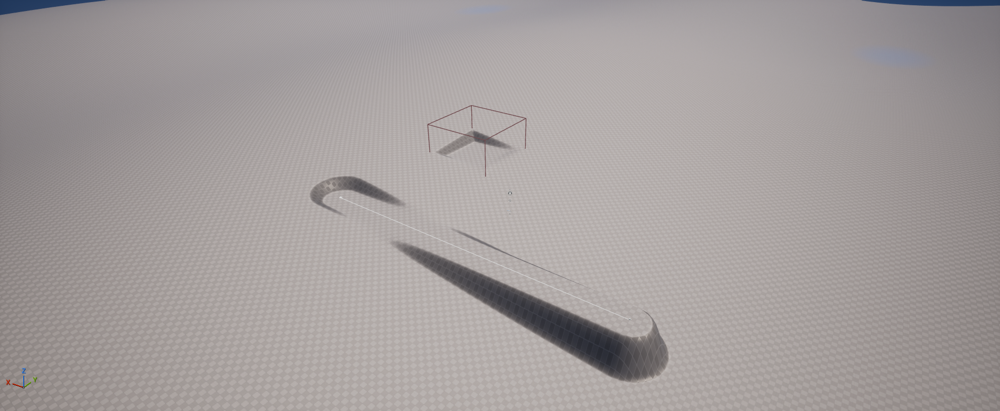

# Bauplätze und Straßen nach einem Spielneustart laden

Im Testprojekt lassen sich während des Spiels Bauplätze ebnen und Straßentrassen anlegen, speichern und in einem neuen Spielprozess wiederherstellen. Das ist durch einen Test mit zwei getrennten Prozessen und echten Terrain-Kollisionsabfragen belegt.[^persistence-proof]

Die Speicherfunktion ist eine **eigene C++-Erweiterung des Testprojekts**. Sie ist kein allgemeiner ShaderWorld-Menüpunkt und wird durch das Aktivieren des Plugins allein nicht verfügbar. ShaderWorld liefert die verformbaren Terrain- und Straßenbausteine; das Projekt speichert die logischen Stadtänderungen und baut sie beim Laden neu auf.[^lab-implementation]

**Diese Bedienfolge beschreibt das ältere Pad-/Terrainstraßenlabor.** Das neuere [Foundations-Labor](foundations-lab.md) verwendet einen eigenen Slot und Speicherformat 4; sein erfolgreicher Neustartnachweis für geplante/ausgeführte Geländeänderungen und Einzelrodung steht [weiter unten](#aktueller-stand-speicherformat-4). Die Tasten des älteren Labors bleiben in dieser Anleitung erhalten.[^foundations-proof]

## Was du zum Nachmachen brauchst

Du benötigst das ursprüngliche, lauffähig kompilierte Projekt **UnrealMcpTest** mit Unreal Engine 5.8.4, ShaderWorld 4.1 und der Karte `/Game/Maps/ShaderWorldPersistenceLab`. In deren World Settings muss der projektlokale **CityLabGameMode** verwendet werden.

Dieses öffentliche Repository enthält ausschließlich Wissen und ausgewählte Nachweise. Das Unreal-Projekt, das native Runtime-Modul, die Karte und ihre Materialien werden hier nicht mitgeliefert. Ein Klon dieses Repositories reicht deshalb nicht aus, um das Labor zu starten.

Die Abbildung illustriert die verwandte **CityLab**-Geländekarte. Sie ist keine Aufnahme des Neustarttests und ersetzt dessen Messdaten nicht.[^citylab-view]

## Das Labor starten und bauen

1. Öffne im ursprünglichen Projekt den Content Browser und dort **Content → Maps → ShaderWorldPersistenceLab**.
2. Prüfe in **World Settings → GameMode Override**, dass **CityLabGameMode** eingestellt ist. Starte **Play** und klicke in das Spielfenster, damit es Tastatureingaben erhält.
3. Warte, bis das Gelände sichtbar und unter dem Mauszeiger erreichbar ist. Ein vorhandener Spielstand wird erst geladen, wenn die Grundwelt erzeugt wurde. Notiere die bereits angezeigte Anzahl an Bauplätzen und Straßen.
4. Zeige auf eine freie Stelle und drücke **P**. Der Bauplatz wird auf die getroffene Bodenhöhe plus den angezeigten Höhenversatz geebnet.
5. Für eine deutliche Höhenänderung drücke beispielsweise zweimal **E** und setze an einer anderen Stelle einen weiteren Bauplatz. **Q** senkt den Versatz wieder um jeweils einen Meter.
6. Für eine Straße zeige auf den Anfang und drücke **R**. Bewege den Mauszeiger zum Ende und drücke erneut **R**. Die beiden Punkte müssen mindestens einen Meter auseinanderliegen. Ihre Höhen bestimmen die Steigung.
7. Warte nach jeder Änderung, bis Gelände und Kollision nachgezogen haben. Prüfe die Statusmeldung und die angezeigten Objektzahlen.

Die Bedienung verwendet folgende Tasten:[^lab-implementation]

| Eingabe | Wirkung |
| --- | --- |
| **P** | Bauplatz am Mauszeiger anlegen. |
| **R**, dann **R** | Anfang und Ende einer geraden Straßentrasse setzen. |
| **Q / E** | Höhenversatz für anschließend gesetzte Punkte um 1 m senken / erhöhen. |
| **K** | Aktuellen Zustand im Slot `CityLabCity` speichern. |
| **L** | Gespeicherten Zustand laden und die aktuell verwalteten Änderungen ersetzen. |
| **WASD** | Kamera verschieben. |
| **Rechte Maustaste + Maus** | Blick drehen. |
| **Mausrad** | Zoomen. |

**Q/E verschiebt bereits gesetzte Objekte nicht.** Der Versatz wird zu einem neuen Bodenhit addiert; er ist keine absolute Welthöhe. Ein Bauplatz verwendet einen Brushbereich mit 10 m Radiusparameter und einen ebenen Kern von 12 × 12 m. Die Straßenbedienung erzeugt einen 8 m breiten ebenen Streifen mit je 4 m Übergang. Sichtbarer Asphalt, Kreuzungen und Verkehr entstehen dadurch noch nicht.[^lab-implementation]

## Speichern und Laden selbst prüfen

**K überschreibt den festen Slot `CityLabCity`.** Neue Änderungen werden nicht automatisch gespeichert. Im Development-Labor liegt der Slot projektbezogen unter `Saved/SaveGames/CityLabCity.sav`.[^lab-implementation]

1. Baue einen gut erkennbaren Bauplatz und eine Straße. Merke dir Position, Höhe und die angezeigten Objektzahlen.
2. Drücke **K** und prüfe die Meldung **Stadt gespeichert**.
3. Lege einen zusätzlichen Bauplatz an und speichere ihn noch nicht. Drücke **L**. Nach der Aktualisierung soll dieser zusätzliche Bauplatz wieder verschwunden sein; die zuvor gespeicherte Stadt soll zurückkehren. **L verwirft damit ungespeicherte Änderungen.**
4. Beende Play. Schließe anschließend den Editor vollständig und öffne das ursprüngliche Projekt erneut. Öffne dieselbe Persistenzkarte und starte Play.
5. Warte auf **Gespeicherte Stadt wiederhergestellt**. Prüfe erneut Anzahl, Positionen und Höhen. Das automatische Laden geschieht verzögert nach der ShaderWorld-Grunderzeugung, damit dieselben Generator- und Seed-Identitäten verfügbar sind.
6. Drücke testweise noch einmal **L**. Die Anzahl darf sich dadurch nicht verdoppeln.

Das Speichern des Editor-Levels ersetzt **K** nicht. Der Spielstand beschreibt die Laufzeitstadt; die Map enthält die Ausgangswelt und die Spieleinrichtung.[^lab-implementation]

## Was der vorhandene Nachweis tatsächlich belegt

Der automatisierte Lauf erzeugte zwei Bauplätze und zwei Straßentrassen, schrieb einen Spielstand und lud ihn nach Ende des ersten Prozesses in einem zweiten Prozess. IDs, Geometrie und Änderungsreihenfolge blieben erhalten. Pro Prozess wurden 26 Terrainproben vor und 26 nach der Änderung beziehungsweise Wiederherstellung geprüft. Die Toleranz betrug 3 cm; der größte gemessene Fehler nach den Änderungen einschließlich unveränderter Kontrollpunkte lag bei rund 0,63 cm.[^persistence-proof]

| Geprüfter Fall | Ergebnis im Labor |
| --- | --- |
| Neuer Prozess lädt gespeicherte Änderungen | Bauplätze und Straßentrassen samt geprüfter Terrainkollision wiederhergestellt. |
| Erneut denselben Spielstand laden | Keine Duplikate; IDs, Geometrie und Reihenfolge erhalten. |
| Fehlenden Slot laden | Aktuelle leere oder bereits geladene Stadt bleibt erhalten. |
| Spielstand mit falscher Formatversion laden | Vorhandene Stadt bleibt erhalten. |

Diese Prüfungen liefen als **uncooked Development-Editor-Laufzeit** mit `UnrealEditor.exe -game -RenderOffscreen` und gerenderten Frames. Das belegt einen vollständigen Neustart des Spielprozesses. Ein verpackter Shipping-Build wurde dabei nicht getestet.[^persistence-proof]

## Wie die Speicherung funktioniert

Gespeichert werden Bauplatzmittelpunkte und Radiusparameter sowie Straßenkontrollpunkte, Breiten, Übergänge und Tiefe. Jedes Objekt erhält eine stabile ID; eine gemeinsame Reihenfolge steuert die Priorität überlappender Änderungen. Beim Laden erzeugt das Projekt daraus neue native ShaderWorld-Brushes und Straßenkomponenten.[^lab-implementation]

Der Spielstand trägt eine Formatversion und Identitäten für Karte, Generator und Terrainkonfiguration einschließlich relevanter Materialparameter und Seeds. Das Projekt prüft diese Angaben und die Geometrie, bevor es die aktuelle Stadt ersetzt. Ein anderes Terrain oder eine geänderte Generatorbasis benötigt später eine bewusste Migration. Die Identitätsprüfung ist keine vollständige Versionsverwaltung aller abhängigen Assets.[^lab-implementation]

Eine erfolgreiche Ladebestätigung bedeutet zunächst, dass die Daten übernommen wurden. GPU-Gelände und Physikkollision aktualisieren sich anschließend. Die automatische Bereitschaftsprüfung ist keine vollständige Fertigmeldung der Physik; der automatisierte Test wartet deshalb zusätzlich auf passende Kollisionstreffer. Auch die Herstellerdokumentation beschreibt Terrain-, Kollisions- und Spawnable-Aktualisierung als Folge einer Brush-Änderung.[^lab-implementation][^shaderworld-brush-docs]

## Aktueller Stand: Speicherformat 4

**Stand: 28. Oktober 2026.** Die aktuelle eigene Speicherimplementierung schreibt **Format 4**. Die ursprüngliche Padkarte, RoadLab, CityLoop und Foundations haben weiterhin getrennte Slots. Ein Spielstand des einen Labors ist keine austauschbare Ausgangswelt für die anderen.[^format-four-code]

| Daten | Bedeutung beim erneuten Laden |
| --- | --- |
| Bauplätze und Straßen | Stabile IDs, Reihenfolge, Trasse und Maße; native Backends und Asphaltsegmente werden erneut gebaut. |
| Grundstück, Haus und Bürger | Logische Hauszuordnung, gespeicherte Straßen-/Zugangsroute, Fortschritt und Ankunft. |
| Geplante und stornierte Weltänderungen | Sollzustand und Parameter bleiben gespeichert; sie erzeugen keine ausgeführten Höhen- oder Materialbrushes. |
| Ausgeführte Lab-Debug-Änderungen | Tatsächliche Ausführungsreihenfolge und Parameter werden beim Laden wieder angewendet; Planreihenfolge ist davon getrennt. |
| Ressourcen-/Rodungszustand | Stabile logische Identität und Zustand einzelner Ressourcen; aktuelle Instanznummern sind keine dauerhafte Identität. |
| Aktiver lokaler Bürgerumweg | Zusätzliche Wegpunkte, Fortschritt auf dem Umweg und die Stelle zum Wiedereintritt in die ursprüngliche Route. |

Die Felder sind eigene Projektfunktionen. Sie sind keine allgemeine ShaderWorld-Speicherfunktion und bilden noch keine Maschinenarbeit, Materialbilanz oder frei ausgrabbare Untergrundgeometrie ab.[^format-four-code]

Der neue [Foundations-Nachweis](../evidence/foundations-report.json) bestand in **zwei unterschiedlichen gerenderten uncooked Prozessen** mit **29/29 und 12/12 Checks** und **306 + 288** erfolgreichen Terrainproben nach der nativen Paintkorrektur mit schwarzer Datamap. Anheben, Absenken und Ebnen auf eine absolute Höhe wurden tatsächlich gemessen. Ein einzelner Baum blieb mit Darstellung und Kollision entfernt, auch nach echter ShaderWorld-Regeneration, 30 s Beobachtung und Laden im zweiten Prozess; der Kontrollbaum blieb erhalten. Noch nicht ausgeführte und stornierte Pläne erzeugten bei der Wiederherstellung keine Backends. Drei weitere Loads pro Prozess erzeugten keine Duplikate, ein Spielstand mit falscher Identität ersetzte die vorhandene Stadt nicht.[^foundations-proof]

Die Schreibweise **Format 4** ersetzt die älteren Format-2-/Format-3-Nachweise nicht: CityLoop besitzt seinen getrennten Drei-Prozess-Nachweis für Haus/Bürger. Die Fortsetzung eines gespeicherten lokalen Umwegs ist zusätzlich mit kontrolliertem Physikboden nativ getestet; sie ist keine allgemeine NavMesh- oder neue Foundations-Bürger-Neustartabnahme. Der Loader unterstützt Formate 1–3 weiter; das ist keine Zusage für beliebige archivierte Spielstände aus alten ausführbaren Versionen.[^format-four-code][^foundations-proof]

### Wechsel des Paintbackends ohne stilles Umdeuten

**Das Speicherformat bleibt 4.** Zusätzlich trägt jeder Weltänderungsrecord eine genaue Backend-/Terrain-/Materialidentität. Der Wechsel vom bisherigen Spline-Paint zum nativen LayerMask-Brush mit schwarzer Datamap (Flow-Anteil 0) erhält eine neue Backendkennung **v2**: Das alte Paint hatte eine Kreisfläche, das neue eine quadratische Fläche mit nativem Randverlauf. Eine bereits bemalte Fläche lässt sich daher nicht allein durch Austausch des Backends mit identischer Bedeutung wiederherstellen.[^format-four-code]

Der Loader erkennt nur die **exakt passende v1-Identität derselben Terrain-/Materialbindung**. Noch nicht ausgeführte und stornierte Pläne, einschließlich Paint, sowie unveränderte Höhenoperationen dürfen übernommen werden. Erst nach vollständiger Prüfung normalisiert der vorbereitete Restore diese Records auf v2; IDs, Geometrie, Planstatus und Ausführungsreihenfolge bleiben erhalten. Neue Paint-Ausführung verwendet anschließend die aktuelle Fläche.[^format-four-code]

Enthält der alte Spielstand **bereits ausgeführtes v1-Paint**, wird er vor dem Staging mit einer Erklärung abgewiesen. Die vorhandene Stadt bleibt erhalten, der alte Spielstand wird nicht überschrieben. Er braucht eine ausdrücklich festgelegte Migration statt einer stillen Kreis-zu-Quadrat-Umdeutung. Die älteren Stadtformate **1–3 mit leerem Weltänderungsjournal** behalten ihr bisheriges Verhalten.[^format-four-code]

Der native Test **CityLab.WorldEdits.BackendMigration** bestand unter NullRHI: sichere Planübernahme, akzeptierte alte Höhenrecords, abgewiesenes altes Applied-Paint, unveränderte Live-Records und strikte Generator-/Bindingprüfung. Seine erwartete Ablehnungswarnung gehört zum Test. Das bestätigt die logischen Migrationsregeln; es ersetzt keinen Versuch mit einer archivierten binären SaveGame-Datei.[^foundations-proof]

Im Foundations-Labor wählt der Code nach Laden den neuesten offenen Plan; **Tab** wechselt zwischen offenen Plänen. Bei einem gespeicherten Ebnen-Plan bleibt die absolute Zielhöhe beim Verschieben mit **T** erhalten. Fehlt der Bodenhit noch, zeigt das HUD zunächst die absolute Zielhöhe. Der Start wartet auf das tatsächlich geladene, für die aktive Plattform shaderbereite Höhenmaterial; solange ist die Baueingabe gesperrt. Eine normale Slate-Bedienprobe aus rund **5 km Kamerahöhe** bestätigte Planerstellung ohne Weltänderung, PageUp/Undo, Tab-Auswahl, K und normales PIE-Autoload mit derselben Plan-ID und absoluter Zielhöhe. Nach dem Laden blieb das Ziel 4 m auch beim Verschieben auf Boden bei 5 m erhalten. Das ist ein Bediennachweis im selben Editorprozess; die Betriebssystem-Neustartprüfung steht getrennt im Bericht.[^foundations-guide][^format-four-code]

Die korrigierte verpackte V2-Fassung bestand nach abgeschlossenem Cook/Stage/Archive **zwei frische Spielprozesse mit RequiresCookedData = true**: **29/29 Checks in 118,6 s** beim Erzeugen und **12/12 in 66,1 s** beim Wiederherstellen; alle **306 + 279 Terrainproben** bestanden. Der native Layer-Brush-Pfad mit schwarzer Datamap und Flow-Anteil 0 erhält den bewuchsfreien Kern/Rand auch nach Paint, tatsächlicher Regeneration und drei Loads pro Prozess. Das Development-Paket enthält zwei gekochte Karten; die Laufzeitabnahme gilt für Foundations. Shipping und eine eigene Materialbild-Abnahme im verpackten Spiel stehen noch aus. Die finale normale PIE-Sichtprobe mit T/F6/K/L bestätigte separat sichtbares Snow nach Ausführung und nach Laden; [die Aufnahme nach K/L](../assets/images/foundations-paint-reloaded.png) zeigt den erhaltenen Materialanstrich. Ein zweites Snow-Paint über dem [geschützten Bauplatz](../assets/images/foundations-protected-pad.png) ließ dessen Sandboden, sichtbare Freistellung und 500 cm Terrainhöhe bestehen. Diese qualitativen Frames sind kein zusätzlicher Betriebssystem-Neustarttest oder Pixelgleichheitstest. Die früheren kartenbezogenen Nachweise behalten ihren eigenen Umfang. Die vollständigen Schritte und der genaue Prüfstatus stehen im [Foundations-Guide](foundations-lab.md).[^foundations-proof]

## Wenn etwas nicht klappt

| Beobachtung | Als Nächstes prüfen |
| --- | --- |
| P/R/K/L tun nichts | Läuft Play, hat das Spielfenster Fokus und ist CityLabGameMode aktiv? |
| Kein Boden unter dem Mauszeiger | Shader und Terrainaufbau abwarten; Generate Collision und die lokale Kollisionsabdeckung prüfen. |
| Straße fehlt nach dem ersten R | Den zweiten Endpunkt mit R setzen, mindestens einen Meter entfernt. |
| Neue Änderungen fehlen nach Neustart | Wurde nach diesen Änderungen K gedrückt und dieselbe Persistenzkarte geöffnet? |
| L meldet inkompatiblen Spielstand | Karte, Generator, Seeds oder Terrainkonfiguration mit der gespeicherten Basis vergleichen. Die aktuelle Stadt wird bei Ablehnung nicht ersetzt. |
| Gelände sieht geladen aus, Bodenhit stimmt noch nicht | Weitere gerenderte Frames und Kollisionsaktualisierung abwarten. |

Die hier beschriebene ältere Laborabnahme enthält keine Gebäude, Bewuchsfreistellung, Verkehrsnetz-Navigation, Tunnel oder Multiplayerzustände. Die inzwischen ergänzte [CityLoop-Spielschleife](city-builder-loop.md) besitzt eigene Format-3-Daten und Neustartnachweise für Grundstück, flächige Bewuchsfreistellung, Testhaus und Bürgerroute. Dauerhafte Einzelrodung ist inzwischen separat im [Foundations-Labor](foundations-lab.md) geprüft; allgemeine Navigation und Tunnelpersistenz bleiben offen. Für die geometrischen Grenzen eines Tunnels siehe [Löcher im Gelände und Bergtunnel](holes-and-mountain-tunnels.md).

[^persistence-proof]: [Bereinigter Bericht des Neustarttests](../evidence/persistence-report.json), mit ausgewählten Prüfungen und Messwerten aus dem ursprünglichen Testprojekt.
[^citylab-view]: [Illustration der CityLab-Geländeversuche](../assets/images/citylab-terrain.png); andere Karte als das Persistenzlabor.
[^lab-implementation]: Geprüfte projektlokale Implementierung in `CityLabPersistence.h/.cpp`, `CityLabGameMode.h/.cpp` und `CityLabVerification.h/.cpp` sowie das Bedienungsprotokoll des ursprünglichen Testprojekts. Diese Dateien sind nicht Bestandteil des öffentlichen Dokumentationsbundles.
[^shaderworld-brush-docs]: [ShaderWorld: Blueprint Brush System – Landmass](https://universgen.gitbook.io/shader-world/fundamentals/kick-start/blueprint-brush-system-landmass).

[^foundations-proof]: [Bereinigter Foundations-Bericht](../evidence/foundations-report.json): getrennte uncooked und aktuelle Development-cooked Prozesse, tatsächliche Geländeänderung, Einzelrodung und native Tests; korrigierter Paintpfad mit schwarzer Datamap in beiden Laufarten mit Core-/Side-NoGrowth und Loads bestanden; finaler qualitativer Materialbildvergleich mit T/F6/K/L in normalem PIE bestanden; eigene verpackte Materialpixelprüfung offen.
[^foundations-guide]: [Foundations-Labor](foundations-lab.md): eigenes Grundlagenlabor und vorgesehene HUD-/Tastenbedienung.
[^format-four-code]: Eigene Format-4-Implementierung in `CityLabPersistence`, `CityLabWorldEdits`, `CityLabVegetationState` und `CityLabSettlement`; nicht im öffentlichen Wissensbundle enthalten.
