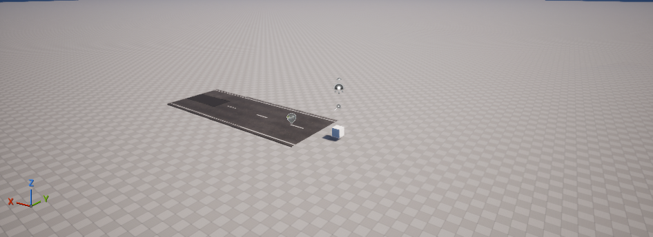

# Terrain und Kollision einrichten

Ziel ist eine **1 × 1 km große, flache Oberfläche mit Kollision**. Du brauchst Unreal 5.8.4 und das installierte ShaderWorld-Plugin 4.1. Für den schnellsten Einstieg kannst du die vorhandene Lernprojektkarte `Content/Maps/ShaderWorldTest` öffnen. Ihre Einstellungen und Darstellung wurden im Editor und nach erneutem Laden geprüft. Vier Terrain-Kollisionstreffer sind im verlinkten Bericht für PIE belegt.[^terrain-proof]

Die asphaltierte Straße im Bild stammt aus **Road Creator Pro** und ist ein getrenntes Testobjekt. Sie ist kein Nachweis einer automatischen Verbindung zu ShaderWorld.

## Eine eigene flache Karte vorbereiten

1. Öffne **Edit → Plugins**, suche `ShaderWorld` beziehungsweise `Shader World` und aktiviere das Plugin. Starte den Editor neu, falls er das verlangt.
2. Erstelle über **File → New Level** eine beleuchtete Standardkarte oder verwende eine eigene Kopie von `/ShaderWorld/Maps/Map_Blank`. Speichere deine Karte im Projekt unter `Content/Maps`. Enthält eine Standardkarte bereits einen **Floor** oder ein anderes überlagerndes Gelände, entferne es in deiner Testkopie. Sonst kann diese Fläche das ShaderWorld-Terrain verdecken oder seinen Kollisionstest verfälschen.
3. Wähle bei einer Kopie von **Map_Blank** den bereits vorhandenen ShaderWorld-Actor im Outliner aus. Nur wenn deine eigene Karte noch keinen enthält, suche im Bereich **Place Actors** nach `ShaderWorldActor` beziehungsweise `Shader World Actor` und ziehe genau einen Actor in die Karte. Setze im **Details**-Fenster seine Position auf `0, 0, 0`, Rotation auf `0, 0, 0` und Skalierung auf `1, 1, 1`.[^create-world]
4. Suche in den Actor-Details nach **Bounded World** und aktiviere die Begrenzung. Setze **World Size** auf `1000`. Dieses Feld verwendet **Meter**; die Position unter Transform verwendet dagegen **Zentimeter**.
5. Suche nach **Generate Collision** und aktiviere es. Beim frischen Actor ist Kollision standardmäßig ausgeschaltet. Das sichtbare Gelände allein bedeutet deshalb noch nicht, dass Figuren darauf stehen können.[^terrain-proof]
6. Klappe **Producers** auf. Der Eintrag für die Höhe heißt **Height**. Sein Feld **Material To Generate Layer** beschreibt die Geländeform. Lass zum ersten Test das vorhandene flache Standardsetup stehen. Ein eigenes Höhenmaterial wird später dort zugewiesen; das Feld **Material** unter World Settings ist dagegen das sichtbare Oberflächenmaterial.[^detail-panel]
7. Suche nach **Rebuild** und schalte es ein, falls die Welt nach deiner Änderung nicht neu aufgebaut wird. Der Actor setzt das Feld nach Bearbeitung wieder zurück.
8. Aktiviere den Viewport und seine **Realtime**-Darstellung. Warte, bis die Shaderkompilierung beendet ist. Falls nötig, starte mit **Play** eine kurze Vorschau. ShaderWorld benötigt tatsächlich gerenderte Frames.
9. Speichere die Karte. Öffne sie erneut und kontrolliere, dass Fläche und Einstellungen erhalten bleiben.

Die Einstellungen wurden im Lernprojekt über Editorwerkzeuge gesetzt und zurückgelesen. Die oben beschriebene manuelle Folge über Place Actors ist eine aus diesen Einstellungen und der Herstelleranleitung abgeleitete Bedienhilfe; sie wurde nicht als eigener Klick-für-Klick-Abnahmelauf aufgezeichnet.

## So prüfst du den Erfolg

- In der Editoransicht erscheint eine zusammenhängende, flache Fläche. Ein Schachbrettmaterial ist zum technischen Test ausreichend.
- **Generate Collision** bleibt aktiviert.
- Für einen Begehbarkeitstest braucht die Spielfigur außerdem einen passenden Startpunkt und eine ShaderWorld-Kollisionsanforderung in ihrer Nähe. Nutze für diesen Test eine passende Character-Figur mit SW_Collision-Komponente. Die CityLab-Flykamera dient dagegen den Terrainabfragen unter dem Mauszeiger und prüft kein Stehen auf dem Boden.
- Im vorhandenen Lernprojekt bestätigt der [Terrain-Bericht](../evidence/terrain-report.json) vier Kollisionstreffer in PIE. Diese Messung ersetzt keinen Test mit deiner eigenen Figur.

## Wenn etwas fehlt

Bei leerem Gelände zuerst den Viewport aktivieren und Shaderkompilierung abwarten. Bei Durchfallen zuerst Generate Collision und die Nähe der Kollisionsanforderung prüfen. Die vollständige [Fehlerdiagnose](troubleshooting.md) führt diese Fälle auseinander.

## Renderer im geprüften Projekt

Das Testprojekt verwendet **DirectX 12 und SM6**. Damit verschwand die beobachtete Nanite-Warnung. Eine zusätzliche globale Virtual-Texture-Einstellung war für diesen flachen Test nicht nötig. Die in einigen späteren Beispielbildern sichtbare **Lumen-Warnung** ist ein eigener, noch offener Beleuchtungspunkt; DX12/SM6 löst sie nicht automatisch.

Weiter mit den [Beispielwelten](../reference/example-maps.md) oder [Bauplätzen und Straßen](building-pads-and-roads.md).

[^terrain-proof]: [Bereinigter Terrain-Prüfbericht](../evidence/terrain-report.json), PIE-Kollision sowie Editor-Einstellungen und erneutes Laden.
[^create-world]: [Offizielle Anleitung Creating a new world](https://universgen.gitbook.io/shader-world/fundamentals/kick-start/creating-a-new-world).
[^detail-panel]: [Offizielle Beschreibung des Detail-Panels](https://universgen.gitbook.io/shader-world/fundamentals/kick-start/detail-panel).
