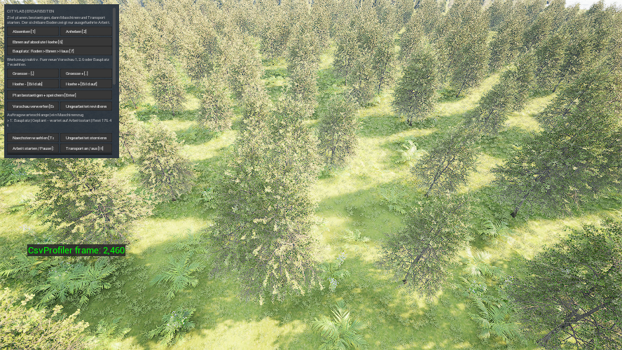
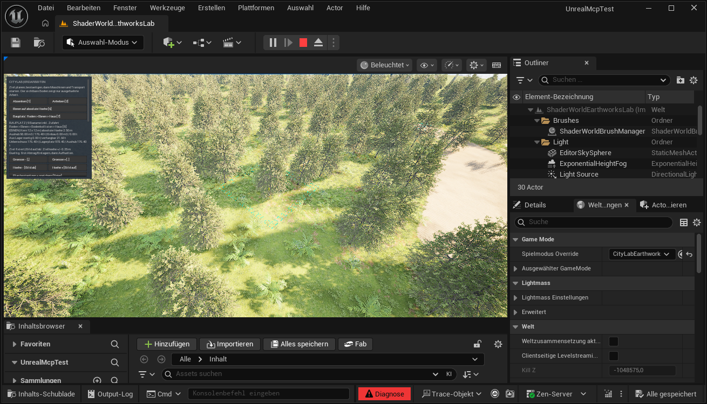
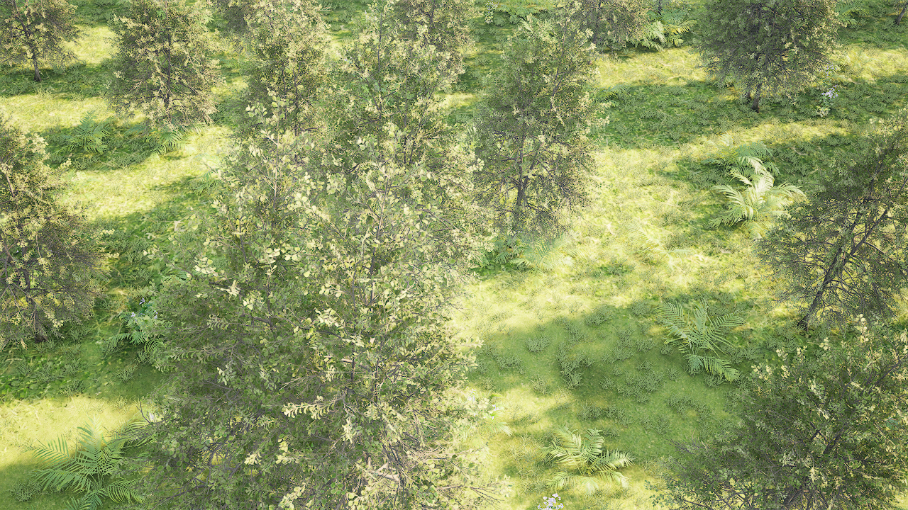
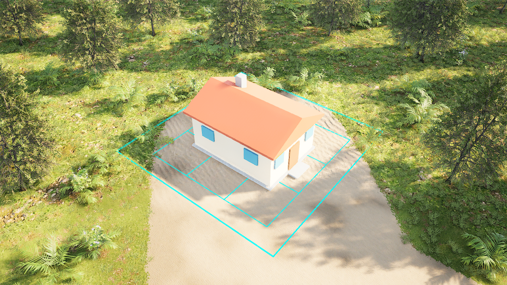

# Grundstück durch Rodung und Erdarbeit zum Bauplatz vorbereiten

Im getrennten **SitePreparationLab** bereitest du einen Bauplatz als zusammenhängenden Auftrag vor: **planen → roden → Erde bewegen → Boden prüfen → Testhaus setzen**. Die neue Karte hat eigene Biomkopien und einen eigenen Spielstand. Einrichtung, native Tests und vollständige Uncooked- sowie Development-Cooked-Neustartpaare dieser V2-Fassung sind geprüft. Die aktuelle gemeinsame Controller-/Kamera-API ist separat auf der erhaltenen EarthworksLab-Karte geprüft. Die normalen Startdaten werden korrekt geladen; getrennte normale Starts ohne CSV-Instrumentierung enden sauber. Ein später Exitfehler des CSV-Prüflaufs bleibt offen. Ein passender Startspielstand und die versiegelte Demo sind vorbereitet. Der normale Launcherstart mit reagierendem eigenem Fenster und korrekter Spielkarte ist ebenfalls bestanden. Die Anleitung ist für diesen begrenzten PoC **stable**; physische Eingaben und menschliche Pixelabnahme stehen separat aus.[^v2-biome-contract][^proof]

## Voraussetzungen

Benötigt werden CityLab mit Unreal **5.8.4**, ShaderWorld **4.1**, dem aktuellen Projektmodul und **/Game/Maps/ShaderWorldSitePreparationLab**. Öffne diese vorbereitete Karte und starte **Play**. Das öffentliche Wissensbundle enthält Anleitung und Nachweise; Karte, Projektquellen und lizenzierte Assets liegen im ursprünglichen Projekt.

Die neue Karte verwendet **CityLabSitePreparation** als normalen Speicher-Slot. Sie startet bei dessen erster Verwendung frisch mit **0 t Lagerbestand**: zuerst abtragen und einlagern, danach Material einbauen. Das bisherige **ShaderWorldEarthworksLab** mit Slot **CityLabEarthworks**, seinen fünf Aufträgen und rund 6,4 t bleibt getrennt erhalten. Alte Saves werden nicht umgebunden oder ersetzt. Eine verpackte V2-Demo bekommt außerdem einen eigenen UserDir; ein alter Spielstand mit anderer Welt-/Materialbindung wird sicher abgewiesen.[^own-site-model][^v2-biome-contract]

**Wichtig für alte Spielstände:** Alte Quelle und passende Paketfassung gemeinsam erhalten. Die bisherige Demo bleibt ihrer Format-7-Fassung zugeordnet. Die [ausdrückliche Übernahme bekannter V2-Stände nach Format 8](stable-save-binding.md) ist nativ über zwei neue vollständige Cooks, mit strenger physischer Wiederaufnahme und mit normalem Speicher-/Lade-/Kaltstartpaar bestanden. Der neue normale C2-Start zeigt ein antwortendes eigenes Fenster und die richtige Karte. Frühere Fehler bleiben im Beleg; menschliche Pixelbestätigung und physische Tasten sind separat offen. Der normale Ladebefehl konvertiert Altstände nicht stillschweigend.

## Aktuelle stabile Demo starten

Für den übernommenen eigenen Stand startet **Tools/launch_stable_site_preparation_demo.ps1** die geprüfte C2-Fassung mit eigener Datenablage **Saved/SaveBindingDemoUser**. Sie setzt den einmalig übernommenen Arbeitsstand fort und besät vorhandenen Fortschritt nicht neu. **F5** speichert und **F9** lädt; für einen kalten Neustart denselben Launcher erneut verwenden. Die [Speicheranleitung](stable-save-binding.md) erklärt Übernahme, Prüfungen und Rückweg zur bewahrten alten Fassung.

## Historische vorgeplante Format-7-Demo starten

Im Projektordner startet **Tools/launch_site_preparation_demo.ps1** die vorbereitete verpackte V2-Fassung mit eigener Datenablage **Saved/SitePreparationDemoUser**. Der Launcher prüft die sechs Paketdateien gegen das Manifest und schützt gegen doppelte Starts derselben Demo. Die Startdatei ist exakt die geprüfte Cooked-Ready-Datei; bestehender Spielfortschritt wird nicht automatisch neu besät. Der normale Launcherstart ist separat bestanden: Am **29. Oktober 2026 um 18:12:47 UTC** bestätigten Prozess-/Fensterabfrage und natives Startlog ein reagierendes eigenes Hauptfenster, die richtige Spielkarte und einen Start ohne Offscreen-Modus oder protokollierten Startup-Error. Seeddatei und Paketmanifest stimmten mit den vorbereiteten SHA256-Werten überein. Dieser Nachweis enthält keine Pixelprüfung, Computer-Use-Bedienung, physischen Eingaben oder menschliche Bestätigung und keinen abschließenden Exitnachweis.[^proof]

In dieser Demo ist **ein Bauplatz bereits geplant und pausiert**: **Arbeit starten [Space]**, danach **Transport an [H]** verwenden. Zuerst wird gerodet, dann Erde bewegt. Sobald **Bauplatz bereit** erscheint, mit **B** das Haus setzen. **7** brauchst du erst für einen neuen Standort. Die Demo verwendet das ausdrücklich beschleunigte Prüfprofil; das ist keine realistische Maschinenleistung.

## Einen eigenen Bauplatz vorbereiten

Die Knopfbezeichnungen und Kürzel stammen aus der aktuellen Controllerintegration. Eine vollständige physische Tasten-/Mausprüfung wird daraus nicht abgeleitet.[^own-site-model]

1. Karte öffnen, **Play** starten und fertigen Boden abwarten. Links **Bauplatz: Roden > Ebnen > Haus [7]** wählen. Der Testhaus-Bauplatz hat einen festen **12 × 12 m** großen ebenen Kern.
2. Den Mauszeiger außerhalb der Werkzeugleiste auf geeigneten Boden bewegen. Ein kurzer linker Klick fixiert den Standort. Mit **Hoehe − / Hoehe +** beziehungsweise **Bild ab / Bild auf** die absolute Zielhöhe in **0,25-m-Schritten** ändern. Die Vorschau nennt Bäume einschließlich der Zufahrt und getrennte Aushub-/Einbaumengen. Kurz stillhalten, bis die Baumerfassung stabil ist.
3. **Plan bestaetigen + speichern [Enter]** wählen. Der Auftrag erscheint in der Warteschlange; Bäume und Erde bleiben zunächst unverändert. Danach ist die Vorschau inaktiv. Für eine neue Planung das Werkzeug erneut wählen; **Vorschau verwerfen [Esc]** beendet nur die Vorschau.
4. Den gewünschten Auftrag mit der Maus über **Naechsten waehlen [Tab]** auswählen und **Arbeit starten / Pause [Space]** anklicken. Ein **`>`** vor der Listenzeile markiert die Auswahl. Tab besitzt aktuell den unten beschriebenen Fokusfehler. Erst jetzt entfernt die Rodung schrittweise die gespeicherten Bäume. Erneutes Betätigen pausiert und erhält den Fortschritt.
5. Für denselben gestarteten Bauplatz **Transport an / aus [H]** einschalten. Während der Rodung wird der Wunsch nur vorgemerkt. Erst nach vollständiger Rodung beginnt die Erdarbeit mit dem gemeinsamen Lager, begrenztem Puffer und Lkw. Aushub braucht Lagerplatz; zusätzlicher Einbau braucht echten vorhandenen Bestand.[^flatten]
6. Auf **Bauplatz bereit** warten. Dafür müssen Erdarbeit und lokale Kollisionsprüfung abgeschlossen sein. Dann **Haus auf fertigen Bauplatz setzen [B]** wählen. Der Boden und freie Hausbereich werden erneut geprüft. Wiederholtes Auslösen baut kein zweites Haus.[^own-site-model]

**Speichern [F5]** und **Laden [F9]** sichern beziehungsweise laden die gemeinsame Kette. Erfolgreiche Plan- und Schalteraktionen speichern ebenfalls; geänderter Fortschritt wird ungefähr alle zwei Sekunden automatisch gesichert. Vor einem gezielten Neustart ausdrücklich speichern. Die Kürzel gelten außerhalb der linken Leiste; die sichtbaren Knöpfe sind der einfachste Einstieg.

| Phase | Bedeutung |
| --- | --- |
| Geplant | Gespeicherte Absicht; noch keine Maschinenarbeit. Revision/Storno nur ungearbeitet. |
| Rodung | Gespeicherter Baumbestand wird schrittweise dauerhaft entfernt. |
| Erdarbeit | Rodung vollständig; getrennte Aushub-/Einbauphasen mit Materialtransport. |
| Bauplatz bereit | Erde fertig und Hausboden über neun lokale Punkte in drei stabilen Durchläufen geprüft. |
| Haus gebaut | Genau das zugeordnete Testhaus steht am freigegebenen Ort. |
| Storniert | Ungearbeiteter Auftrag neutral beendet. Geleistete Arbeit wird nicht zurückgedreht. |

## Bekannter Eingabefehler: Tab landet auf den Kamerareglern

Am 29. Oktober 2026 meldete der Nutzer, dass **Tab** die unteren Kameraregler blau fokussiert, statt den nächsten Auftrag zu wählen. Der gelesene Controllerpfad erklärt das Verhalten: Die Regler dürfen Tastaturfokus erhalten, die Auftragsauswahl ist dagegen ein nachgelagerter Spielbefehl. Slate kann Tab vorher als UI-Navigation behandeln; ein fokussierter Regler sperrt anschließend über den vorgesehenen UI-Schutz weitere Weltkürzel. Das ist ein Eingabefehler, keine Grenze auf einen Bauplatz.[^tab-focus]

**Ohne Tastaturkürzel weiterarbeiten:** Links zur **Auftragswarteschlange** hochscrollen und **Naechsten waehlen [Tab]** mit der Maus anklicken. Das **`>`** wandert zur nächsten vorhandenen Zeile; auch fertige Aufträge werden durchlaufen. Danach die Knöpfe **Arbeit starten / Pause**, **Transport an / aus** und bei fertigem Bauplatz **Haus auf fertigen Bauplatz setzen** benutzen. Ein weiterer Bauplatz entsteht über das erneut gewählte Bauplatzwerkzeug, einen anderen Ort und **Plan bestaetigen + speichern**. Je Bauplatz ist ein Haus vorgesehen; der einzelne Maschinenzug arbeitet die Aufträge nacheinander ab. Tab erstellt keinen neuen Plan.

Der Mausweg ist durch die gelesenen direkten Button-Callbacks belegt; eine neue physische Bedienprobe wurde dafür nicht ausgeführt. Die vorhandenen Zustands- und API-Prüfungen sind kein Test der tatsächlichen Tab-Weiterleitung. **Noch nicht korrigiert oder neu ausgeliefert:** Ein gezielter Fix muss Tab vor der UI-Navigation im eigenen Spielfenster behandeln und anschließend den Weltfokus wiederherstellen, ohne Editorfenster oder beabsichtigte Reglerbedienung zu verändern. Dafür ist eine echte Slate-Eingabeprüfung mit mehreren Aufträgen und fokussierten Reglern erforderlich. Das laufende Nutzerspiel wurde für diesen Befund nicht bedient oder neu gestartet.

## Aktuelle Werkzeugleiste im normalen verpackten Spiel

Diese unveränderte **888 × 500-SHOWUI-Aufnahme** zeigt den normalen V2-Controller mit einem bereits geplanten, pausierten Bauplatz im Wald. Acht native Snapshots bestätigten separat den exakten ungearbeiteten Ready-Zustand. Der grüne Framezähler gehört zur CSV-Prüfung; deren später Exitfehler bleibt offen. Ein getrennter normaler Start desselben Builds mit demselben Save, ohne CSV, endete sauber. Das Bild belegt keine physischen Eingaben.[^proof]

## Getrennter gemeinsamer Werkzeugleistenbeleg im Editor

Die unveränderte Aufnahme zeigt die Bauplatzvorschau mit dem aktuellen Controller auf der erhaltenen EarthworksLab-Karte. Die Slate-Leiste ist innerhalb des gesamten **1310 × 750-Editorrahmens** klein sichtbar. Normale API-Aufrufe sind geprüft; das Bild belegt keine physischen Tasten und noch keine normale V2-Cooked-Demo.

## So sieht der geprüfte Ablauf im verpackten Spiel aus

Die folgenden unveränderten Aufnahmen stammen aus dem erfolgreichen Development-Cooked-Lauf auf der neuen V2-Karte.

**Teilrodung:** Die Terrainaufnahme zeigt noch Wald. Ein erster Rodungsschritt ist gespeichert; einzelne Ressourcenkennungen sind aus dem Bild allein nicht abzulesen.

**Abschluss:** Nach Rodung, Erdarbeit und Bodenfreigabe stehen Testhaus und geschlossenes Dach auf dem abgesenkten freien Bauplatz. Die Zufahrt bleibt frei; blaue Hilfslinien gehören zum Labor.

Die unveränderten Bilder wurden vom Agenten visuell geprüft und im [Bildmanifest](../evidence/image-manifest.json) erfasst. Sie zeigen Terrain und Haus, keine Slate-Werkzeugleiste oder physische Bedienung.[^proof]

## Explizite Biomregeln im neuen Labor

Die neue Karte verwendet fünf getrennte **SitePreparationV2**-Profile: **Wald, Wiese, Fels, Strand und Meeresboden**. Ihre bestehenden Höhen- und Hanggrenzen bleiben erhalten; die gemeinsam genutzten Spawnassets werden nicht verändert.[^biome-rules][^v2-biome-contract]

Die neue Dichtematerialregel **BlueAndBounds1** wertet die ausdrücklich gewählte Biom-ID im blauen Datenkanal und ShaderWorlds native Zellgrenzen aus. Der rote Kanal bestimmt das Bodenmaterial. **GrassAlt** als sichtbarer Bodenwert erzeugt dadurch keine zusätzliche versteckte Pflanzensperre. Die bewuchsfreie **Biom-ID 3** bleibt in dieser eigenen Konfiguration ausdrücklich für NoGrowth reserviert. Eine solche Maske ersetzt weiterhin keine gespeicherte Rodung.[^v2-biome-contract][^clearing]

Dafür wurden **zehn neue Biom-/Dichtematerialassets und eine neue Karte** angelegt. Die Originaldateien der Biome und der alten Welt bleiben unverändert; ihre zur Laufzeit berechnete Bindung kann sich beim Cook dennoch ändern. Das ist eine versionierte Labortrennung, keine automatische Migration bestehender Welten.

## Speichern und Wiederaufnahme

Gespeichert werden die verbundenen Aufträge, eingefrorenen Baumkennungen, Rodungsfortschritt, Phase, Pause, Transportwunsch, ausgeführte Erde, Materialkonten, Lkw-Ladung und Hausidentität. **NoGrowth ersetzt das Rodungsregister nicht:** Die Maske verhindert neuen Bewuchs; das Register hält fest, welche Ressourcen tatsächlich entfernt wurden. Holz besitzt in diesem Slice noch kein eigenes Konto.[^own-site-model][^clearing]

Die hier ursprünglich abgenommene Demo schreibt ausdrücklich **Format 7**. Die getrennte neue stabile V2-Fassung schreibt **Format 8** mit Schema 1; ihr begrenzter Übernahme-/B/C-Nachweis steht in der [neuen Speicheranleitung](stable-save-binding.md). Ältere unterstützte Formate werden innerhalb ihrer Welt-/Generatorbindung geprüft; ein nativer Binärtest erhält auch den alten ausgelassenen Versionswert 6. Das ist keine universelle Altsave-Migration. Widersprüchliche Records oder eine andere Welt-/Generator-/Terrainbindung werden vor Anwendung abgewiesen. Die erfolgreichen kalten Restarts verwenden jeweils dieselbe Paketfassung; sie bestätigen keine Kompatibilität nach erneutem Cook.[^proof][^build-bound-save-source]

Nach dem Laden kann **Bewuchs nach Laden: native Neuberechnung abwarten** erscheinen. Die Runtime fordert den lokalen Boden selbst an und lässt die beteiligten nativen Baumquellen in ihrer begrenzten Region fertig rechnen, bevor weitere Arbeit folgt. Sie erfindet keine Instanzen und verändert dafür keine Rodungs- oder Materialbuchung. Lokale Bodenbereitschaft ist trotzdem keine globale GPU-/Bewuchs-Fertiggarantie für beliebige Biome oder Streaminglagen.[^own-site-model][^proof]

## Stand der aktuellen Prüfung

Die Einrichtung mit elf neuen Assets, native V2-Suite und Wiederholung ohne neue Assets sind bestanden. **Uncooked und Development-Cooked bestanden jeweils mit zwei frischen Prozessen:** Teilrodung und beladene Fahrt wurden exakt fortgesetzt; beide Pfade endeten mit 21 gerodeten Ressourcen, erhaltenem Kontrollbaum, genau einem Haus, 176,4 t Lager und 0 g Bilanzfehler. Drei weitere Loads erzeugten keine Duplikate. Die aktuelle gemeinsame Controller-/Kamera-API bestand separat 38 Checks auf der erhaltenen EarthworksLab-Karte. Die normale V2-Startprüfung bestätigt zusätzlich acht vollständig gleiche native Snapshots des ungearbeiteten Plans. Dennoch liefert der Prozess nach sauber protokollierter CSV-Finalisierung einen späten Nichtnull-Exit; dasselbe passiert mit dem passenden alten Archivpaket. Das ist kein vollständiger normaler Demo-PASS. Drei getrennte normale Starts ohne CSV-Instrumentierung bestanden inzwischen mit Exit 0: neue V2-Karte mit demselben Ready-Save, passende alte Foundations-Karte und leere Entry-Karte. Sie bestätigen saubere normale Prozessbeendigung; die instrumentierten Fehlversuche bleiben erhalten. Die versiegelte Demo mit identischer privater Ready-Datei ist vorbereitet: 106 Quelldateien und sechs Paketdateien geprüft, 170 zuvor vorhandene Save-Dateien unverändert; genau eine neue private Startdatei hinzugefügt. Der tatsächliche normale Launcherstart bestand anschließend die begrenzte Fenster-/Kartenprüfung mit unveränderter Seed- und Manifestbindung. Physische Eingaben, Computer-Use-Bedienung und menschliche Pixelabnahme bleiben offen; der Start ergänzt keinen weiteren Exitnachweis.[^proof]

Der [Prüfbericht](../evidence/site-preparation-test.json) erhält die früheren Erfolge, die gescheiterten Kontrollbaumversuche und deren Diagnose getrennt. Diese historischen Ergebnisse und Bilder werden nicht auf V2 übertragen. Boden- und Baumgates bleiben streng; keine Ersatzbäume, zusätzlichen Rodungsbuchungen oder nachträglich angepassten Savebindungen.

## Fehlerhilfe und Grenzen

| Beobachtung | Vorgehen |
| --- | --- |
| Nach Bestätigung passiert nichts | Richtigen Queueauftrag mit **Tab** wählen, dann **Arbeit starten / Pause**. Bestätigen allein startet keine Arbeit. |
| Baumerfassung oder Wiederaufnahme wartet | Standort unverändert lassen und gerenderte Frames zulassen. Bodenbereitschaft allein bestätigt keine fertigen Baumquellen; Status lesen. |
| Der Lkw fährt nicht | Erst Arbeit starten, danach für denselben Bauplatz **H** verwenden. Während Rodung wird der Transportwunsch nur vorgemerkt. |
| Das Haus bleibt gesperrt | Fertige Erdarbeit und aktuellen Kollisionsnachweis abwarten; den Hausbereich freihalten. |
| Ein Baum scheint ungerodet zu fehlen | Native Nullskalierung und dauerhaften Rodungsrecord unterscheiden. Ein fehlender sichtbarer Kandidat darf nicht als zusätzlich gefällter Baum gebucht werden. |
| Alter Save wird nach neuem Cook abgewiesen | Quelle mit passender alter Paketfassung bewahren. Für die bekannten V2-Stände den [ausdrücklichen Format-8-Weg](stable-save-binding.md) nutzen lassen; dessen native B2/C2-Abnahme und separate physische Fortsetzung gelten für bekannte Stände bei unveränderter Grundlage. Beliebige Inhaltsänderungen benötigen eine eigene Migration. Keine Bindungen umhashen. |
| Ausgangsboden ändert sich während Rodung extern | Der spätere Erdstart kann **NeedsReplan** blockieren. Rodungsfortschritt bleibt erhalten; ein expliziter Replanpfad nach begonnener Rodung fehlt noch. |

Es gibt weiterhin **einen Maschinenzug**, feste geprüfte Wege und ein Erdmaterial. Holztransport, allgemeine Bürger-/Fahrzeugnavigation, Oberflächenarbeit und das Ändern bereits geleisteter Aufträge folgen später. Die [Untergrundansicht](underground-view.md) ist eine getrennte Darstellungsfunktion.

[^own-site-model]: Gelesene eigene Implementierung gemäß Quellenbeschreibung.
[^proof]: [Prüfbericht mit aktueller V2-Grenze und getrennten historischen Nachweisen](../evidence/site-preparation-test.json).
[^clearing]: [Dauerhafte Ressourcenkennungen und Rodungscache](clearing-cache-and-performance.md).
[^flatten]: [Erdarbeit, Lager und getrennte Aushub-/Einbauphasen](flatten-machine-earthworks.md).
[^plan]: [Vereinbarter Scaping-Ausbau](../reference/scaping-machine-work-plan.md).
[^v2-biome-contract]: Eigene gelesene V2-Setup-/Dichtewerkzeuge und erfolgreicher begrenzter Einrichtungsbericht gemäß Quellenbeschreibung; vollständige V2-Uncooked-/Cooked-Neustartpaare separat im Prüfbericht.
[^biome-rules]: [Bestehende Höhen- und Hangregeln](foundations-lab.md).

[^build-bound-save-source]: Gelesene native PreSave-Versionierung und eigene Terrainidentität gemäß Quellenbeschreibung; keine Änderung am Vendorcode oder nachträgliche Save-Normalisierung.

[^tab-focus]: Direkte Nutzermeldung und unabhängige lesende Prüfung des aktuellen Controllers und Slate-Routingpfads; kein neuer Build, kein physischer Eingabetest und keine ausgelieferte Korrektur.
