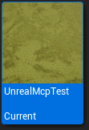

# Fehler gezielt eingrenzen

Beginne beim sichtbaren Symptom. Ändere möglichst eine Ursache nach der anderen und kontrolliere danach das erwartete Ergebnis.

| Symptom | Zuerst prüfen | Erfolg erkennen |
| --- | --- | --- |
| Projekt fehlt in der Liste oder verlangt trotz passender Engineversion eine Konvertierung | Enginekennung und bekannte Projektordner prüfen; den Projektbrowser nach einer Reparatur neu öffnen | Das vorhandene Projekt erscheint und öffnet sich ohne Konvertierungsdialog |
| Terrain oder Meer fehlen nach dem Laden | Shaderkompilierung beenden lassen, Editor/Viewport aktivieren und Realtime einschalten; bei Bedarf Play starten | Oberfläche wird nach gerenderten Frames aufgebaut |
| Gelände ist sichtbar, die Figur fällt hindurch | Generate Collision aktiv? Wird Kollision in der Nähe dieser Figur angefordert? | Die Figur bleibt nach fertiger Kollisionsgenerierung auf dem Terrain |
| Große Baukamera, aber Bodenabfragen fehlen | Darstellungsreichweite und Kollisionsreichweite getrennt betrachten; im CityLab gibt es einen eigenen Kollisionsanker | Terrain-Traces nahe dem Baugebiet treffen wirklich den Terrain-Actor |
| Schaum ist eingeschaltet, aber unsichtbar | Am Ocean-Actor Rebuild auslösen und einige Sekunden aktive Frames abwarten | Weiße Schaumflächen bilden sich auf Wellenkämmen |
| Schaum kommt trotz Rebuild nicht | Choppiness muss größer 0 sein; oceanfähiges Oberflächenmaterial verwenden | Schaum reagiert auf Faltung der Wellenkämme |
| Speichern/Laden reagiert nicht | In den PIE-Spielbereich klicken; CityLab-Karte und deren GameMode verwenden; K/L statt F5/F9 | HUD-/Log-Rückmeldung und sichtbare Rekonstruktion |
| Figur wird unter dem Gelände nach oben versetzt | An ihrer SW_Collision-Komponente Prevent Falling Under Terrain prüfen | Im Tunnelbereich verhindert diese Hilfsfunktion keinen Abstieg |

Die ersten Terrainfälle wurden beim Aufbau der Referenz beobachtet; Wind und Schaum wurden nach Parameter-Readback und Rebuild visuell bestätigt.[^terrain-proof][^ocean-proof] Die Tunnelzeile ist eine aus der aktuellen Komponente abgeleitete Prüfung, noch kein abgenommener Bergtunnel.

## Projekt fehlt oder verlangt unerwartet eine Konvertierung

Eine passende Versionsnummer allein reicht dem Projektbrowser nicht immer: Er vergleicht die **gespeicherte Enginekennung des Projekts** mit der **Kennung der laufenden Installation**. Bei einer Abweichung kann er eine Konvertierung anbieten, obwohl beide dieselbe Engine verwenden. Die Kennung beeinflusst außerdem, in welchem Einstellungsordner Unreal nach bekannten Projekten sucht.[^engine-registration-code]

1. Prüfe die tatsächlich gestartete Engineversion. Die hier untersuchte Installation ist **UE 5.8.4**; ShaderWorld bleibt **4.1**. Die Pluginversion steuert diesen Dialog nicht.
2. Öffne das vorhandene Projekt über seinen tatsächlichen `.uproject`-Pfad. Ein fehlender Eintrag in der Übersicht bedeutet noch nicht, dass Projekt oder Spielstände fehlen. Prüfe außerdem die bekannten **Projekt-Suchordner**: Eine vorhandene Recent-Liste allein reichte im untersuchten UE-5.8-Browserpfad nicht aus.
3. Prüfe bei unerwarteter Konvertierungsaufforderung die Zuordnung dieser Projektdatei zur vorgesehenen Engine. Für eine normale Zuordnung bietet das Kontextmenü der `.uproject`-Datei **Switch Unreal Engine version**. Stimmen die angezeigten Versionen bereits überein, müssen zusätzlich die lokalen Installationskennungen abgeglichen werden.
4. Öffne nach einer korrigierten Zuordnung einen **neuen Projektbrowser**. Unreal merkt sich die aktuelle Enginekennung innerhalb eines laufenden Prozesses; ein bereits geöffnetes Browserfenster kann deshalb weiterhin den alten Dialog zeigen. Die reine Registrierungsänderung kann eine laufende Laborsitzung bestehen lassen. Werden zusätzlich Suchordner geändert, kann für ihre dauerhafte Übernahme ein gespeicherter Editor-Neustart nötig sein.

**Konkret reparierter Laborfall am 28. Oktober 2026:** Das Projekt war mit `EngineAssociation = 5.8` verbunden. Der Launcherbestand enthielt keinen Engineeintrag `UE_5.8`; dieselbe korrekte Installation stand in der benutzerspezifischen Registrierung stattdessen unter einer automatisch erzeugten GUID. Nach Sicherung wurde ausschließlich der Name dieses vorhandenen Eintrags auf `5.8` korrigiert. Enginepfad und Projektdatei blieben unverändert; der SHA-256-Vergleich der Projektdatei bestätigte das. Dies ist eine Reparatur dieser nachgewiesenen Zuordnung, keine allgemeine Anleitung, unbekannte Installationskennungen umzubenennen.

Für die dauerhafte Suche verwendet Unreal die Einträge `CreatedProjectPaths` unter `[/Script/UnrealEd.EditorSettings]` in seiner `EditorSettings.ini`. Bei der hier reparierten Kennung `5.8` liegt sie unter `%LOCALAPPDATA%\UnrealEngine\5.8\Saved\Config\WindowsEditor\`. Dort gehört der **Sammlungsordner über dem Projektordner** hinein: Für `<Projektablage>\CityLab\CityLab.uproject` beispielsweise `CreatedProjectPaths=<Projektablage>`; den Platzhalter durch den eigenen Ordner ersetzen. Sichere zuerst den Spielstand, beende die Spielvorschau und schließe die betroffenen Unreal-Instanzen vollständig. Sichere dann die Datei und ergänze den Eintrag bei geschlossenem Editor; vorhandene Suchordner erhalten. Starte anschließend Unreal beziehungsweise den Projektbrowser neu. Eine bereits vorhandene Recent-Liste ist in dieser geprüften Konstellation kein Ersatz für den Suchordner.[^engine-registration-code]

Der betreffende Windows-Eintrag liegt unter `HKCU\SOFTWARE\Epic Games\Unreal Engine\Builds`. Eine zweite Kennung für denselben Engineordner daneben einzutragen ist hier keine dauerhafte Lösung: Der native Enumerator entfernt doppelte Ordnerzuordnungen. Der Launcherbestand wurde bei der Reparatur nicht künstlich ergänzt.[^engine-registration-code]

**Prüfstand:** Registrierung zurückgelesen und unveränderte Projektdatei bestätigt. Ein frischer Projektbrowser mit echtem Windows-Backend erkannte die Engine als `5.8`. Nach Ergänzung des Suchordners zeigte seine Kachel das Projekt mit **Current**: Der native Kennungsvergleich passt. **Open wurde dort nicht ausgelöst**; die Aufnahme bestätigt dieses Widget, keine Betriebssystem-Sichtbarkeit. Separat bestand die reguläre Öffnung der unveränderten `.uproject` über die Windows-Dateizuordnung und den registrierten UnrealVersionSelector: neuer Editor mit UE 5.8.4, anschließend ConstructionLab und neues PIE. Beide Suchordner blieben nach dem Neustart erhalten. Die vollständig gesicherten Baustellenrecords kamen identisch zurück, ebenso die Kameraposition; die 16 unbeteiligten Spielstände blieben bytegleich. Arbeit und Transport wurden auf ihre vorherigen Werte zurückgestellt und normal gespeichert. Keine Konvertierung vorgenommen.[^engine-registration-proof]

**Cache-Falle:** Die zuvor laufende Altinstanz konnte ihren alten Suchordner-Cache über eine externe Dateiänderung zurückschreiben. Deshalb wurde die gesicherte Einstellung erst nach Beendigung der Altinstanzen dauerhaft ergänzt und nach dem neuen Start nochmals zurückgelesen. Eine bloße Änderung der Datei bei weiterlaufendem Editor war hier keine dauerhafte Lösung.

Die unveränderte native Kachelaufnahme zeigt **Current** für die passende Enginekennung. Nur dieses Widget wurde erfasst; persönliche Pfade sind nicht im Bild enthalten.[^engine-registration-image]

## Die rote Lumen-Meldung in unseren Bildern

Einige Viewport-Aufnahmen melden, dass **Lumen keine Ray-Tracing-Daten** besitzt. Im Projekt fehlen dafür geeignete Software-Distance-Field-Daten beziehungsweise aktiviertes Hardware-Ray-Tracing. Die dokumentierte Umstellung auf DX12/SM6 behob eine andere, zuvor beobachtete Nanite-Warnung. Die Lumen-Meldung ist weiterhin offen.

Die Bilder zeigen deshalb den beobachteten Terrain-/Wassereffekt, aber keine fertig abgestimmte Beleuchtung. Die Meldung einfach auszublenden wäre kein Renderer-Fix. Für eine spätere Rendererkonfiguration müssen Zielhardware und gewählte Lumen-Methode gemeinsam geprüft werden.

## Löcher treffen bei einem Trace trotzdem etwas

Unter der ausgeschnittenen Terrainfläche können separate Planes oder Tunnelmeshes liegen. Ein beliebiger Treffer beweist deshalb nicht, dass das Terrainloch geschlossen ist. Zur Prüfung muss erkennbar sein, **welcher Actor** getroffen wurde. Unsere Heightmap-Demo wurde visuell und anhand ihrer Komponenten untersucht; ein unabhängiger Loch-Kollisionsversuch steht noch aus.[^hole-proof]

## Ein Brush verändert nichts

Kontrolliere, ob der Brush aktiviert ist und zum richtigen Brush Manager beziehungsweise Layer gehört. Sein Einflussbereich muss die gewünschte Fläche vollständig umfassen. Die offizielle Brush-Anleitung beschreibt außerdem, dass Terrain, Kollision und Spawnables bei relevanten Änderungen neu berechnet werden.[^brush-doc]

## Falls eine ältere Anleitung andere Felder zeigt

Suche zuerst nach **Producers → Height**. Bei einem aktiven **Compute Producer** wird das Höhen-Generatormaterial ersetzt. Das ist insbesondere im aktuellen FFT-Ozean wichtig. Ein fehlender alter Materialverweis bedeutet dort nicht automatisch einen defekten Ozean. Siehe [Ozeanrezept](ocean-waves-and-foam.md) und [Versionsübersicht](../reference/versions-and-capabilities.md).

[^terrain-proof]: [Terrain-Prüfbericht](../evidence/terrain-report.json).
[^ocean-proof]: [Ozeanprüfung](../evidence/ocean-report.json).
[^hole-proof]: [Umfang der Lochprüfung](../evidence/hole-report.json).
[^brush-doc]: [Offizielles Brush-System](https://universgen.gitbook.io/shader-world/fundamentals/kick-start/blueprint-brush-system-landmass).

[^engine-registration-code]: Native UE-5.8.4-Quellen gemäß Quellenbeschreibung: `GetCurrentEngineIdentifier`, `GetEngineRootDirFromIdentifier`, `GetUserDir`, `EnumerateEngineInstallations`, `EnumerateProjectsKnownByEngine` sowie `SProjectBrowser::FindProjects` und `OpenProject`. Lokal gelesen; kein mitgelieferter Enginecode.

[^engine-registration-image]: [Native Projektkachel](../assets/images/project-browser-current.png), UE 5.8.4, 28. Oktober 2026; Herkunft und SHA-256 im [Bildmanifest](../evidence/image-manifest.json). Visuell inspizierte Slate-Widgetaufnahme, kein Open- oder Betriebssystem-Sichtbarkeitstest.

[^engine-registration-proof]: [Bereinigter Zuordnungs- und Neustartbericht](../evidence/engine-registration-test.json): lokale Registry-/Dateiprüfungen, native Windows-Projektkachel und gesonderte reguläre Dateiöffnung mit Save-/Kamera-Restore. Browser-Open und vollständige Launcher-Installationsreparatur wurden nicht geprüft.
