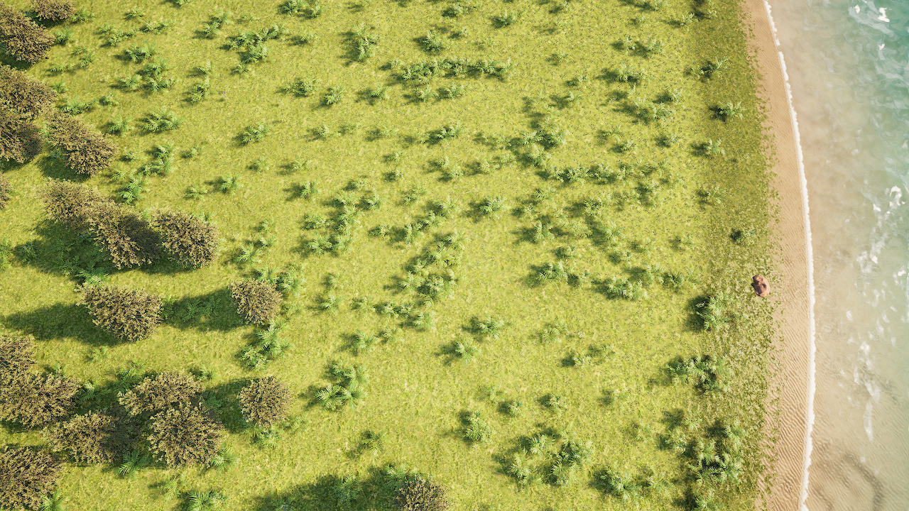
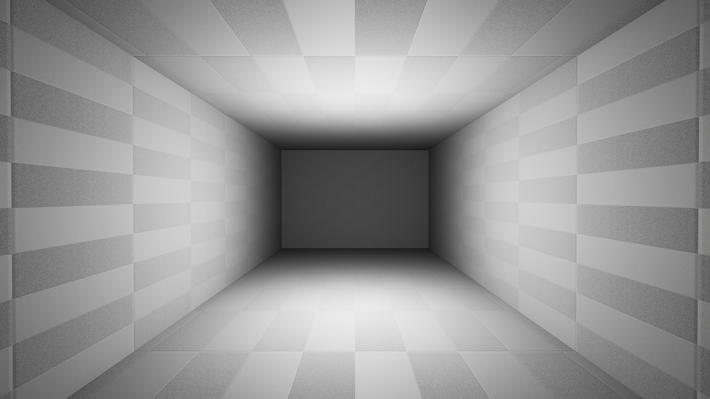

# Einen getrennten Untergrundversuch unter intakter Oberfläche prüfen

Der Versuch soll zeigen, ob eine **kleine, separat gebaute Kammer unter einer unveränderten ShaderWorld-Oberfläche** mit eigener Kollision und nach einem Spielneustart bestehen kann. Die Kammer wird aus einfachen Engine-Meshes zusammengesetzt. Eine Ansicht zeigt den Boden darüber, eine zweite den Innenraum. Der Test läuft in eigenen Spielprozessen. Er verändert keine normale CityLab-Karte und verwendet keinen normalen Spielstand.[^probe-implementation]

**Prüfstatus: im verpackten Development-Spiel mit Neustart bestanden.** Zwei gerenderte Spielprozesse bestanden **13/13** beziehungsweise **14/14** Checks nach **33,4 s** und **33,0 s**. Das Kammerprofil blieb nach dem Prozesswechsel identisch. Beide neuen nativen Datentests bestanden ohne Warnungen. Zwei Aufnahmen aus der ersten Phase wurden von einem Agenten visuell geprüft; die Aufnahmen der zweiten Phase wurden nicht zusätzlich betrachtet.[^probe-proof]



*Geprüfte create-Aufnahme aus dem verpackten Spiel: bewachsene Oberfläche ohne sichtbare kammergroße Öffnung. Neun separate Kollisionsmessstellen lagen weiterhin auf **300 cm**.*



*Dieselbe Testkammer von innen: Boden, Wände und Decke erscheinen geschlossen und im betrachteten Bild trocken. Diese einzelne Aufnahme belegt keine vollständige Wasser- oder Wellenprüfung.*[^probe-proof]

## Was dieser Versuch über ShaderWorld aussagen kann

Das bisher verwendete ShaderWorld-Gelände ist ein **Höhenfeld**: Es beschreibt eine Oberfläche mit einer Höhe pro XY-Position. Ein Holebrush entfernt den horizontalen Fußabdruck der Oberfläche. Er zieht kein räumlich begrenztes Bohrvolumen aus einem Berg ab. Darum würde ein Loch über die gesamte Tunneltrasse auch die Bergoberfläche darüber öffnen.[^holes]

Die installierte Version enthält außerdem einen VoxelActor und eine Voxel-Beispielkarte. Der gelesene VoxelActor beschreibt die Erzeugung volumetrischer Texturdaten und hält an der untersuchten Stelle ausdrücklich fest, dass noch keine Isosurface-Extraktion stattfindet. Das ist **kein Beleg für ein fertiges System zum freien Graben von Höhlen**. Aus dieser Quellcodebeobachtung wird keine Aussage über jede mögliche künftige oder externe Implementierung abgeleitet.[^installed-voxel]

Unser begrenzter Ansatz kombiniert daher das unveränderte Höhenfeld mit einer **eigenen Hülle aus Boden, Decke und vier Wänden** darunter. Unter einem Höhenfeld liegt bereits kein von uns geprüftes geschlossenes Erdvolumen vor. Das Einsetzen dieser Hülle entfernt deshalb kein vorhandenes Bodenvolumen und erzeugt keinen Aushub. Der bestandene Test belegt die Koexistenz und Wiederherstellung der Hülle. Der Bau eines Untergrundbaggers bleibt offen. Die räumliche Geologie, Materialentnahme und durch Maschinen ausgeführte Arbeit bleiben Aufgaben des [Architekturkonzepts](../reference/construction-and-terrain-architecture.md).[^architecture]

## Voraussetzungen

Benötigt wird das ursprüngliche **UnrealMcpTest** mit Unreal Engine **5.8.4**, ShaderWorld **4.1** und den neuen eigenen Dateien **UndergroundProbe**. Die eigene Testklasse ist kein mitgeliefertes ShaderWorld-Werkzeug. Dieses öffentliche Wissensbundle enthält weder diese Projektimplementierung noch die Unreal-Karten oder lizenzierten Plugindateien.

Die Karte **ShaderWorldConstructionLab** muss vorhanden und für einen verpackten Test mitgekocht sein. Ein erfolgreicher neuer Modul-Build ist Voraussetzung für jeden Unreal-Lauf. Die beiden bestandenen nativen Tests heißen **CityLab.UndergroundProbe.BoundedProfile** und **CityLab.UndergroundProbe.ProfileSerialization**. Sie prüfen Profilgrenzen und Datenspeicherung, keinen sichtbaren ShaderWorld-Untergrund.

Für eine Wiederholung der gerenderten Probe werden eine funktionsfähige DX12-/SM6-Umgebung und tatsächlich gerenderte Frames benötigt. **NullRHI reicht dafür nicht.** Python wird für den Harness gebraucht. Ein weiterer GPU-Test sollte währenddessen nicht gleichzeitig laufen; der Start wird im gemeinsamen Arbeitsablauf abgestimmt.

## Was getrennt aufgebaut wird

| Teil | Vorgesehener Aufbau |
| --- | --- |
| Freier Innenraum | **16 m Länge, 6 m Breite, 4 m Höhe** |
| Wände, Boden und Decke | Sechs Engine-Cubes mit **0,5 m** Stärke und eigener blockierender Kollision |
| Lage | XY-Mittelpunkt **−170 m / 100 m**; Höhe nach neun echten Terrain-Kollisionsproben |
| Boden über dem Dach | An den neun Messstellen mindestens **4 m** Abstand zwischen Terrain und Außenseite der Kammerdecke |
| Unterirdische Bewegung | Gerader **13-m**-Sweep mit einer testweisen Kapsel, ohne Portaldurchfahrt |
| Wasserausschluss | Eigene **CityLab Tunnel (Dry)**-Komponente; Box wird aus der Kammer und **0,25 m** Randzugabe je Seite berechnet |
| Speicherung | Eigenes Kammerprofil und eigene Laufkennung, getrennt vom CityLab-SaveGame |
| Zugang | Testkamera wird in die geschlossene Kammer versetzt; kein Eingang in einen Hang |

Die neun Messstellen sind Stichproben. Sie belegen keine lückenlose Mindestüberdeckung einer beliebigen Gebirgsoberfläche. Der Versuch legt auch keinen Holebrush an. Die Air-Pocket-Komponente ist im Aufbau enthalten; die neue Probe prüft bislang nur ihre Profilmaße. **Eine vollständige Wasserfreiheitsprüfung ist damit nicht nachgewiesen.** Der geprüfte Innenraum wirkte in einem einzelnen Bild trocken. Die bekannte Wasserfunktion und ihre eigenen Grenzen beschreibt die [Tunnelkomponenten-Anleitung](reusable-tunnel-component.md).[^dry-tunnel]

## Aus dem Projekt starten

Die Befehle werden im Hauptverzeichnis des Unreal-Projekts ausgeführt, in dem **UnrealMcpTest.uproject** und **Tools** liegen. Vor dem Start erst den neuen Build und ein freies GPU-Testfenster sicherstellen. Der Harness bedient den laufenden Editor nicht und benötigt keinen Computer Use.

1. Prüfe zuerst den Harness ohne Spielstart:

   ```powershell
   python Tools/verify_underground_probe.py --self-test
   python Tools/verify_underground_probe.py --dry-run
   ```

   Der erste Befehl prüft nur die Auswertung künstlicher Testberichte. Der zweite zeigt die geplanten Startargumente; er startet keinen Unreal-Prozess und schreibt keinen Spielstand.

2. Starte nach erfolgreichem Modul-Build den getrennten gerenderten Versuch:

   ```powershell
   python Tools/verify_underground_probe.py
   ```

   Die erste Phase **create** misst die Oberfläche, erstellt die Hülle, prüft die Kollision und speichert das eigene Profil. Erst nach ihrem erfolgreichen Ende startet **resume** als zweiter echter Spielprozess. Diese Phase lädt das Profil und baut die Hülle daraus wieder auf.

3. Der Harness verwendet für jeden Durchlauf eine neue UUID. Daraus entstehen ein eigener **UserDir**, ein Slot mit dem Präfix **UndergroundProbe_** und ein Berichtverzeichnis unter **Saved/UndergroundProbeAcceptance**. Der voreingestellte MCP-Port ist **8104**, getrennt vom normalen Editor-Port 8000. Wenn 8104 bereits belegt ist, kann beispielsweise **--port 8105** ergänzt werden.

4. Die beiden Spielprozesse laufen mit **RenderOffscreen**. Ein zusätzliches sichtbares Spielfenster ist nicht zu erwarten. Öffne anschließend die im Bericht genannten **surface_image**- und **interior_image**-Dateien. Kontrolliere sowohl die Außenansicht als auch den Innenraum. Der zusammengefasste Bericht heißt **underground-probe-test.json**.

Das verpackte Spiel wurde mit **--executable** geprüft. Eine Wiederholung kann mit dieser Option und dem Pfad zu dessen ausführbarer Datei gestartet werden. Dafür muss dieses Spiel den neuen Probe-Code und die Testkarte enthalten. Die vorliegende Abnahme gilt für den verpackten Development-Build; ein zusätzlicher uncooked Spielablauf wurde für diese Probe nicht ausgeführt.

## Geprüftes Ergebnis und Abnahmekriterien

Die folgenden Kriterien wurden in beiden verpackten Prozessen erfüllt. Die Kammermitte lag bei **−350 cm**, die Terrainoberfläche an allen neun Messstellen bei **300 cm**; die Kammerdecke lag außen auf **−100 cm**. Damit ergeben sich an diesen Messstellen **4 m** Bodenabstand über dem Dach. Pro Prozess wurden drei vollständige Sechsflächenprüfungen protokolliert.[^probe-proof]

Ein gültiger Bericht braucht in **beiden** Phasen drei aufeinanderfolgende vollständige Kollisionsprüfungen. Vom Kammermittelpunkt müssen sechs Strahlen die jeweils eigene Boden-, Decken- und Wandkomponente in der erwarteten Entfernung treffen. Die Testkapsel muss ihren 13-m-Weg innerhalb der Kammer ohne Blockierung zurücklegen. Die Terrainhöhe an allen neun ursprünglichen Messstellen darf sich höchstens **2 cm** ändern.

Nach dem zweiten Start müssen Profil und Profil-Hash identisch sein. Der zweite Prozess muss eine andere Prozess-ID besitzen und die gespeicherte ID des ersten Prozesses zurückmelden. Damit wird ein echter Prozesswechsel von einem bloßen erneuten Laden im selben Prozess unterschieden.

Zusätzlich müssen beide Ansichtsdateien geschrieben sein. Ihre Existenz allein beweist kein korrektes Bild: Eine Person oder ein Agent muss prüfen, ob außen die Oberfläche erhalten ist und innen tatsächlich Boden, Wände und Decke zu sehen sind. Ein späterer Ergebnisbericht soll diese Sichtkontrolle ausdrücklich von den automatischen Physik- und Speicherprüfungen trennen.

## Wenn der Versuch scheitert

| Beobachtung | Nächste Prüfung |
| --- | --- |
| Keine Probeberichte, keine neue Klasse | Aktuellen Modul-Build und Startargumente prüfen. Alte Binaries enthalten den neuen WorldSubsystem nicht. |
| Terrain-Kollision konvergiert nicht | Gerenderte Frames, Shaderkompilierung, Generate Collision und die lokale Kollisionsanforderung prüfen. NullRHI ist für diese Abnahme ungeeignet. |
| Kammerprofil abgewiesen | Neun gültige Terrainproben, feste Profilmaße und ausreichende Dachüberdeckung prüfen. Ein vorhandenes Terrainloch ist kein geeigneter Standort für diese Probe. |
| Unsichtbarer Innenraum oder schwarzes Bild | Innenkamera, sechs Meshteile, Beleuchtung und abgeschlossenen Screenshot prüfen. Ein Kollisionsbericht ersetzt die Bildkontrolle nicht. |
| Unveränderte Oberfläche nicht bestätigt | Terrainhöhe und tatsächlich getroffenen Actor prüfen. Ein Treffer auf die Kammer darf nicht als ShaderWorld-Terrainhöhe gewertet werden. |
| Neustart meldet fehlendes Profil | Beide Phasen müssen denselben automatisch erzeugten UserDir und dieselbe Laufkennung verwenden. Die normale CityLab-Speicherdatei ist dafür ungeeignet. |
| Test läuft in ein Zeitlimit | Zuerst den eigenen Phasenbericht und dessen Log untersuchen. Der Harness beendet nur seinen selbst gestarteten Kindprozess. |
| Sichtbares Meer im Innenraum | Diese Probe enthält noch keinen Wasserfreiheitsnachweis. Air-Pocket-Registrierung, Reichweite und Wasser-Material gesondert nach der Tunnelanleitung prüfen. |

Zum Wiederholen wird der Harness erneut gestartet; er erzeugt eine frische Laufkennung und ersetzt keinen vorhandenen Probe-Slot. Die Testhülle lebt nur im jeweiligen Testprozess. Die Ausgangskarte wird nicht gespeichert oder verändert. Normale Baustellen- und CityLab-Spielstände sollen dafür weder geladen noch gelöscht werden.

## Offene Folgeschritte nach dieser begrenzten Abnahme

Der bestandene Versuch liefert eine Grundlage für eine bewusst begrenzte Entscheidung: separate Tunnel- und Kammergeometrie unter ShaderWorld weiterverwenden oder für echtes räumliches Ausgraben eine zusätzliche Geometrie- und Kollisionslösung untersuchen. Erst danach folgen Portale, Straßenanschlüsse, Kurven, Navigation, geologische Materialzustände und Maschinenarbeit mit Materialbilanz. Ein produktiver Tunnel muss außerdem in das reguläre Spielstandmodell integriert werden; der eigene Probe-Slot übernimmt diese Aufgabe nicht.

[^probe-implementation]: Eigene Projektimplementierung und getrennte Harness-Prüfungen; Rohprojekte und lizenzierte Assets bleiben außerhalb dieses Wissensbundles.
[^probe-proof]: [Bereinigter Untergrundbericht mit nativen Tests, zwei verpackten Prozessen und Sichtumfang](../evidence/underground-hybrid-test.json).
[^installed-voxel]: Gelesener ShaderWorld-4.1-VoxelActor. Die Quelle wird beschrieben, nicht als lizenzierter Quellcode mitgeliefert.
[^holes]: [Höhenfeldlöcher und Bergtunnel](holes-and-mountain-tunnels.md).
[^dry-tunnel]: [Wiederverwendbare Tunnelkomponente mit Wasserausschluss](reusable-tunnel-component.md).
[^architecture]: [Architekturkonzept für Bauarbeit, Gelände und Material](../reference/construction-and-terrain-architecture.md).
