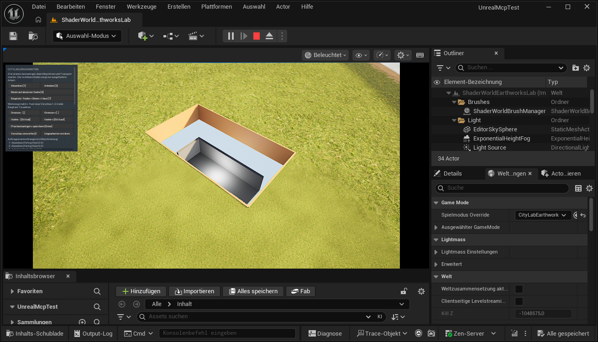
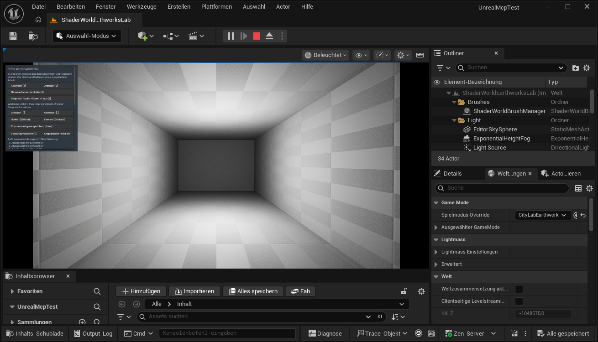
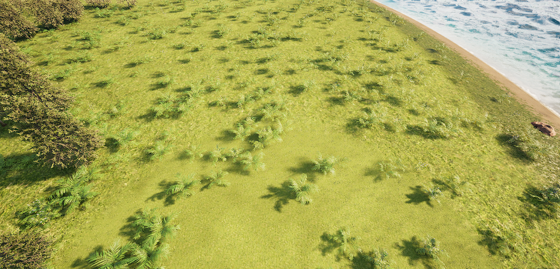
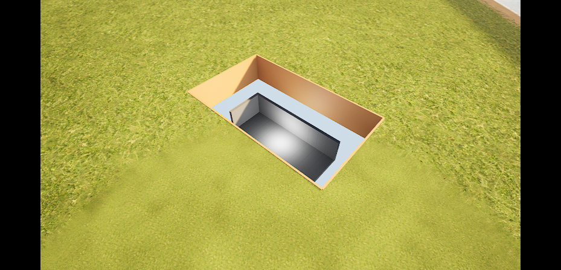
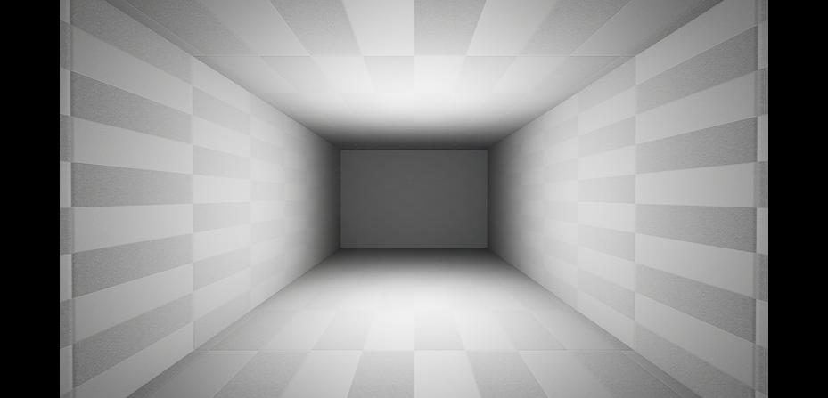
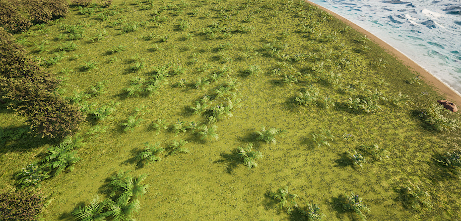

# Untergrund zwischen Oberfläche, Schnitt und Innenraum ansehen

Mit der Laboransicht kannst du die Lage einer Testkammer unter der Insel untersuchen und in ihren Innenraum schauen. Die freie Kamera und das verschiebbare Schnittfenster sind nativ und erneut über die aktuellen gemeinsamen Controller-/Kamera-APIs mit Editorbildern auf EarthworksLab geprüft. **Die normale SitePreparation-V2-Demo ist vorbereitet; ihre Oberflächenaufnahme bestätigt keine verpackte Schnitt-/Innenraumansicht.** Echte physische Eingaben bleiben offen.[^free-camera-source][^camera-build-native]

Die vier bisherigen Bilder und die lokalen Kollisions-, Lade- und Kaltstartnachweise gehören zur vorherigen Fassung mit fester Inspektionskamera. Sie bleiben als historische Belege erhalten und bestätigen die neue Bewegung nicht automatisch. **Oberflaeche [3]** ist weiterhin der eindeutige Rückweg zur Baukamera. Die Anleitung bleibt bis zur verpackten Ansicht und gezielten physischen Eingabeprüfung ein Entwurf.[^own-test][^previous-probe]

## Voraussetzungen und Einrichtung

Vorgesehen ist das ursprüngliche UnrealMcpTest mit Unreal **5.8.4**, ShaderWorld **4.1**, dem neu gebauten Earthworks-Code und der vorbereiteten Karte **/Game/Maps/ShaderWorldEarthworksLab**. Die Karte verwendet den eigenen **CityLabEarthworksGameMode**. Dieses Wissensbundle enthält weder die Karte noch den Projektcode oder lizenzierte Pluginassets.[^own-panel]

Vor dem ersten Versuch richtet ein Agent oder Projektbetreuer bei gestoppter Spielvorschau mit der festen **setup**-Aktion aus **Tools/earthworks_editor_session.py** ausschließlich die eigene Earthworks-Laborkarte ein. Diese wird aus der bisherigen Construction-Karte kopiert. Die Quelle und Pluginassets bleiben unverändert. Die Einrichtung speichert den bisherigen Fern-LOD-Materialpfad in eigenen Kartenmetadaten und im Ergebnisbericht; sie weist im neuen Labor allen Terrain-LODs das Hauptmaterial zu. Danach ruft sie **Tools/setup_underground_view_material.py** auf. Es erstellt eigene Materialien unter **/Game/CityLab/Underground**. Benötigt werden **M_UndergroundCutaway** und **MI_UndergroundCutaway**; bei einer verschachtelten Ausgangsinstanz entstehen zusätzliche eigene Instanzkopien. Das Werkzeug kopiert die konfigurierte Terrain-Materialkette und ergänzt die Sichtmaske. Das Materialwerkzeug verändert keine Originalmaterialassets. Die Fernmaterial-Zuweisung der eigenen neuen Karte wird wie oben beschrieben angeglichen. Danach die Shaderkompilierung abwarten. Die eigene Karte wurde mit GameMode und angeglichenem Fernmaterial gespeichert und erneut geladen. Die Materialeinrichtung Revision 2 lief im Editor erfolgreich durch und speicherte ihre eigenen Assets. Die normale Spielvorschau initialisierte anschließend ihren Earthworks-Controller. Die anschließenden Bild- und Komponentenspurprüfungen sind unten getrennt beschrieben.[^own-view]

### Die Einrichtung ohne Quellcode ausführen

Die allgemeine [Einstiegsfolge des Erdarbeitslabors](machine-earthworks.md#voraussetzungen-und-einstieg) gilt auch für diese Ansicht. Der externe Client benötigt zuerst die feste Bridge im bereits geöffneten Editor; er startet Unreal nicht selbst.[^setup-client]

1. Dieses Projekt im normalen Editor öffnen, eigene Änderungen speichern und **Play/PIE beenden**. Die gemeinsame Editor-Sitzung darf gerade keinen anderen Auftrag abarbeiten.
2. In Unreals **Python-Konsole** die feste Bridge ausführen:

   ```python
   import runpy, unreal
   runpy.run_path(unreal.Paths.project_dir() + "Tools/earthworks_editor_session.py", run_name="__main__")
   ```

3. Sobald das Editorlog **CITYLAB_EARTHWORKS_EDITOR_BRIDGE_READY** meldet, innerhalb von **120 Sekunden** in einer externen PowerShell im Projektordner ausführen:

   ```powershell
   python Tools/setup_earthworks_lab.py
   ```

4. Auf die Bestätigung **EarthworksLab eingerichtet und gespeichert zurückgelesen** warten. Der private Bericht liegt unter **Saved/McpDiagnostics/earthworks-map-setup.json**. Danach **/Game/Maps/ShaderWorldEarthworksLab** öffnen, die Shader abwarten und **Play** starten.

Die Bridge selbst richtet beim Anhängen noch nichts ein. Erst die feste **setup**-Anfrage kopiert beziehungsweise prüft die eigene Karte, gleicht ihre LOD-Materialien an und richtet die eigenen Schnittmaterialien ein. Der Client sendet genau eine Anfrage für diese Editor-Sitzung; er liest oder schreibt keine Spielstände. Bei fehlender, veralteter oder bereits anderweitig benutzter Bereitschaft gibt er eine Fehlerhilfe aus. Ein Timeout wiederholt den Auftrag nicht: Der Editor kann noch arbeiten. Zuerst dessen Ergebnis und den privaten Bericht prüfen, statt die Einrichtung blind erneut auszulösen. Eine erneute bewusste Einrichtung benötigt eine frisch angehängte Bridge.[^setup-client]

Es muss genau ein kollisionsaktives ShaderWorld-Terrain vorhanden sein. Unterschiedliche konfigurierte Oberflächenmaterialien für nahe und entfernte Terrain-LODs werden von diesem begrenzten Ansatz abgewiesen. Deshalb verwendet nur die neue Laborkarte das gleiche vollständige Hauptmaterial für alle LODs. Das kann in der Entfernung teurer sein als das ursprüngliche vereinfachte Fernmaterial. Es ist eine begrenzte Laborvoraussetzung, keine allgemeine Unterstützung verschiedener LOD-Materialien und keine Leistungszusage. Neue Karte, Code und Schnittmaterialien sind im frischen Cook/Stage/Archive enthalten. Der verpackte Maschinenkreislauf bestand separat; seine Daten-/Kollisionsprüfung nimmt diese Ansichtsmodi und ihre Pixel nicht ab. Ein NullRHI-Test kann die Darstellung nicht prüfen.

## Die drei Ansichten bedienen

Für den aktuellen [Slice C](site-preparation.md) verwende die bereits eingerichtete **/Game/Maps/ShaderWorldSitePreparationLab** mit eigenem Slot **CityLabSitePreparation**. Die zuvor beschriebene Erstinstallation der EarthworksLab-Basis ist kein Auftrag, die neue V2-Karte nochmals umzubauen. Die ursprüngliche EarthworksLab-Karte und ihr Spielstand bleiben getrennt erhalten. Die Kamera-/Schnittbedienung unten gilt als aktueller Quellvertrag; die gemeinsame API ist erneut auf EarthworksLab geprüft, die normale V2-Cooked-Demo steht aus.


Starte nach der Einrichtung die normale Spielvorschau. Warte, bis Terrain und Bodenkollision bereit sind. Scrolle in der linken Werkzeugleiste zum Bereich **Untergrund | getrennte schematische Testkammer**. Die folgende Tabelle beschreibt die Bedienung aus dem Code. Alle drei Ansichten und die Rückkehr wurden im Editor visuell verglichen. Die Prüfung rief die normalen Controllerfunktionen über eine begrenzte Editorbrücke auf; sie drückte keine echten Tasten oder Bedienknöpfe.[^own-panel]

| Bedienung | Erwartetes Ergebnis |
| --- | --- |
| **Oberflaeche [3]** anklicken | Die Schnittmaske verschwindet; die ursprüngliche Baukamera und die von der Ansicht selbst ausgeblendeten Objekte werden freigegeben. |
| **Schnitt [4]** anklicken | Die getrennte Kammer wird bei Bedarf initialisiert und ausgewählt. Eine Übersicht als Startpose zeigt einen lokalen Ausschnitt von **24 × 14 m**; die neue Kamera bleibt danach frei beweglich. |
| **Innenraum [5]** anklicken | Die Kamera startet innerhalb der geschlossenen Hülle. Die Terrain-Schnittmaske ist wieder deaktiviert; die neue Bewegung bleibt im begrenzten Innenraum. |
| **Schnitt 1 m tiefer** anklicken | Die horizontale Schnitthöhe sinkt um **1 m**. |
| **Schnitt 1 m hoeher** anklicken | Die horizontale Schnitthöhe steigt um **1 m**. |
| Im Schnitt oder Innenraum auf die Kammer klicken | Eine eigene Auswahlabfrage prüft die räumliche Kammerbox; ein Klick daneben hebt diese Auswahl auf. |

Die Zahlen **3**, **4** und **5** sind zusätzlich als Tastenkürzel gebunden, wenn der Zeiger außerhalb der Bedienleiste liegt und kein Bedienfeld den Tastaturfokus hält. Die sichtbaren Knöpfe sind der eindeutigste Einstieg. Die normale Baukamera bleibt während der Inspektion gesperrt. Die eigene Inspektionskamera erhält getrennte Bewegungseingaben.[^free-camera-source]

Für die Rückkehr immer **Oberflaeche [3]** verwenden. Der eigene **Esc**-Eingabefilter kehrt laut Quellvertrag während der Inspektion zuerst zur Oberfläche zurück und verbraucht die Taste, bevor Unreals normaler Vorschau-Abbruch greift. Außerhalb der Inspektion verwirft Esc gegebenenfalls eine Bauvorschau. Der echte Tastendruck ist noch nicht praktisch abgenommen; der sichtbare Oberflächenknopf bleibt der eindeutige Rückweg. Auch ein Wechsel zum Anheben- oder Absenken-Werkzeug setzt die Untergrundansicht zurück.[^own-panel]

## Freie Kamera und Schnittfenster: neuer Entwurf

Die folgenden Bindungen sind im aktuellen Controller implementiert. Für den vorherigen Quellstand sind Builds, native Zahlen-/Kameratests und normale Controller-/Kamera-API-Aufrufe bestanden. Die zugehörigen Editorbilder wurden visuell geprüft; echte Tastatur-/Mausbedienung bleibt separat offen.[^free-camera-source][^camera-build-native]

1. **Schnitt [4]** wählen und den Mauszeiger von der linken Werkzeugleiste in die Welt bewegen. Mit **W/S** vorwärts/rückwärts, **A/D** seitlich und **Q/E** abwärts/aufwärts fahren. Im Schnitt beträgt die Grundgeschwindigkeit **10 m/s**, im Innenraum **1,5 m/s**, jeweils multipliziert mit dem Regler **Bewegung**. Vorwärts folgt der Blickrichtung; Q/E folgt der Welthöhe.
2. Die **rechte Maustaste gedrückt halten**, um den Blick zu drehen. Der Zeiger wird währenddessen verborgen; nach Loslassen erscheint er wieder an der Ausgangsstelle. Die Blickgeschwindigkeit folgt dem Regler **Maus**. Blickneigung und Bewegung sind begrenzt. Bei Fokusverlust soll die Eingabefreigabe greifen; das ist ein gelesener Eingabevertrag, noch keine physische Fokusabnahme.
3. Mit dem **Mausrad** entlang der Blickrichtung vorwärts/rückwärts fahren. **Untergrundkamera zentrieren [Home]** setzt ausdrücklich die Startperspektive neu.
4. Im Schnitt den Zeiger über den gewünschten Bereich setzen und **G** drücken. Das verschiebt den Mittelpunkt des weiterhin **24 × 14 m** großen Fensters. Die Auswahl trifft eine mathematische horizontale Ebene auf der aktuellen Schnitthöhe; ausgeblendete Terrainkollision wird nicht als sichtbarer Boden interpretiert. G wird außerhalb der Werkzeugleiste bedient.
5. Mit **Bild ab / Bild auf** oder den Knöpfen **Schnitt 1 m tiefer / hoeher** die Schnitthöhe in **1-m-Schritten** ändern. Dabei bleiben die selbst gewählte Kamerapose und Blickrichtung erhalten. Auch eine Fensterverschiebung setzt die Kamera nicht zurück.
6. Mit **Oberflaeche [3]** zur ursprünglichen Baukamera zurückkehren. **Esc** ist der zusätzliche Quellvertrag für denselben Rückweg; echte Tastenprüfung bleibt offen.

Der Fenstermittelpunkt bleibt auf jeder XY-Achse höchstens **30 m** vom Demokammermittelpunkt entfernt. Ein ungeeigneter oder rückwärts gerichteter Zeigerstrahl wird abgewiesen. Das verschiebt nur die Sichtmaske; weder Kammer noch Erde werden verschoben. Die Kamera darf im Schnitt auf jeder XY-Achse bis **60 m** um die Kammer und höchstens **100 m über dem Demoboden** fahren. Im Innenraum bleibt ihre Position mindestens **25 cm** von den modellierten Innenraumgrenzen entfernt. Dies sind Inspektionsgrenzen, keine simulierte Weltkollision oder frei befahrbare Untergrundwelt.

Bei freier Schnittbewegung wechseln die ausgeblendeten kameranahen Hüllenflächen mit der Kameraseite. Dafür besitzt die Ansicht eigene lokale Ausblendeeinträge; Pflanzenpools werden nicht bei jedem Kameraschritt neu durchsucht. Bauteilkollision, Baumzustände und Materialkonten bleiben davon unberührt.

Mit **Oberflaeche [3]** geht es weiterhin zur ursprünglichen Baukamera zurück. Die beiden neuen Tests **CityLab.UndergroundView.BoundedCameraMath** und **CityLab.UndergroundView.FreeCameraAndSliceIndependence** sind ohne Warnungen oder Fehler bestanden. Sie prüfen Zahlen-/Auswahlgrenzen, Kameraposen in einer isolierten Testwelt, Tiefenschritte ohne Rücksprung und fremden Kamerabesitz. Die drei bisherigen Untergrundtests sind ebenfalls sauber bestanden. Diese native Prüfung ist kein Nachweis echter Maus-/Tastaturbedienung oder gerenderter Pixel.[^camera-build-native]

## Aktuelle Editorbilder und Kameraprüfung auf EarthworksLab

Die erneute normale Editorprobe mit aktuellem gemeinsamem Controller auf der erhaltenen EarthworksLab-Karte bestand **38/38 Checks in 204,31 s**. Im Schnitt wurden Bewegung, Blick, Zoom, Tiefe, Fenstermittelpunkt und Fokus über die eigenen APIs geprüft. Im Innenraum wurden Bewegung, Blick, Zoom und Fokus geprüft. Die vollständigen gespeicherten Baudaten blieben bei beiden Ansichten gleich; die Rückkehr stellte das ursprüngliche Kameraziel wieder her. Der Harness rief normale Controller-/Komponentenfunktionen auf, keine echten Tasten oder Mausbewegungen.[^normal-ui-proof]

**Bewegliche Schnittansicht:** Die unveränderte SHOWUI-Aufnahme zeigt den lokalen schematischen Schnitt mit grünem Boden außerhalb des Fensters. Sie stammt aus dem tatsächlichen **1310 × 750-Editorrahmen**, keine Vollbildaufnahme des Spiels. Die Werkzeugleiste ist oben links klein sichtbar.



**Innenraum:** Die unveränderte Editoraufnahme zeigt den begrenzten geschlossenen Raum mit kariertem Material. Das ist weiterhin eine getrennte Testkammer, kein ausgehobener Tunnel.



Beide Bilder wurden vom Agenten visuell geprüft und sind mit Herkunft, Größe und SHA-256 im [Bildmanifest](../evidence/image-manifest.json) erfasst. Die darunterstehenden älteren Bilder und Kollisionsspuren bleiben getrennte historische Nachweise. Ein Bild bestätigt weder physische Kamerabedienung noch eine globale Kollisions-/Navigationsstrecke.

## Der geprüfte Ansichtswechsel

Dieser Abschnitt zeigt den früheren geprüften Stand mit fester Inspektionskamera. Die aktuellen API-Nachweise und neuen Editorbilder stehen im vorherigen Abschnitt; die alten Bilder bleiben separat erhalten.

Die vier unveränderten Bilder stammen aus der normalen Earthworks-Spielvorschau. Ihre Herkunft, Größe und Prüfsummen stehen im [Bildmanifest](../evidence/image-manifest.json); der [bereinigte Prüfbericht](../evidence/underground-view-test.json) enthält die passenden Zustände und Grenzen. Sie zeigen keinen bereits ausgehobenen Tunnel.[^own-test]

**Oberfläche:** Die Insel bleibt bewachsen; Strand und Meer liegen rechts. Die Kammer ist unter dem Terrain verborgen.



**Schnitt:** Nur das lokale Rechteck öffnet die Sicht auf die helle Kammer. Braune Flächen markieren den schematischen Schnittrand. Außerhalb bleibt der Boden grün; die Ansicht verbirgt ganze betroffene Bewuchsgruppen. Ein kurzer Nachlauf direkt nach dem Wechsel ist möglich.



**Innenraum:** Die feste Kamera schaut in die beleuchtete, geschlossene Testhülle. Das Bild zeigt weder einen Portaleingang noch eine freie Fahrstrecke durch einen Berg.



**Zurück zur Oberfläche:** Die Baukamera ist wieder das Blickziel. Der eigene ausgeblendete Bewuchspool-Zähler steht auf null; die grüne Oberfläche und Bewuchs sind wieder sichtbar. Laden während des Schnitts ergab ebenfalls Oberfläche und Baukamera.



## Was Tiefe und Schnittseiten bedeuten

Die Demokammer liegt mit ihrem XY-Mittelpunkt bei **−170 m / 100 m**. Ihre tatsächliche Höhe wird erst nach neun Terrain-Kollisionsproben bestimmt. Für diesen Standort erwartet die Implementierung eine nahezu ebene, unveränderte Inseloberfläche. Der freie Innenraum misst **16 × 6 × 4 m**. Boden, Dach und vier Wände bestehen aus eigenen einfachen Meshes; dazu kommt eine eigene Tunnel-Air-Pocket.[^own-view]

Der anfängliche Schnitt liegt **5 m unter der gemessenen Oberfläche am Demostandort**. Die Anzeige nennt sowohl die absolute Welthöhe in Metern als auch den Abstand unter dem Demoboden. Ein verschobenes Fenster liefert keine neu vermessene Geologie oder neue örtliche Bodenreferenz. Die Knöpfe verändern diese Sichtgrenze in 1-m-Schritten innerhalb eines begrenzten Bereichs. Die Schnittposition verändert keinen Bauauftrag und führt keine Maschine aus.

Die Maske betrifft nur Terrainpunkte innerhalb des gewählten Rechtecks, die über der eingestellten Schnitthöhe liegen. Außerhalb dieses Rechtecks soll das Terrain sichtbar bleiben. Die vorhandene Terrain-Lochmaske wird mit der eigenen Sichtmaske kombiniert. Dadurch sollen bereits vorhandene Öffnungen erhalten bleiben. Die braunen senkrechten Flächen am Rand sind **schematische Schnittseiten**. Sie zeigen keine gemessenen Gesteinsschichten und kein tatsächlich abgeschnittenes Erdvolumen.[^own-view]

Die Oberfläche wird als Materialdarstellung maskiert. Ihre physische Kollision bleibt bestehen. Deshalb nutzt die Kammerauswahl eine eigene mathematische Boxabfrage entlang des Mausstrahls; sie benötigt keinen durch die ausgeblendete Oberfläche hindurchgehenden normalen Boden-Kollisionstreffer. Es entsteht damit auch kein begehbarer Schacht. Dach und kameranahe Wände der Hülle werden im Schnitt nur für die Ansicht ausgeblendet; ihre Kollision bleibt ebenfalls aktiv.

## Bewuchs und mehrere Ansichten

Damit Bäume den Ausschnitt nicht verdecken, ergänzt die Komponente die **HiddenPrimitiveComponents** des lokalen Spielers. Sie bearbeitet dabei ganze ShaderWorld-Bewuchs-Pools, deren Begrenzungsbox den Ausschnitt berührt. Das ist **gruppenweises Ausblenden**, keine genaue Beschneidung jedes Baums an der Rechteckkante. Sichtbar verschwinden deshalb möglicherweise auch Pflanzen außerhalb des kleinen Rechtecks, wenn sie zum selben Pool gehören. Ein begrenzter Nachlauf berücksichtigt neu erzeugte Pools.[^own-view]

Das Ausblenden rodet keine Bäume, verschiebt keine Instanzen und deaktiviert keine Pflanzenkollision. Beim Zurücksetzen werden ausschließlich die eigenen Einträge freigegeben. Im normalen PIE wechselte der öffentliche eigene Poolzähler zwischen **0 / 18 / 0 / 0** für Oberfläche, Schnitt, Innenraum und Rückkehr. Vorher bereits von einem anderen System ausgeblendete Komponenten sollen ausgeblendet bleiben. Diese Besitz- und Rücksetzlogik besitzt einen bestandenen nativen Test; die sichtbare Wiederherstellung und der eigene Zähler sind nun zusätzlich im PIE belegt. Das geschützte gesamte Spielerregister ist in Python nicht zugänglich und wurde nicht als ausgelesen ausgegeben.[^native-final]

**Die Terrain-Materialmaske wirkt auf den gesamten gewählten Terrain-Actor.** Sie ist räumlich lokal, aber nicht exklusiv an einen Spieler-Renderblick gebunden. Die Kamera und Bewuchs-Ausblendung gehören dagegen zum lokalen Spieler. Der aktuelle Aufbau ist deshalb ein Labor für **einen lokalen Spieler**. Split Screen, zusätzliche Kameras und Multiplayer wurden nicht unterstützt oder geprüft. Aus dem lokalen Rechteck darf keine getrennte Materialdarstellung für mehrere gleichzeitige Spieler abgeleitet werden.[^installed-renderer]

## Welche Materialinstanzen tatsächlich verwendet werden

Die Ansicht reicht die eigene gespeicherte Materialinstanz an ShaderWorld weiter. ShaderWorld erstellt daraus seine dynamischen Instanzen pro Terrain-LOD. Genau diese tatsächlich auf den Terrain-Meshes verwendeten Instanzen werden registriert und mit der Sichtmaske aktualisiert. Ein weiterer dynamischer Material-Elternknoten wäre hier falsch: Unreal erlaubt keine dynamische Materialinstanz als Elternmaterial einer weiteren dynamischen Instanz.[^installed-renderer][^installed-mid-parent]

Die Ansicht muss die tatsächlichen Live-Materialinstanzen jedes Rings und des Fern-LODs übernehmen. Gespeicherte Materialassets allein enthalten die später gesetzten Biom-Cache-Bindungen nicht. Genau dieser Unterschied verursachte im ersten Bildtest einen Gras-zu-Sand-Wechsel außerhalb des Schnitts und nach der Rückkehr. Die gebaute Korrektur übernimmt die Live-Bindungen und priorisiert beim Wechsel nur explizite frische ShaderWorld-Patch- und Texturbindungen. Im erneuten Bildtest blieb die grüne Biomoberfläche außerhalb des sauberen lokalen Schnitts erhalten. Der zuvor bestandene native Test prüfte den Material-Elternpfad und die Maskenfreigabe. Die neue Erweiterung prüft zusätzlich verschiedene Live-Biomarrays für zwei Ringe und den Fern-LOD, neue Standardwerte gegen echte Laufzeitwerte und aktuelle Cachearrays bei der Wiederherstellung; sie hat den neuen nativen Lauf ohne Warnungen und Fehler bestanden. Eine fremde Instanz mit gleichem Elternmaterial gilt dabei nicht als Eigentum der Ansicht. Der native Test ist eine Code- und Parameterprüfung. Der zusätzliche Editor-Bildvergleich bestätigt die grüne Biomoberfläche außerhalb des Schnitts; die getrennten lokalen Komponentenspuren sind ebenfalls bestanden, der verpackte Lauf folgt noch.[^native-final]

## Speichern, Laden und Rücksetzen

Die Ansicht erzeugt ihre eigene Kammer **erst auf ausdrücklichen Aufruf**. Sie wird nicht in normalen Karten automatisch beim Laden platziert. Die Kamera, die schematischen Schnittseiten und die Demohülle sind flüchtige Laborobjekte. Sie werden nicht als fertiger Bauauftrag oder Stadtobjekt im normalen Spielstand gespeichert.[^own-view]

**Laden** setzt zuerst die Oberfläche wieder her. Dasselbe gilt beim Beenden der Spielvorschau und beim Freigeben der Komponente. Wenn während der Inspektion ein anderes System die Kamera oder ein Terrainmaterial übernimmt, soll die Ansicht ihre eigenen Änderungen freigeben und fremde Zustände erhalten. Für die Materialwiederherstellung wird geprüft, ob die aktuell verwendeten Materialinstanzen noch genau die registrierten eigenen Instanzen sind. Eine fremde Materialänderung soll nicht mit einem alten Zustand überschrieben werden.

Nach einem vollständigen Spielneustart öffnest du die Ansicht erneut über **Schnitt** oder **Innenraum**; sie erstellt ihre Demo dann wieder neu. **Das ist keine Speicherabnahme für einen gebauten Tunnel.** Die frühere, getrennte [Untergrundprobe mit eigenem Profil und zwei Spielprozessen](underground-hybrid-probe.md) untersucht eine andere Speicherstrecke. Ansichtsmodus und Schnitthöhe sind hier keine dauerhaften Bauzustände.[^previous-probe]

## Was die Kollisions- und Speicherprüfung belegt

Nach einem kalten Editorneustart wurde der normale gespeicherte Erdarbeitsstand wieder geladen. In der Folge **Oberfläche → Schnitt → Innenraum → Oberfläche** wurden jeweils neun vertikale Terrain-Komponentenspuren und sechs direkte Hüllen-Komponentenspuren ausgeführt. Alle **60 Spuren** trafen. Die neun Bodenhöhen blieben in allen vier Ansichten exakt gleich bei rund **300,0021 cm**; Boden und Dach der Hülle lagen jeweils etwa **200 cm**, Seiten **300 cm** und Stirnseiten **800 cm** vom Kammermittelpunkt entfernt.[^own-test]

Die Geländeauswahl war ausdrücklich lokal: **14** Kollisionskomponenten insgesamt, davon **eine** mit überlappender Begrenzungsbox am festen Kammerstandort. Es gab keine unbekannten Bounds, abgeschnittenen Kandidaten oder Diagnosefehler. Die Prüfung verwendete die öffentlichen Ausgabevektoren von Unreals Komponenten-Linienspur; geschützte Trefferfelder wurden nicht benötigt. Das ist ein Nachweis unveränderter Komponentenabfragen an diesem Standort. Eine befahrbare Weltstrecke, globale Physik, Navigation oder Wasserfreiheit folgt daraus nicht.

Die gesamte logische Erdarbeitsstruktur wurde bei den Ansichtswechseln kanonisch verglichen: gleicher SHA-256, gleicher vorhandener Auftrag, keine Kontenänderung und **0 g Materialbilanzfehler**. Die Baukamera-Pawnposition blieb ebenfalls gleich. Ein 1-m-Schritt verschob nur die Schnitthöhe von **−300 cm** auf **−200 cm** beziehungsweise zurück. Die normale Ladefunktion während des Schnitts stellte Oberfläche, Baukamera und eigenen Poolzähler **0** her. Die bisherige normale Speicherdatei und **102** andere Speicherdateien blieben bytegleich. Die genauen Prüfsummen stehen im bereinigten Bericht; Speicherdateien selbst werden nicht veröffentlicht.[^own-test]

## Was damit noch nicht gebaut wird

ShaderWorlds verwendetes Gelände ist ein Höhenfeld. Die Kammer darunter ergänzt eine eigene Hülle in einem Bereich, für den bislang kein geschlossenes ausgrabbares Erdvolumen nachgewiesen wurde. Ihre Erstellung entnimmt keinen Boden und erzeugt keinen Aushub. Die Sichtmaske ist auch kein Holebrush und keine neue Geländekollision.[^holes]

Für einen echten Maschinenauftrag im Untergrund fehlen unter anderem gespeicherte räumliche Bauabschnitte, Geologie, Entnahme- und Materialkonten, Arbeitszugang, fortschreitende Hüllen-/Kollisionsgeometrie und Navigation. Diese Aufgaben gehören zur [geplanten Verbindung von Scaping und Maschinenarbeit](../reference/scaping-machine-work-plan.md). Sie werden nicht durch den Ansichtswechsel erledigt.[^architecture]

## Fehlerhilfe

| Beobachtung | Nächster Schritt |
| --- | --- |
| Der Untergrundbereich fehlt in der Werkzeugleiste | Richtige Earthworks-Karte, GameMode und aktuellen Modul-Build prüfen. Ältere Labor-Controller besitzen den Bereich nicht. |
| Die Statuszeile wartet auf Terrain oder lokale Kollision | Gerenderte Frames und Shaderkompilierung abwarten; denselben Ansichtsknopf erneut versuchen. Die Kammer wird erst nach gültigen Proben erstellt. |
| Der Standort wird als ungeeignet abgewiesen | Unveränderten ebenen Demostandort verwenden. Vorhandene Höhenänderungen oder Löcher am festen XY-Punkt passen nicht zum begrenzten Probeaufbau. |
| Schnittmaterial fehlt oder wird abgewiesen | Bei gestoppter Vorschau die eigene Materialeinrichtung prüfen. Masked-Modus, eigener Maskenparameter und Virtual-Heightfield-Mesh-Verwendung sind erforderlich. |
| Die Oberfläche bleibt im Schnitt vollständig sichtbar | Statusmeldung, tatsächliche Materialinstanzen, Shaderabschluss und Lage der Schnitthöhe prüfen. Kein globales Ausblenden des Terrains als Ersatz verwenden. |
| Grüner Boden wird außerhalb des Schnitts zu Sand | Aktuellen Build mit der Live-Materialkorrektur verwenden. Im ersten Versuch gingen Biom-Cache-Bindungen beim Materialwechsel verloren; dieser Fehler ist im neuen nativen Test und Editor-Schnittbild behoben. |
| Mehr Bäume als erwartet verschwinden | Ganze betroffene Bewuchs-Pools werden für die Ansicht verborgen. Mit **Oberflaeche** zurücksetzen; keine Rodungsdaten löschen. |
| Das unsichtbare Gelände blockiert weiterhin eine Abfrage oder Bewegung | Für eine Sichtmaske erwartet: Kollision wird nicht entfernt. Für die Kammerauswahl die eigene Auswahlfunktion benutzen. |
| Die Inspektionskamera bleibt fest | Die frühere Fassung hatte feste Posen. Aktuellen Build verwenden, Spielansicht fokussieren und den Zeiger außerhalb der linken Bedienleiste halten. **Home** setzt eine ungünstige Kamera ausdrücklich zurück. **Oberflaeche [3]** bleibt der Rückweg. |
| Das Schnittfenster lässt sich unter dem Zeiger nicht verschieben | Schnittmodus wählen und die Kamera so ausrichten, dass der Zeigerstrahl die Schnittebene vor ihr trifft. Der Mittelpunkt muss im begrenzten Demo-Umfeld bleiben. |
| Nach Laden bleibt eine fremde Kamera oder Materialzuweisung aktiv | Fremder Besitz wird absichtlich nicht überschrieben. Statusmeldung und Reihenfolge der beteiligten Systeme prüfen. |
| Im Innenraum erscheint Wasser | Air-Pocket-Registrierung und Ozeanmaterial gesondert prüfen. Diese neue Ansicht besitzt noch keinen Wasserfreiheitsnachweis. |

## Noch offene Abnahme dieser Ansicht

Der vorherige gemeinsame Editor-/Game-Build und die drei damaligen **CityLab.UndergroundView**-Tests einschließlich der erweiterten Live-Biom-Bindungsregression sind bestanden. Die Tests prüfen das begrenzte Maskierungsrechteck, die Auswahlbox, den tatsächlichen nativen Materialpfad mit erhaltenen ShaderWorld-Bindungen sowie das Freigeben eigener Material-/Spieler-Ausblendungen.[^native-final] Ein bestandener Datentest allein bestätigt kein sichtbares Bild.

Im Editor sind die grüne Oberfläche und der saubere lokale Schnitt nach Korrektur des Biomfehlers visuell geprüft. Außerhalb des Rechtecks bleibt grüner Boden erhalten; betroffene Bewuchsgruppen werden für die Ansicht verborgen. Direkt nach dem Wechsel kann noch ein kurzer Nachlauf sichtbar sein, bis die begrenzte Bewuchs-Aktualisierung gegriffen hat. Das belegt keine exakten Einzelpflanzengrenzen.

Im damaligen Stand mit fester Kamera bestanden die normalen Controlleraufrufe für alle drei Ansichten, 1-m-Tiefenschritte, Oberflächenrückkehr und Laden während des Schnitts sowie die lokalen Komponentenspuren und der normale Kaltstart. Die vier historischen Bilder belegen diese gerenderten Ansichten; sie ersetzen keine Tastatur-/Mausprüfung.

Die freie Kamera und der verschiebbare Ausschnitt sind durch die fünf nativen Untergrundtests und die erneut geprüfte aktuelle API mit Editorbildern auf EarthworksLab belegt. Die normale V2-Cooked-Demo ist vorbereitet; verpackte Schnitt-/Innenraumpixel bleiben separat offen. Die weiter oben gezeigten älteren festen Kamerabilder bleiben ein weiterer eigener historischer Stand. Physische Eingaben und verpackte Ansichtspixel bleiben offen.[^camera-build-native][^normal-ui-proof]

Offen bleiben die **verpackten Ansichts-/Pixelprüfungen**, echte Tasten/Knopf-/Mausbedienung einschließlich **Esc** und Kammerauswahl, Weltbewegung und Navigation, Wasser- und Dauertests sowie mehrere gleichzeitige Kameras oder Spieler. Die Grenzen von Höhenfeld und Hybridkammer gelten weiterhin.

[^own-test]: [Bereinigter Untergrundansichtsbericht mit Bildern, Zustandsvergleich und lokalen Komponentenspuren](../evidence/underground-view-test.json).
[^own-view]: Gelesene eigene Implementierung der Untergrundansicht und vorbereitetes Material-Setup; Build, erweiterte native Tests und Materialeinrichtung bestanden; lokaler Schnitt und Biomoberfläche im Editor visuell geprüft, weitere Abnahmen offen.
[^native-final]: Gelesener finaler nativer Rohbericht: drei CityLab.UndergroundView-Tests bestanden ohne Warnungen oder Fehler; keine Bild- oder Cookabnahme abgeleitet.
[^own-panel]: Gelesene eigene Earthworks-Integration; normale Controllerfunktionen im PIE geprüft. Physische Tasten, Maus und Knöpfe noch nicht separat abgenommen.
[^setup-client]: Gelesener fester Editor-Bridge-Vertrag und neun Offlinefälle des externen Clients; tatsächliches Setup über die identische feste Bridge-Aktion, kein gesonderter externer Wrapper-Lauf.
[^installed-renderer]: Gelesene ShaderWorld-4.1-Materialwechsel-API. Die lokale Maske ist eine eigene Ergänzung; keine mitgelieferte native Untergrundansicht behauptet.
[^installed-mid-parent]: Gelesene installierte Engine-5.8.4-Materialimplementierung; keine Enginequelldateien mitgeliefert.
[^previous-probe]: [Getrennter bestandener Hybridkammer-Versuch](underground-hybrid-probe.md).
[^holes]: [Höhenfeldlöcher und Bergtunnel](holes-and-mountain-tunnels.md).
[^architecture]: [Geplanter Maschinenarbeits-Slice und Untergrundansicht](../reference/scaping-machine-work-plan.md).
[^free-camera-source]: Gelesene neue eigene Kamera-/Schnittfensterimplementierung einschließlich Controllerbindungen und Eingaberückgabe; keine physische Eingabeabnahme daraus abgeleitet.
[^camera-build-native]: Gelesene aktuelle V2-Buildlogs und nativer Gesamtreport mit fünf fehlerfreien Untergrundtests. Aktuelle gemeinsame API-/Editorbildprobe getrennt auf EarthworksLab; physische Eingaben und verpackte Ansichtspixel offen.

[^normal-ui-proof]: [Aktuelle normale 38-Check-Controller-/Kameraprobe auf EarthworksLab mit SHOWUI-Bildern](../evidence/site-preparation-test.json); agentengeprüfte Editorrahmen, keine physischen Eingaben oder menschliche Abnahme.
