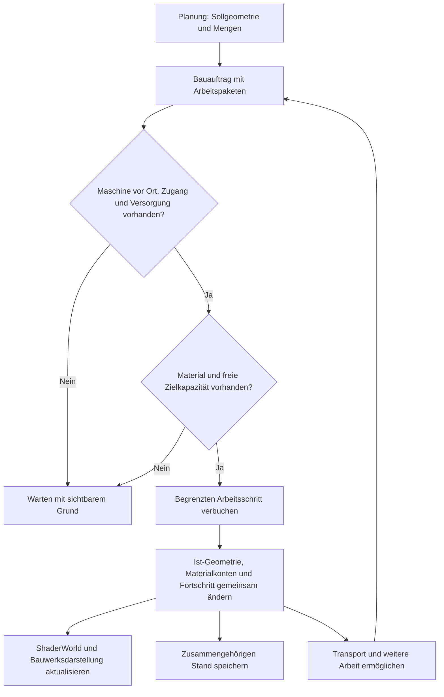

# Bauarbeit, Gelände und Material als gemeinsames System

**Unser Ziel ist eine Stadt, deren Landschaft durch Bauarbeit entsteht.** Der Spieler plant eine Straße oder Baugrube. Maschinen erreichen den Ort, arbeiten dort und bewegen Material. Die Welt zeigt den erreichten Bauzustand, auch wenn die Baustelle unterbrochen und das Spiel neu gestartet wird.

Diese Seite leitet aus dem bereitgestellten Nutzerdesign eine technische Richtung ab. **„Gesetzte Regel“** bezeichnet eine Nutzeranforderung, **„Vorschlag“** unsere noch zu erprobende Umsetzung. Die Versionsangaben nennen die technische Prüfbasis; sie versprechen keine fertige Baustellensimulation im Plugin. Der erste abgegrenzte Maschinen-/Materialkreislauf im [ConstructionLab](../guides/construction-lab.md) ist implementiert und bis zum vollständigen Abschluss nach cooked Prozessneustart geprüft. Weitergehende Architekturthemen bleiben Vorschläge; die normale vollständige Bedienrunde ist davon getrennt.[^construction-proof] Die [Foundations-Anleitung](../guides/foundations-lab.md) beschreibt seine vorhandenen Vorarbeiten und die aktuellen abgegrenzten Nachweise nach zwei unterschiedlichen Paintfehlern.[^user-design][^foundations]

## Gesetzte Regeln und offene Entscheidungen

| Bereich | Gesetzte Regel aus dem Nutzerdesign | Noch zu entscheiden oder zu erproben |
| --- | --- | --- |
| Planung und Welt | Sollgeometrie und tatsächliches Ist-Gelände bleiben getrennt. Eine Planung verformt den Boden nicht kostenlos. | Bedienung der Planung, Genauigkeit und Darstellung der Vorschau |
| Baufortschritt | Infrastruktur entsteht durch Arbeit am Standort. Fehlende Zufahrt, Versorgung, Energie oder Personal können Arbeiten begrenzen. Unterbrechung hinterlässt einen echten Zwischenstand. | Aufgabenverteilung, Arbeitsraten, Maschinendetail und Simulationsauflösung |
| Erde als Ressource | Aushub bleibt in der Materialwirtschaft: wiederverwenden, lagern, verarbeiten, verkaufen oder entsorgen. Begrenzte Transport-/Lagerkapazität kann den Vortrieb stoppen. | Materialklassen, Dichten, Kapazitätseinheiten und Genauigkeit der Bilanz |
| Untergrund | Räumliche Spielwelt mit Geologie, Erkundung, Tunneln und Leitungen. | Konkrete Geologie, Erkundungsregeln und Wahl zwischen Schnitt-, Würfel- oder Übersichtsdarstellung |
| Tunnelbau | Offene Bauweise, TBM und bergmännischer Vortrieb sind favorisierte kombinierbare Verfahren. | Machbarkeit der 3D-Darstellung, Kollisionsaktualisierung und genaue Bauphasen |
| Versorgungsnetze | Leitungen besitzen echte Positionen; komfortables Einrasten und erkennbare Provisorien sollen den Bau unterstützen. | Netzsimulation, Konfliktregeln und Werkzeuge |

Unterschiedliche Volumenzustände für gewachsenen Boden, lockeren Aushub und verdichtete Aufschüttung sind ein **technischer Modellvorschlag im Designauszug**. Die tragende Regel ist Massenerhaltung; dieselbe Masse muss nicht dasselbe Volumen besitzen. Die in der Vorlage erwähnte ältere Gesprächshistorie wird hier nicht unabhängig bestätigt.[^user-design]

## Was wir auf den vorhandenen Laboren aufbauen können

| Vorhandene Grundlage | Tatsächlicher Nachweis | Was für das Ziel noch fehlt |
| --- | --- | --- |
| Laufzeitstraße mit Road-Creator-Meshes | Gemeinsame Spline mit ShaderWorld-Terrain und Bewuchsmaske; eigener Neustart- und Kollisionsversuch | Geplante Trasse von tatsächlich fertiggestellten Abschnitten trennen |
| Grundstück, Haus und Bürger | CityLoop speichert Änderungen und Bürgerfortschritt über getrennte Spielprozesse | Räumlicher Arbeitsfortschritt, Baustoffe, Maschinen und Bauzustände |
| Freigeräumte Bauflächen und Einzelrodung | Maskenkerne bleiben nach Laden frei; stabile Einzelbaumzustände, CPU-/Physikpersistenz und getrennte normale PIE-Baumbilder geprüft | Rodung als Maschinenarbeit, Holzgewinnung, Kollisionsnachlauf und Lastbegrenzung |
| Kleine Baugrube mit Materialkreislauf | Vier Arbeitszellen, Pufferstopp, beladener Transport, vollständiger Zwischenstandrestore und Abschluss in zwei cooked Prozessen; 172,8 t im Lager, 0 g Modellbilanzfehler | Freie Aufträge, dynamische Maschinenanreise, Wiedereinbau, mehrere Materialien und allgemeine Logistik[^construction-proof] |
| Bürger vor verändertem Gelände | Gerenderter Gruben-/Reparaturversuch mit 11/11 Checks und 81 Groundhits | Der Harness hielt zusätzlich zehn Ticks an; keine allgemeine Produktions-Fence oder NavMesh-Abnahme[^navigation-proof] |
| Bergtunnel und Air Pocket | Eigene Tunnelmeshes, Portalöffnungen, Kollision und abgegrenzte Durchfahrt geprüft | Gespeicherter räumlicher Aushub, Bauabschnitte, Geologie und alle drei Tunnelverfahren |

Der aktuelle CityLoop baut mit **R/Enter** eine Straße und mit **P** ein gerodetes Grundstück samt Haus sofort. Er bleibt als Entwicklungs- und Prüflabor nützlich. Der spätere Spielablauf soll daraus zunächst **Bauaufträge** machen. Eine bereits sichtbare fertige Straße ist noch kein Nachweis physischer Bauarbeit.[^loop][^roads][^dry-tunnel]

Die getrennte Foundations-Karte implementiert einen Vorläufer der Soll-/Ist-Trennung: Planrecords, Undo/Cancel ungearbeiteter Planung und ausdrückliche Debugausführung. Fünf Biomprofile sind eingerichtet. Nach einem NoGrowth-Überlappungsfehler des alten Paint-Splinebackends wurde auf einen quadratischen LayerMask-Brush umgestellt. Eine weitere Sichtprobe entdeckte einen falschen White-Flow-Selektor; der aktuelle Code verwendet Black für Zero-Flow. Diese Fassung bestand jeweils 29/29 und 12/12 Checks in zwei gerenderten uncooked und zwei echten cooked Prozessen; reale Kern-/Seitenvegetation blieb nach Paint, Regeneration und wiederholtem Laden entfernt, die Waldkontrolle erhalten. Die damaligen acht nativen Foundations-Tests und die normale kompilierte PIE-Paint-/Ladebildprüfung waren erfolgreich; die erweiterte native Gesamtsuite umfasst inzwischen 22 bestandene Tests, 20 ohne und zwei mit bekannten Warnungen. Das [ConstructionLab](../guides/construction-lab.md) ergänzt den tatsächlich abgeschlossenen kleinen Bagger-/Puffer-/Lkw-Kreislauf. Zwei frische cooked Prozesse bestanden 14/14 Checks in 24,705998 s und 15/15 in 113,845061 s. Das sind getrennte Nachweise mit unterschiedlichen Aufgaben.[^foundations][^construction-proof]

Für die Architektur ist eine Rangfolge der Masken nötig: Freie Materialmalerei darf strukturelle Straßen-/Pad-Daten nicht verdrängen. Der Brush setzt Material R vor dem Road-/Pad-Pass; spätere Strukturregeln behalten Material und NoGrowth in Kern und Seitenbereich. Uncooked und cooked prüfen diese Wirkung mit zuvor bewachsenem Gelände. Die nativen Maskentestactors werden je Prozess neu erzeugt und nicht zusätzlich gespeichert. Die Datamap steuert hier die Wahl zwischen Ground- und Flow-Material, nicht die Flächendeckung. Black wählt Ground; White hatte trotz passender Actorwerte keine sichtbare Farbe erzeugt. GPU-Pixel, Datenparameter und beliebige Maskenpersistenz benötigen deshalb getrennte Nachweise.[^foundations]

## Vorschlag: Die Spielsimulation führt, ShaderWorld stellt den Bauzustand dar

Die eigene Simulation sollte bestimmen, was geplant, tatsächlich abgetragen, transportiert, eingebaut und fertiggestellt wurde. ShaderWorld erhält daraus die aktuellen Oberflächenänderungen und Masken für Darstellung, Kollision und Biome. Straßen- und Gebäudemeshes entstehen entsprechend den fertiggestellten Bauphasen. Damit bleiben Material- und Auftragsdaten verständlich, auch wenn die Kamera weit weg ist oder ShaderWorld Daten neu erzeugt.

### 1. Bauauftrag: Ziel und Mengen festhalten

Ein Auftrag speichert seine stabile Kennung, Sollgeometrie, Arbeitsbereiche, Bauphasen und Abhängigkeiten. Eine Straßen-Spline kann das Zielprofil beschreiben; die tatsächliche Fahrbahn hat ihren eigenen Fortschritt je Abschnitt. Rodung, Erdarbeit, Unterbau, Belag und Freigabe sollten getrennte Phasen sein. Für Gebäude entsprechend Baugrube, Fundament und weiterer Aufbau.

Die Vorschau zeigt zunächst geschätzte Aushub-/Einbaumengen und betroffene Infrastruktur. Eine Planung allein entfernt keine Bäume und reserviert nicht heimlich die ganze fertige Geländeform. Ob Flächen, Material oder Maschinen reserviert werden, braucht explizite Regeln. Die Mengenberechnung muss ihre Auflösung und Unsicherheit nennen; genaue Geologie wird nicht aus einer hübschen Oberflächenansicht abgeleitet.

### 2. Arbeit am Ort: Erreichbare Teilflächen verändern

Ein Bagger erhält ein begrenztes Arbeitspaket an einer erreichbaren Stelle. Er darf nur so viel abtragen, wie Arbeitsleistung und freie Aufnahme erlauben. Ein Fahrzeug oder Lager übernimmt das Material. Bei vollem Puffer wartet die Maschine; nach Abtransport kann sie weiterarbeiten. Die sichtbare Bewegung muss zu dieser Arbeit passen.

Dafür müssen nicht alle Erdkörner als Physikobjekte simuliert werden. Als Vorschlag genügen zunächst räumliche Arbeitszellen und mengenbegrenzte Schritte. Zellgröße, sichtbare Übergänge und Aktualisierungsrate werden gemessen, bevor wir eine Schaufel-genaue Bodenauflösung versprechen. Versorgung, Personal und verschiedene Maschinen werden anschließend ergänzt.

### 3. Materialbilanz: Masse und Volumen auseinanderhalten

Vorgeschlagene Materialkonten sind Boden im Arbeitsgebiet, Maschinenpuffer, Fahrzeugladung, Zwischenlager, eingebautes Material und dokumentierte Abgänge durch Verkauf oder Entsorgung. Jeder Transfer hat Herkunft, Ziel, Materialart und Menge. Ein Abgang aus der Welt muss nachvollziehbar verbucht sein.

Beim Aushub wandert Masse aus dem gewachsenen Boden in den Puffer; beim Einbau aus einer Lieferung in die Aufschüttung. Volumen ergibt sich je Materialzustand aus Masse und angenommener Dichte. **Für eine allgemeine Produktionswelt sind Materialklassen und Dichten weiter offen.** Das kleine Labor verwendet ausdrücklich angenommene **1800 kg/m³ gewachsen** und **1400 kg/m³ locker**. Sein kontinuierliches Zellmodell ergibt **96 m³/172,8 t**; diese Grammkonten stimmen exakt, das quantisierte ShaderWorld-Meshvolumen wurde nicht unabhängig integriert.[^construction-proof] Geometrische Rasterung und Rundung benötigen eine definierte Toleranz samt Restmengen, damit viele kleine Schritte keine Erde erzeugen oder verlieren.

Die Sollmenge bleibt eine Prognose. Die Bilanz zählt ausgeführte Arbeit. So kann Aushub aus Projekt A einen Damm in Projekt B versorgen, ohne denselben Vorrat mehrfach zu verplanen.

### 4. Darstellung und Kollision: Den gebauten Stand zuverlässig zeigen

Nur bearbeitete Bereiche erhalten eine Geländeänderung oder Rodungsmaske. Asphalt und feste Gebäudeteile werden erst mit ihrer Bauphase sichtbar und nutzbar. Ein Abbruch lässt die erreichten Höhen und verbrauchten Materialien bestehen. Das Stornieren ungearbeiteter Planung und ein späterer Rückbau sind unterschiedliche Vorgänge; bereits ausgeführte Erdarbeit verlangt einen neuen Arbeitsauftrag.

Terrain, Vegetation und Kollision können zeitversetzt aktualisiert werden. Wir brauchen deshalb eine erkennbare Bereitschaft je geändertem Bereich und Tests, dass Maschinen und Bürger keine veraltete Kollision verwenden. Ein bloß gestarteter GPU- oder Brush-Update gilt nicht als Nachweis fertiger Physik. Das Vier-Brush-Labor wartet tatsächlich auf **neun passende Bodenpunkte in drei stabilen Durchläufen** bei **5 cm Toleranz**, mit **100 cm Kollisionsauflösung und 129 Vertices je Patch**. Am Ende wich die Oberfläche maximal **2,000778 cm** vom 150-cm-Modellziel ab. Der native Ausgang quantisiert Höhe je Pass auf ganze Zentimeter; dieses lokale Gate ist deshalb keine universelle Genauigkeits- oder Bereitschaftszusage. Eine abweichende Kollisionsregion wird alle zwei Sekunden erneut angefordert.[^construction-proof]

Vorschlag für die Lastbegrenzung: Arbeit logisch in festen Schritten buchen, benachbarte Änderungen zusammenfassen und ShaderWorld nur betroffene Bereiche aktualisieren lassen. Ob wir verdichtete Höhenänderungen, Brush-Daten oder ein begrenztes Änderungsjournal speichern, entscheidet ein kleiner Leistungstest. Eine neue dauerhaft aktive Brush pro Schaufel wäre zunächst nur eine zu untersuchende Variante.

### 5. Speichern: Einen zusammengehörigen Bauzustand wiederherstellen

Ein Arbeitsschritt braucht eine stabile Kennung beziehungsweise Reihenfolge. Ist-Geometrie, Auftragsfortschritt und Materialtransfer müssen einen gemeinsamen Speicherstand bilden. Beim erneuten Laden darf derselbe Schritt weder Material erneut erzeugen noch erneut verbrauchen. Ein bekannter vollständiger Stand muss erhalten bleiben, wenn ein neuer Speichervorgang scheitert.

Zu speichern wären mindestens Aufträge und Planrevisionen, ausgeführte räumliche Arbeit, Materialkonten und Reservierungen, Maschinen-/Fahrzeugpositionen und -ladungen, aktive Arbeits-/Transportzustände, laufende Übergaben, Bearbeitungsreihenfolge sowie Generator-/Datenversion. Sichtbare Brushes und Meshes sollen daraus wiederherstellbar sein. Das frühere projektlokale **Spielstandformat 4** ergänzte Straßen-, Bauflächen- und Bürgerdaten um Plan-/Änderungsrecords und Einzelrodungszustände. **Format 5** enthält zusätzlich das begrenzte Baustellenmodell mit Zellfortschritt, Materialkonten, Ladung, Positionen und Maschinen-/Transportphasen. Im ConstructionLab wurden der vollständige serialisierte Modellhash vor jedem Weiterarbeiten und drei wiederholte Loads identisch bestätigt; anschließend endete der Auftrag mit exakt **172800000 g im Lager**, **0 g Restboden/Puffer/Laster und 0 g Modellbilanzfehler**. Das ist ein eigener Maschinen-/Materialspielstand für einen festen Laborauftrag, noch kein allgemeines Auftrags- und Logistiksystem.[^construction-proof] CityLoop besitzt einen getrennten Neustartnachweis. Die aktuelle Black-/Zero-Flow-Foundations-Fassung bestand passende native Persistenz- und Maskenprüfungen uncooked und cooked; die aktuelle kompilierte GPU-Wirkung ist zusätzlich in ausgewählten normalen PIE-Frames mit Laden geprüft. Das ersetzt keine separate verpackte Pixelabnahme.[^saves][^loop][^foundations]

Ändert der Spieler einen laufenden Plan, bleibt die bereits ausgeführte Arbeit real vorhanden. Die neue Planrevision muss die verbleibenden Mengen und erforderlichen Gegenarbeiten neu bestimmen. Verhalten bei konkurrierenden Aufträgen und Speicherfehlern gehört zu den offenen Tests.

## Untergrund: Eigenes räumliches Modell, eigener Machbarkeitsversuch

Holebrushes und Tunnelmeshes sind Darstellungs-/Kollisionsmittel. Ihr Ausschnitt erzeugt keinen Materialertrag. Aushub wird aus tatsächlich ausgeführten räumlichen Arbeitsschritten bilanziert; überlagernde Oberflächen- und Untergrundänderungen dürfen dieselbe Masse nicht doppelt entnehmen. Das gemeinsame Erdmodell braucht dafür eindeutige räumliche Zuständigkeit.

**Das geprüfte ShaderWorld-Terrain ist ein Höhenfeld mit einer Oberflächenhöhe je XY-Position.** Unsere Holebrushes entfernen einen horizontalen Fußabdruck. Sie modellieren kein begrenztes 3D-Abzugsvolumen. Ein kompletter Tunnel-Holebrush würde auch die Oberfläche über dem Tunnel entfernen. Die bisherige Lösung kombiniert kleine Portalöffnungen mit eigenen Tunnelmeshes; deren Boden ist keine automatisch erzeugte unterirdische Geländeschicht.[^holes]

`Map_VoxelMap` und vorhandene Voxeltypen belegen im untersuchten Bestand keinen fertigen Workflow für frei ausgrabbares Erdreich. Insbesondere TBM-Vortrieb, verzweigte Hohlräume, übereinanderliegende Tunnel, Geologie und Erkundung sind dadurch nicht abgenommen.[^capabilities]

**Vorschlag:** Das Spiel verwaltet räumliche Geologie, bekannte/unbekannte Bereiche, ausgegrabene Volumen und belegte Bauwerks-/Leitungsräume unabhängig von der Oberflächendarstellung. Ob dafür Raster, Volumenfelder oder andere räumliche Strukturen geeignet sind und wie sie sichtbar werden, bleibt offen. Die erste Oberfläche kann weiter ShaderWorld verwenden. Für unterirdische Geometrie und Kollision prüfen wir getrennt eigene Meshes, eine geeignete Volumendarstellung oder weitere Technik, bevor davon eine große Tunnelplanung abhängt.

| Bauweise | Was das System dafür leisten müsste |
| --- | --- |
| Offene Bauweise | Grube schrittweise öffnen, Bauwerk setzen, tatsächlich geliefertes Material wieder einbauen; Versorgung und Verkehr währenddessen behandeln |
| TBM | Nur den erreichten Vortriebsbereich ausheben und auskleiden; ohne Energie, Nachschub oder freie Abraumkapazität stoppen |
| Bergmännisch | Teilquerschnitte und Sicherung in Bauabschnitten abbilden; mit anderen Verfahren kombinieren |

Ein Tunnelbaustein sollte Trasse, Profil, Portalöffnung, Körper, Kollision und Wasserausschluss gemeinsam verwalten. Unsere vorhandene **CityLab Tunnel (Dry)**-Komponente liefert davon den automatischen Air-Pocket-Ausschluss; sie ist kein vollständiger Tunnelgenerator. Für spätere Bauphasen müssen Lage und Aktivierung von Öffnung, gebautem Innenraum und Air Pocket gemeinsam getestet werden. Eine Air Pocket ist eine Wasser-Maskierung/-Abfragefunktion, keine Simulation von Grundwasser, Abdichtung oder Baustellenentwässerung.[^dry-tunnel]

Bauzüge sollen nach dem Nutzerdesign gewöhnliche Güterzüge mit tatsächlichen Betriebsbedingungen sein: Spurweite, Lichtraum, Stromversorgung, Zugsicherung, Länge und zulässige Fracht bestimmen die Nutzbarkeit. Zeitfenster auf betriebenen Strecken sind eine spätere Erweiterung. Leitungsnetze bekommen echte Positionen, Konfliktprüfungen und gegebenenfalls provisorische Anschlüsse; das Werkzeug kann bequem an Straßenmitte oder Gehweg einrasten. Dafür ist noch keine Netz- oder Zugimplementierung nachgewiesen.[^user-design]

## Aushub und anschließender Wiedereinbau bestanden

Das [ConstructionLab](../guides/construction-lab.md) setzt den ersten kleinen Versuch bereits um: eine Baugrube, einen animierten Bagger aus UE-Grundformen, einen begrenzten Puffer, einen Lkw auf fester geprüfter Route und ein Lager. Die vier 400-cm-Zellen besitzen einen auslaufenden 12 × 12 m Fußabdruck mit 4 × 4 m Kern. Die normale maximale Absenkung beträgt 150 cm. **18 t Puffer**, **12 t Lkw** und **500 t Lager** begrenzen die Arbeit; der eigene Slot **CityLabConstruction** bleibt von Foundations und CityLoop getrennt.[^construction-lab]

1. **Planen:** Ein noch fehlender Beispielauftrag erscheint pausiert und mit ausgeschaltetem Transport. Planung allein verändert weder Gelände noch Bewuchs oder Konten.
2. **Arbeitsbereich freistellen:** Erst begonnene Arbeit aktiviert die begrenzte NoGrowth-Maske samt festem Maschinen-/Transportkorridor. Das Labor gewinnt dabei kein Holz; allgemeine Rodungsarbeit und Maschinenanreise fehlen.
3. **Arbeiten:** Begrenzte Modellschritte verändern die tatsächlich ausgeführte Grubenform. Der Puffer füllt sich; der nächste Schritt wartet auf die lokale physische Höhenprüfung.
4. **Anhalten und transportieren:** Bei 18 t Puffer stoppt der Aushub. Freigegebener Transport übernimmt höchstens 12 t und liefert zum Lager. Eine feste Route und Bodenprüfungen ersetzen keine freie Fahrzeugnavigation oder Fahrzeugphysik.
5. **Unterbrochen neu starten:** Ein realer Zwischenstand mit **42 t Aushub = 18 t Puffer + 12 t fahrender Lkw + 12 t Lager** wurde gespeichert. Der neue cooked Prozess stellte alle Modellfelder identisch wieder her, lud dreimal zusätzlich und arbeitete vollständig fertig.
6. **Abschließen:** Alle **172,8 t** lagen im Lager; Restboden, Puffer und Fahrzeug waren leer. Der unveränderte Zielplan und die tatsächliche Endoberfläche bestanden die getrennten Prüfungen.[^construction-proof]
7. **Wiederverwenden inzwischen ergänzt:** Ein zweiter Lkw liefert vom gemeinsamen Lager zum Aufschüttpuffer; nur angelieferte Masse hebt das zweite Arbeitsfeld. Uncooked und cooked bestanden jeweils zwei Prozesse mit gespeicherter beladener Fahrt, drei weiteren Loads und vollständigem Wiedereinbau von 172,8 t bei 0 g Modellbilanzfehler. Die [Kreislaufanleitung](../guides/closed-material-cycle.md) beschreibt Bedienung, Höhenmessungen und Grenzen. Mehrere frei zugewiesene Aufträge und materialübergreifende Logistik fehlen weiterhin.

### Was belegt ist und was wir zusätzlich prüfen müssen

| Probe | Aktueller begrenzter Nachweis | Verbleibende Grenze |
| --- | --- | --- |
| Nur planen | Pausierter Plan ohne Höhen-/Masken-/Kontenänderung im cooked Versuch | Weitere Planformen, Storno und Umplanung laufender Arbeit separat prüfen |
| Arbeitsreichweite oder Zufahrt fehlt | Beispielauftrag schließt überlagernde Straßen/Bauflächen aus und nutzt eine feste Route | Keine beliebige Maschinenanreise oder allgemeine Erreichbarkeitsprüfung |
| Puffer oder Ziellager voll | 18-t-Puffer stoppt echten Aushub; native Modelltests prüfen Kapazitätsregeln | Voller Ziellagerfall im normalen gerenderten Spiel separat prüfen |
| Teilweise gebaut und neu gestartet | Zwei cooked Prozesse mit identischem vollständigem Modellhash vor Weiterarbeit; Abschluss bestanden | Keine vollständige korrigierte uncooked Zwei-Prozess-Runde aus diesem Bericht ableiten |
| Denselben Stand mehrfach laden | Drei zusätzliche Loads ohne Modellabweichung oder doppelte Backends | Mehrere Aufträge und konkurrierende Transfers fehlen |
| Aushub wieder einbauen | Zweiter Standort mit Zielpuffer und Lager-Lkw, exakte Grammbilanz, uncooked/cooked Neustart und vollständiger Abschluss bestanden | Feste Routen, angenommene gemeinsame Einbaudichte; keine Verdichtung, freie Zuweisung oder stadtweite Logistik |
| Bereich verlassen und zurückkehren | Nicht Teil dieser Baugruben-Abnahme | Reichweiten-/Streamingfahrt und unfertigen Bewuchs prüfen |
| Kollision baut verzögert neu auf | Baugrube wartet auf drei passende Neun-Punkt-Durchläufe; Bürger-Grubenversuch getrennt bestanden | Dessen zusätzlicher Harness-Halt ist keine allgemeine Produktions-Fence |
| Plan nach Teilbau ändern | Zielplan blieb während der geprüften Arbeit unverändert | Restbedarf und Gegenarbeiten bei echter Revision fehlen |
| Startupretry und Autosave-Schutz | Normaler pausierter Erstplan automatisch erzeugt; weltfremder Stand abgewiesen und über das Autosavefenster bytegleich; gültiger gesicherter Stand danach exakt wiederhergestellt | Begrenzte normale PIE-Fehlerfallprobe bestanden; keine pauschale Tastatur-/Fokusabnahme |

**Historisch fehlgeschlagen** bleibt der frühere uncooked Fortsetzungsversuch mit **2-cm-Gate**: Nach erfolgreichem Zwischenstandrestore blieb er auf Kollision hängen. Die spätere cooked Abnahme mit lokalem **5-cm-Gate** und weiteren Freiraum-/Retrykorrekturen bestand vollständig. Sie isoliert keine einzelne Ursache des früheren Stillstands. Die Zahlen und ausgewählten eigenen Standbilder sind im [Baugrubenbericht](../evidence/construction-lab-test.json) abgegrenzt; normale Erstplanung, Pufferstopp, Transport und exaktes pausiertes PIE-Wiederladen sind zusätzlich geprüft. Eine pauschale Abnahme aller Tastatur-/Fokusfälle oder ein automatischer Pixelvergleich bleibt offen.[^construction-proof]

### Vor größerem Ausbau: Rodungskosten begrenzen

Ein getrennter isolierter cooked Benchmark bestand **acht 8-s-Fenster** für **0/1/10/100 Rodungsrecords**, jeweils mit und ohne native Rayabfrage. Reapply kostete bei null Records rund **0,001 ms**, bei positiven Recordzahlen im Mittel **19,85–22,06 ms je Aufruf**. Die native Rayabfrage kostete schon ohne Records etwa **21 ms**, insgesamt **20,43–21,02 ms**. Sie lief tatsächlich etwa 4,74–4,85 Hz. Das sind synchrone CPU-Aufrufzeiten, keine GPU- oder FPS-Abnahme; der 48er Cap ist nur eine Rahmenbedingung.[^clearing-cpu]

**152881 visuelle Slots sind keine 152881 lebenden Bäume:** Zu Beginn waren nur **1410 visuelle Transforms** und ebenso viele Kollisionsinstanzen aktiv. Bei positiven Records besuchte Reapply trotzdem alle **154997 Slots** beider Pools. Als nächster Schritt sind sicher invalidierte Live-/Raumindizes beziehungsweise Publish-Snapshots, Poolfilter und konservative Broadphase zu untersuchen. Restore-/Indexwechsel-/Regenerationsverträge und der getrennte Kollisionsnachlauf müssen erhalten bleiben. Keine solche Optimierung ist bisher eingebaut; die genaue interne Kostenaufteilung wurde nicht gemessen.

## Empfohlene Reihenfolge

1. Nach dem cooked Baugrubenabschluss die normale Bedien-/Bildrunde ergänzen und die gemessenen Rodungsvollscans unter geklärtem Restore-Vertrag begrenzen. Erst anschließend größere Welt und mehrere Baustellen belasten. Sofortbau als gesonderten Entwicklermodus erhalten.
2. Parallel früh einen kleinen **3D-Untergrundversuch** durchführen: begrenzten Hohlraum unter intakter Oberfläche anlegen, aus zwei Perspektiven ansehen, Kollision und Wiederherstellung prüfen. Das ist die Entscheidungsvorlage für Tunneltechnik, keine bereits zugesagte ShaderWorld-Funktion.
3. Den bereits bestandenen Cook/verpackten Neustart bei Erweiterungen erhalten; zusätzlich viele kleine Geländeänderungen messen: Physikverzögerung, Framezeit, Speicher und Größe des Spielstands. Der aktuelle einzelne CPU-Rodungsbenchmark ist kein Gesamtleistungsnachweis. Daraus die Datenauflösung und Aktualisierungsstrategie wählen.
4. Den gleichen Auftrags-/Materialablauf auf Straßenabschnitte und Hausbau übertragen; erst bearbeitete Abschnitte räumen, formen und fertigstellen.
5. Maschinenvielfalt, projektübergreifende Erdlogistik, geologische Erkundung, Tunnelverfahren und präzise Versorgungsnetze auf dieser Grundlage ergänzen.

Die erhaltenen Themen zu Biomen, Navigation, Wasser und größeren Welten stehen weiterhin in der [Roadmap](city-builder-roadmap.md). Diese Seite ersetzt den früher zurückgestellten allgemeinen Terraforming-Vorschlag durch die nun bestätigte Richtung: **planen, vor Ort arbeiten, Material bewegen und den realen Zwischenstand bewahren**.

[^user-design]: Vom Nutzer am 28. Oktober 2026 bereitgestellter und als Richtung bestätigter Designauszug „Geländeverformung und physischer Bau“ / „Der Untergrund als vollwertige Spielwelt“. Private Vorlage; hier sinngemäß zusammengefasst. Umsetzungsvorschläge auf dieser Seite sind gesondert gekennzeichnet.
[^loop]: [CityLoop: implementierter Ablauf und abgegrenzter Nachweis](../guides/city-builder-loop.md).
[^foundations]: [Foundations: vorhandene Vorarbeiten und aktuelle abgegrenzte native/PIE-Nachweise](../guides/foundations-lab.md).
[^saves]: [Bisheriges Speichern und Laden](../guides/save-and-load.md).
[^roads]: [Laufzeitstraßen mit gemeinsamer Spline](../guides/runtime-roads.md).
[^holes]: [Höhenfeld, Portalöffnungen und eigene Tunnelkörper](../guides/holes-and-mountain-tunnels.md).
[^dry-tunnel]: [Umfang der vorhandenen trockenen Tunnelkomponente](../guides/reusable-tunnel-component.md).
[^capabilities]: [Versions- und Fähigkeitenübersicht mit Voxelgrenze](versions-and-capabilities.md).

[^construction-lab]: [Baugrubenlabor mit Testbagger, Puffer und Abtransport](../guides/construction-lab.md).
[^construction-proof]: [Bereinigter Baugrubenbericht](../evidence/construction-lab-test.json): 22 native Tests, cooked 14/14 und 15/15 Checks, vollständiger Zwischenstandrestore und lokale Höhen-/Modellbilanzgrenzen.
[^navigation-proof]: [Gerenderter Navigationsversuch](../evidence/terrain-navigation-test.json): 11/11 Checks, 81 Groundhits und zusätzlicher Harness-Halt.
[^clearing-cpu]: [Bereinigter CPU-Rodungsbenchmark](../evidence/clearing-performance-test.json): acht Fenster, reale Slot-/Aktivzahlen und getrennte CPU-/GPU-Grenzen.
