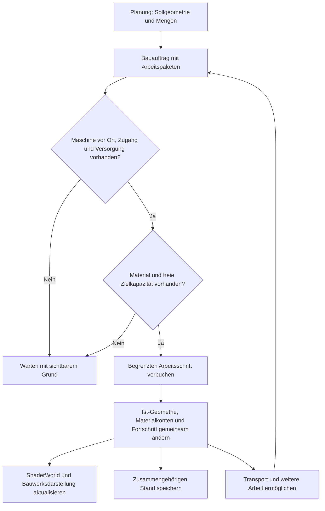

# Bauarbeit, Gelände und Material als gemeinsames System

**Unser Ziel ist eine Stadt, deren Landschaft durch Bauarbeit entsteht.** Der Spieler plant eine Straße oder Baugrube. Maschinen erreichen den Ort, arbeiten dort und bewegen Material. Die Welt zeigt den erreichten Bauzustand, auch wenn die Baustelle unterbrochen und das Spiel neu gestartet wird.

Diese Seite leitet aus dem bereitgestellten Nutzerdesign eine technische Richtung ab. **„Gesetzte Regel“** bezeichnet eine Nutzeranforderung, **„Vorschlag“** unsere noch zu erprobende Umsetzung. Die Versionsangaben nennen die bisherige technische Prüfbasis; sie versprechen keine fertige Baustellensimulation im Plugin. Es gibt hier noch keine neuen Editor-Schritte: Der vorgeschlagene Versuch ist nicht implementiert.[^user-design]

## Gesetzte Regeln und offene Entscheidungen

| Bereich | Gesetzte Regel aus dem Nutzerdesign | Noch zu entscheiden oder zu erproben |
| --- | --- | --- |
| Planung und Welt | Sollgeometrie und tatsächliches Ist-Gelände bleiben getrennt. Eine Planung verformt den Boden nicht kostenlos. | Bedienung der Planung, Genauigkeit und Darstellung der Vorschau |
| Baufortschritt | Infrastruktur entsteht durch Arbeit am Standort. Fehlende Zufahrt, Versorgung, Energie oder Personal können Arbeiten begrenzen. Unterbrechung hinterlässt einen echten Zwischenstand. | Aufgabenverteilung, Arbeitsraten, Maschinendetail und Simulationsauflösung |
| Erde als Ressource | Aushub bleibt in der Materialwirtschaft: wiederverwenden, lagern, verarbeiten, verkaufen oder entsorgen. Begrenzte Transport-/Lagerkapazität kann den Vortrieb stoppen. | Materialklassen, Dichten, Kapazitätseinheiten und Genauigkeit der Bilanz |
| Untergrund | Räumliche Spielwelt mit Geologie, Erkundung, Tunneln und Leitungen. | Konkrete Geologie, Erkundungsregeln und Wahl zwischen Schnitt-, Würfel- oder Übersichtsdarstellung |
| Tunnelbau | Offene Bauweise, TBM und bergmännischer Vortrieb sind favorisierte kombinierbare Verfahren. | Machbarkeit der 3D-Darstellung, Kollisionsaktualisierung und genaue Bauphasen |
| Versorgungsnetze | Leitungen besitzen echte Positionen; komfortables Einrasten und erkennbare Provisorien sollen den Bau unterstützen. | Netzsimulation, Konfliktregeln und Werkzeuge |

Unterschiedliche Volumenzustände für gewachsenen Boden, lockeren Aushub und verdichtete Aufschüttung sind ein **technischer Modellvorschlag im Designauszug**. Die tragende Regel ist Massenerhaltung; dieselbe Masse muss nicht dasselbe Volumen besitzen. Die in der Vorlage erwähnte ältere Gesprächshistorie wird hier nicht unabhängig bestätigt.[^user-design]

## Was wir auf den vorhandenen Laboren aufbauen können

| Vorhandene Grundlage | Tatsächlicher Nachweis | Was für das Ziel noch fehlt |
| --- | --- | --- |
| Laufzeitstraße mit Road-Creator-Meshes | Gemeinsame Spline mit ShaderWorld-Terrain und Bewuchsmaske; eigener Neustart- und Kollisionsversuch | Geplante Trasse von tatsächlich fertiggestellten Abschnitten trennen |
| Grundstück, Haus und Bürger | CityLoop speichert Änderungen und Bürgerfortschritt über getrennte Spielprozesse | Räumlicher Arbeitsfortschritt, Baustoffe, Maschinen und Bauzustände |
| Freigeräumte Bauflächen | Gemessene Pflanzenursprünge im geprüften Kern werden entfernt und nach Laden wieder freigehalten | Rodung als Arbeitsphase, einzelne Baumzustände und gegebenenfalls verwertbares Material |
| Bergtunnel und Air Pocket | Eigene Tunnelmeshes, Portalöffnungen, Kollision und abgegrenzte Durchfahrt geprüft | Gespeicherter räumlicher Aushub, Bauabschnitte, Geologie und alle drei Tunnelverfahren |

Der aktuelle CityLoop baut mit **R/Enter** eine Straße und mit **P** ein gerodetes Grundstück samt Haus sofort. Er bleibt als Entwicklungs- und Prüflabor nützlich. Der spätere Spielablauf soll daraus zunächst **Bauaufträge** machen. Eine bereits sichtbare fertige Straße ist noch kein Nachweis physischer Bauarbeit.[^loop][^roads][^dry-tunnel]

## Vorschlag: Die Spielsimulation führt, ShaderWorld stellt den Bauzustand dar

Die eigene Simulation sollte bestimmen, was geplant, tatsächlich abgetragen, transportiert, eingebaut und fertiggestellt wurde. ShaderWorld erhält daraus die aktuellen Oberflächenänderungen und Masken für Darstellung, Kollision und Biome. Straßen- und Gebäudemeshes entstehen entsprechend den fertiggestellten Bauphasen. Damit bleiben Material- und Auftragsdaten verständlich, auch wenn die Kamera weit weg ist oder ShaderWorld Daten neu erzeugt.

### 1. Bauauftrag: Ziel und Mengen festhalten

Ein Auftrag speichert seine stabile Kennung, Sollgeometrie, Arbeitsbereiche, Bauphasen und Abhängigkeiten. Eine Straßen-Spline kann das Zielprofil beschreiben; die tatsächliche Fahrbahn hat ihren eigenen Fortschritt je Abschnitt. Rodung, Erdarbeit, Unterbau, Belag und Freigabe sollten getrennte Phasen sein. Für Gebäude entsprechend Baugrube, Fundament und weiterer Aufbau.

Die Vorschau zeigt zunächst geschätzte Aushub-/Einbaumengen und betroffene Infrastruktur. Eine Planung allein entfernt keine Bäume und reserviert nicht heimlich die ganze fertige Geländeform. Ob Flächen, Material oder Maschinen reserviert werden, braucht explizite Regeln. Die Mengenberechnung muss ihre Auflösung und Unsicherheit nennen; genaue Geologie wird nicht aus einer hübschen Oberflächenansicht abgeleitet.

### 2. Arbeit am Ort: Erreichbare Teilflächen verändern

Ein Bagger erhält ein begrenztes Arbeitspaket an einer erreichbaren Stelle. Er darf nur so viel abtragen, wie Arbeitsleistung und freie Aufnahme erlauben. Ein Fahrzeug oder Lager übernimmt das Material. Bei vollem Puffer wartet die Maschine; nach Abtransport kann sie weiterarbeiten. Die sichtbare Bewegung muss zu dieser Arbeit passen.

Dafür müssen nicht alle Erdkörner als Physikobjekte simuliert werden. Als Vorschlag genügen zunächst räumliche Arbeitszellen und mengenbegrenzte Schritte. Zellgröße, sichtbare Übergänge und Aktualisierungsrate werden gemessen, bevor wir eine Schaufel-genaue Bodenauflösung versprechen. Versorgung, Personal und verschiedene Maschinen werden anschließend ergänzt.

### 3. Materialbilanz: Masse und Volumen auseinanderhalten

Vorgeschlagene Materialkonten sind Boden im Arbeitsgebiet, Maschinenpuffer, Fahrzeugladung, Zwischenlager, eingebautes Material und dokumentierte Abgänge durch Verkauf oder Entsorgung. Jeder Transfer hat Herkunft, Ziel, Materialart und Menge. Ein Abgang aus der Welt muss nachvollziehbar verbucht sein.

Beim Aushub wandert Masse aus dem gewachsenen Boden in den Puffer; beim Einbau aus einer Lieferung in die Aufschüttung. Volumen ergibt sich je Materialzustand aus Masse und angenommener Dichte. **Wir legen hier noch keine Dichten oder Umrechnungsfaktoren fest.** Geometrische Rasterung und Rundung benötigen eine definierte Toleranz samt Restmengen, damit viele kleine Schritte keine Erde erzeugen oder verlieren.

Die Sollmenge bleibt eine Prognose. Die Bilanz zählt ausgeführte Arbeit. So kann Aushub aus Projekt A einen Damm in Projekt B versorgen, ohne denselben Vorrat mehrfach zu verplanen.

### 4. Darstellung und Kollision: Den gebauten Stand zuverlässig zeigen

Nur bearbeitete Bereiche erhalten eine Geländeänderung oder Rodungsmaske. Asphalt und feste Gebäudeteile werden erst mit ihrer Bauphase sichtbar und nutzbar. Ein Abbruch lässt die erreichten Höhen und verbrauchten Materialien bestehen. Das Stornieren ungearbeiteter Planung und ein späterer Rückbau sind unterschiedliche Vorgänge; bereits ausgeführte Erdarbeit verlangt einen neuen Arbeitsauftrag.

Terrain, Vegetation und Kollision können zeitversetzt aktualisiert werden. Wir brauchen deshalb eine erkennbare Bereitschaft je geändertem Bereich und Tests, dass Maschinen und Bürger keine veraltete Kollision verwenden. Ein bloß gestarteter GPU- oder Brush-Update gilt nicht als Nachweis fertiger Physik.

Vorschlag für die Lastbegrenzung: Arbeit logisch in festen Schritten buchen, benachbarte Änderungen zusammenfassen und ShaderWorld nur betroffene Bereiche aktualisieren lassen. Ob wir verdichtete Höhenänderungen, Brush-Daten oder ein begrenztes Änderungsjournal speichern, entscheidet ein kleiner Leistungstest. Eine neue dauerhaft aktive Brush pro Schaufel wäre zunächst nur eine zu untersuchende Variante.

### 5. Speichern: Einen zusammengehörigen Bauzustand wiederherstellen

Ein Arbeitsschritt braucht eine stabile Kennung beziehungsweise Reihenfolge. Ist-Geometrie, Auftragsfortschritt und Materialtransfer müssen einen gemeinsamen Speicherstand bilden. Beim erneuten Laden darf derselbe Schritt weder Material erneut erzeugen noch erneut verbrauchen. Ein bekannter vollständiger Stand muss erhalten bleiben, wenn ein neuer Speichervorgang scheitert.

Zu speichern wären mindestens Aufträge und Planrevisionen, ausgeführte räumliche Arbeit, Materialkonten und Reservierungen, Maschinen-/Fahrzeugpositionen und -ladungen, aktive Arbeits-/Transportzustände, laufende Übergaben, Bearbeitungsreihenfolge sowie Generator-/Datenversion. Sichtbare Brushes und Meshes sollen daraus wiederherstellbar sein. Die bestehende SaveGame-Version 3 ist dafür **noch kein fertiges Schema**; sie speichert die bisherigen Straßen, Bauflächen und Bürgerzustände.[^saves][^loop]

Ändert der Spieler einen laufenden Plan, bleibt die bereits ausgeführte Arbeit real vorhanden. Die neue Planrevision muss die verbleibenden Mengen und erforderlichen Gegenarbeiten neu bestimmen. Verhalten bei konkurrierenden Aufträgen und Speicherfehlern gehört zu den offenen Tests.

## Untergrund: Eigenes räumliches Modell, eigener Machbarkeitsversuch

Holebrushes und Tunnelmeshes sind Darstellungs-/Kollisionsmittel. Ihr Ausschnitt erzeugt keinen Materialertrag. Aushub wird aus tatsächlich ausgeführten räumlichen Arbeitsschritten bilanziert; überlagernde Oberflächen- und Untergrundänderungen dürfen dieselbe Masse nicht doppelt entnehmen. Das gemeinsame Erdmodell braucht dafür eindeutige räumliche Zuständigkeit.

**Das geprüfte ShaderWorld-Terrain ist ein Höhenfeld mit einer Oberflächenhöhe je XY-Position.** Unsere Holebrushes entfernen einen horizontalen Fußabdruck. Sie modellieren kein begrenztes 3D-Abzugsvolumen. Ein kompletter Tunnel-Holebrush würde auch die Oberfläche über dem Tunnel entfernen. Die bisherige Lösung kombiniert kleine Portalöffnungen mit eigenen Tunnelmeshes; deren Boden ist keine automatisch erzeugte unterirdische Geländeschicht.[^holes]

`Map_VoxelMap` und vorhandene Voxeltypen belegen im untersuchten Bestand keinen fertigen Workflow für frei ausgrabbares Erdreich. Insbesondere TBM-Vortrieb, verzweigte Hohlräume, übereinanderliegende Tunnel, Geologie und Erkundung sind dadurch nicht abgenommen.[^capabilities]

**Vorschlag:** Das Spiel verwaltet räumliche Geologie, bekannte/unbekannte Bereiche, ausgegrabene Volumen und belegte Bauwerks-/Leitungsräume unabhängig von der Oberflächendarstellung. Ob dafür Raster, Volumenfelder oder andere räumliche Strukturen geeignet sind und wie sie sichtbar werden, bleibt offen. Die erste Oberfläche kann weiter ShaderWorld verwenden. Für unterirdische Geometrie und Kollision prüfen wir getrennt eigene Meshes, eine geeignete Volumendarstellung oder weitere Technik, bevor davon eine große Tunnelplanung abhängt.

| Bauweise | Was das System dafür leisten müsste |
| --- | --- |
| Offene Bauweise | Grube schrittweise öffnen, Bauwerk setzen, tatsächlich geliefertes Material wieder einbauen; Versorgung und Verkehr währenddessen behandeln |
| TBM | Nur den erreichten Vortriebsbereich ausheben und auskleiden; ohne Energie, Nachschub oder freie Abraumkapazität stoppen |
| Bergmännisch | Teilquerschnitte und Sicherung in Bauabschnitten abbilden; mit anderen Verfahren kombinieren |

Ein Tunnelbaustein sollte Trasse, Profil, Portalöffnung, Körper, Kollision und Wasserausschluss gemeinsam verwalten. Unsere vorhandene **CityLab Tunnel (Dry)**-Komponente liefert davon den automatischen Air-Pocket-Ausschluss; sie ist kein vollständiger Tunnelgenerator. Für spätere Bauphasen müssen Lage und Aktivierung von Öffnung, gebautem Innenraum und Air Pocket gemeinsam getestet werden. Eine Air Pocket ist eine Wasser-Maskierung/-Abfragefunktion, keine Simulation von Grundwasser, Abdichtung oder Baustellenentwässerung.[^dry-tunnel]

Bauzüge sollen nach dem Nutzerdesign gewöhnliche Güterzüge mit tatsächlichen Betriebsbedingungen sein: Spurweite, Lichtraum, Stromversorgung, Zugsicherung, Länge und zulässige Fracht bestimmen die Nutzbarkeit. Zeitfenster auf betriebenen Strecken sind eine spätere Erweiterung. Leitungsnetze bekommen echte Positionen, Konfliktprüfungen und gegebenenfalls provisorische Anschlüsse; das Werkzeug kann bequem an Straßenmitte oder Gehweg einrasten. Dafür ist noch keine Netz- oder Zugimplementierung nachgewiesen.[^user-design]

## Nächster Vorschlag: Eine kleine Baustelle als vollständiger Kreislauf

Der erste Versuch sollte **eine Baugrube, einen einfachen Baggerplatzhalter, einen begrenzten Aushubpuffer und einen Abtransport** enthalten. UE-Grundformen genügen als Darstellung. Neue Fahrzeugpakete lösen die Fragen nach Mengen, Teilfortschritt und konsistentem Speichern noch nicht; sie sind für diesen Versuch keine Voraussetzung.

1. **Planen:** Eine flache Baugrube auswählen. Sollfläche und geschätzte Menge erscheinen, das Ist-Gelände und der Bewuchs bleiben zunächst erhalten.
2. **Erschließen und roden:** Eine erreichbare Arbeitsposition prüfen; benötigten Bewuchs als eigene Arbeit entfernen. Für diesen ersten Versuch kann die Zufahrt vorgegeben sein. Ein freier Teleport ersetzt später keine Maschinenanreise.
3. **Arbeiten:** Der Baggerplatzhalter verändert erreichbare Teilflächen in begrenzten Schritten. Die Grube wächst sichtbar, der zugehörige Puffer füllt sich.
4. **Anhalten:** Bei vollem Puffer stoppt die Erdarbeit mit verständlichem Grund. Ohne Abtransport darf kein weiterer Boden verschwinden.
5. **Transportieren:** Ein einfaches Fahrzeug übernimmt verbuchte Ladung und bringt sie zu einem begrenzten Lager; freier Puffer erlaubt neue Arbeit. Zunächst genügt eine feste geprüfte Route.
6. **Unterbrochen neu starten:** Während der halb fertigen Grube mit gefülltem Puffer und/oder beladenem Fahrzeug speichern, den Spielprozess beenden und neu starten. Form, Bewuchs, Mengen, Maschinen-/Fahrzeugpositionen, Ladung und aktiver Arbeits-/Transportschritt müssen wiederkehren.
7. **Wiederverwenden:** Einen Teil des gelagerten Materials in einer kleinen Testaufschüttung einbauen. Damit prüfen wir auch den Rückweg vom Lager ins Gelände; danach bis zum geplanten Zustand weiterarbeiten.

### Woran wir diesen Versuch abnehmen würden

| Probe | Erwartetes Ergebnis, noch nicht getestet |
| --- | --- |
| Nur planen oder ungearbeiteten Plan stornieren | Keine Gelände-/Rodungsänderung und kein Materialertrag |
| Arbeitsreichweite oder freie Zufahrt fehlt | Kein Fortschritt außerhalb der tatsächlich erreichbaren Arbeitsfläche |
| Puffer oder Ziellager voll | Fortschritt stoppt; keine verschwundene oder doppelt gezählte Masse |
| Teilweise gebaut und neu gestartet | Dieselben räumlichen Zwischenstände, Auftrags-IDs, Maschinen-/Fahrzeugpositionen, Ladungen und Materialkonten; Weiterarbeit im richtigen Arbeits-/Transportschritt |
| Denselben gespeicherten Stand mehrfach laden | Keine doppelten Baustellen, Transfers oder fertigen Abschnitte |
| Aushub anschließend wieder einbauen | Gesamtbilanz inklusive nachvollziehbarer Restmengen innerhalb vorher festgelegter Toleranz |
| Bereich verlassen und zurückkehren | Unfertige Form und bearbeiteter Bewuchs bleiben erhalten; keine automatische Fertigstellung durch Streaming |
| Kollision baut verzögert neu auf | Maschinen/Bürger warten oder werden sicher geführt; keine Fahrt auf veralteter Geometrie |
| Plan nach Teilbau ändern | Ausgeführte Arbeit bleibt; Restbedarf und Gegenarbeiten beziehen sich auf den tatsächlichen Zustand |
| Neuen Speicherstand nicht vollständig schreiben | Letzter vollständiger Stand bleibt ladbar; kein gemischter Stand aus alter Erde und neuer Ladung |

Die Ergebnisse gehören später mit getrennten Nachweisen für Datenbilanz, sichtbares Gelände, Kollision und echten Neustart in den [Prüfstand](../verification.md). Eine erfolgreiche Dokuprüfung bestätigt nur diese Beschreibung.

## Empfohlene Reihenfolge

1. Den Baustellenversuch mit Oberfläche, Materialbilanz und unterbrochenem Neustart durchführen. Sofortbau als gesonderten Entwicklermodus erhalten.
2. Parallel früh einen kleinen **3D-Untergrundversuch** durchführen: begrenzten Hohlraum unter intakter Oberfläche anlegen, aus zwei Perspektiven ansehen, Kollision und Wiederherstellung prüfen. Das ist die Entscheidungsvorlage für Tunneltechnik, keine bereits zugesagte ShaderWorld-Funktion.
3. Früh Cook/verpackten Start und viele kleine Geländeänderungen messen: Physikverzögerung, Framezeit, Speicher und Größe des Spielstands. Daraus die Datenauflösung und Aktualisierungsstrategie wählen.
4. Den gleichen Auftrags-/Materialablauf auf Straßenabschnitte und Hausbau übertragen; erst bearbeitete Abschnitte räumen, formen und fertigstellen.
5. Maschinenvielfalt, projektübergreifende Erdlogistik, geologische Erkundung, Tunnelverfahren und präzise Versorgungsnetze auf dieser Grundlage ergänzen.

Die erhaltenen Themen zu Biomen, Navigation, Wasser und größeren Welten stehen weiterhin in der [Roadmap](city-builder-roadmap.md). Diese Seite ersetzt den früher zurückgestellten allgemeinen Terraforming-Vorschlag durch die nun bestätigte Richtung: **planen, vor Ort arbeiten, Material bewegen und den realen Zwischenstand bewahren**.

[^user-design]: Vom Nutzer am 28. Oktober 2026 bereitgestellter und als Richtung bestätigter Designauszug „Geländeverformung und physischer Bau“ / „Der Untergrund als vollwertige Spielwelt“. Private Vorlage; hier sinngemäß zusammengefasst. Umsetzungsvorschläge auf dieser Seite sind gesondert gekennzeichnet.
[^loop]: [CityLoop: implementierter Ablauf und abgegrenzter Nachweis](../guides/city-builder-loop.md).
[^saves]: [Bisheriges Speichern und Laden](../guides/save-and-load.md).
[^roads]: [Laufzeitstraßen mit gemeinsamer Spline](../guides/runtime-roads.md).
[^holes]: [Höhenfeld, Portalöffnungen und eigene Tunnelkörper](../guides/holes-and-mountain-tunnels.md).
[^dry-tunnel]: [Umfang der vorhandenen trockenen Tunnelkomponente](../guides/reusable-tunnel-component.md).
[^capabilities]: [Versions- und Fähigkeitenübersicht mit Voxelgrenze](versions-and-capabilities.md).
